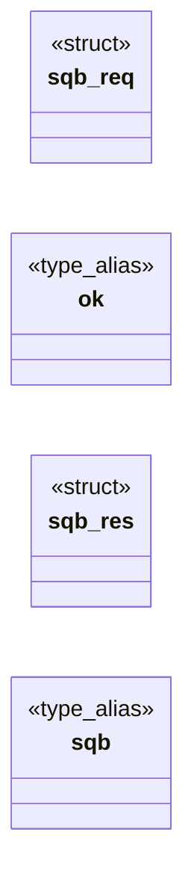

# `include/subreq_batch.h`

> Source: [include/subreq_batch.h:1](../../include/subreq_batch.h#L1) | language `h` | coverage 46.2% | [API index](../index.md)

## Contents

- **Structs:** [`sqb_req`](#sqb_req), [`sqb_res`](#sqb_res)
- **Type Aliases:** [`ok`](#ok), [`sqb`](#sqb)
- **Functions:** [`sqb_new`](#sqb_new), [`sqb_submit`](#sqb_submit), [`sqb_count`](#sqb_count), [`sqb_wait_all`](#sqb_wait_all), [`sqb_result`](#sqb_result), [`sqb_reset`](#sqb_reset), [`sqb_free`](#sqb_free)
- **Macros:** [`SQB_MAX_JOBS`](#sqb_max_jobs)

## Type Diagram



## Structs

<a id="sqb_req"></a>

### `sqb_req`

`struct` | [include/subreq_batch.h:16](../../include/subreq_batch.h#L16)

```c
typedef struct sqb_req
```

---

<a id="sqb_res"></a>

### `sqb_res`

`struct` | [include/subreq_batch.h:23](../../include/subreq_batch.h#L23)

```c
typedef struct sqb_res
```

Filled by the run callback; every pointer malloc'd and owned by the batch afterwards.

---

## Type Aliases

<a id="ok"></a>

### `ok`

`type_alias` | [include/subreq_batch.h:23](../../include/subreq_batch.h#L23)

```c
typedef struct sqb_res { int ok;
```

Filled by the run callback; every pointer malloc'd and owned by the batch afterwards.

---

<a id="sqb"></a>

### `sqb`

`type_alias` | [include/subreq_batch.h:34](../../include/subreq_batch.h#L34)

```c
typedef struct sqb sqb;
```

---

## Functions

<a id="sqb_new"></a>

### `sqb_new`

`function` | [include/subreq_batch.h:37](../../include/subreq_batch.h#L37)

```c
sqb *sqb_new(int max_threads, sqb_run_fn run, void *ctx);
```

**Parameters**

| Name | Type | Default | Description |
|---|---|---|---|
| `max_threads` | `int` |  |  |
| `run` | `sqb_run_fn` |  |  |
| `ctx` | `void *` |  |  |

**Returns:** `sqb *`

---

<a id="sqb_submit"></a>

### `sqb_submit`

`function` | [include/subreq_batch.h:41](../../include/subreq_batch.h#L41)

```c
int sqb_submit(sqb *b, int refused, const sqb_req *req);
```

Queues one request. refused != 0 queues a ready-made failure (no thread, no fetch) so the result count always equals the submit count.

Returns 0, or -1 when full / out of memory (nothing queued: the caller must answer the worker itself).

**Parameters**

| Name | Type | Default | Description |
|---|---|---|---|
| `b` | `sqb *` |  |  |
| `refused` | `int` |  |  |
| `req` | `sqb_req *` |  |  |

**Returns:** `int`

---

<a id="sqb_count"></a>

### `sqb_count`

`function` | [include/subreq_batch.h:42](../../include/subreq_batch.h#L42)

```c
size_t sqb_count(const sqb *b);
```

**Parameters**

| Name | Type | Default | Description |
|---|---|---|---|
| `b` | `sqb *` |  |  |

**Returns:** `size_t`

---

<a id="sqb_wait_all"></a>

### `sqb_wait_all`

`function` | [include/subreq_batch.h:44](../../include/subreq_batch.h#L44)

```c
void sqb_wait_all(sqb *b);
```

Joins every running request.

**Parameters**

| Name | Type | Default | Description |
|---|---|---|---|
| `b` | `sqb *` |  |  |

---

<a id="sqb_result"></a>

### `sqb_result`

`function` `const` | [include/subreq_batch.h:46](../../include/subreq_batch.h#L46)

```c
const sqb_res *sqb_result(const sqb *b, size_t i);
```

Valid after sqb_wait_all, for i < sqb_count.

**Parameters**

| Name | Type | Default | Description |
|---|---|---|---|
| `b` | `sqb *` |  |  |
| `i` | `size_t` |  |  |

**Returns:** `sqb_res *`

---

<a id="sqb_reset"></a>

### `sqb_reset`

`function` | [include/subreq_batch.h:48](../../include/subreq_batch.h#L48)

```c
void sqb_reset(sqb *b);
```

Joins and frees every job and result; the batch is reusable.

**Parameters**

| Name | Type | Default | Description |
|---|---|---|---|
| `b` | `sqb *` |  |  |

---

<a id="sqb_free"></a>

### `sqb_free`

`function` | [include/subreq_batch.h:49](../../include/subreq_batch.h#L49)

```c
void sqb_free(sqb *b);
```

**Parameters**

| Name | Type | Default | Description |
|---|---|---|---|
| `b` | `sqb *` |  |  |

---

## Macros

<a id="sqb_max_jobs"></a>

### `SQB_MAX_JOBS`

`macro` | [include/subreq_batch.h:14](../../include/subreq_batch.h#L14)

```c
#define SQB_MAX_JOBS
```

---
