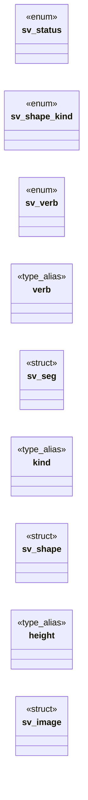

# `include/svg_render.h`

> Source: [include/svg_render.h:1](../../include/svg_render.h#L1) | language `h` | coverage 38.9% | [API index](../index.md)

## Contents

- **Structs:** [`sv_seg`](#sv_seg), [`sv_shape`](#sv_shape), [`sv_image`](#sv_image)
- **Enums:** [`sv_status`](#sv_status), [`sv_shape_kind`](#sv_shape_kind), [`sv_verb`](#sv_verb)
- **Type Aliases:** [`verb`](#verb), [`kind`](#kind), [`height`](#height)
- **Functions:** [`sv_fit`](#sv_fit)
- **Macros:** [`SV_MAX_SHAPES`](#sv_max_shapes), [`SV_MAX_POINTS`](#sv_max_points), [`SV_MAX_SEGS`](#sv_max_segs), [`SV_MAX_DEPTH`](#sv_max_depth), [`SV_TEXT_MAX`](#sv_text_max), [`SV_MAX_INPUT`](#sv_max_input), [`SV_DEFAULT_W`](#sv_default_w)

## Type Diagram



## Structs

<a id="sv_seg"></a>

### `sv_seg`

`struct` | [include/svg_render.h:65](../../include/svg_render.h#L65)

```c
typedef struct sv_seg
```

---

<a id="sv_shape"></a>

### `sv_shape`

`struct` | [include/svg_render.h:75](../../include/svg_render.h#L75)

```c
typedef struct sv_shape
```

One paintable shape, already resolved: presentation attributes inherited from the <g> chain, and `m` the flattened affine transform of that chain (a,b,c,d,e,f in Cairo order).

Colours are packed 0xRRGGBB, -1 = none, CC_COLOR_CURRENT (-2) = currentColor (the painter substitutes the inherited text colour).

---

<a id="sv_image"></a>

### `sv_image`

`struct` | [include/svg_render.h:104](../../include/svg_render.h#L104)

```c
typedef struct sv_image
```

A parsed SVG.

LARGE (fixed pools): allocate on the HEAP, never on the stack. width/height are the intrinsic pixel dimensions; the viewBox (when present) is the user-space rect those dimensions map to.

---

## Enums

<a id="sv_status"></a>

### `sv_status`

`enum` | [include/svg_render.h:25](../../include/svg_render.h#L25)

```c
typedef enum sv_status
```

---

<a id="sv_shape_kind"></a>

### `sv_shape_kind`

`enum` | [include/svg_render.h:44](../../include/svg_render.h#L44)

```c
typedef enum sv_shape_kind
```

---

<a id="sv_verb"></a>

### `sv_verb`

`enum` | [include/svg_render.h:58](../../include/svg_render.h#L58)

```c
typedef enum sv_verb
```

A flattened path verb.

CUBIC carries two control points plus the end point; MOVE/LINE carry one point; CLOSE carries none. Quadratics and arcs are converted to cubics at parse time, so the painter only ever sees these four.

---

## Type Aliases

<a id="verb"></a>

### `verb`

`type_alias` | [include/svg_render.h:64](../../include/svg_render.h#L64)

```c
typedef struct sv_seg { int verb;
```

---

<a id="kind"></a>

### `kind`

`type_alias` | [include/svg_render.h:75](../../include/svg_render.h#L75)

```c
typedef struct sv_shape { int kind;
```

One paintable shape, already resolved: presentation attributes inherited from the <g> chain, and `m` the flattened affine transform of that chain (a,b,c,d,e,f in Cairo order).

Colours are packed 0xRRGGBB, -1 = none, CC_COLOR_CURRENT (-2) = currentColor (the painter substitutes the inherited text colour).

---

<a id="height"></a>

### `height`

`type_alias` | [include/svg_render.h:104](../../include/svg_render.h#L104)

```c
typedef struct sv_image { double width, height;
```

A parsed SVG.

LARGE (fixed pools): allocate on the HEAP, never on the stack. width/height are the intrinsic pixel dimensions; the viewBox (when present) is the user-space rect those dimensions map to.

---

## Functions

<a id="sv_fit"></a>

### `sv_fit`

`function` | [include/svg_render.h:131](../../include/svg_render.h#L131)

```c
void sv_fit(const sv_image *img, double dw, double dh, double *scale, double *off_x, double *off_y);
```

Maps the image's user space onto the destination rect [dx, dy, dw, dh] the way a `preserveAspectRatio="xMidYMid meet"` SVG does: uniform scale, centred.

Writes the scale and the translation the painter must apply. Never divides by zero (a degenerate viewBox yields scale 1 and no offset).

**Parameters**

| Name | Type | Default | Description |
|---|---|---|---|
| `img` | `sv_image *` |  |  |
| `dw` | `double` |  |  |
| `dh` | `double` |  |  |
| `scale` | `double *` |  |  |
| `off_x` | `double *` |  |  |
| `off_y` | `double *` |  |  |

*Called by:* [`LLVMFuzzerTestOneInput`](fuzz.fuzz_svg_render.c.md#llvmfuzzertestoneinput)

---

## Macros

<a id="sv_max_shapes"></a>

### `SV_MAX_SHAPES`

`macro` | [include/svg_render.h:32](../../include/svg_render.h#L32)

```c
#define SV_MAX_SHAPES
```

---

<a id="sv_max_points"></a>

### `SV_MAX_POINTS`

`macro` | [include/svg_render.h:33](../../include/svg_render.h#L33)

```c
#define SV_MAX_POINTS
```

---

<a id="sv_max_segs"></a>

### `SV_MAX_SEGS`

`macro` | [include/svg_render.h:34](../../include/svg_render.h#L34)

```c
#define SV_MAX_SEGS
```

---

<a id="sv_max_depth"></a>

### `SV_MAX_DEPTH`

`macro` | [include/svg_render.h:35](../../include/svg_render.h#L35)

```c
#define SV_MAX_DEPTH
```

---

<a id="sv_text_max"></a>

### `SV_TEXT_MAX`

`macro` | [include/svg_render.h:36](../../include/svg_render.h#L36)

```c
#define SV_TEXT_MAX
```

---

<a id="sv_max_input"></a>

### `SV_MAX_INPUT`

`macro` | [include/svg_render.h:37](../../include/svg_render.h#L37)

```c
#define SV_MAX_INPUT
```

---

<a id="sv_default_w"></a>

### `SV_DEFAULT_W`

`macro` | [include/svg_render.h:41](../../include/svg_render.h#L41)

```c
#define SV_DEFAULT_W
```

CSS default replaced-element size, used when the markup declares neither width/height nor a viewBox (CSS 2.1 §10.3.2).

---
