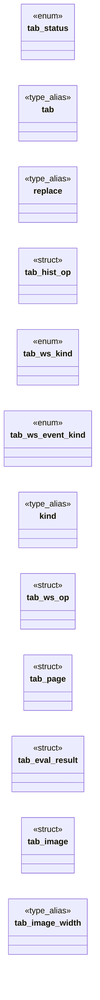

# `include/tab.h`

> Source: [include/tab.h:1](../../include/tab.h#L1) | language `h` | coverage 47.9% | [API index](../index.md)

## Contents

- **Structs:** [`tab_hist_op`](#tab_hist_op), [`tab_ws_op`](#tab_ws_op), [`tab_page`](#tab_page), [`tab_eval_result`](#tab_eval_result), [`tab_image`](#tab_image)
- **Enums:** [`tab_status`](#tab_status), [`tab_ws_kind`](#tab_ws_kind), [`tab_ws_event_kind`](#tab_ws_event_kind)
- **Type Aliases:** [`tab`](#tab), [`replace`](#replace), [`kind`](#kind)
- **Functions:** [`tab_worker_dispatch`](#tab_worker_dispatch), [`tab_open`](#tab_open), [`tab_parse_worker_args`](#tab_parse_worker_args), [`out_status`](#out_status), [`tab_set_fetcher`](#tab_set_fetcher), [`tab_inflight_request_headers`](#tab_inflight_request_headers), [`tab_report_response_headers`](#tab_report_response_headers), [`bytes`](#bytes), [`tab_set_css_sink`](#tab_set_css_sink), [`tab_set_net_allowed`](#tab_set_net_allowed), [`tab_set_op_net_budget_ms`](#tab_set_op_net_budget_ms), [`tab_async_fd`](#tab_async_fd), [`tab_async_busy`](#tab_async_busy), [`jar`](#jar), [`tab_set_cookies`](#tab_set_cookies), [`origin`](#origin), [`tab_set_storage`](#tab_set_storage), [`exclusively`](#exclusively), [`tab_set_viewport_w`](#tab_set_viewport_w), [`tab_set_identity`](#tab_set_identity), [`tab_last_subreq_stats`](#tab_last_subreq_stats), [`tab_subreq_permitted`](#tab_subreq_permitted), [`view`](#view), [`string`](#string), [`granted`](#granted), [`returned`](#returned), [`popstate`](#popstate), [`decode`](#decode), [`tab_alive`](#tab_alive), [`tab_child_pid`](#tab_child_pid), [`tab_close`](#tab_close), [`tab_page_free`](#tab_page_free), [`tab_eval_result_free`](#tab_eval_result_free), [`tab_image_free`](#tab_image_free)
- **Macros:** [`TAB_MAX_INPUT`](#tab_max_input)

## Type Diagram



## Structs

<a id="tab_hist_op"></a>

### `tab_hist_op`

`struct` | [include/tab.h:54](../../include/tab.h#L54)

```c
typedef struct tab_hist_op
```

One history operation the page's JS performed (spec/js_dom.md 7e): pushState (replace == 0) or replaceState (replace == 1) to url, an absolute same-origin URL the parent re-validated against the page URL.

Owned by the tab_page.

---

<a id="tab_ws_op"></a>

### `tab_ws_op`

`struct` | [include/tab.h:69](../../include/tab.h#L69)

```c
typedef struct tab_ws_op
```

---

<a id="tab_page"></a>

### `tab_page`

`struct` | [include/tab.h:76](../../include/tab.h#L76)

```c
typedef struct tab_page
```

---

<a id="tab_eval_result"></a>

### `tab_eval_result`

`struct` | [include/tab.h:128](../../include/tab.h#L128)

```c
typedef struct tab_eval_result
```

Result of evaluating script: the value, or a JS error message.

---

<a id="tab_image"></a>

### `tab_image`

`struct` | [include/tab.h:141](../../include/tab.h#L141)

```c
typedef struct tab_image
```

Pixels of a decoded image, produced inside the confined worker. data is owned and holds premultiplied ARGB32 (Cairo's CAIRO_FORMAT_ARGB32 layout: bytes B,G,R,A; stride == width*4). data == NULL means the worker could not decode the bytes (not a PNG, corrupt, or out of bounds): the caller shows the placeholder.

**Members**

| Member | Kind | Summary |
|---|---|---|
| [`width`](#tab_image-width) | type_alias | Pixels of a decoded image, produced inside the confined worker. data is owned and holds premultiplied ARGB32 (Cairo's CAIRO_FORMAT_ARGB32 layout: bytes... |

<a id="tab_image-width"></a>

#### `tab_image.width`

`type_alias` | [include/tab.h:141](../../include/tab.h#L141)

```c
typedef struct tab_image { uint32_t width;
```

Pixels of a decoded image, produced inside the confined worker. data is owned and holds premultiplied ARGB32 (Cairo's CAIRO_FORMAT_ARGB32 layout: bytes B,G,R,A; stride == width*4). data == NULL means the worker could not decode the bytes (not a PNG, corrupt, or out of bounds): the caller shows the placeholder.

---

## Enums

<a id="tab_status"></a>

### `tab_status`

`enum` | [include/tab.h:31](../../include/tab.h#L31)

```c
typedef enum tab_status
```

---

<a id="tab_ws_kind"></a>

### `tab_ws_kind`

`enum` | [include/tab.h:61](../../include/tab.h#L61)

```c
typedef enum tab_ws_kind
```

One WebSocket operation a trusted page's JS recorded (spec/js_dom.md 7f); the trusted parent owns the socket.

Kinds mirror jd_ws_kind. Owned by the tab_page.

---

<a id="tab_ws_event_kind"></a>

### `tab_ws_event_kind`

`enum` | [include/tab.h:65](../../include/tab.h#L65)

```c
typedef enum tab_ws_event_kind
```

---

## Type Aliases

<a id="tab"></a>

### `tab`

`type_alias` | [include/tab.h:46](../../include/tab.h#L46)

```c
typedef struct tab tab;
```

Opaque parent-side handle to a tab worker.

---

<a id="replace"></a>

### `replace`

`type_alias` | [include/tab.h:54](../../include/tab.h#L54)

```c
typedef struct tab_hist_op { int replace;
```

One history operation the page's JS performed (spec/js_dom.md 7e): pushState (replace == 0) or replaceState (replace == 1) to url, an absolute same-origin URL the parent re-validated against the page URL.

Owned by the tab_page.

---

<a id="kind"></a>

### `kind`

`type_alias` | [include/tab.h:68](../../include/tab.h#L68)

```c
typedef struct tab_ws_op { int kind;
```

---

## Functions

<a id="tab_worker_dispatch"></a>

### `tab_worker_dispatch`

`function` | [include/tab.h:153](../../include/tab.h#L153)

```c
* Call tab_worker_dispatch(argc, argv) as the FIRST thing in main(): if argv is the * internal "--tab-worker <rfd> <wfd>" invocation it runs the confined worker loop on * those pipe fds and never retu
```

**Returns:** `* Call`

*Called by:* [`main`](src.freedom.c.md#main)

---

<a id="tab_open"></a>

### `tab_open`

`function` | [include/tab.h:157](../../include/tab.h#L157)

```c
* and reaches tab_open (the app and the test harness) must call this first. */ void tab_worker_dispatch(int argc, char **argv);
```

**Parameters**

| Name | Type | Default | Description |
|---|---|---|---|
| `harness` | `the app and the test` |  |  |

**Returns:** `* and reaches`

---

<a id="tab_parse_worker_args"></a>

### `tab_parse_worker_args`

`function` | [include/tab.h:164](../../include/tab.h#L164)

```c
int tab_parse_worker_args(int argc, const char *const *argv, int *rfd, int *wfd);
```

Pure validator of the worker handoff arguments (the security-relevant surface of the exec): returns nonzero and writes the two fds iff argv is exactly "<prog> --tab-worker <rfd> <wfd>" with both fds non-negative decimal integers within a sane bound.

No side effects; fail-closed (any malformation => 0).

**Parameters**

| Name | Type | Default | Description |
|---|---|---|---|
| `argc` | `int` |  |  |
| `argv` | `char *const *` |  |  |
| `rfd` | `int *` |  |  |
| `wfd` | `int *` |  |  |

**Returns:** `int`

---

<a id="out_status"></a>

### `out_status`

`function` | [include/tab.h:176](../../include/tab.h#L176)

```c
* On success return 0 and set *out_status (HTTP status), *out_body / *out_body_len * (malloc'd response bytes, tab frees with free()), *out_ctype (malloc'd Content-Type, * may be NULL). Return non-zer
```

**Parameters**

| Name | Type | Default | Description |
|---|---|---|---|
| `status` | `HTTP` |  |  |

**Returns:** `* On success return 0 and set *`

---

<a id="tab_set_fetcher"></a>

### `tab_set_fetcher`

`function` | [include/tab.h:187](../../include/tab.h#L187)

```c
void tab_set_fetcher(tab *t, tab_fetch_fn fn, void *ctx);
```

Installs the subresource fetcher used for XHR/fetch (NULL clears it: requests are then refused). fn/ctx must outlive any tab_load_full call that may trigger a subresource.

**Parameters**

| Name | Type | Default | Description |
|---|---|---|---|
| `t` | `tab *` |  |  |
| `fn` | `tab_fetch_fn` |  |  |
| `ctx` | `void *` |  |  |

---

<a id="tab_inflight_request_headers"></a>

### `tab_inflight_request_headers`

`function` `const` | [include/tab.h:192](../../include/tab.h#L192)

```c
const char *tab_inflight_request_headers(void);
```

Inside a tab_fetch_fn call: the request headers the page attached to this XHR/fetch, already filtered by rp_sanitize_request_headers ("Name: value\n" lines), or NULL when it set none.

Valid only for the duration of that call, on the calling thread; NULL anywhere else.

**Returns:** `char *`

*Called by:* [`gets`](src.freedom.c.md#gets)

---

<a id="tab_report_response_headers"></a>

### `tab_report_response_headers`

`function` | [include/tab.h:197](../../include/tab.h#L197)

```c
void tab_report_response_headers(const char *lines);
```

Inside a tab_fetch_fn call: reports the response header lines ("name: value\n", no Set-Cookie) the page's XHR/fetch may read.

Copied (bounded); the fetcher keeps ownership of `lines`. Outside a fetcher call it is a no-op.

**Parameters**

| Name | Type | Default | Description |
|---|---|---|---|
| `lines` | `char *` |  |  |

*Called by:* [`gets`](src.freedom.c.md#gets)

---

<a id="bytes"></a>

### `bytes`

`function` | [include/tab.h:201](../../include/tab.h#L201)

```c
* so the parent can retain the bytes (spec/webfont.md b3b feeds them to the * @font-face loader as extern sheets). url is the RAW worker-requested URL * (possibly relative: resolve it against the page
```

**Parameters**

| Name | Type | Default | Description |
|---|---|---|---|
| `sheets` | `spec/webfont.md b3b feeds them to the * @font-face loader as extern` |  |  |

**Returns:** `* so the parent can retain the`

---

<a id="tab_set_css_sink"></a>

### `tab_set_css_sink`

`function` | [include/tab.h:210](../../include/tab.h#L210)

```c
void tab_set_css_sink(tab *t, tab_css_sink_fn fn, void *ctx);
```

**Parameters**

| Name | Type | Default | Description |
|---|---|---|---|
| `t` | `tab *` |  |  |
| `fn` | `tab_css_sink_fn` |  |  |
| `ctx` | `void *` |  |  |

---

<a id="tab_set_net_allowed"></a>

### `tab_set_net_allowed`

`function` | [include/tab.h:215](../../include/tab.h#L215)

```c
void tab_set_net_allowed(tab *t, int allowed);
```

Grants/revokes page-JS network access (XMLHttpRequest/fetch) for the NEXT load.

Set it true ONLY when the page's host is in BOTH allow.conf AND js.conf (the sovereignty boundary); false (default) keeps XHR/fetch undefined (Same-Origin-by-construction).

**Parameters**

| Name | Type | Default | Description |
|---|---|---|---|
| `t` | `tab *` |  |  |
| `allowed` | `int` |  |  |

---

<a id="tab_set_op_net_budget_ms"></a>

### `tab_set_op_net_budget_ms`

`function` | [include/tab.h:219](../../include/tab.h#L219)

```c
void tab_set_op_net_budget_ms(tab *t, int ms);
```

Per-operation network time budget in ms for requests the worker issues AFTER the load (default FC_TAB_OP_NET_BUDGET_MS; <= 0 restores it).

Tests lower it.

**Parameters**

| Name | Type | Default | Description |
|---|---|---|---|
| `t` | `tab *` |  |  |
| `ms` | `int` |  |  |

---

<a id="tab_async_fd"></a>

### `tab_async_fd`

`function` | [include/tab.h:224](../../include/tab.h#L224)

```c
* the completion is signalled on tab_async_fd (readable). The pipe to the worker is a single * channel, so EVERY other worker call first waits for the job and DISCARDS its (now stale) * result. Everyt
```

**Returns:** `* the completion is signalled on`

---

<a id="tab_async_busy"></a>

### `tab_async_busy`

`function` | [include/tab.h:230](../../include/tab.h#L230)

```c
int tab_async_busy(const tab *t);
```

**Parameters**

| Name | Type | Default | Description |
|---|---|---|---|
| `t` | `tab *` |  |  |

**Returns:** `int`

---

<a id="jar"></a>

### `jar`

`function` | [include/tab.h:237](../../include/tab.h#L237)

```c
* the trusted parent read from its ephemeral network jar (sf_cookie_header_for). Only * meaningful for a trusted host (allow.conf AND js.conf);
```

**Returns:** `* the trusted parent read from its ephemeral network`

---

<a id="tab_set_cookies"></a>

### `tab_set_cookies`

`function` | [include/tab.h:241](../../include/tab.h#L241)

```c
void tab_set_cookies(tab *t, const char *cookies);
```

Seeds the page's document.cookie jar for the NEXT load with cookies ("name=value; ...") the trusted parent read from its ephemeral network jar (sf_cookie_header_for).

Only meaningful for a trusted host (allow.conf AND js.conf); pass NULL/"" otherwise so the jar stays disabled (untrusted sites see no cookies -- Zero Knowledge). The bytes are copied. In-memory only; never persisted.

**Parameters**

| Name | Type | Default | Description |
|---|---|---|---|
| `t` | `tab *` |  |  |
| `cookies` | `char *` |  |  |

---

<a id="origin"></a>

### `origin`

`function` | [include/tab.h:244](../../include/tab.h#L244)

```c
* page origin (web_storage snapshot, copied). Used only when the load is trusted * (net granted);
```

**Parameters**

| Name | Type | Default | Description |
|---|---|---|---|
| `snapshot` | `web_storage` |  |  |

**Returns:** `* page`

---

<a id="tab_set_storage"></a>

### `tab_set_storage`

`function` | [include/tab.h:246](../../include/tab.h#L246)

```c
void tab_set_storage(tab *t, const char *blob, size_t len);
```

Seeds localStorage for the next load from the parent's in-memory store for the page origin (web_storage snapshot, copied).

Used only when the load is trusted (net granted); NULL/0 clears it. See spec/web_storage.md.

**Parameters**

| Name | Type | Default | Description |
|---|---|---|---|
| `t` | `tab *` |  |  |
| `blob` | `char *` |  |  |
| `len` | `size_t` |  |  |

---

<a id="exclusively"></a>

### `exclusively`

`function` | [include/tab.h:252](../../include/tab.h#L252)

```c
* exclusively (tab_subreq_permitted). Default 0: zero fetches, Privacy by Default. */ void tab_set_css_allowed(tab *t, int allowed);
```

**Returns:** `*`

---

<a id="tab_set_viewport_w"></a>

### `tab_set_viewport_w`

`function` | [include/tab.h:260](../../include/tab.h#L260)

```c
void tab_set_viewport_w(tab *t, int px);
```

Sets the render viewport width (px) used to evaluate @media width queries on the NEXT load, so a responsive page selects the same breakpoint the paint width would (the page is painted at this width). <= 0 restores the normalized default.

Only the @media width query sees it; viewport UNITS (vw/vh) still resolve against the fixed normalized desktop, so no real geometry leaks into computed lengths.

**Parameters**

| Name | Type | Default | Description |
|---|---|---|---|
| `t` | `tab *` |  |  |
| `px` | `int` |  |  |

---

<a id="tab_set_identity"></a>

### `tab_set_identity`

`function` | [include/tab.h:265](../../include/tab.h#L265)

```c
void tab_set_identity(tab *t, const char *serialized);
```

The user's identity override (idn_serialize text, spec/identity.md) for the NEXT loads: the worker applies it to navigator and, for a trusted host with a fixed place, installs geolocation.

"" / NULL (or a string that does not fit) is the normalized default.

**Parameters**

| Name | Type | Default | Description |
|---|---|---|---|
| `t` | `tab *` |  |  |
| `serialized` | `char *` |  |  |

---

<a id="tab_last_subreq_stats"></a>

### `tab_last_subreq_stats`

`function` | [include/tab.h:271](../../include/tab.h#L271)

```c
void tab_last_subreq_stats(const tab *t, size_t *count, uint64_t *total_us);
```

Subresources the parent served for the LAST load (the worker's TAG_SUBREQ: XHR, fetch, external scripts, ES modules): how many, and the total wall time the worker spent blocked on them, in microseconds.

A diagnostic (FREEDOM_PERF): it separates "the page's JS is slow" from "the page waited on the network".

**Parameters**

| Name | Type | Default | Description |
|---|---|---|---|
| `t` | `tab *` |  |  |
| `count` | `size_t *` |  |  |
| `total_us` | `uint64_t *` |  |  |

---

<a id="tab_subreq_permitted"></a>

### `tab_subreq_permitted`

`function` | [include/tab.h:276](../../include/tab.h#L276)

```c
int tab_subreq_permitted(int net_allowed, int css_allowed, const char *method);
```

Pure parent-side subresource gate (Zero Trust: decided from the PARENT's grants for this load, never the worker's claims): net_allowed permits any well-formed method; css_allowed alone permits exactly "GET"; a NULL/empty method or no grant is refused.

**Parameters**

| Name | Type | Default | Description |
|---|---|---|---|
| `net_allowed` | `int` |  |  |
| `css_allowed` | `int` |  |  |
| `method` | `char *` |  |  |

**Returns:** `int`

---

<a id="view"></a>

### `view`

`function` | [include/tab.h:284](../../include/tab.h#L284)

```c
* <noscript> handling in the built view (off => fallback shown, on => suppressed) * and is where allowlisted page-script execution will hook in (live-DOM milestone). * tab_load is tab_load_ex with run
```

**Parameters**

| Name | Type | Default | Description |
|---|---|---|---|
| `shown` | `off => fallback` |  |  |
| `suppressed` | `on =>` |  |  |

**Returns:** `* <noscript> handling in the built`

---

<a id="string"></a>

### `string`

`function` | [include/tab.h:304](../../include/tab.h#L304)

```c
* event_type is a JS event type string (e.g. "keydown", "input", "change"). * key is the keyboard key value (may be NULL). * key_code is the numeric keyCode/key value. * value is the element's current
```

**Parameters**

| Name | Type | Default | Description |
|---|---|---|---|
| `keydown` | `e.g. " "` |  |  |
| `input` |  |  |  |
| `change` |  |  |  |

**Returns:** `* event_type is a JS event`

---

<a id="granted"></a>

### `granted`

`function` | [include/tab.h:353](../../include/tab.h#L353)

```c
* granted (allow.conf AND js.conf);
```

**Parameters**

| Name | Type | Default | Description |
|---|---|---|---|
| `conf` | `allow.conf AND js.` |  |  |

**Returns:** `*`

---

<a id="returned"></a>

### `returned`

`function` | [include/tab.h:354](../../include/tab.h#L354)

```c
* returned (the page keeps its zeros). The worker re-checks the same condition. * g must be finished (jg_finish). */ tab_status tab_set_geometry(tab *t, const jg_table *g);
```

**Parameters**

| Name | Type | Default | Description |
|---|---|---|---|
| `zeros` | `the page keeps its` |  |  |

**Returns:** `*`

---

<a id="popstate"></a>

### `popstate`

`function` | [include/tab.h:360](../../include/tab.h#L360)

```c
* popstate (+ hashchange) and re-derives the view like a click. */ tab_status tab_popstate(tab *t, int index, tab_page *out);
```

**Parameters**

| Name | Type | Default | Description |
|---|---|---|---|
| `hashchange` |  |  |  |

**Returns:** `*`

---

<a id="decode"></a>

### `decode`

`function` | [include/tab.h:379](../../include/tab.h#L379)

```c
* could not decode (caller shows the placeholder), which is not a transport error. * TAB_ERR_* is reserved for transport/worker failures. */ tab_status tab_decode_image(tab *t, const uint8_t *bytes, s
```

**Parameters**

| Name | Type | Default | Description |
|---|---|---|---|
| `placeholder` | `caller shows the` |  |  |

**Returns:** `* could not`

---

<a id="tab_alive"></a>

### `tab_alive`

`function` | [include/tab.h:392](../../include/tab.h#L392)

```c
int tab_alive(const tab *t);
```

Nonzero while the worker process is believed alive.

**Parameters**

| Name | Type | Default | Description |
|---|---|---|---|
| `t` | `tab *` |  |  |

**Returns:** `int`

---

<a id="tab_child_pid"></a>

### `tab_child_pid`

`function` | [include/tab.h:395](../../include/tab.h#L395)

```c
pid_t tab_child_pid(const tab *t);
```

The worker's process id (for monitoring), or -1.

**Parameters**

| Name | Type | Default | Description |
|---|---|---|---|
| `t` | `tab *` |  |  |

**Returns:** `pid_t`

---

<a id="tab_close"></a>

### `tab_close`

`function` | [include/tab.h:398](../../include/tab.h#L398)

```c
void tab_close(tab *t);
```

Terminates the worker and frees the handle.

Safe on NULL.

**Parameters**

| Name | Type | Default | Description |
|---|---|---|---|
| `t` | `tab *` |  |  |

---

<a id="tab_page_free"></a>

### `tab_page_free`

`function` | [include/tab.h:401](../../include/tab.h#L401)

```c
void tab_page_free(tab_page *p);
```

Idempotent releasers for the result structs.

Safe on NULL / zeroed structs.

**Parameters**

| Name | Type | Default | Description |
|---|---|---|---|
| `p` | `tab_page *` |  |  |

---

<a id="tab_eval_result_free"></a>

### `tab_eval_result_free`

`function` | [include/tab.h:402](../../include/tab.h#L402)

```c
void tab_eval_result_free(tab_eval_result *r);
```

**Parameters**

| Name | Type | Default | Description |
|---|---|---|---|
| `r` | `tab_eval_result *` |  |  |

---

<a id="tab_image_free"></a>

### `tab_image_free`

`function` | [include/tab.h:403](../../include/tab.h#L403)

```c
void tab_image_free(tab_image *img);
```

**Parameters**

| Name | Type | Default | Description |
|---|---|---|---|
| `img` | `tab_image *` |  |  |

---

## Macros

<a id="tab_max_input"></a>

### `TAB_MAX_INPUT`

`macro` | [include/tab.h:149](../../include/tab.h#L149)

```c
#define TAB_MAX_INPUT
```

---
