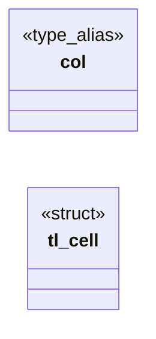

# `include/table_layout.h`

> Source: [include/table_layout.h:1](../../include/table_layout.h#L1) | language `h` | coverage 75.0% | [API index](../index.md)

table_layout (tl_) -- used column widths of a table (automatic table layout).

## Contents

- **Structs:** [`tl_cell`](#tl_cell)
- **Type Aliases:** [`col`](#col)
- **Functions:** [`px`](#px), [`tl_intrinsic`](#tl_intrinsic)
- **Macros:** [`TL_MAX_COLS`](#tl_max_cols), [`TL_WIDTH_MAX`](#tl_width_max), [`TL_PER_MILLE`](#tl_per_mille)

## Type Diagram



## Structs

<a id="tl_cell"></a>

### `tl_cell`

`struct` | [include/table_layout.h:28](../../include/table_layout.h#L28)

```c
typedef struct tl_cell
```

---

## Type Aliases

<a id="col"></a>

### `col`

`type_alias` | [include/table_layout.h:27](../../include/table_layout.h#L27)

```c
typedef struct tl_cell { int col;
```

#ifdef __cplusplus #error "Freedom is pure C11 by policy; C++ is not supported." #endif #include <stddef.h> /* Columns one table may have.

A table past this is laid out by the caller's fallback. #define TL_MAX_COLS 64u /* Largest width (px) any input may carry; larger values are capped. #define TL_WIDTH_MAX 1.0e9 /* A cell's percentage width is carried in per-mille; this is 100%. define TL_PER_MILLE 1000

---

## Functions

<a id="px"></a>

### `px`

`function` | [include/table_layout.h:41](../../include/table_layout.h#L41)

```c
* px (< 0 = auto: the table is as wide as its content, capped at avail). gap is the space * between adjacent columns. * * Returns 0.0 and writes nothing when out is NULL or ncols is 0 or above TL_MAX_
```

**Parameters**

| Name | Type | Default | Description |
|---|---|---|---|
| `< 0` |  | `auto: the table is as wide as its content, capped at avail` |  |

**Returns:** `*`

---

<a id="tl_intrinsic"></a>

### `tl_intrinsic`

`function` | [include/table_layout.h:53](../../include/table_layout.h#L53)

```c
void tl_intrinsic(const tl_cell *cells, size_t n, size_t ncols, double gap, double *min_total, double *max_total);
```

The table's min-content and max-content widths (columns plus gaps): what it contributes when it is itself a cell of an outer table.

Either output may be NULL. Both are 0 for an invalid ncols.

**Parameters**

| Name | Type | Default | Description |
|---|---|---|---|
| `cells` | `tl_cell *` |  |  |
| `n` | `size_t` |  |  |
| `ncols` | `size_t` |  |  |
| `gap` | `double` |  |  |
| `min_total` | `double *` |  |  |
| `max_total` | `double *` |  |  |

*Called by:* [`LLVMFuzzerTestOneInput`](fuzz.fuzz_table_layout.c.md#llvmfuzzertestoneinput)

---

## Macros

<a id="tl_max_cols"></a>

### `TL_MAX_COLS`

`macro` | [include/table_layout.h:20](../../include/table_layout.h#L20)

```c
#define TL_MAX_COLS
```

Columns one table may have.

A table past this is laid out by the caller's fallback.

---

<a id="tl_width_max"></a>

### `TL_WIDTH_MAX`

`macro` | [include/table_layout.h:23](../../include/table_layout.h#L23)

```c
#define TL_WIDTH_MAX
```

Largest width (px) any input may carry; larger values are capped.

---

<a id="tl_per_mille"></a>

### `TL_PER_MILLE`

`macro` | [include/table_layout.h:26](../../include/table_layout.h#L26)

```c
#define TL_PER_MILLE
```

A cell's percentage width is carried in per-mille; this is 100%.

---
