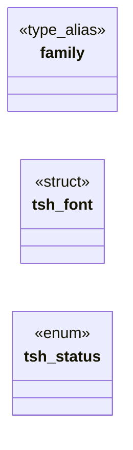
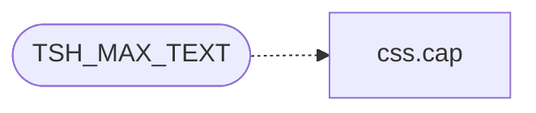

# `include/text_shape.h`

> Source: [include/text_shape.h:1](../../include/text_shape.h#L1) | language `h` | coverage 61.5% | [API index](../index.md)

## Contents

- **Structs:** [`tsh_font`](#tsh_font)
- **Enums:** [`tsh_status`](#tsh_status)
- **Type Aliases:** [`family`](#family)
- **Functions:** [`content`](#content), [`tsh_ready`](#tsh_ready), [`origin`](#origin), [`tsh_measure`](#tsh_measure), [`tsh_webfont_register`](#tsh_webfont_register), [`tsh_webfont_clear`](#tsh_webfont_clear), [`tsh_shutdown`](#tsh_shutdown)
- **Macros:** [`TSH_MAX_GLYPHS`](#tsh_max_glyphs), [`TSH_MAX_TEXT`](#tsh_max_text)

## Type Diagram



## Call Graph

Solid arrows stay in this module, dashed arrows leave it.



## Structs

<a id="tsh_font"></a>

### `tsh_font`

`struct` | [include/text_shape.h:33](../../include/text_shape.h#L33)

```c
typedef struct tsh_font
```

Font selector: a css_font_family bucket (CSS_FF_*) plus weight/slant flags.

The engine matches the generic group only, never an exact author family -- unless wfh names a registered @font-face (spec/webfont.md): a wf_name_hash, 0 = none. A set-but-unregistered hash falls back to the bucket (fail-visible, never fail-hard).

---

## Enums

<a id="tsh_status"></a>

### `tsh_status`

`enum` | [include/text_shape.h:43](../../include/text_shape.h#L43)

```c
typedef enum tsh_status
```

---

## Type Aliases

<a id="family"></a>

### `family`

`type_alias` | [include/text_shape.h:33](../../include/text_shape.h#L33)

```c
typedef struct tsh_font { int family;
```

Font selector: a css_font_family bucket (CSS_FF_*) plus weight/slant flags.

The engine matches the generic group only, never an exact author family -- unless wfh names a registered @font-face (spec/webfont.md): a wf_name_hash, 0 = none. A set-but-unregistered hash falls back to the bucket (fail-visible, never fail-hard).

---

## Functions

<a id="content"></a>

### `content`

`function` | [include/text_shape.h:11](../../include/text_shape.h#L11)

```c
* TEXT is hostile remote content (sanitised UTF-8) and is fuzzed (make fuzz-tsh);
```

**Parameters**

| Name | Type | Default | Description |
|---|---|---|---|
| `UTF` | `sanitised -8` |  |  |

**Returns:** `* TEXT is hostile remote`

---

<a id="tsh_ready"></a>

### `tsh_ready`

`function` | [include/text_shape.h:52](../../include/text_shape.h#L52)

```c
int tsh_ready(void);
```

1 once a fallback (sans) font resolves; lazily initialises on first call.

0 means no font backend: the caller must use the toy-API path.

**Returns:** `int`

---

<a id="origin"></a>

### `origin`

`function` | [include/text_shape.h:55](../../include/text_shape.h#L55)

```c
* glyphs are written with positions relative to origin (0,0) on the baseline, * and *out_adv holds the total pen advance in pixels. Fail-closed on every other * status (see spec): the caller must not
```

**Parameters**

| Name | Type | Default | Description |
|---|---|---|---|
| `0` |  |  |  |
| `0` |  |  |  |

**Returns:** `* glyphs are written with positions relative to`

---

<a id="tsh_measure"></a>

### `tsh_measure`

`function` | [include/text_shape.h:64](../../include/text_shape.h#L64)

```c
double tsh_measure(const tsh_font *f, double px, const char *text, size_t len);
```

Total advance (px) of [text,len).

Returns < 0.0 on any failure so the caller can fall back to the toy-API measurement.

**Parameters**

| Name | Type | Default | Description |
|---|---|---|---|
| `f` | `tsh_font *` |  |  |
| `px` | `double` |  |  |
| `text` | `char *` |  |  |
| `len` | `size_t` |  |  |

**Returns:** `double`

*Called by:* [`LLVMFuzzerTestOneInput`](fuzz.fuzz_text_shape.c.md#llvmfuzzertestoneinput)

---

<a id="tsh_webfont_register"></a>

### `tsh_webfont_register`

`function` | [include/text_shape.h:77](../../include/text_shape.h#L77)

```c
int tsh_webfont_register(const char *name, const unsigned char *bytes, size_t nbytes, int bold, int italic);
```

Registers one fetched @font-face for this document (spec/webfont.md): name is the author family (hashed with wf_name_hash), bytes the validated font program (copied; caller keeps ownership).

Re-registering a key replaces it. Returns 0 on success, -1 fail-closed (NULL/empty/oversize args, bad magic, unparseable bytes, table full). Trusted side only; never the worker.

**Parameters**

| Name | Type | Default | Description |
|---|---|---|---|
| `name` | `char *` |  |  |
| `bytes` | `unsigned char *` |  |  |
| `nbytes` | `size_t` |  |  |
| `bold` | `int` |  |  |
| `italic` | `int` |  |  |

**Returns:** `int`

*Called by:* [`WF_DATA_URL_MAX`](src.webfont_load.c.md#wf_data_url_max)

---

<a id="tsh_webfont_clear"></a>

### `tsh_webfont_clear`

`function` | [include/text_shape.h:83](../../include/text_shape.h#L83)

```c
void tsh_webfont_clear(void);
```

Drops every registered webfont (document teardown / navigation).

Idempotent, NULL-safe by construction (no args). tsh_shutdown also clears the table.

*Called by:* [`first`](gui.browser_ui.c.md#first), [`first`](src.freedom.c.md#first)

---

<a id="tsh_shutdown"></a>

### `tsh_shutdown`

`function` | [include/text_shape.h:86](../../include/text_shape.h#L86)

```c
void tsh_shutdown(void);
```

Releases cached faces / blobs / FreeType library (leak hygiene; tests).

---

## Macros

<a id="tsh_max_glyphs"></a>

### `TSH_MAX_GLYPHS`

`macro` | [include/text_shape.h:40](../../include/text_shape.h#L40)

```c
#define TSH_MAX_GLYPHS
```

---

<a id="tsh_max_text"></a>

### `TSH_MAX_TEXT`

`macro` | [include/text_shape.h:41](../../include/text_shape.h#L41)

```c
#define TSH_MAX_TEXT
```

anti-DoS cap on one shaped slice

*Calls:* [`cap`](src.css.c.md#cap)

---
