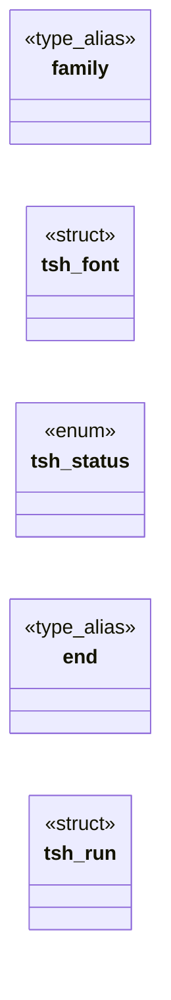

# `include/text_shape.h`

> Source: [include/text_shape.h:1](../../include/text_shape.h#L1) | language `h` | coverage 70.8% | [API index](../index.md)

## Contents

- **Structs:** [`tsh_font`](#tsh_font), [`tsh_run`](#tsh_run)
- **Enums:** [`tsh_status`](#tsh_status)
- **Type Aliases:** [`family`](#family), [`end`](#end)
- **Functions:** [`content`](#content), [`tsh_family_is_generic`](#tsh_family_is_generic), [`wins`](#wins), [`tsh_pick_family`](#tsh_pick_family), [`tsh_local_handle`](#tsh_local_handle), [`tsh_ready`](#tsh_ready), [`origin`](#origin), [`tsh_measure`](#tsh_measure), [`tsh_webfont_register`](#tsh_webfont_register), [`tsh_webfont_clear`](#tsh_webfont_clear), [`tsh_face`](#tsh_face), [`own`](#own), [`tsh_shutdown`](#tsh_shutdown)
- **Macros:** [`TSH_LOCAL_LISTS`](#tsh_local_lists), [`TSH_LOCAL_FAMILIES`](#tsh_local_families), [`TSH_FAMILY_MAX`](#tsh_family_max), [`TSH_MAX_GLYPHS`](#tsh_max_glyphs), [`TSH_MAX_TEXT`](#tsh_max_text)

## Type Diagram



## Call Graph

Solid arrows stay in this module, dashed arrows leave it.


## Structs

<a id="tsh_font"></a>

### `tsh_font`

`struct` | [include/text_shape.h:33](../../include/text_shape.h#L33)

```c
typedef struct tsh_font
```

Font selector: a css_font_family bucket (CSS_FF_*) plus weight/slant flags.

The engine matches the generic group only, never an exact author family -- unless wfh names a registered @font-face (spec/webfont.md): a wf_name_hash, 0 = none. A set-but-unregistered hash falls back to the bucket (fail-visible, never fail-hard).

---

<a id="tsh_run"></a>

### `tsh_run`

`struct` | [include/text_shape.h:132](../../include/text_shape.h#L132)

```c
typedef struct tsh_run { size_t start, end; int face; } tsh_run;
```

Per-glyph font fallback (spec/text_shape.md 8).

One maximal run of [text,len) drawn with one face: bytes [start, end), face id as returned by the cover callback (0 = the requested face).

---

## Enums

<a id="tsh_status"></a>

### `tsh_status`

`enum` | [include/text_shape.h:80](../../include/text_shape.h#L80)

```c
typedef enum tsh_status
```

---

## Type Aliases

<a id="family"></a>

### `family`

`type_alias` | [include/text_shape.h:33](../../include/text_shape.h#L33)

```c
typedef struct tsh_font { int family;
```

Font selector: a css_font_family bucket (CSS_FF_*) plus weight/slant flags.

The engine matches the generic group only, never an exact author family -- unless wfh names a registered @font-face (spec/webfont.md): a wf_name_hash, 0 = none. A set-but-unregistered hash falls back to the bucket (fail-visible, never fail-hard).

---

<a id="end"></a>

### `end`

`type_alias` | [include/text_shape.h:132](../../include/text_shape.h#L132)

```c
typedef struct tsh_run { size_t start, end;
```

Per-glyph font fallback (spec/text_shape.md 8).

One maximal run of [text,len) drawn with one face: bytes [start, end), face id as returned by the cover callback (0 = the requested face).

---

## Functions

<a id="content"></a>

### `content`

`function` | [include/text_shape.h:11](../../include/text_shape.h#L11)

```c
* TEXT is hostile remote content (sanitised UTF-8) and is fuzzed (make fuzz-tsh);
```

**Parameters**

| Name | Type | Default | Description |
|---|---|---|---|
| `UTF` | `sanitised -8` |  |  |

**Returns:** `* TEXT is hostile remote`

---

<a id="tsh_family_is_generic"></a>

### `tsh_family_is_generic`

`function` | [include/text_shape.h:52](../../include/text_shape.h#L52)

```c
int tsh_family_is_generic(const char *name);
```

1 for a CSS generic family keyword (serif, sans-serif, monospace, cursive, fantasy, system-ui, ui-*, emoji, math, fangsong), case-insensitive.

Pure.

**Parameters**

| Name | Type | Default | Description |
|---|---|---|---|
| `name` | `char *` |  |  |

**Returns:** `int`

---

<a id="wins"></a>

### `wins`

`function` | [include/text_shape.h:58](../../include/text_shape.h#L58)

```c
* the first name the resolver accepts wins (returns 1, family in out). Pure: the * resolver is injected (fontconfig in production, a table in tests). */ int tsh_pick_from_list(const char *list, tsh_na
```

**Parameters**

| Name | Type | Default | Description |
|---|---|---|---|
| `returns` |  |  |  |
| `out` | `family in` |  |  |

**Returns:** `* the first name the resolver accepts`

---

<a id="tsh_pick_family"></a>

### `tsh_pick_family`

`function` `const` | [include/text_shape.h:68](../../include/text_shape.h#L68)

```c
const char *tsh_pick_family(const char *req, const char *const *subs, const int *strong, size_t n, int (*installed)(const char *name, void *ctx), void *ctx);
```

The acceptance rule for one requested name given fontconfig's substituted family list subs[0..n) and their bindings (strong[k] != 0 for a strong/same binding): req itself when installed, else the first INSTALLED entry of the leading run of strong substitutes; a weak substitute ends the run.

Returns the chosen name or NULL. Pure (installed is injected).

**Parameters**

| Name | Type | Default | Description |
|---|---|---|---|
| `req` | `char *` |  |  |
| `subs` | `char *const *` |  |  |
| `strong` | `int *` |  |  |
| `n` | `size_t` |  |  |
| `ctx` | `int (*installed)(const char *name, void * )` |  |  |
| `ctx` | `void *` |  |  |

**Returns:** `char *`

---

<a id="tsh_local_handle"></a>

### `tsh_local_handle`

`function` | [include/text_shape.h:75](../../include/text_shape.h#L75)

```c
int tsh_local_handle(const char *list);
```

Handle (>0) for an author family list that resolves to a local family, cached per list; 0 when nothing resolves, the list is NULL/empty, or a cap is hit (the caller then uses the bucket).

Trusted side only.

**Parameters**

| Name | Type | Default | Description |
|---|---|---|---|
| `list` | `char *` |  |  |

**Returns:** `int`

---

<a id="tsh_ready"></a>

### `tsh_ready`

`function` | [include/text_shape.h:89](../../include/text_shape.h#L89)

```c
int tsh_ready(void);
```

1 once a fallback (sans) font resolves; lazily initialises on first call.

0 means no font backend: the caller must use the toy-API path.

**Returns:** `int`

---

<a id="origin"></a>

### `origin`

`function` | [include/text_shape.h:92](../../include/text_shape.h#L92)

```c
* glyphs are written with positions relative to origin (0,0) on the baseline, * and *out_adv holds the total pen advance in pixels. Fail-closed on every other * status (see spec): the caller must not
```

**Parameters**

| Name | Type | Default | Description |
|---|---|---|---|
| `0` |  |  |  |
| `0` |  |  |  |

**Returns:** `* glyphs are written with positions relative to`

---

<a id="tsh_measure"></a>

### `tsh_measure`

`function` | [include/text_shape.h:101](../../include/text_shape.h#L101)

```c
double tsh_measure(const tsh_font *f, double px, const char *text, size_t len);
```

Total advance (px) of [text,len).

Returns < 0.0 on any failure so the caller can fall back to the toy-API measurement.

**Parameters**

| Name | Type | Default | Description |
|---|---|---|---|
| `f` | `tsh_font *` |  |  |
| `px` | `double` |  |  |
| `text` | `char *` |  |  |
| `len` | `size_t` |  |  |

**Returns:** `double`

---

<a id="tsh_webfont_register"></a>

### `tsh_webfont_register`

`function` | [include/text_shape.h:114](../../include/text_shape.h#L114)

```c
int tsh_webfont_register(const char *name, const unsigned char *bytes, size_t nbytes, int bold, int italic);
```

Registers one fetched @font-face for this document (spec/webfont.md): name is the author family (hashed with wf_name_hash), bytes the validated font program (copied; caller keeps ownership).

Re-registering a key replaces it. Returns 0 on success, -1 fail-closed (NULL/empty/oversize args, bad magic, unparseable bytes, table full). Trusted side only; never the worker.

**Parameters**

| Name | Type | Default | Description |
|---|---|---|---|
| `name` | `char *` |  |  |
| `bytes` | `unsigned char *` |  |  |
| `nbytes` | `size_t` |  |  |
| `bold` | `int` |  |  |
| `italic` | `int` |  |  |

**Returns:** `int`

*Called by:* [`WF_DATA_URL_MAX`](src.webfont_load.c.md#wf_data_url_max)

---

<a id="tsh_webfont_clear"></a>

### `tsh_webfont_clear`

`function` | [include/text_shape.h:120](../../include/text_shape.h#L120)

```c
void tsh_webfont_clear(void);
```

Drops every registered webfont (document teardown / navigation).

Idempotent, NULL-safe by construction (no args). tsh_shutdown also clears the table.

*Called by:* [`first`](gui.browser_ui.c.md#first), [`first`](src.freedom.c.md#first)

---

<a id="tsh_face"></a>

### `tsh_face`

`function` | [include/text_shape.h:127](../../include/text_shape.h#L127)

```c
cairo_font_face_t *tsh_face(const tsh_font *f);
```

The cairo face tsh_draw paints f with (webfont, local family or bucket), or NULL when no face resolves.

Borrowed: owned by the cache, valid until tsh_shutdown / tsh_webfont_clear. The painter selects it so cairo's font extents -- line-height: normal, ascent, descent -- are the metrics of the face that is actually drawn, not of the generic stand-in (CSS 2.1 10.8.1).

**Parameters**

| Name | Type | Default | Description |
|---|---|---|---|
| `f` | `tsh_font *` |  |  |

**Returns:** `cairo_font_face_t *`

*Called by:* [`sites`](gui.browser_ui.c.md#sites)

---

<a id="own"></a>

### `own`

`function` | [include/text_shape.h:136](../../include/text_shape.h#L136)

```c
* face of their own (controls, combining marks, variation selectors, ZWJ/ZWNJ) * stay in the run before them. Returns the run count, 0 for empty text, -1 when * more than cap runs would be needed or o
```

**Parameters**

| Name | Type | Default | Description |
|---|---|---|---|
| `marks` | `combining` |  |  |
| `selectors` | `variation` |  |  |
| `ZWNJ` | `ZWJ/` |  |  |

**Returns:** `* face of their`

---

<a id="tsh_shutdown"></a>

### `tsh_shutdown`

`function` | [include/text_shape.h:143](../../include/text_shape.h#L143)

```c
void tsh_shutdown(void);
```

Releases cached faces / blobs / FreeType library (leak hygiene; tests).

---

## Macros

<a id="tsh_local_lists"></a>

### `TSH_LOCAL_LISTS`

`macro` | [include/text_shape.h:46](../../include/text_shape.h#L46)

```c
#define TSH_LOCAL_LISTS
```

--- Named LOCAL families (spec/text_shape.md section 7) ---------------------
The author's font-family list (normalized by the cascade: unquoted names,
comma-separated) resolves to the first name fontconfig really provides --
installed, or a STRONG substitute such as Arial -> Liberation Sans -- the way
Firefox does on Linux. A generic name stops the walk (the bucket applies).

---

<a id="tsh_local_families"></a>

### `TSH_LOCAL_FAMILIES`

`macro` | [include/text_shape.h:47](../../include/text_shape.h#L47)

```c
#define TSH_LOCAL_FAMILIES
```

distinct lists resolved per process

---

<a id="tsh_family_max"></a>

### `TSH_FAMILY_MAX`

`macro` | [include/text_shape.h:48](../../include/text_shape.h#L48)

```c
#define TSH_FAMILY_MAX
```

distinct local families loaded (x4 styles)

---

<a id="tsh_max_glyphs"></a>

### `TSH_MAX_GLYPHS`

`macro` | [include/text_shape.h:77](../../include/text_shape.h#L77)

```c
#define TSH_MAX_GLYPHS
```

---

<a id="tsh_max_text"></a>

### `TSH_MAX_TEXT`

`macro` | [include/text_shape.h:78](../../include/text_shape.h#L78)

```c
#define TSH_MAX_TEXT
```

anti-DoS cap on one shaped slice

*Calls:* [`cap`](src.css.c.md#cap)

---
