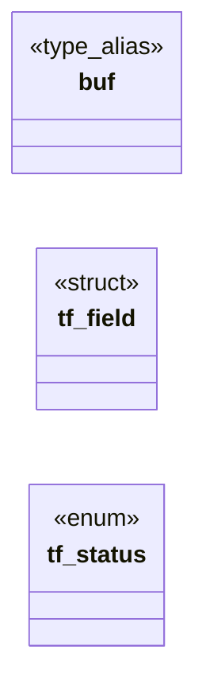

# `include/textfield.h`

> Source: [include/textfield.h:1](../../include/textfield.h#L1) | language `h` | coverage 53.3% | [API index](../index.md)

## Contents

- **Structs:** [`tf_field`](#tf_field)
- **Enums:** [`tf_status`](#tf_status)
- **Type Aliases:** [`buf`](#buf)
- **Functions:** [`tf_init`](#tf_init), [`tf_clear`](#tf_clear), [`tf_backspace`](#tf_backspace), [`tf_delete`](#tf_delete), [`tf_move`](#tf_move), [`tf_home`](#tf_home), [`tf_end`](#tf_end), [`tf_text`](#tf_text), [`tf_len`](#tf_len), [`tf_cursor`](#tf_cursor)
- **Macros:** [`TF_CAP`](#tf_cap)

## Type Diagram



## Structs

<a id="tf_field"></a>

### `tf_field`

`struct` | [include/textfield.h:25](../../include/textfield.h#L25)

```c
typedef struct tf_field
```

---

## Enums

<a id="tf_status"></a>

### `tf_status`

`enum` | [include/textfield.h:31](../../include/textfield.h#L31)

```c
typedef enum tf_status
```

---

## Type Aliases

<a id="buf"></a>

### `buf`

`type_alias` | [include/textfield.h:24](../../include/textfield.h#L24)

```c
typedef struct tf_field { char buf[TF_CAP];
```

fixed buffer capacity, including the trailing NUL

---

## Functions

<a id="tf_init"></a>

### `tf_init`

`function` | [include/textfield.h:38](../../include/textfield.h#L38)

```c
void tf_init(tf_field *f);
```

Resets the field to empty with the cursor at 0.

NULL-safe.

**Parameters**

| Name | Type | Default | Description |
|---|---|---|---|
| `f` | `tf_field *` |  |  |

*Called by:* [`tf_clear`](src.textfield.c.md#tf_clear), [`whole`](src.textfield.c.md#whole)

---

<a id="tf_clear"></a>

### `tf_clear`

`function` | [include/textfield.h:45](../../include/textfield.h#L45)

```c
void tf_clear(tf_field *f);
```

Empties the field (cursor at 0).

NULL-safe.

**Parameters**

| Name | Type | Default | Description |
|---|---|---|---|
| `f` | `tf_field *` |  |  |

---

<a id="tf_backspace"></a>

### `tf_backspace`

`function` | [include/textfield.h:53](../../include/textfield.h#L53)

```c
void tf_backspace(tf_field *f);
```

Deletes the byte before the cursor (no-op at the start).

NULL-safe.

**Parameters**

| Name | Type | Default | Description |
|---|---|---|---|
| `f` | `tf_field *` |  |  |

---

<a id="tf_delete"></a>

### `tf_delete`

`function` | [include/textfield.h:56](../../include/textfield.h#L56)

```c
void tf_delete(tf_field *f);
```

Deletes the byte at the cursor (no-op at the end).

NULL-safe.

**Parameters**

| Name | Type | Default | Description |
|---|---|---|---|
| `f` | `tf_field *` |  |  |

---

<a id="tf_move"></a>

### `tf_move`

`function` | [include/textfield.h:59](../../include/textfield.h#L59)

```c
void tf_move(tf_field *f, long delta);
```

Moves the cursor by delta, saturating to [0, len].

NULL-safe.

**Parameters**

| Name | Type | Default | Description |
|---|---|---|---|
| `f` | `tf_field *` |  |  |
| `delta` | `long` |  |  |

---

<a id="tf_home"></a>

### `tf_home`

`function` | [include/textfield.h:62](../../include/textfield.h#L62)

```c
void tf_home(tf_field *f);
```

Moves the cursor to the start / end.

NULL-safe.

**Parameters**

| Name | Type | Default | Description |
|---|---|---|---|
| `f` | `tf_field *` |  |  |

---

<a id="tf_end"></a>

### `tf_end`

`function` | [include/textfield.h:63](../../include/textfield.h#L63)

```c
void tf_end(tf_field *f);
```

**Parameters**

| Name | Type | Default | Description |
|---|---|---|---|
| `f` | `tf_field *` |  |  |

---

<a id="tf_text"></a>

### `tf_text`

`function` `const` | [include/textfield.h:66](../../include/textfield.h#L66)

```c
const char *tf_text(const tf_field *f);
```

Read accessors.

NULL-safe (return ""/0).

**Parameters**

| Name | Type | Default | Description |
|---|---|---|---|
| `f` | `tf_field *` |  |  |

**Returns:** `char *`

---

<a id="tf_len"></a>

### `tf_len`

`function` | [include/textfield.h:67](../../include/textfield.h#L67)

```c
size_t tf_len(const tf_field *f);
```

**Parameters**

| Name | Type | Default | Description |
|---|---|---|---|
| `f` | `tf_field *` |  |  |

**Returns:** `size_t`

---

<a id="tf_cursor"></a>

### `tf_cursor`

`function` | [include/textfield.h:68](../../include/textfield.h#L68)

```c
size_t tf_cursor(const tf_field *f);
```

**Parameters**

| Name | Type | Default | Description |
|---|---|---|---|
| `f` | `tf_field *` |  |  |

**Returns:** `size_t`

---

## Macros

<a id="tf_cap"></a>

### `TF_CAP`

`macro` | [include/textfield.h:23](../../include/textfield.h#L23)

```c
#define TF_CAP
```

---
