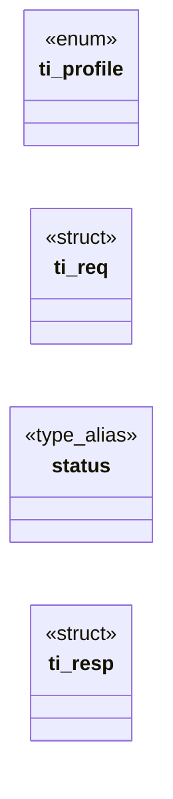

# `include/tls_impersonate.h`

> Source: [include/tls_impersonate.h:1](../../include/tls_impersonate.h#L1) | language `h` | coverage 30.4% | [API index](../index.md)

## Contents

- **Structs:** [`ti_req`](#ti_req), [`ti_resp`](#ti_resp)
- **Enums:** [`ti_profile`](#ti_profile)
- **Type Aliases:** [`status`](#status)
- **Functions:** [`path`](#path), [`chain`](#chain), [`ti_should_impersonate`](#ti_should_impersonate), [`success`](#success), [`ti_decode_req`](#ti_decode_req), [`ti_req_free`](#ti_req_free), [`ti_encode_resp`](#ti_encode_resp), [`ti_decode_resp`](#ti_decode_resp), [`ti_resp_free`](#ti_resp_free)
- **Macros:** [`TI_MAGIC`](#ti_magic), [`TI_MAX_URL`](#ti_max_url), [`TI_MAX_METHOD`](#ti_max_method), [`TI_MAX_HEADERS`](#ti_max_headers), [`TI_MAX_BODY`](#ti_max_body), [`TI_MAX_RESP_HDR`](#ti_max_resp_hdr), [`TI_MAX_RESP_BODY`](#ti_max_resp_body), [`TI_MAX_CHAIN`](#ti_max_chain), [`TI_MAX_GROUP`](#ti_max_group)

## Type Diagram



## Structs

<a id="ti_req"></a>

### `ti_req`

`struct` | [include/tls_impersonate.h:72](../../include/tls_impersonate.h#L72)

```c
typedef struct ti_req
```

Request: parent -> helper.

Pointers are borrowed by ti_encode_req (not copied); ti_decode_req allocates its own copies, released by ti_req_free.

---

<a id="ti_resp"></a>

### `ti_resp`

`struct` | [include/tls_impersonate.h:82](../../include/tls_impersonate.h#L82)

```c
typedef struct ti_resp
```

Response: helper -> parent. ti_decode_resp allocates; ti_resp_free releases.

---

## Enums

<a id="ti_profile"></a>

### `ti_profile`

`enum` | [include/tls_impersonate.h:41](../../include/tls_impersonate.h#L41)

```c
typedef enum ti_profile
```

Browser profile imitated on the wire.

Owner decision (2026-07-12): TI_PROFILE_CHROME_CLASSIC — maximally-common JA3, CLASSICAL key exchange (no X25519MLKEM768) on this route, accepted per-host via user opt-in (see below).

---

## Type Aliases

<a id="status"></a>

### `status`

`type_alias` | [include/tls_impersonate.h:82](../../include/tls_impersonate.h#L82)

```c
typedef struct ti_resp { long status;
```

Response: helper -> parent. ti_decode_resp allocates; ti_resp_free releases.

---

## Functions

<a id="path"></a>

### `path`

`function` | [include/tls_impersonate.h:26](../../include/tls_impersonate.h#L26)

```c
* Zero Knowledge path (PQ-hybrid, VERIFYPEER). * * 2. ti_encode_x / ti_decode_x — the length-prefixed, fail-closed serialization of * the parent<->helper request/response. Every field is bounded (TI_M
```

**Parameters**

| Name | Type | Default | Description |
|---|---|---|---|
| `hybrid` | `PQ-` |  |  |

**Returns:** `* Zero Knowledge`

---

<a id="chain"></a>

### `chain`

`function` | [include/tls_impersonate.h:32](../../include/tls_impersonate.h#L32)

```c
* * The response carries the peer certificate chain (DER) and the negotiated group so * the TRUSTED PARENT re-applies the strength policy (RSA<3072 leaf, SHA-1 fatal, * hybrid-KE) with OpenSSL over wh
```

**Returns:** `* * The response carries the peer certificate`

---

<a id="ti_should_impersonate"></a>

### `ti_should_impersonate`

`function` | [include/tls_impersonate.h:56](../../include/tls_impersonate.h#L56)

```c
int ti_should_impersonate(int host_in_allowlist, int host_js_enabled, int user_opt_in);
```

The double opt-in + user-flag gate (pure).

Returns 1 IFF all three signals are set: host_in_allowlist  — an explicit allow.conf entry (hb_is_allowlisted) host_js_enabled    — JS permitted for this host (js_policy / js.conf) user_opt_in        — explicit user decision for this run (CLI --impersonate or FREEDOM_IMPERSONATE=1; future vendored curl-impersonate / BoringSSL helper also gated here, never by default) Any zero => 0 (fail-closed: the default hardened OpenSSL path is used). A global JSP_ON does NOT substitute for the explicit allow.conf entry. No impersonate.conf.

**Parameters**

| Name | Type | Default | Description |
|---|---|---|---|
| `host_in_allowlist` | `int` |  |  |
| `host_js_enabled` | `int` |  |  |
| `user_opt_in` | `int` |  |  |

**Returns:** `int`

*Called by:* [`proceed`](gui.browser_ui.c.md#proceed), [`HL_JS_NAV_MAX`](src.freedom.c.md#hl_js_nav_max), [`gets`](src.freedom.c.md#gets)

---

<a id="success"></a>

### `success`

`function` | [include/tls_impersonate.h:97](../../include/tls_impersonate.h#L97)

```c
* ti_decode_* returns 0 on success (out fully populated), <0 on any malformed, * truncated or over-cap input (out left zeroed / owned buffers freed). */ size_t ti_encode_req(const ti_req *r, uint8_t *
```

**Parameters**

| Name | Type | Default | Description |
|---|---|---|---|
| `populated` | `fully` |  |  |

**Returns:** `* ti_decode_* returns 0 on`

---

<a id="ti_decode_req"></a>

### `ti_decode_req`

`function` | [include/tls_impersonate.h:101](../../include/tls_impersonate.h#L101)

```c
int ti_decode_req(const uint8_t *in, size_t len, ti_req *out);
```

**Parameters**

| Name | Type | Default | Description |
|---|---|---|---|
| `in` | `uint8_t *` |  |  |
| `len` | `size_t` |  |  |
| `out` | `ti_req *` |  |  |

**Returns:** `int`

---

<a id="ti_req_free"></a>

### `ti_req_free`

`function` | [include/tls_impersonate.h:102](../../include/tls_impersonate.h#L102)

```c
void ti_req_free(ti_req *r);
```

**Parameters**

| Name | Type | Default | Description |
|---|---|---|---|
| `r` | `ti_req *` |  |  |

---

<a id="ti_encode_resp"></a>

### `ti_encode_resp`

`function` | [include/tls_impersonate.h:104](../../include/tls_impersonate.h#L104)

```c
size_t ti_encode_resp(const ti_resp *r, uint8_t *out, size_t out_cap);
```

**Parameters**

| Name | Type | Default | Description |
|---|---|---|---|
| `r` | `ti_resp *` |  |  |
| `out` | `uint8_t *` |  |  |
| `out_cap` | `size_t` |  |  |

**Returns:** `size_t`

---

<a id="ti_decode_resp"></a>

### `ti_decode_resp`

`function` | [include/tls_impersonate.h:105](../../include/tls_impersonate.h#L105)

```c
int ti_decode_resp(const uint8_t *in, size_t len, ti_resp *out);
```

**Parameters**

| Name | Type | Default | Description |
|---|---|---|---|
| `in` | `uint8_t *` |  |  |
| `len` | `size_t` |  |  |
| `out` | `ti_resp *` |  |  |

**Returns:** `int`

---

<a id="ti_resp_free"></a>

### `ti_resp_free`

`function` | [include/tls_impersonate.h:106](../../include/tls_impersonate.h#L106)

```c
void ti_resp_free(ti_resp *r);
```

**Parameters**

| Name | Type | Default | Description |
|---|---|---|---|
| `r` | `ti_resp *` |  |  |

---

## Macros

<a id="ti_magic"></a>

### `TI_MAGIC`

`macro` | [include/tls_impersonate.h:60](../../include/tls_impersonate.h#L60)

```c
#define TI_MAGIC
```

Anti-DoS bounds: a hostile helper or a corrupt frame must never overrun.

---

<a id="ti_max_url"></a>

### `TI_MAX_URL`

`macro` | [include/tls_impersonate.h:61](../../include/tls_impersonate.h#L61)

```c
#define TI_MAX_URL
```

"TIMP"

---

<a id="ti_max_method"></a>

### `TI_MAX_METHOD`

`macro` | [include/tls_impersonate.h:62](../../include/tls_impersonate.h#L62)

```c
#define TI_MAX_METHOD
```

---

<a id="ti_max_headers"></a>

### `TI_MAX_HEADERS`

`macro` | [include/tls_impersonate.h:63](../../include/tls_impersonate.h#L63)

```c
#define TI_MAX_HEADERS
```

---

<a id="ti_max_body"></a>

### `TI_MAX_BODY`

`macro` | [include/tls_impersonate.h:64](../../include/tls_impersonate.h#L64)

```c
#define TI_MAX_BODY
```

---

<a id="ti_max_resp_hdr"></a>

### `TI_MAX_RESP_HDR`

`macro` | [include/tls_impersonate.h:65](../../include/tls_impersonate.h#L65)

```c
#define TI_MAX_RESP_HDR
```

---

<a id="ti_max_resp_body"></a>

### `TI_MAX_RESP_BODY`

`macro` | [include/tls_impersonate.h:66](../../include/tls_impersonate.h#L66)

```c
#define TI_MAX_RESP_BODY
```

---

<a id="ti_max_chain"></a>

### `TI_MAX_CHAIN`

`macro` | [include/tls_impersonate.h:67](../../include/tls_impersonate.h#L67)

```c
#define TI_MAX_CHAIN
```

---

<a id="ti_max_group"></a>

### `TI_MAX_GROUP`

`macro` | [include/tls_impersonate.h:68](../../include/tls_impersonate.h#L68)

```c
#define TI_MAX_GROUP
```

---
