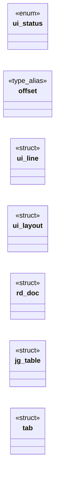

# `include/ui.h`

> Source: [include/ui.h:1](../../include/ui.h#L1) | language `h` | coverage 29.4% | [API index](../index.md)

## Contents

- **Structs:** [`ui_line`](#ui_line), [`ui_layout`](#ui_layout), [`rd_doc`](#rd_doc), [`jg_table`](#jg_table), [`tab`](#tab)
- **Enums:** [`ui_status`](#ui_status)
- **Type Aliases:** [`offset`](#offset)
- **Functions:** [`space`](#space), [`ui_layout_free`](#ui_layout_free), [`ui_clamp_scroll`](#ui_clamp_scroll), [`available`](#available), [`out`](#out), [`placeholders`](#placeholders), [`disk`](#disk), [`images`](#images), [`ui_render_viewport_w`](#ui_render_viewport_w)

## Type Diagram



## Structs

<a id="ui_line"></a>

### `ui_line`

`struct` | [include/ui.h:29](../../include/ui.h#L29)

```c
typedef struct ui_line
```

A laid-out line is a contiguous slice [offset, offset+len) of the source text (no copy): render with text + offset over len bytes.

---

<a id="ui_layout"></a>

### `ui_layout`

`struct` | [include/ui.h:34](../../include/ui.h#L34)

```c
typedef struct ui_layout
```

---

<a id="rd_doc"></a>

### `rd_doc`

`struct` | [include/ui.h:68](../../include/ui.h#L68)

```c
struct rd_doc;
```

---

<a id="jg_table"></a>

### `jg_table`

`struct` | [include/ui.h:94](../../include/ui.h#L94)

```c
struct jg_table;
```

---

<a id="tab"></a>

### `tab`

`struct` | [include/ui.h:104](../../include/ui.h#L104)

```c
struct tab;
```

---

## Enums

<a id="ui_status"></a>

### `ui_status`

`enum` | [include/ui.h:19](../../include/ui.h#L19)

```c
typedef enum ui_status
```

---

## Type Aliases

<a id="offset"></a>

### `offset`

`type_alias` | [include/ui.h:29](../../include/ui.h#L29)

```c
typedef struct ui_line { size_t offset;
```

A laid-out line is a contiguous slice [offset, offset+len) of the source text (no copy): render with text + offset over len bytes.

---

## Functions

<a id="space"></a>

### `space`

`function` | [include/ui.h:43](../../include/ui.h#L43)

```c
* Breaks at the last fitting space (the break space is consumed), hard-breaks * words longer than max_cols, and treats '\n' as a forced break. max_cols == 0 * is treated as 1. len == 0 yields zero lin
```

**Parameters**

| Name | Type | Default | Description |
|---|---|---|---|
| `consumed` | `the break space is` |  |  |

**Returns:** `* Breaks at the last fitting`

---

<a id="ui_layout_free"></a>

### `ui_layout_free`

`function` | [include/ui.h:51](../../include/ui.h#L51)

```c
void ui_layout_free(ui_layout *lay);
```

Idempotent; safe on a zero-initialised struct and safe to call twice.

**Parameters**

| Name | Type | Default | Description |
|---|---|---|---|
| `lay` | `ui_layout *` |  |  |

---

<a id="ui_clamp_scroll"></a>

### `ui_clamp_scroll`

`function` | [include/ui.h:54](../../include/ui.h#L54)

```c
size_t ui_clamp_scroll(size_t desired, size_t total_lines, size_t viewport_lines);
```

Clamps desired to [0, max(0, total_lines - viewport_lines)].

**Parameters**

| Name | Type | Default | Description |
|---|---|---|---|
| `desired` | `size_t` |  |  |
| `total_lines` | `size_t` |  |  |
| `viewport_lines` | `size_t` |  |  |

**Returns:** `size_t`

---

<a id="available"></a>

### `available`

`function` | [include/ui.h:85](../../include/ui.h#L85)

```c
* cheapest artifact to inspect a render where no display is available (CI, an AI * agent): export, then read the PNG directly (no PDF rasterise step). The image * height is bounded (a hostile page can
```

**Parameters**

| Name | Type | Default | Description |
|---|---|---|---|
| `agent` | `an AI *` |  |  |

**Returns:** `export, then read the PNG directly (no PDF rasterise step). The image * height is bounded (a hostile page can`

---

<a id="out"></a>

### `out`

`function` | [include/ui.h:97](../../include/ui.h#L97)

```c
* ui_render_png does and fills *out (jg_init'ed by the caller) with one rect per * element in document coordinates, plus a FC_PNG_PAGE_W x FC_HEADLESS_VIEW_H * viewport at scroll 0. The caller hands i
```

**Parameters**

| Name | Type | Default | Description |
|---|---|---|---|
| `caller` | `jg_init'ed by the` |  |  |

**Returns:** `* ui_render_png does and fills *`

---

<a id="placeholders"></a>

### `placeholders`

`function` | [include/ui.h:107](../../include/ui.h#L107)

```c
* above always draw image placeholders (no worker to decode hostile bytes);
```

**Parameters**

| Name | Type | Default | Description |
|---|---|---|---|
| `bytes` | `no worker to decode hostile` |  |  |

**Returns:** `* above always draw image`

---

<a id="disk"></a>

### `disk`

`function` | [include/ui.h:112](../../include/ui.h#L112)

```c
* images are read from disk (confined to the document directory by render_doc). * top_url is the page origin (https or file://);
```

**Parameters**

| Name | Type | Default | Description |
|---|---|---|---|
| `render_doc` | `confined to the document directory by` |  |  |

**Returns:** `* images are read from`

---

<a id="images"></a>

### `images`

`function` | [include/ui.h:114](../../include/ui.h#L114)

```c
* fetcher loads no images (placeholders, as before). Any image that fails falls back * to its placeholder, byte-identical to the on-screen window path. The fetcher type * matches tab_fetch_fn (include
```

**Parameters**

| Name | Type | Default | Description |
|---|---|---|---|
| `before` | `as` |  |  |

**Returns:** `* fetcher loads no`

---

<a id="ui_render_viewport_w"></a>

### `ui_render_viewport_w`

`function` | [include/ui.h:141](../../include/ui.h#L141)

```c
int ui_render_viewport_w(void);
```

The fixed canvas width (px) every headless render (ui_render_png/pdf, ui_dump_layout) lays out at.

The headless driver feeds it to tab_set_viewport_w so @media width queries match the width the page is actually painted at.

**Returns:** `int`

---
