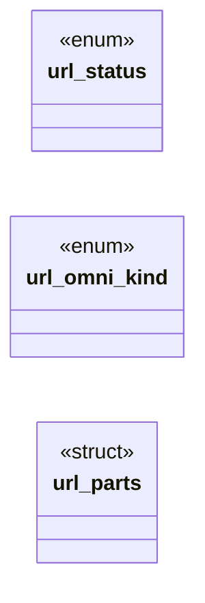

# `include/url.h`

> Source: [include/url.h:1](../../include/url.h#L1) | language `h` | coverage 50.0% | [API index](../index.md)

## Contents

- **Structs:** [`url_parts`](#url_parts)
- **Enums:** [`url_status`](#url_status), [`url_omni_kind`](#url_omni_kind)
- **Functions:** [`url_is_https`](#url_is_https), [`url_has_scheme`](#url_has_scheme), [`url_authority_len`](#url_authority_len), [`URL_ERR_NOT_HTTPS`](#url_err_not_https), [`path`](#path), [`url_file_path`](#url_file_path), [`url`](#url), [`password`](#password)
- **Macros:** [`URL_MAX_LEN`](#url_max_len), [`URL_SEARCH_ENDPOINT`](#url_search_endpoint)

## Type Diagram



## Structs

<a id="url_parts"></a>

### `url_parts`

`struct` | [include/url.h:129](../../include/url.h#L129)

```c
typedef struct url_parts
```

Components of a validated absolute https URL, sliced for a JS location object.

Every field ALIASES the input url (not owned, valid while url is alive); lengths exclude any NUL. Absent components have length 0. pathname is the literal path span and is empty when the URL has no path (the location shim presents "" as "/").

---

## Enums

<a id="url_status"></a>

### `url_status`

`enum` | [include/url.h:32](../../include/url.h#L32)

```c
typedef enum url_status
```

---

<a id="url_omni_kind"></a>

### `url_omni_kind`

`enum` | [include/url.h:78](../../include/url.h#L78)

```c
typedef enum url_omni_kind
```

---

## Functions

<a id="url_is_https"></a>

### `url_is_https`

`function` | [include/url.h:42](../../include/url.h#L42)

```c
int url_is_https(const char *s);
```

Nonzero iff s begins (case-insensitively) with "https://" and the host is neither empty nor a leading '/'.

NULL => 0.

**Parameters**

| Name | Type | Default | Description |
|---|---|---|---|
| `s` | `char *` |  |  |

**Returns:** `int`

*Called by:* [`LLVMFuzzerTestOneInput`](fuzz.fuzz_url.c.md#llvmfuzzertestoneinput), [`ln_resolve`](src.link_nav.c.md#ln_resolve)

---

<a id="url_has_scheme"></a>

### `url_has_scheme`

`function` | [include/url.h:46](../../include/url.h#L46)

```c
int url_has_scheme(const char *s);
```

Nonzero iff s begins with "<scheme>:" per RFC 3986 (ALPHA *( ALPHA / DIGIT / "+" / "-" / "." ) ":").

NULL => 0.

**Parameters**

| Name | Type | Default | Description |
|---|---|---|---|
| `s` | `char *` |  |  |

**Returns:** `int`

*Called by:* [`ln_resolve`](src.link_nav.c.md#ln_resolve)

---

<a id="url_authority_len"></a>

### `url_authority_len`

`function` | [include/url.h:51](../../include/url.h#L51)

```c
size_t url_authority_len(const char *url);
```

Length of "https://host[:port]" within a validated absolute https URL: the index of the first '/', '?' or '#' after the scheme (RFC 3986 3.2), or the whole length if there is none.

Assumes url passed url_validate_https.

**Parameters**

| Name | Type | Default | Description |
|---|---|---|---|
| `url` | `char *` |  |  |

**Returns:** `size_t`

---

<a id="url_err_not_https"></a>

### `URL_ERR_NOT_HTTPS`

`function` | [include/url.h:109](../../include/url.h#L109)

```c
* URL_ERR_NOT_HTTPS (out untouched);
```

**Returns:** `*`

---

<a id="path"></a>

### `path`

`function` | [include/url.h:115](../../include/url.h#L115)

```c
* absolute path ("file:///..."). NULL => 0. */ int url_is_file(const char *s);
```

**Parameters**

| Name | Type | Default | Description |
|---|---|---|---|
| `file` |  |  |  |

**Returns:** `* absolute`

---

<a id="url_file_path"></a>

### `url_file_path`

`function` `const` | [include/url.h:121](../../include/url.h#L121)

```c
const char *url_file_path(const char *s);
```

Returns the absolute filesystem path inside a "file:///path" URL (i.e. the "/path" part), or NULL when s is not a valid file:// URL.

The pointer aliases s (not owned).

**Parameters**

| Name | Type | Default | Description |
|---|---|---|---|
| `s` | `char *` |  |  |

**Returns:** `char *`

*Called by:* [`arrives`](gui.browser_ui.c.md#arrives)

---

<a id="url"></a>

### `url`

`function` | [include/url.h:126](../../include/url.h#L126)

```c
* Every field ALIASES the input url (not owned, valid while url is alive);
```

**Parameters**

| Name | Type | Default | Description |
|---|---|---|---|
| `owned` | `not` |  |  |
| `alive` | `valid while url is` |  |  |

**Returns:** `* Every field ALIASES the input`

*Called by:* [`blur`](src.css.c.md#blur), [`declaration`](src.css.c.md#declaration), [`cb_expand_grid_template_cols`](src.css_box.c.md#cb_expand_grid_template_cols), [`cb_expand_grid_template_rows`](src.css_box.c.md#cb_expand_grid_template_rows), [`ct_expand_shadow`](src.css_text.c.md#ct_expand_shadow), [`ct_interp_fontfamily`](src.css_text.c.md#ct_interp_fontfamily), [`ct_interp_liststyle`](src.css_text.c.md#ct_interp_liststyle)

---

<a id="password"></a>

### `password`

`function` | [include/url.h:152](../../include/url.h#L152)

```c
* username and password (owned, must be freed) into *username_out and * *password_out, and returns URL_OK. When there is no userinfo ("@") in the * URL, writes the original URL into out and sets *user
```

**Parameters**

| Name | Type | Default | Description |
|---|---|---|---|
| `freed` | `must be` |  |  |

**Returns:** `* username and`

---

## Macros

<a id="url_max_len"></a>

### `URL_MAX_LEN`

`macro` | [include/url.h:30](../../include/url.h#L30)

```c
#define URL_MAX_LEN
```

Hard cap for any single URL the browser will act on.

Sized for the modern web: bundler URLs on real sites carry long query strings (e.g. google's /xjs/_/js/... approaches 3.5 KiB), so the classic 2 KiB ceiling silently rejected legitimate subresource fetches. 8 KiB matches the de-facto server limit (nginx large_client_header_buffers, Apache LimitRequestLine).

---

<a id="url_search_endpoint"></a>

### `URL_SEARCH_ENDPOINT`

`macro` | [include/url.h:76](../../include/url.h#L76)

```c
#define URL_SEARCH_ENDPOINT
```

The no-JS DuckDuckGo HTML endpoint (the percent-encoded query is appended).

It works without scripting, which is why it is the default search target.

---
