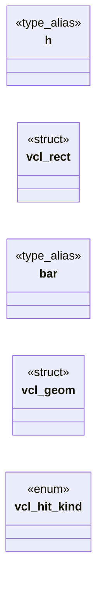

# `include/video_controls.h`

> Source: [include/video_controls.h:1](../../include/video_controls.h#L1) | language `h` | coverage 55.0% | [API index](../index.md)

## Contents

- **Structs:** [`vcl_rect`](#vcl_rect), [`vcl_geom`](#vcl_geom)
- **Enums:** [`vcl_hit_kind`](#vcl_hit_kind)
- **Type Aliases:** [`h`](#h), [`bar`](#bar)
- **Functions:** [`vcl_layout`](#vcl_layout), [`frac`](#frac), [`vcl_seg_duration`](#vcl_seg_duration), [`vcl_total`](#vcl_total), [`start`](#start), [`vcl_segment_start`](#vcl_segment_start), [`vcl_position`](#vcl_position), [`vcl_clamp_frac`](#vcl_clamp_frac), [`vcl_format_time`](#vcl_format_time)
- **Macros:** [`VCL_MIN_W`](#vcl_min_w), [`VCL_PAD`](#vcl_pad), [`VCL_TEXT_W`](#vcl_text_w), [`VCL_MAX_SEGMENT_S`](#vcl_max_segment_s), [`VCL_SEEK_STEP_S`](#vcl_seek_step_s)

## Type Diagram



## Structs

<a id="vcl_rect"></a>

### `vcl_rect`

`struct` | [include/video_controls.h:27](../../include/video_controls.h#L27)

```c
typedef struct vcl_rect { double x, y, w, h; } vcl_rect;
```

---

<a id="vcl_geom"></a>

### `vcl_geom`

`struct` | [include/video_controls.h:29](../../include/video_controls.h#L29)

```c
typedef struct vcl_geom
```

---

## Enums

<a id="vcl_hit_kind"></a>

### `vcl_hit_kind`

`enum` | [include/video_controls.h:38](../../include/video_controls.h#L38)

```c
typedef enum vcl_hit_kind
```

---

## Type Aliases

<a id="h"></a>

### `h`

`type_alias` | [include/video_controls.h:26](../../include/video_controls.h#L26)

```c
typedef struct vcl_rect { double x, y, w, h;
```

arrow keys

---

<a id="bar"></a>

### `bar`

`type_alias` | [include/video_controls.h:28](../../include/video_controls.h#L28)

```c
typedef struct vcl_geom { vcl_rect bar;
```

---

## Functions

<a id="vcl_layout"></a>

### `vcl_layout`

`function` | [include/video_controls.h:47](../../include/video_controls.h#L47)

```c
int vcl_layout(double x, double y, double w, double h, vcl_geom *g);
```

Lays out the bar inside the video rect (x,y,w,h).

Returns 1 and fills *g, or 0 (and zeroes *g) when the rect is too small or not finite: then there is no bar.

**Parameters**

| Name | Type | Default | Description |
|---|---|---|---|
| `x` | `double` |  |  |
| `y` | `double` |  |  |
| `w` | `double` |  |  |
| `h` | `double` |  |  |
| `g` | `vcl_geom *` |  |  |

**Returns:** `int`

---

<a id="frac"></a>

### `frac`

`function` | [include/video_controls.h:50](../../include/video_controls.h#L50)

```c
* *frac (may be NULL) receives the track position for VCL_HIT_SEEK, else 0. */ vcl_hit_kind vcl_hit(const vcl_geom *g, const vcl_rect *video, double px, double py, double *frac);
```

**Parameters**

| Name | Type | Default | Description |
|---|---|---|---|
| `NULL` | `may be` |  |  |

**Returns:** `* *`

---

<a id="vcl_seg_duration"></a>

### `vcl_seg_duration`

`function` | [include/video_controls.h:55](../../include/video_controls.h#L55)

```c
double vcl_seg_duration(double d);
```

Sanitised duration of one segment: non-finite or negative => 0, capped.

**Parameters**

| Name | Type | Default | Description |
|---|---|---|---|
| `d` | `double` |  |  |

**Returns:** `double`

---

<a id="vcl_total"></a>

### `vcl_total`

`function` | [include/video_controls.h:58](../../include/video_controls.h#L58)

```c
double vcl_total(const hls_playlist *pl);
```

Total duration in seconds (0 for NULL/empty).

Always finite.

**Parameters**

| Name | Type | Default | Description |
|---|---|---|---|
| `pl` | `hls_playlist *` |  |  |

**Returns:** `double`

---

<a id="start"></a>

### `start`

`function` | [include/video_controls.h:61](../../include/video_controls.h#L61)

```c
* in *start (may be NULL). NULL/empty playlist => 0 and *start = 0. */ size_t vcl_segment_at(const hls_playlist *pl, double t, double *start);
```

**Parameters**

| Name | Type | Default | Description |
|---|---|---|---|
| `NULL` | `may be` |  |  |

**Returns:** `* in *`

*Called by:* [`main`](src.freedom.c.md#main)

---

<a id="vcl_segment_start"></a>

### `vcl_segment_start`

`function` | [include/video_controls.h:65](../../include/video_controls.h#L65)

```c
double vcl_segment_start(const hls_playlist *pl, size_t idx);
```

Start time (s) of segment idx (clamped).

**Parameters**

| Name | Type | Default | Description |
|---|---|---|---|
| `pl` | `hls_playlist *` |  |  |
| `idx` | `size_t` |  |  |

**Returns:** `double`

---

<a id="vcl_position"></a>

### `vcl_position`

`function` | [include/video_controls.h:68](../../include/video_controls.h#L68)

```c
double vcl_position(double base_s, int64_t pts0_us, int64_t pts_us, double total);
```

Playback position: base_s + (pts_us - pts0_us)/1e6, clamped to [0,total].

**Parameters**

| Name | Type | Default | Description |
|---|---|---|---|
| `base_s` | `double` |  |  |
| `pts0_us` | `int64_t` |  |  |
| `pts_us` | `int64_t` |  |  |
| `total` | `double` |  |  |

**Returns:** `double`

---

<a id="vcl_clamp_frac"></a>

### `vcl_clamp_frac`

`function` | [include/video_controls.h:71](../../include/video_controls.h#L71)

```c
double vcl_clamp_frac(double f);
```

Clamps a seek fraction to [0,1]; NaN => 0.

**Parameters**

| Name | Type | Default | Description |
|---|---|---|---|
| `f` | `double` |  |  |

**Returns:** `double`

---

<a id="vcl_format_time"></a>

### `vcl_format_time`

`function` | [include/video_controls.h:75](../../include/video_controls.h#L75)

```c
size_t vcl_format_time(double seconds, char *buf, size_t cap);
```

Writes "m:ss" (or "h:mm:ss" from one hour) into buf; returns the length, or 0 when buf is NULL/too small (buf then holds "" when cap > 0).

Negative/NaN => 0:00.

**Parameters**

| Name | Type | Default | Description |
|---|---|---|---|
| `seconds` | `double` |  |  |
| `buf` | `char *` |  |  |
| `cap` | `size_t` |  |  |

**Returns:** `size_t`

---

## Macros

<a id="vcl_min_w"></a>

### `VCL_MIN_W`

`macro` | [include/video_controls.h:19](../../include/video_controls.h#L19)

```c
#define VCL_MIN_W
```

bar height, px

---

<a id="vcl_pad"></a>

### `VCL_PAD`

`macro` | [include/video_controls.h:21](../../include/video_controls.h#L21)

```c
#define VCL_PAD
```

shorter video rect: no bar

---

<a id="vcl_text_w"></a>

### `VCL_TEXT_W`

`macro` | [include/video_controls.h:22](../../include/video_controls.h#L22)

```c
#define VCL_TEXT_W
```

---

<a id="vcl_max_segment_s"></a>

### `VCL_MAX_SEGMENT_S`

`macro` | [include/video_controls.h:24](../../include/video_controls.h#L24)

```c
#define VCL_MAX_SEGMENT_S
```

---

<a id="vcl_seek_step_s"></a>

### `VCL_SEEK_STEP_S`

`macro` | [include/video_controls.h:25](../../include/video_controls.h#L25)

```c
#define VCL_SEEK_STEP_S
```

one hostile #EXTINF counts at most 24 h

---
