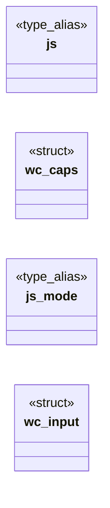

# `include/webcaps.h`

> Source: [include/webcaps.h:1](../../include/webcaps.h#L1) | language `h` | coverage 80.0% | [API index](../index.md)

## Contents

- **Structs:** [`wc_caps`](#wc_caps), [`wc_input`](#wc_input)
- **Type Aliases:** [`js`](#js), [`js_mode`](#js_mode)

## Type Diagram



## Structs

<a id="wc_caps"></a>

### `wc_caps`

`struct` | [include/webcaps.h:38](../../include/webcaps.h#L38)

```c
typedef struct wc_caps
```

Full capability table for one page.

The zero value ({0}) is the safe baseline: every capability off. Only an explicit derivation turns a field on, keeping every opt-in auditable.

---

<a id="wc_input"></a>

### `wc_input`

`struct` | [include/webcaps.h:57](../../include/webcaps.h#L57)

```c
typedef struct wc_input
```

Per-host derivation inputs (GUI path). host_in_js / host_in_allow are nonzero iff the page host is on js.conf / allow.conf (e.g. hb_is_allowlisted, subdomain-aware). user_css / user_images are the user's session toggles; reader is distraction-free (reader) mode.

---

## Type Aliases

<a id="js"></a>

### `js`

`type_alias` | [include/webcaps.h:38](../../include/webcaps.h#L38)

```c
typedef struct wc_caps { /* leak-free (global): granted by user toggle or allow.conf presentation-trust. */ bool js;
```

Full capability table for one page.

The zero value ({0}) is the safe baseline: every capability off. Only an explicit derivation turns a field on, keeping every opt-in auditable.

---

<a id="js_mode"></a>

### `js_mode`

`type_alias` | [include/webcaps.h:57](../../include/webcaps.h#L57)

```c
typedef struct wc_input { jsp_mode js_mode;
```

Per-host derivation inputs (GUI path). host_in_js / host_in_allow are nonzero iff the page host is on js.conf / allow.conf (e.g. hb_is_allowlisted, subdomain-aware). user_css / user_images are the user's session toggles; reader is distraction-free (reader) mode.

---
