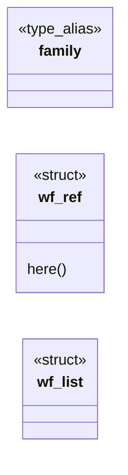

# `include/webfont.h`

> Source: [include/webfont.h:1](../../include/webfont.h#L1) | language `h` | coverage 17.6% | [API index](../index.md)

## Contents

- **Structs:** [`wf_ref`](#wf_ref), [`wf_list`](#wf_list)
- **Type Aliases:** [`family`](#family)
- **Functions:** [`wf_scan`](#wf_scan), [`wf_list_free`](#wf_list_free), [`boundaries`](#boundaries), [`wf_supported_format`](#wf_supported_format), [`wf_name_hash`](#wf_name_hash)
- **Macros:** [`WF_FAMILY_MAX`](#wf_family_max), [`WF_URL_MAX`](#wf_url_max), [`WF_FORMAT_MAX`](#wf_format_max), [`WF_MAX_REFS`](#wf_max_refs), [`WF_MAX_FACE_BYTES`](#wf_max_face_bytes), [`WF_MAX_TOTAL_BYTES`](#wf_max_total_bytes), [`WF_DATA_URL_MAX`](#wf_data_url_max)

## Type Diagram



## Structs

<a id="wf_ref"></a>

### `wf_ref`

`struct` | [include/webfont.h:31](../../include/webfont.h#L31)

```c
typedef struct wf_ref
```

**Members**

| Member | Kind | Summary |
|---|---|---|
| [`here`](#wf_ref-here) | method |  |

<a id="wf_ref-here"></a>

#### `wf_ref.here`

`method` | [include/webfont.h:38](../../include/webfont.h#L38)

```c
* set with the decoded bytes owned here (freed by wf_list_free);
```

**Parameters**

| Name | Type | Default | Description |
|---|---|---|---|
| `wf_list_free` | `freed by` |  |  |

**Returns:** `* set with the decoded bytes owned`

---

<a id="wf_list"></a>

### `wf_list`

`struct` | [include/webfont.h:46](../../include/webfont.h#L46)

```c
typedef struct wf_list
```

---

## Type Aliases

<a id="family"></a>

### `family`

`type_alias` | [include/webfont.h:30](../../include/webfont.h#L30)

```c
typedef struct wf_ref { char family[WF_FAMILY_MAX];
```

Upper bound on a data: font URL string: it must decode within the face cap (base64 inflates 4/3), plus scheme/mime slack.

Longer is rejected before * decoding (fail closed, no big allocation). define WF_DATA_URL_MAX ((WF_MAX_FACE_BYTES * 4u) / 3u + 256u)

---

## Functions

<a id="wf_scan"></a>

### `wf_scan`

`function` | [include/webfont.h:52](../../include/webfont.h#L52)

```c
int wf_scan(const char *css, size_t len, wf_list *out);
```

**Parameters**

| Name | Type | Default | Description |
|---|---|---|---|
| `css` | `char *` |  |  |
| `len` | `size_t` |  |  |
| `out` | `wf_list *` |  |  |

**Returns:** `int`

*Called by:* [`LLVMFuzzerTestOneInput`](fuzz.fuzz_webfont.c.md#llvmfuzzertestoneinput), [`wf_load_document`](src.webfont_load.c.md#wf_load_document)

---

<a id="wf_list_free"></a>

### `wf_list_free`

`function` | [include/webfont.h:53](../../include/webfont.h#L53)

```c
void wf_list_free(wf_list *l);
```

**Parameters**

| Name | Type | Default | Description |
|---|---|---|---|
| `l` | `wf_list *` |  |  |

*Called by:* [`LLVMFuzzerTestOneInput`](fuzz.fuzz_webfont.c.md#llvmfuzzertestoneinput), [`wf_load_document`](src.webfont_load.c.md#wf_load_document)

---

<a id="boundaries"></a>

### `boundaries`

`function` | [include/webfont.h:57](../../include/webfont.h#L57)

```c
* boundaries (scan_inline accumulation, loader collection). */ void wf_ref_move(wf_ref *dst, wf_ref *src);
```

**Parameters**

| Name | Type | Default | Description |
|---|---|---|---|
| `accumulation` | `scan_inline` |  |  |
| `collection` | `loader` |  |  |

**Returns:** `*`

---

<a id="wf_supported_format"></a>

### `wf_supported_format`

`function` | [include/webfont.h:60](../../include/webfont.h#L60)

```c
int wf_supported_format(const char *fmt);
```

**Parameters**

| Name | Type | Default | Description |
|---|---|---|---|
| `fmt` | `char *` |  |  |

**Returns:** `int`

*Called by:* [`WF_DATA_URL_MAX`](src.webfont_load.c.md#wf_data_url_max)

---

<a id="wf_name_hash"></a>

### `wf_name_hash`

`function` `inline` `static` | [include/webfont.h:69](../../include/webfont.h#L69)

```c
static inline unsigned wf_name_hash(const char *s, size_t n)
```

FNV-1a (32-bit) over s[0,n), lowercased per byte, for author family names.

The worker hashes the cascaded first-name, the parent hashes scanned @font-face families; equal names hash equal on both sides regardless of the author's capitalisation. Empty/NULL hashes to 0 (="no webfont"); a nonempty name that hashes to 0 is remapped to 1 so 0 keeps its single meaning. Pure, no allocation. Static inline (like the csel_* ASCII helpers) so the cascade side needs no new link edge: every css.o consumer already links.

**Parameters**

| Name | Type | Default | Description |
|---|---|---|---|
| `s` | `char *` |  |  |
| `n` | `size_t` |  |  |

**Returns:** `unsigned`

*Called by:* [`tsh_webfont_register`](src.text_shape.c.md#tsh_webfont_register), [`WF_DATA_URL_MAX`](src.webfont_load.c.md#wf_data_url_max)

---

## Macros

<a id="wf_family_max"></a>

### `WF_FAMILY_MAX`

`macro` | [include/webfont.h:20](../../include/webfont.h#L20)

```c
#define WF_FAMILY_MAX
```

---

<a id="wf_url_max"></a>

### `WF_URL_MAX`

`macro` | [include/webfont.h:21](../../include/webfont.h#L21)

```c
#define WF_URL_MAX
```

---

<a id="wf_format_max"></a>

### `WF_FORMAT_MAX`

`macro` | [include/webfont.h:22](../../include/webfont.h#L22)

```c
#define WF_FORMAT_MAX
```

---

<a id="wf_max_refs"></a>

### `WF_MAX_REFS`

`macro` | [include/webfont.h:23](../../include/webfont.h#L23)

```c
#define WF_MAX_REFS
```

---

<a id="wf_max_face_bytes"></a>

### `WF_MAX_FACE_BYTES`

`macro` | [include/webfont.h:24](../../include/webfont.h#L24)

```c
#define WF_MAX_FACE_BYTES
```

---

<a id="wf_max_total_bytes"></a>

### `WF_MAX_TOTAL_BYTES`

`macro` | [include/webfont.h:25](../../include/webfont.h#L25)

```c
#define WF_MAX_TOTAL_BYTES
```

---

<a id="wf_data_url_max"></a>

### `WF_DATA_URL_MAX`

`macro` | [include/webfont.h:29](../../include/webfont.h#L29)

```c
#define WF_DATA_URL_MAX
```

Upper bound on a data: font URL string: it must decode within the face cap (base64 inflates 4/3), plus scheme/mime slack.

Longer is rejected before decoding (fail closed, no big allocation).

---
