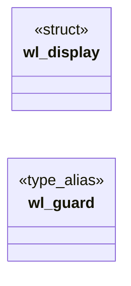

# `include/wl_guard.h`

> Source: [include/wl_guard.h:1](../../include/wl_guard.h#L1) | language `h` | coverage 60.0% | [API index](../index.md)

## Contents

- **Structs:** [`wl_display`](#wl_display)
- **Type Aliases:** [`wl_guard`](#wl_guard)
- **Functions:** [`wlg_start`](#wlg_start), [`wlg_stop`](#wlg_stop)

## Type Diagram



## Structs

<a id="wl_display"></a>

### `wl_display`

`struct` | [include/wl_guard.h:8](../../include/wl_guard.h#L8)

```c
struct wl_display;
```

---

## Type Aliases

<a id="wl_guard"></a>

### `wl_guard`

`type_alias` | [include/wl_guard.h:21](../../include/wl_guard.h#L21)

```c
typedef struct wl_guard wl_guard;
```

wl_guard -- keeps the Wayland connection drained while the GUI thread is busy.

A compositor queues events for a client in a small buffer (4 KiB) backed by the socket; a
client that does not read for a few seconds while the pointer moves gets DISCONNECTED
("libwayland: Data too big for buffer ... error in client communication"). Freedom blocks its
GUI thread on page loads, image fetches and big layouts, so a helper thread reads the socket
meanwhile. It uses libwayland's documented multi-thread pattern: wl_display_prepare_read_queue
on a PRIVATE (always empty) queue, so the events are only enqueued -- every handler still runs
on the GUI thread, in order, when the main loop dispatches. See spec/wl_guard.md.

---

## Functions

<a id="wlg_start"></a>

### `wlg_start`

`function` | [include/wl_guard.h:25](../../include/wl_guard.h#L25)

```c
wl_guard *wlg_start(struct wl_display *display);
```

Starts the helper for `display` (NULL on failure: the GUI then runs unguarded).

**Parameters**

| Name | Type | Default | Description |
|---|---|---|---|
| `display` | `struct wl_display *` |  |  |

**Returns:** `wl_guard *`

---

<a id="wlg_stop"></a>

### `wlg_stop`

`function` | [include/wl_guard.h:28](../../include/wl_guard.h#L28)

```c
void wlg_stop(wl_guard *g);
```

Stops and joins the helper.

Call before wl_display_disconnect. NULL is a no-op.

**Parameters**

| Name | Type | Default | Description |
|---|---|---|---|
| `g` | `wl_guard *` |  |  |

---
