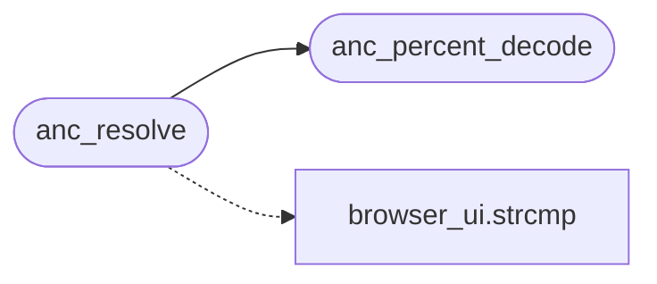

# `src/anchor.c`

> Source: [src/anchor.c:1](../../src/anchor.c#L1) | language `c` | coverage 66.7% | [API index](../index.md)

anchor.c — the indicated part of a document and where it sits (spec/anchor.md).

## Contents

- **Functions:** [`anc_percent_decode`](#anc_percent_decode), [`anc_resolve`](#anc_resolve), [`anc_collect`](#anc_collect), [`anc_target_top`](#anc_target_top), [`anc_scroll_for`](#anc_scroll_for)

## Call Graph

Solid arrows stay in this module, dashed arrows leave it.



## Functions

<a id="anc_percent_decode"></a>

### `anc_percent_decode`

`function` | [src/anchor.c:15](../../src/anchor.c#L15)

```c
size_t anc_percent_decode(const char *in, char *out, size_t cap)
```

**Parameters**

| Name | Type | Default | Description |
|---|---|---|---|
| `in` | `char *` |  |  |
| `out` | `char *` |  |  |
| `cap` | `size_t` |  |  |

**Returns:** `size_t`

*Called by:* [`anc_resolve`](#anc_resolve)

---

<a id="anc_resolve"></a>

### `anc_resolve`

`function` | [src/anchor.c:63](../../src/anchor.c#L63)

```c
anc_kind anc_resolve(const dom_index *idx, const char *fragment, dom_node_id *out)
```

**Parameters**

| Name | Type | Default | Description |
|---|---|---|---|
| `idx` | `dom_index *` |  |  |
| `fragment` | `char *` |  |  |
| `out` | `dom_node_id *` |  |  |

**Returns:** `anc_kind`

*Calls:* [`strcmp`](gui.browser_ui.c.md#strcmp), [`anc_percent_decode`](#anc_percent_decode)

*Called by:* [`LLVMFuzzerTestOneInput`](fuzz.fuzz_anchor.c.md#llvmfuzzertestoneinput)

---

<a id="anc_collect"></a>

### `anc_collect`

`function` | [src/anchor.c:93](../../src/anchor.c#L93)

```c
size_t anc_collect(const dom_index *idx, dom_node_id target, dom_node_id *out, size_t cap, size_t *nsub)
```

Writes target and its element subtree in preorder (*nsub handles), then the elements that follow the subtree in tree order, up to cap handles in all (cap is clamped to ANC_MAX_HANDLES).

Returns the count written; 0 (and *nsub = 0) on NULL arguments, cap 0 or an invalid target.

**Parameters**

| Name | Type | Default | Description |
|---|---|---|---|
| `idx` | `dom_index *` |  |  |
| `target` | `dom_node_id` |  |  |
| `out` | `dom_node_id *` |  |  |
| `cap` | `size_t` |  |  |
| `nsub` | `size_t *` |  |  |

**Returns:** `size_t`

> **Inherited:** Documentation from [`anc_collect`](#anc_collect) (include/anchor.h:50).

---

<a id="anc_target_top"></a>

### `anc_target_top`

`function` | [src/anchor.c:110](../../src/anchor.c#L110)

```c
int anc_target_top(const jg_table *g, const dom_node_id *h, size_t n, size_t nsub, double *top)
```

The document offset of the target from a FINISHED geometry table (jg_finish): the smallest y among the rects of h[0, nsub); when none of them painted, the y of the first of h[nsub, n) that did.

0 and *top on success; -1 (top untouched) when no handle has a rect or an argument is NULL.

**Parameters**

| Name | Type | Default | Description |
|---|---|---|---|
| `g` | `jg_table *` |  |  |
| `h` | `dom_node_id *` |  |  |
| `n` | `size_t` |  |  |
| `nsub` | `size_t` |  |  |
| `top` | `double *` |  |  |

**Returns:** `int`

> **Inherited:** Documentation from [`anc_target_top`](#anc_target_top) (include/anchor.h:57).

---

<a id="anc_scroll_for"></a>

### `anc_scroll_for`

`function` | [src/anchor.c:131](../../src/anchor.c#L131)

```c
double anc_scroll_for(double top, double max_scroll)
```

The scroll offset that puts top at the top of the viewport, clamped to [0, max_scroll].

Non-finite arguments or max_scroll < 0 => 0.

**Parameters**

| Name | Type | Default | Description |
|---|---|---|---|
| `top` | `double` |  |  |
| `max_scroll` | `double` |  |  |

**Returns:** `double`

> **Inherited:** Documentation from [`anc_scroll_for`](#anc_scroll_for) (include/anchor.h:62).

---
