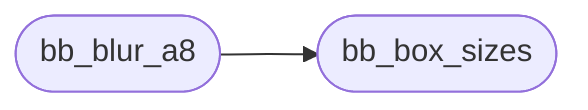

# `src/box_blur.c`

> Source: [src/box_blur.c:1](../../src/box_blur.c#L1) | language `c` | coverage 25.0% | [API index](../index.md)

## Contents

- **Functions:** [`bb_box_sizes`](#bb_box_sizes), [`variance`](#variance), [`bb_blur_a8`](#bb_blur_a8)

## Call Graph

Solid arrows stay in this module, dashed arrows leave it.



## Functions

<a id="bb_box_sizes"></a>

### `bb_box_sizes`

`function` | [src/box_blur.c:7](../../src/box_blur.c#L7)

```c
int bb_box_sizes(double sigma, int sizes[3])
```

The three odd box widths approximating a Gaussian of standard deviation sigma.

Returns 0 (sizes untouched) when sigma is not finite or <= 0, else 1.

**Parameters**

| Name | Type | Default | Description |
|---|---|---|---|
| `sigma` | `double` |  |  |
| `sizes` | `int [3]` |  |  |

**Returns:** `int`

> **Inherited:** Documentation from [`bb_box_sizes`](#bb_box_sizes) (include/box_blur.h:16).

*Called by:* [`bb_blur_a8`](#bb_blur_a8)

---

<a id="variance"></a>

### `variance`

`function` | [src/box_blur.c:10](../../src/box_blur.c#L10)

```c
* width w has variance (w^2 - 1) / 12): the ideal common width, rounded down * to an odd wl and up to wu = wl + 2, mixed so the sum lands on sigma^2. */ double wideal = sqrt(12.0 * sigma * sigma / 3.0
```

**Parameters**

| Name | Type | Default | Description |
|---|---|---|---|
| `w` |  |  |  |

**Returns:** `* width w has`

---

<a id="bb_blur_a8"></a>

### `bb_blur_a8`

`function` | [src/box_blur.c:41](../../src/box_blur.c#L41)

```c
int bb_blur_a8(unsigned char *buf, int w, int h, int stride, double sigma)
```

**Parameters**

| Name | Type | Default | Description |
|---|---|---|---|
| `buf` | `unsigned char *` |  |  |
| `w` | `int` |  |  |
| `h` | `int` |  |  |
| `stride` | `int` |  |  |
| `sigma` | `double` |  |  |

**Returns:** `int`

*Calls:* [`bb_box_sizes`](#bb_box_sizes)

---
