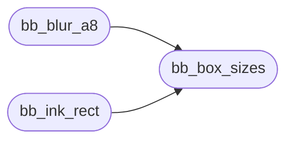

# `src/box_blur.c`

> Source: [src/box_blur.c:1](../../src/box_blur.c#L1) | language `c` | coverage 33.3% | [API index](../index.md)

## Contents

- **Functions:** [`bb_box_sizes`](#bb_box_sizes), [`variance`](#variance), [`bb_blur_a8`](#bb_blur_a8), [`bb_ink_rect`](#bb_ink_rect)
- **Macros:** [`BB_BOX_MAX`](#bb_box_max)

## Call Graph

Solid arrows stay in this module, dashed arrows leave it.



## Functions

<a id="bb_box_sizes"></a>

### `bb_box_sizes`

`function` | [src/box_blur.c:8](../../src/box_blur.c#L8)

```c
int bb_box_sizes(double sigma, int sizes[3])
```

The three odd box widths approximating a Gaussian of standard deviation sigma.

Returns 0 (sizes untouched) when sigma is not finite or <= 0, else 1.

**Parameters**

| Name | Type | Default | Description |
|---|---|---|---|
| `sigma` | `double` |  |  |
| `sizes` | `int [3]` |  |  |

**Returns:** `int`

> **Inherited:** Documentation from [`bb_box_sizes`](#bb_box_sizes) (include/box_blur.h:16).

*Called by:* [`bb_blur_a8`](#bb_blur_a8), [`bb_ink_rect`](#bb_ink_rect)

---

<a id="variance"></a>

### `variance`

`function` | [src/box_blur.c:11](../../src/box_blur.c#L11)

```c
* width w has variance (w^2 - 1) / 12): the ideal common width, rounded down * to an odd wl and up to wu = wl + 2, mixed so the sum lands on sigma^2. */ double wideal = sqrt(12.0 * sigma * sigma / 3.0
```

**Parameters**

| Name | Type | Default | Description |
|---|---|---|---|
| `w` |  |  |  |

**Returns:** `* width w has`

---

<a id="bb_blur_a8"></a>

### `bb_blur_a8`

`function` | [src/box_blur.c:82](../../src/box_blur.c#L82)

```c
int bb_blur_a8(unsigned char *buf, int w, int h, int stride, double sigma)
```

**Parameters**

| Name | Type | Default | Description |
|---|---|---|---|
| `buf` | `unsigned char *` |  |  |
| `w` | `int` |  |  |
| `h` | `int` |  |  |
| `stride` | `int` |  |  |
| `sigma` | `double` |  |  |

**Returns:** `int`

*Calls:* [`bb_box_sizes`](#bb_box_sizes)

*Called by:* [`LLVMFuzzerTestOneInput`](fuzz.fuzz_box_blur.c.md#llvmfuzzertestoneinput)

---

<a id="bb_ink_rect"></a>

### `bb_ink_rect`

`function` | [src/box_blur.c:102](../../src/box_blur.c#L102)

```c
int bb_ink_rect(const unsigned char *argb, int w, int h, int stride, double sigma, int rect[4])
```

**Parameters**

| Name | Type | Default | Description |
|---|---|---|---|
| `argb` | `unsigned char *` |  |  |
| `w` | `int` |  |  |
| `h` | `int` |  |  |
| `stride` | `int` |  |  |
| `sigma` | `double` |  |  |
| `rect` | `int [4]` |  |  |

**Returns:** `int`

*Calls:* [`bb_box_sizes`](#bb_box_sizes)

---

## Macros

<a id="bb_box_max"></a>

### `BB_BOX_MAX`

`macro` | [src/box_blur.c:31](../../src/box_blur.c#L31)

```c
#define BB_BOX_MAX
```

floor((sum + bw/2) / bw) without a division: m = floor(2^32 / bw) + 1 makes (n * m) >> 32 exact for every n < 2^32 / bw (Granlund-Montgomery), and here n <= 256 * bw with bw < BB_BOX_MAX, so 256 * bw^2 < 2^32 holds.

The byte-for-byte test against the division keeps it honest.

---
