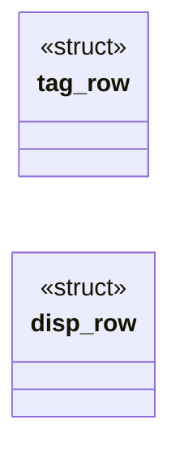
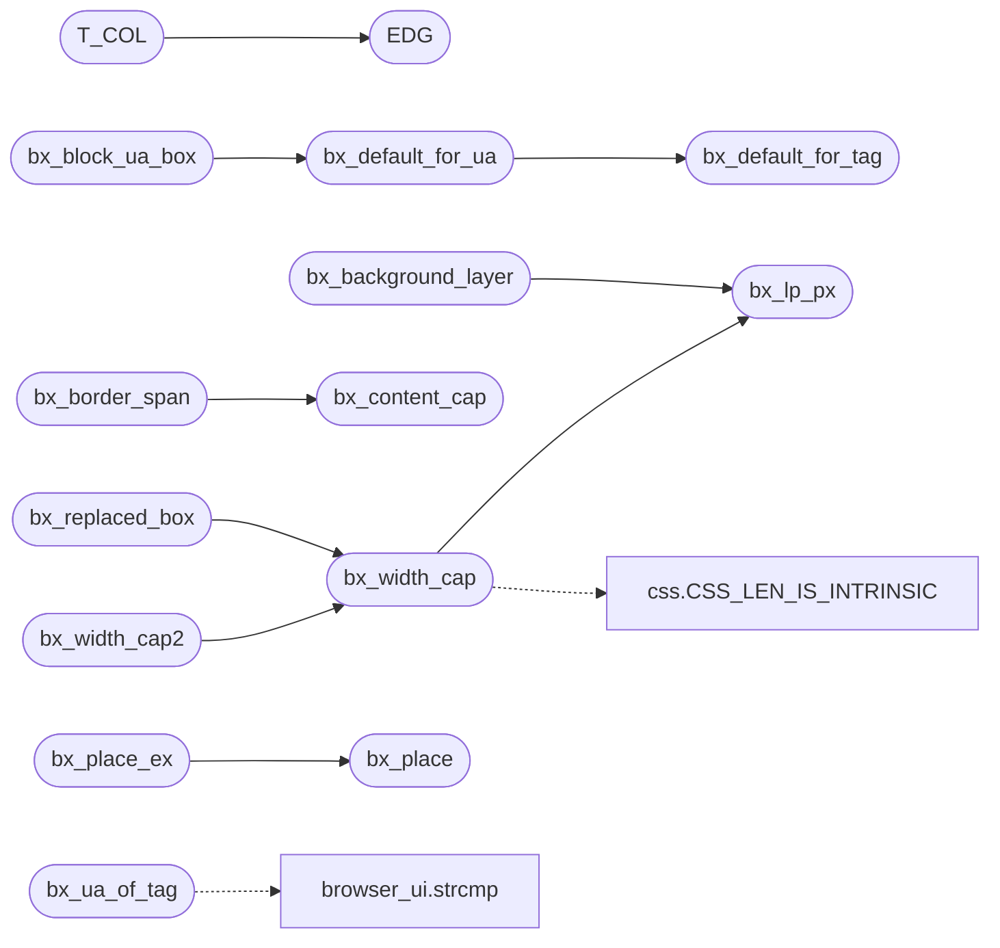

# `src/box_style.c`

> Source: [src/box_style.c:1](../../src/box_style.c#L1) | language `c` | coverage 31.8% | [API index](../index.md)

## Contents

- **Structs:** [`tag_row`](#tag_row), [`disp_row`](#disp_row)
- **Functions:** [`bx_default_for_tag`](#bx_default_for_tag), [`bx_table_role_of`](#bx_table_role_of), [`bx_ua_of_tag`](#bx_ua_of_tag), [`bx_default_for_ua`](#bx_default_for_ua), [`bx_block_ua_box`](#bx_block_ua_box), [`bx_parse_display`](#bx_parse_display), [`bx_place`](#bx_place), [`bx_width_cap`](#bx_width_cap), [`take`](#take), [`bx_width_cap2`](#bx_width_cap2), [`bx_replaced_box`](#bx_replaced_box), [`bx_border_box_h`](#bx_border_box_h), [`bx_pct_block_size`](#bx_pct_block_size), [`bx_definite_content_h`](#bx_definite_content_h), [`bx_content_clipped`](#bx_content_clipped), [`bx_lp_px`](#bx_lp_px), [`bx_content_cap`](#bx_content_cap), [`bx_flex_min_clamp`](#bx_flex_min_clamp), [`bx_border_span`](#bx_border_span), [`bx_background_layer`](#bx_background_layer), [`bx_display_name`](#bx_display_name), [`bx_flex_max_clamp`](#bx_flex_max_clamp), [`bx_place_ex`](#bx_place_ex)
- **Macros:** [`BX_TAG_MAX`](#bx_tag_max), [`BX_DISPLAY_MAX`](#bx_display_max), [`BLOCK`](#block), [`INLINE`](#inline), [`IBLOCK`](#iblock), [`LITEM`](#litem), [`NONE`](#none), [`EDG`](#edg), [`ZERO`](#zero), [`T_NO`](#t_no), [`T_TBL`](#t_tbl), [`T_GRP`](#t_grp), [`T_ROW`](#t_row), [`T_CELL`](#t_cell), [`T_CAP`](#t_cap), [`T_COL`](#t_col), [`TAG_N`](#tag_n), [`DISP_N`](#disp_n)

## Type Diagram



## Call Graph

Solid arrows stay in this module, dashed arrows leave it.



## Structs

<a id="tag_row"></a>

### `tag_row`

`struct` | [src/box_style.c:61](../../src/box_style.c#L61)

```c
typedef struct tag_row
```

One row of the user-agent sheet.

`role` is the table role the UA sheet assigns the tag (CSS 2.1 17.2: `table{display:table}`, `td{display:table-cell}`, ...); it stays on the SAME row as the metrics so the sheet keeps one source of truth per tag. Rows that omit it get BX_TROLE_NONE from aggregate zero-init, which is the correct answer for every non-table element.

---

<a id="disp_row"></a>

### `disp_row`

`struct` | [src/box_style.c:241](../../src/box_style.c#L241)

```c
typedef struct disp_row
```

---

## Functions

<a id="bx_default_for_tag"></a>

### `bx_default_for_tag`

`function` | [src/box_style.c:163](../../src/box_style.c#L163)

```c
bx_box bx_default_for_tag(const char *tag)
```

**Parameters**

| Name | Type | Default | Description |
|---|---|---|---|
| `tag` | `char *` |  |  |

**Returns:** `bx_box`

*Called by:* [`bx_default_for_ua`](#bx_default_for_ua)

---

<a id="bx_table_role_of"></a>

### `bx_table_role_of`

`function` | [src/box_style.c:171](../../src/box_style.c#L171)

```c
bx_table_role bx_table_role_of(const char *tag, css_display display)
```

**Parameters**

| Name | Type | Default | Description |
|---|---|---|---|
| `tag` | `char *` |  |  |
| `display` | `css_display` |  |  |

**Returns:** `bx_table_role`

---

<a id="bx_ua_of_tag"></a>

### `bx_ua_of_tag`

`function` | [src/box_style.c:210](../../src/box_style.c#L210)

```c
bx_ua_tag bx_ua_of_tag(const char *tag)
```

**Parameters**

| Name | Type | Default | Description |
|---|---|---|---|
| `tag` | `char *` |  |  |

**Returns:** `bx_ua_tag`

*Calls:* [`strcmp`](gui.browser_ui.c.md#strcmp)

---

<a id="bx_default_for_ua"></a>

### `bx_default_for_ua`

`function` | [src/box_style.c:219](../../src/box_style.c#L219)

```c
bx_box bx_default_for_ua(bx_ua_tag id)
```

**Parameters**

| Name | Type | Default | Description |
|---|---|---|---|
| `id` | `bx_ua_tag` |  |  |

**Returns:** `bx_box`

*Calls:* [`bx_default_for_tag`](#bx_default_for_tag)

*Called by:* [`bx_block_ua_box`](#bx_block_ua_box)

---

<a id="bx_block_ua_box"></a>

### `bx_block_ua_box`

`function` | [src/box_style.c:225](../../src/box_style.c#L225)

```c
bx_box bx_block_ua_box(int heading_level, int in_list, bx_ua_tag ua)
```

**Parameters**

| Name | Type | Default | Description |
|---|---|---|---|
| `heading_level` | `int` |  |  |
| `in_list` | `int` |  |  |
| `ua` | `bx_ua_tag` |  |  |

**Returns:** `bx_box`

*Calls:* [`bx_default_for_ua`](#bx_default_for_ua)

---

<a id="bx_parse_display"></a>

### `bx_parse_display`

`function` | [src/box_style.c:261](../../src/box_style.c#L261)

```c
bx_status bx_parse_display(const char *token, bx_display *out)
```

**Parameters**

| Name | Type | Default | Description |
|---|---|---|---|
| `token` | `char *` |  |  |
| `out` | `bx_display *` |  |  |

**Returns:** `bx_status`

---

<a id="bx_place"></a>

### `bx_place`

`function` | [src/box_style.c:271](../../src/box_style.c#L271)

```c
bx_hplace bx_place(double inset_l, double inset_r, double width_cap, int center, double avail_w)
```

**Parameters**

| Name | Type | Default | Description |
|---|---|---|---|
| `inset_l` | `double` |  |  |
| `inset_r` | `double` |  |  |
| `width_cap` | `double` |  |  |
| `center` | `int` |  |  |
| `avail_w` | `double` |  |  |

**Returns:** `bx_hplace`

*Called by:* [`bx_place_ex`](#bx_place_ex)

---

<a id="bx_width_cap"></a>

### `bx_width_cap`

`function` | [src/box_style.c:288](../../src/box_style.c#L288)

```c
double bx_width_cap(int w_px, int w_pct, double avail_w)
```

Effective width cap combining the px cap (w_px, 0 = none) with a symbolic per-mille cap (w_pct, 0 = none; Hito 32) resolved against the real available width: both set => the tighter wins; neither (or avail_w <= 0 for the pct) => 0 (no cap).

Never negative. Pure.

**Parameters**

| Name | Type | Default | Description |
|---|---|---|---|
| `w_px` | `int` |  |  |
| `w_pct` | `int` |  |  |
| `avail_w` | `double` |  |  |

**Returns:** `double`

> **Inherited:** Documentation from [`bx_width_cap`](#bx_width_cap) (include/box_style.h:182).

*Calls:* [`CSS_LEN_IS_INTRINSIC`](include.css.h.md#css_len_is_intrinsic), [`bx_lp_px`](#bx_lp_px)

*Called by:* [`bx_replaced_box`](#bx_replaced_box), [`bx_width_cap2`](#bx_width_cap2)

---

<a id="take"></a>

### `take`

`function` | [src/box_style.c:295](../../src/box_style.c#L295)

```c
* caller has to take (Sizing 3 section 5.1), so to a resolver that only sums a * px and a percentage half they read exactly like `auto` -- no declared width. * Letting the sentinel through would have
```

**Parameters**

| Name | Type | Default | Description |
|---|---|---|---|
| `section` | `Sizing 3 5.1` |  |  |

**Returns:** `* caller has to`

---

<a id="bx_width_cap2"></a>

### `bx_width_cap2`

`function` | [src/box_style.c:313](../../src/box_style.c#L313)

```c
double bx_width_cap2(int w_px, int w_pct, int mw_px, int mw_pct, double avail_w)
```

The used width cap of an element: the tighter of its `width` (w_px, w_pct) and its `max-width` (mw_px, mw_pct), each one <length-percentage> resolved on its own by bx_width_cap; 0 = neither declared.

Pure.

**Parameters**

| Name | Type | Default | Description |
|---|---|---|---|
| `w_px` | `int` |  |  |
| `w_pct` | `int` |  |  |
| `mw_px` | `int` |  |  |
| `mw_pct` | `int` |  |  |
| `avail_w` | `double` |  |  |

**Returns:** `double`

> **Inherited:** Documentation from [`bx_width_cap2`](#bx_width_cap2) (include/box_style.h:187).

*Calls:* [`bx_width_cap`](#bx_width_cap)

---

<a id="bx_replaced_box"></a>

### `bx_replaced_box`

`function` | [src/box_style.c:321](../../src/box_style.c#L321)

```c
int bx_replaced_box(int w_px, int w_pct, int aspect_num, int aspect_den, double avail_w, double *out_w, double *out_h)
```

The used BOX of a replaced element (image/video) that has no intrinsic pixel size of its own -- because it did not load, or was never allowed to.

CSS Sizing 4 section 4: when one axis is definite and an aspect-ratio is present,
the ratio supplies the other. That is what makes a blocked thumbnail keep the
shape the author reserved for it instead of collapsing to a text-height bar and
letting its `alt` reflow the page. Freedom renders this case by default (images
off; third-party images blocked even when on), so it is the common path, not an
edge case.

w_px / w_pct are the declared width's two halves (CSS_LEN_UNSET / 0 for absent),
resolved against avail_w exactly like every other <length-percentage>.
aspect_num / aspect_den are the ratio x1000 (0 = none).

Returns 1 and writes *out_w / *out_h only when BOTH a positive used width and a
usable ratio are available; otherwise returns 0 and touches nothing, leaving the
caller's own fallback in place rather than inventing a height. Pure.

**Parameters**

| Name | Type | Default | Description |
|---|---|---|---|
| `w_px` | `int` |  |  |
| `w_pct` | `int` |  |  |
| `aspect_num` | `int` |  |  |
| `aspect_den` | `int` |  |  |
| `avail_w` | `double` |  |  |
| `out_w` | `double *` |  |  |
| `out_h` | `double *` |  |  |

**Returns:** `int`

> **Inherited:** Documentation from [`bx_replaced_box`](#bx_replaced_box) (include/box_style.h:206).

*Calls:* [`bx_width_cap`](#bx_width_cap)

---

<a id="bx_border_box_h"></a>

### `bx_border_box_h`

`function` | [src/box_style.c:335](../../src/box_style.c#L335)

```c
double bx_border_box_h(double declared_h, int border_box, double pad_t, double pad_b, double bord_t, double bord_b)
```

Border-box height for a DECLARED height under box-sizing (CSS 2.1 10.6.3, CSS Box Sizing 3 section 4).

With content-box -- the CSS default, so the common case -- `height` sizes the CONTENT, and the vertical padding and border sit OUTSIDE it: a `height:60px; padding:2%` box is taller than 60px. With border-box the declared height already includes them and this is the identity. Negative edges are treated as 0; the result is never negative.

The horizontal twin is bx_content_cap, which converts the other way (a
declared border-box WIDTH into the content width cap) because widths are
capped and heights are set. Pure.

**Parameters**

| Name | Type | Default | Description |
|---|---|---|---|
| `declared_h` | `double` |  |  |
| `border_box` | `int` |  |  |
| `pad_t` | `double` |  |  |
| `pad_b` | `double` |  |  |
| `bord_t` | `double` |  |  |
| `bord_b` | `double` |  |  |

**Returns:** `double`

> **Inherited:** Documentation from [`bx_border_box_h`](#bx_border_box_h) (include/box_style.h:220).

---

<a id="bx_pct_block_size"></a>

### `bx_pct_block_size`

`function` | [src/box_style.c:346](../../src/box_style.c#L346)

```c
double bx_pct_block_size(int px_val, int pct_pm, double cb_h)
```

**Parameters**

| Name | Type | Default | Description |
|---|---|---|---|
| `px_val` | `int` |  |  |
| `pct_pm` | `int` |  |  |
| `cb_h` | `double` |  |  |

**Returns:** `double`

---

<a id="bx_definite_content_h"></a>

### `bx_definite_content_h`

`function` | [src/box_style.c:352](../../src/box_style.c#L352)

```c
double bx_definite_content_h(double h, double min_h, double max_h, int border_box, double v_edges)
```

The definite CONTENT height an element hands its children as their percentage basis: its used height h clamped by min_h/max_h (< 0 = none; min wins over max, CSS 2.1 10.7), minus v_edges (vertical padding + border) under border-box, never negative. -1 when h < 0 (auto): a min-height alone does not make a height definite.

Pure.

**Parameters**

| Name | Type | Default | Description |
|---|---|---|---|
| `h` | `double` |  |  |
| `min_h` | `double` |  |  |
| `max_h` | `double` |  |  |
| `border_box` | `int` |  |  |
| `v_edges` | `double` |  |  |

**Returns:** `double`

> **Inherited:** Documentation from [`bx_definite_content_h`](#bx_definite_content_h) (include/box_style.h:235).

---

<a id="bx_content_clipped"></a>

### `bx_content_clipped`

`function` | [src/box_style.c:361](../../src/box_style.c#L361)

```c
int bx_content_clipped(int overflow_x, int overflow_y)
```

**Parameters**

| Name | Type | Default | Description |
|---|---|---|---|
| `overflow_x` | `int` |  |  |
| `overflow_y` | `int` |  |  |

**Returns:** `int`

---

<a id="bx_lp_px"></a>

### `bx_lp_px`

`function` | [src/box_style.c:367](../../src/box_style.c#L367)

```c
double bx_lp_px(int px_val, int pct_pm, double basis)
```

Used px value of a <length-percentage> (CSS Values 4 section 5.3): the px half plus pct_pm per-mille of [`basis`](include.flex_layout.h.md#basis).

This is the ONLY place the engine turns a percentage into pixels, and the rule is the whole of it -- there is no clamping, no minimum and no special case here, because none of those are properties of the value type.

[`basis`](include.flex_layout.h.md#basis) is the containing-block dimension the property resolves against.
Which dimension that is belongs to the caller and is NOT symmetric: CSS 2.1
sections 8.3/8.4 resolve ALL FOUR margin and padding percentages against the
containing block WIDTH, padding-top and padding-bottom included. The full
property -> basis table is spec/css_length.md section 7.3.

px_val may carry a CSS_LEN_UNSET/CSS_LEN_AUTO sentinel, which contributes 0
(a percentage-only value states no absolute length). A basis that is not a
usable length contributes nothing while the absolute half survives. Pure.

**Parameters**

| Name | Type | Default | Description |
|---|---|---|---|
| `px_val` | `int` |  |  |
| `pct_pm` | `int` |  |  |
| `basis` | `double` |  |  |

**Returns:** `double`

> **Inherited:** Documentation from [`bx_lp_px`](#bx_lp_px) (include/box_style.h:261).

*Called by:* [`bx_background_layer`](#bx_background_layer), [`bx_width_cap`](#bx_width_cap)

---

<a id="bx_content_cap"></a>

### `bx_content_cap`

`function` | [src/box_style.c:378](../../src/box_style.c#L378)

```c
double bx_content_cap(double width_cap, int border_box, double pad_l, double pad_r, double bord_l, double bord_r)
```

Content-width cap adjusted for box-sizing (2026-07-11).

With border_box set, the declared width includes the horizontal padding and border, so the cap on the CONTENT is width_cap minus those edges, clamped >= 1 (a border-box narrower than its own edges never yields a negative width). border_box == 0 (content-box or unset) or width_cap <= 0 (no cap) are the identity. Negative edges are treated as 0. Pure.

**Parameters**

| Name | Type | Default | Description |
|---|---|---|---|
| `width_cap` | `double` |  |  |
| `border_box` | `int` |  |  |
| `pad_l` | `double` |  |  |
| `pad_r` | `double` |  |  |
| `bord_l` | `double` |  |  |
| `bord_r` | `double` |  |  |

**Returns:** `double`

> **Inherited:** Documentation from [`bx_content_cap`](#bx_content_cap) (include/box_style.h:269).

*Called by:* [`bx_border_span`](#bx_border_span)

---

<a id="bx_flex_min_clamp"></a>

### `bx_flex_min_clamp`

`function` | [src/box_style.c:389](../../src/box_style.c#L389)

```c
double bx_flex_min_clamp(double outer_basis, double min_w, int border_box, double pad_bord_h, double margin_h)
```

The min-width half of the same clamp (Flexbox 9.2.3): an outer base below the item's min-width (converted to the outer size per box-sizing, plus margins) is raised to it. min_w <= 0 (unset) returns the base unchanged.

Pure.

**Parameters**

| Name | Type | Default | Description |
|---|---|---|---|
| `outer_basis` | `double` |  |  |
| `min_w` | `double` |  |  |
| `border_box` | `int` |  |  |
| `pad_bord_h` | `double` |  |  |
| `margin_h` | `double` |  |  |

**Returns:** `double`

> **Inherited:** Documentation from [`bx_flex_min_clamp`](#bx_flex_min_clamp) (include/box_style.h:292).

---

<a id="bx_border_span"></a>

### `bx_border_span`

`function` | [src/box_style.c:396](../../src/box_style.c#L396)

```c
double bx_border_span(double width_cap, int border_box, double pad_l, double pad_r, double bord_l, double bord_r)
```

The border-inclusive span the painter lays a box out with (its content plus left/right border; padding sits outside it).

CSS 2.1 10.3.3 / CSS Sizing 3 box-sizing: a content-box `width` sizes the CONTENT, so the span is W + bl + br; a border-box `width` already holds padding and border, so the span is W - pl - pr. Without it a content-box box with a border painted its declared width as the border box (300 for `width:300px;border:1px`, Firefox 302) and a border-box one lost its border twice. width_cap <= 0 (no cap) is returned as is. Negative edges count as 0. Pure.

**Parameters**

| Name | Type | Default | Description |
|---|---|---|---|
| `width_cap` | `double` |  |  |
| `border_box` | `int` |  |  |
| `pad_l` | `double` |  |  |
| `pad_r` | `double` |  |  |
| `bord_l` | `double` |  |  |
| `bord_r` | `double` |  |  |

**Returns:** `double`

> **Inherited:** Documentation from [`bx_border_span`](#bx_border_span) (include/box_style.h:280).

*Calls:* [`bx_content_cap`](#bx_content_cap)

---

<a id="bx_background_layer"></a>

### `bx_background_layer`

`function` | [src/box_style.c:415](../../src/box_style.c#L415)

```c
int bx_background_layer(const bx_bg_layer *in, double *out_w, double *out_h, double *out_x, double *out_y)
```

**Parameters**

| Name | Type | Default | Description |
|---|---|---|---|
| `in` | `bx_bg_layer *` |  |  |
| `out_w` | `double *` |  |  |
| `out_h` | `double *` |  |  |
| `out_x` | `double *` |  |  |
| `out_y` | `double *` |  |  |

**Returns:** `int`

*Calls:* [`bx_lp_px`](#bx_lp_px)

---

<a id="bx_display_name"></a>

### `bx_display_name`

`function` `const` | [src/box_style.c:454](../../src/box_style.c#L454)

```c
const char *bx_display_name(bx_display d)
```

Stable, short English name of a display type for structured/agent output.

Never NULL; an unknown enum value yields "inline".

**Parameters**

| Name | Type | Default | Description |
|---|---|---|---|
| `d` | `bx_display` |  |  |

**Returns:** `char *`

> **Inherited:** Documentation from [`bx_display_name`](#bx_display_name) (include/box_style.h:156).

---

<a id="bx_flex_max_clamp"></a>

### `bx_flex_max_clamp`

`function` | [src/box_style.c:467](../../src/box_style.c#L467)

```c
double bx_flex_max_clamp(double outer_basis, double mw_cap, int border_box, double pad_bord_h, double margin_h)
```

Flexbox 1 9.2.3: an item's OUTER flex base size clamped by its max-width (the hypothetical main size). mw_cap <= 0 = no max-width (base returned as is); border_box says whether mw_cap already includes padding+border (pad_bord_h).

**Parameters**

| Name | Type | Default | Description |
|---|---|---|---|
| `outer_basis` | `double` |  |  |
| `mw_cap` | `double` |  |  |
| `border_box` | `int` |  |  |
| `pad_bord_h` | `double` |  |  |
| `margin_h` | `double` |  |  |

**Returns:** `double`

> **Inherited:** Documentation from [`bx_flex_max_clamp`](#bx_flex_max_clamp) (include/box_style.h:286).

---

<a id="bx_place_ex"></a>

### `bx_place_ex`

`function` | [src/box_style.c:474](../../src/box_style.c#L474)

```c
bx_hplace bx_place_ex(double inset_l, double inset_r, double width_cap, int center, double avail_w, int has_decl_width)
```

**Parameters**

| Name | Type | Default | Description |
|---|---|---|---|
| `inset_l` | `double` |  |  |
| `inset_r` | `double` |  |  |
| `width_cap` | `double` |  |  |
| `center` | `int` |  |  |
| `avail_w` | `double` |  |  |
| `has_decl_width` | `int` |  |  |

**Returns:** `bx_hplace`

*Calls:* [`bx_place`](#bx_place)

---

## Macros

<a id="bx_tag_max"></a>

### `BX_TAG_MAX`

`macro` | [src/box_style.c:24](../../src/box_style.c#L24)

```c
#define BX_TAG_MAX
```

Longest display keyword is "inline-block" (12); the tag bound is the public BX_TAG_NAME_MAX (box_style.h) so a caller building a tag buffer and this module agree on one number.

Both are generous, so a normal token always fits and anything longer fails closed instead of truncating.

---

<a id="bx_display_max"></a>

### `BX_DISPLAY_MAX`

`macro` | [src/box_style.c:25](../../src/box_style.c#L25)

```c
#define BX_DISPLAY_MAX
```

---

<a id="block"></a>

### `BLOCK`

`macro` | [src/box_style.c:67](../../src/box_style.c#L67)

```c
#define BLOCK
```

---

<a id="inline"></a>

### `INLINE`

`macro` | [src/box_style.c:68](../../src/box_style.c#L68)

```c
#define INLINE
```

---

<a id="iblock"></a>

### `IBLOCK`

`macro` | [src/box_style.c:69](../../src/box_style.c#L69)

```c
#define IBLOCK
```

---

<a id="litem"></a>

### `LITEM`

`macro` | [src/box_style.c:70](../../src/box_style.c#L70)

```c
#define LITEM
```

---

<a id="none"></a>

### `NONE`

`macro` | [src/box_style.c:71](../../src/box_style.c#L71)

```c
#define NONE
```

---

<a id="edg"></a>

### `EDG`

`macro` | [src/box_style.c:72](../../src/box_style.c#L72)

```c
#define EDG(t, r, b, l)
```

*Called by:* [`T_COL`](#t_col)

---

<a id="zero"></a>

### `ZERO`

`macro` | [src/box_style.c:73](../../src/box_style.c#L73)

```c
#define ZERO
```

---

<a id="t_no"></a>

### `T_NO`

`macro` | [src/box_style.c:75](../../src/box_style.c#L75)

```c
#define T_NO
```

Table roles, aliased like the display values above so a row stays one line.

---

<a id="t_tbl"></a>

### `T_TBL`

`macro` | [src/box_style.c:76](../../src/box_style.c#L76)

```c
#define T_TBL
```

---

<a id="t_grp"></a>

### `T_GRP`

`macro` | [src/box_style.c:77](../../src/box_style.c#L77)

```c
#define T_GRP
```

---

<a id="t_row"></a>

### `T_ROW`

`macro` | [src/box_style.c:78](../../src/box_style.c#L78)

```c
#define T_ROW
```

---

<a id="t_cell"></a>

### `T_CELL`

`macro` | [src/box_style.c:79](../../src/box_style.c#L79)

```c
#define T_CELL
```

---

<a id="t_cap"></a>

### `T_CAP`

`macro` | [src/box_style.c:80](../../src/box_style.c#L80)

```c
#define T_CAP
```

---

<a id="t_col"></a>

### `T_COL`

`macro` | [src/box_style.c:81](../../src/box_style.c#L81)

```c
#define T_COL
```

*Calls:* [`EDG`](#edg)

---

<a id="tag_n"></a>

### `TAG_N`

`macro` | [src/box_style.c:161](../../src/box_style.c#L161)

```c
#define TAG_N
```

---

<a id="disp_n"></a>

### `DISP_N`

`macro` | [src/box_style.c:259](../../src/box_style.c#L259)

```c
#define DISP_N
```

---
