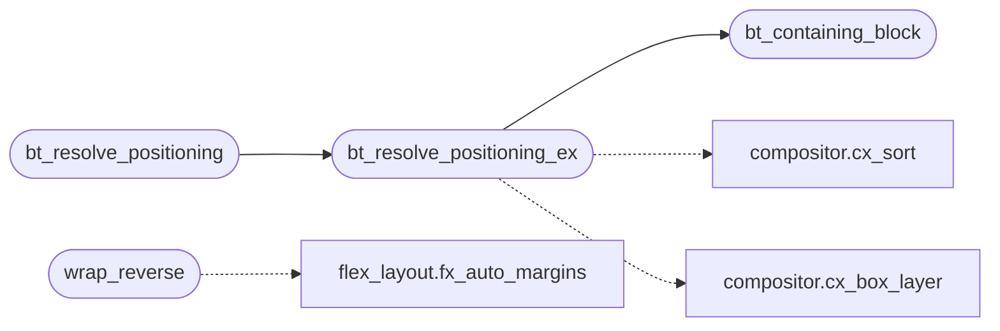

# `src/box_tree.c`

> Source: [src/box_tree.c:1](../../src/box_tree.c#L1) | language `c` | coverage 28.6% | [API index](../index.md)

## Contents

- **Functions:** [`wrap_reverse`](#wrap_reverse), [`sized`](#sized), [`bt_layout`](#bt_layout), [`bt_containing_block`](#bt_containing_block), [`block`](#block), [`bt_resolve_positioning`](#bt_resolve_positioning), [`bt_resolve_positioning_ex`](#bt_resolve_positioning_ex), [`bt_oof_anchor`](#bt_oof_anchor), [`bt_oof_root`](#bt_oof_root), [`bt_box_hidden`](#bt_box_hidden), [`bt_oof_avail`](#bt_oof_avail)
- **Macros:** [`BT_LEN_AUTO`](#bt_len_auto), [`BT_WRAP_EPS`](#bt_wrap_eps)

## Call Graph

Solid arrows stay in this module, dashed arrows leave it.



## Functions

<a id="wrap_reverse"></a>

### `wrap_reverse`

`function` | [src/box_tree.c:79](../../src/box_tree.c#L79)

```c
* * wrap_reverse (node->wrap_reverse): when node->wrap is active and node->wrap_reverse * is no...
```

**Parameters**

| Name | Type | Default | Description |
|---|---|---|---|
| `wrap_reverse` | `node->` |  |  |

**Returns:** `when node->wrap is active and node->wrap_reverse * is no...`

*Calls:* [`fx_auto_margins`](src.flex_layout.c.md#fx_auto_margins)

---

<a id="sized"></a>

### `sized`

`function` | [src/box_tree.c:334](../../src/box_tree.c#L334)

```c
* the tracks are sized (CSS Grid 1 11.5, items spanning several tracks come * last);
```

**Parameters**

| Name | Type | Default | Description |
|---|---|---|---|
| `Grid` | `CSS 1 11.5` |  |  |
| `last` | `items spanning several tracks come *` |  |  |

**Returns:** `* the tracks are`

---

<a id="bt_layout"></a>

### `bt_layout`

`function` | [src/box_tree.c:449](../../src/box_tree.c#L449)

```c
bt_status bt_layout(bt_node *root, double avail_w)
```

**Parameters**

| Name | Type | Default | Description |
|---|---|---|---|
| `root` | `bt_node *` |  |  |
| `avail_w` | `double` |  |  |

**Returns:** `bt_status`

---

<a id="bt_containing_block"></a>

### `bt_containing_block`

`function` | [src/box_tree.c:539](../../src/box_tree.c#L539)

```c
void bt_containing_block(const pv_box_def *boxes, size_t nbox, size_t i, const double *box_x, const double *box_y, const double *box_w, const double *box_h, const char *placed, double viewport_w, double viewport_h, double *cb_x, double *cb_y, double *cb_w, double *cb_h)
```

The containing block of box i as the positioning solver resolves it: the viewport for FIXED (and for ABSOLUTE with no positioned ancestor), else the geometry of the nearest positioned ancestor -- climbing to the nearest PLACED ancestor when [`placed`](include.box_tree.h.md#placed) (may be NULL) says it never got a rect.

Any non-absolute box answers the viewport. Pure; out pointers must be non-NULL.

**Parameters**

| Name | Type | Default | Description |
|---|---|---|---|
| `boxes` | `pv_box_def *` |  |  |
| `nbox` | `size_t` |  |  |
| `i` | `size_t` |  |  |
| `box_x` | `double *` |  |  |
| `box_y` | `double *` |  |  |
| `box_w` | `double *` |  |  |
| `box_h` | `double *` |  |  |
| `placed` | `char *` |  |  |
| `viewport_w` | `double` |  |  |
| `viewport_h` | `double` |  |  |
| `cb_x` | `double *` |  |  |
| `cb_y` | `double *` |  |  |
| `cb_w` | `double *` |  |  |
| `cb_h` | `double *` |  |  |

> **Inherited:** Documentation from [`bt_containing_block`](#bt_containing_block) (include/box_tree.h:253).

*Called by:* [`bt_resolve_positioning_ex`](#bt_resolve_positioning_ex)

---

<a id="block"></a>

### `block`

`function` | [src/box_tree.c:550](../../src/box_tree.c#L550)

```c
* true block (same flow neighbourhood), strictly better than zeros. NULL * placed keeps lega...
```

**Parameters**

| Name | Type | Default | Description |
|---|---|---|---|
| `neighbourhood` | `same flow` |  |  |

**Returns:** `* true`

---

<a id="bt_resolve_positioning"></a>

### `bt_resolve_positioning`

`function` | [src/box_tree.c:569](../../src/box_tree.c#L569)

```c
bt_status bt_resolve_positioning(const pv_box_def *boxes, size_t nbox, const double *box_x, const double *box_y, const double *box_w, const double *box_h, double viewport_w, double viewport_h, bt_positioned *out, size_t out_cap, size_t *out_count)
```

**Parameters**

| Name | Type | Default | Description |
|---|---|---|---|
| `boxes` | `pv_box_def *` |  |  |
| `nbox` | `size_t` |  |  |
| `box_x` | `double *` |  |  |
| `box_y` | `double *` |  |  |
| `box_w` | `double *` |  |  |
| `box_h` | `double *` |  |  |
| `viewport_w` | `double` |  |  |
| `viewport_h` | `double` |  |  |
| `out` | `bt_positioned *` |  |  |
| `out_cap` | `size_t` |  |  |
| `out_count` | `size_t *` |  |  |

**Returns:** `bt_status`

*Calls:* [`bt_resolve_positioning_ex`](#bt_resolve_positioning_ex)

---

<a id="bt_resolve_positioning_ex"></a>

### `bt_resolve_positioning_ex`

`function` | [src/box_tree.c:580](../../src/box_tree.c#L580)

```c
bt_status bt_resolve_positioning_ex(const pv_box_def *boxes, size_t nbox, const double *box_x, const double *box_y, const double *box_w, const double *box_h, const double *static_x, const double *static_y, const char *placed, double viewport_w, double viewport_h, bt_positioned *out, size_t out_cap, size_t *out_count)
```

**Parameters**

| Name | Type | Default | Description |
|---|---|---|---|
| `boxes` | `pv_box_def *` |  |  |
| `nbox` | `size_t` |  |  |
| `box_x` | `double *` |  |  |
| `box_y` | `double *` |  |  |
| `box_w` | `double *` |  |  |
| `box_h` | `double *` |  |  |
| `static_x` | `double *` |  |  |
| `static_y` | `double *` |  |  |
| `placed` | `char *` |  |  |
| `viewport_w` | `double` |  |  |
| `viewport_h` | `double` |  |  |
| `out` | `bt_positioned *` |  |  |
| `out_cap` | `size_t` |  |  |
| `out_count` | `size_t *` |  |  |

**Returns:** `bt_status`

*Calls:* [`cx_sort`](include.compositor.h.md#cx_sort), [`bt_containing_block`](#bt_containing_block), [`cx_box_layer`](src.compositor.c.md#cx_box_layer)

*Called by:* [`bt_resolve_positioning`](#bt_resolve_positioning)

---

<a id="bt_oof_anchor"></a>

### `bt_oof_anchor`

`function` | [src/box_tree.c:752](../../src/box_tree.c#L752)

```c
int bt_oof_anchor(const pv_box_def *boxes, size_t nbox, int bid)
```

Stage 2d out-of-flow subtree classification (spec/box_engine.md).

Both walk the parent_id chain from `bid` (self first) looking for a box whose position is ABSOLUTE or FIXED: - bt_oof_anchor returns the NEAREST such box: the box a block's content belongs to for out-of-flow measurement and painting (a nested absolute box owns its own content). - bt_oof_root returns the OUTERMOST such box: the box whose static position the flow records when it skips the subtree. Both return -1 (in flow) when the chain has none, and FAIL OPEN to -1 on NULL boxes, out-of-range/negative bid, a dangling link or a parent cycle -- a misclassified hostile chain renders in flow (visible) rather than vanishing. Pure; bounded by nbox links; no allocation.

**Parameters**

| Name | Type | Default | Description |
|---|---|---|---|
| `boxes` | `pv_box_def *` |  |  |
| `nbox` | `size_t` |  |  |
| `bid` | `int` |  |  |

**Returns:** `int`

> **Inherited:** Documentation from [`bt_oof_anchor`](#bt_oof_anchor) (include/box_tree.h:238).

---

<a id="bt_oof_root"></a>

### `bt_oof_root`

`function` | [src/box_tree.c:756](../../src/box_tree.c#L756)

```c
int bt_oof_root(const pv_box_def *boxes, size_t nbox, int bid)
```

**Parameters**

| Name | Type | Default | Description |
|---|---|---|---|
| `boxes` | `pv_box_def *` |  |  |
| `nbox` | `size_t` |  |  |
| `bid` | `int` |  |  |

**Returns:** `int`

---

<a id="bt_box_hidden"></a>

### `bt_box_hidden`

`function` | [src/box_tree.c:760](../../src/box_tree.c#L760)

```c
int bt_box_hidden(const pv_box_def *boxes, size_t nbox, size_t bid)
```

Stage 2b visibility gate: 1 when the box at `bid` or any ancestor on the parent_id chain has visibility HIDDEN/COLLAPSE (the same simplification the in-flow path makes -- a visible re-entry under a hidden ancestor stays hidden).

The walk is bounded by nbox links and fails closed (returns 1, hidden) on NULL boxes, an out-of-range bid, a dangling parent link or a parent cycle -- a hostile box tree can never make it loop or read out of bounds. Pure; no allocation.

**Parameters**

| Name | Type | Default | Description |
|---|---|---|---|
| `boxes` | `pv_box_def *` |  |  |
| `nbox` | `size_t` |  |  |
| `bid` | `size_t` |  |  |

**Returns:** `int`

> **Inherited:** Documentation from [`bt_box_hidden`](#bt_box_hidden) (include/box_tree.h:224).

---

<a id="bt_oof_avail"></a>

### `bt_oof_avail`

`function` | [src/box_tree.c:773](../../src/box_tree.c#L773)

```c
double bt_oof_avail(int a, int a_pct, int b, int b_pct, double cb, int *both)
```

**Parameters**

| Name | Type | Default | Description |
|---|---|---|---|
| `a` | `int` |  |  |
| `a_pct` | `int` |  |  |
| `b` | `int` |  |  |
| `b_pct` | `int` |  |  |
| `cb` | `double` |  |  |
| `both` | `int *` |  |  |

**Returns:** `double`

---

## Macros

<a id="bt_len_auto"></a>

### `BT_LEN_AUTO`

`macro` | [src/box_tree.c:31](../../src/box_tree.c#L31)

```c
#define BT_LEN_AUTO
```

Inset sentinels.

PV_LEN_UNSET comes from page_view.h (= INT_MIN). CSS_LEN_AUTO is INT_MIN + 1 in css.h; we define it locally to keep box_tree.c free of the css.h dependency (the layout cares about the values, not their name).

---

<a id="bt_wrap_eps"></a>

### `BT_WRAP_EPS`

`macro` | [src/box_tree.c:62](../../src/box_tree.c#L62)

```c
#define BT_WRAP_EPS
```

---
