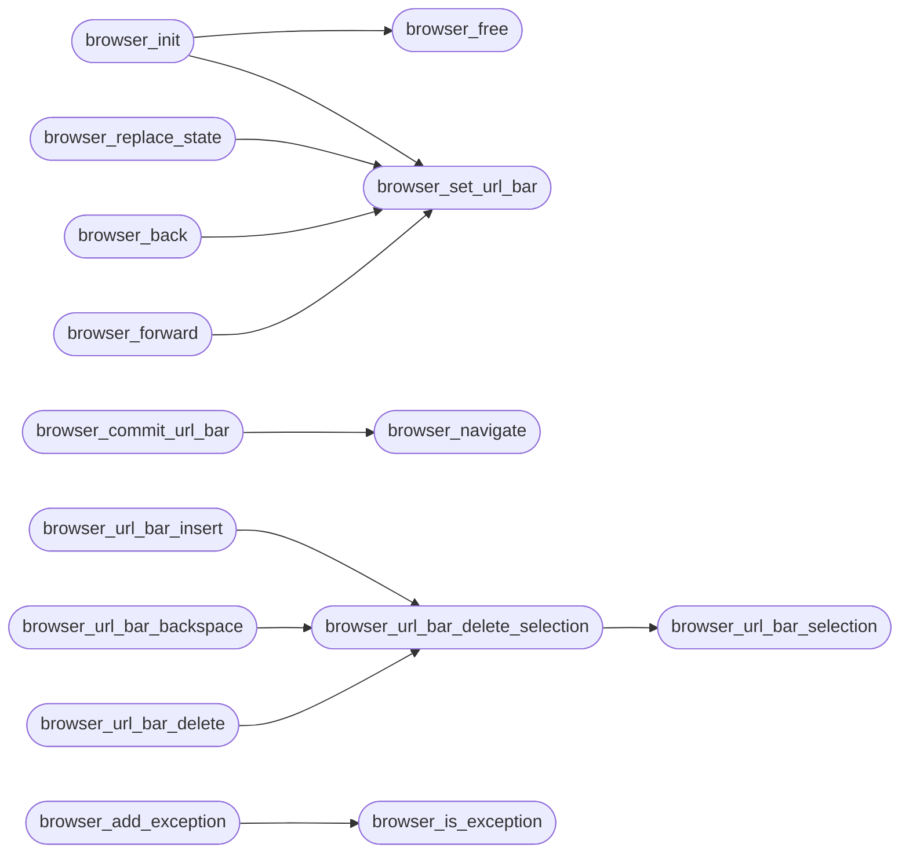

# `src/browser.c`

> Source: [src/browser.c:1](../../src/browser.c#L1) | language `c` | coverage 25.8% | [API index](../index.md)

## Contents

- **Functions:** [`browser_init`](#browser_init), [`browser_free`](#browser_free), [`browser_set_url_bar`](#browser_set_url_bar), [`browser_commit_url_bar`](#browser_commit_url_bar), [`browser_navigate`](#browser_navigate), [`browser_push_state`](#browser_push_state), [`browser_replace_state`](#browser_replace_state), [`browser_entry_doc`](#browser_entry_doc), [`browser_doc_index`](#browser_doc_index), [`browser_back`](#browser_back), [`browser_forward`](#browser_forward), [`browser_can_back`](#browser_can_back), [`browser_can_forward`](#browser_can_forward), [`browser_current_url`](#browser_current_url), [`browser_url_bar_selection`](#browser_url_bar_selection), [`browser_url_bar_delete_selection`](#browser_url_bar_delete_selection), [`browser_url_bar_insert`](#browser_url_bar_insert), [`browser_url_bar_backspace`](#browser_url_bar_backspace), [`browser_url_bar_delete`](#browser_url_bar_delete), [`browser_url_bar_move_cursor`](#browser_url_bar_move_cursor), [`browser_url_bar_extend_cursor`](#browser_url_bar_extend_cursor), [`browser_url_bar_set_cursor`](#browser_url_bar_set_cursor), [`browser_url_bar_select_all`](#browser_url_bar_select_all), [`browser_url_bar_clear`](#browser_url_bar_clear), [`browser_set_page`](#browser_set_page), [`browser_set_status`](#browser_set_status), [`browser_status_text`](#browser_status_text), [`browser_is_exception`](#browser_is_exception), [`browser_add_exception`](#browser_add_exception)
- **Macros:** [`_POSIX_C_SOURCE`](#_posix_c_source)

## Call Graph

Solid arrows stay in this module, dashed arrows leave it.



## Functions

<a id="browser_init"></a>

### `browser_init`

`function` | [src/browser.c:156](../../src/browser.c#L156)

```c
browser_status browser_init(browser_state *bs)
```

**Parameters**

| Name | Type | Default | Description |
|---|---|---|---|
| `bs` | `browser_state *` |  |  |

**Returns:** `browser_status`

*Calls:* [`browser_free`](#browser_free), [`browser_set_url_bar`](#browser_set_url_bar)

---

<a id="browser_free"></a>

### `browser_free`

`function` | [src/browser.c:167](../../src/browser.c#L167)

```c
void browser_free(browser_state *bs)
```

Release all owned memory.

Safe on NULL and zero-initialised.

**Parameters**

| Name | Type | Default | Description |
|---|---|---|---|
| `bs` | `browser_state *` |  |  |

> **Inherited:** Documentation from [`browser_free`](#browser_free) (include/browser.h:66).

*Called by:* [`browser_init`](#browser_init)

---

<a id="browser_set_url_bar"></a>

### `browser_set_url_bar`

`function` | [src/browser.c:178](../../src/browser.c#L178)

```c
browser_status browser_set_url_bar(browser_state *bs, const char *url)
```

**Parameters**

| Name | Type | Default | Description |
|---|---|---|---|
| `bs` | `browser_state *` |  |  |
| `url` | `char *` |  |  |

**Returns:** `browser_status`

*Called by:* [`arrives`](gui.browser_ui.c.md#arrives), [`browser_back`](#browser_back), [`browser_forward`](#browser_forward), [`browser_init`](#browser_init), [`browser_replace_state`](#browser_replace_state)

---

<a id="browser_commit_url_bar"></a>

### `browser_commit_url_bar`

`function` | [src/browser.c:190](../../src/browser.c#L190)

```c
browser_status browser_commit_url_bar(browser_state *bs)
```

**Parameters**

| Name | Type | Default | Description |
|---|---|---|---|
| `bs` | `browser_state *` |  |  |

**Returns:** `browser_status`

*Calls:* [`browser_navigate`](#browser_navigate)

---

<a id="browser_navigate"></a>

### `browser_navigate`

`function` | [src/browser.c:224](../../src/browser.c#L224)

```c
browser_status browser_navigate(browser_state *bs, const char *url)
```

**Parameters**

| Name | Type | Default | Description |
|---|---|---|---|
| `bs` | `browser_state *` |  |  |
| `url` | `char *` |  |  |

**Returns:** `browser_status`

*Called by:* [`browser_commit_url_bar`](#browser_commit_url_bar)

---

<a id="browser_push_state"></a>

### `browser_push_state`

`function` | [src/browser.c:236](../../src/browser.c#L236)

```c
browser_status browser_push_state(browser_state *bs, const char *url)
```

**Parameters**

| Name | Type | Default | Description |
|---|---|---|---|
| `bs` | `browser_state *` |  |  |
| `url` | `char *` |  |  |

**Returns:** `browser_status`

---

<a id="browser_replace_state"></a>

### `browser_replace_state`

`function` | [src/browser.c:243](../../src/browser.c#L243)

```c
browser_status browser_replace_state(browser_state *bs, const char *url)
```

**Parameters**

| Name | Type | Default | Description |
|---|---|---|---|
| `bs` | `browser_state *` |  |  |
| `url` | `char *` |  |  |

**Returns:** `browser_status`

*Calls:* [`browser_set_url_bar`](#browser_set_url_bar)

---

<a id="browser_entry_doc"></a>

### `browser_entry_doc`

`function` | [src/browser.c:255](../../src/browser.c#L255)

```c
int browser_entry_doc(const browser_state *bs, size_t pos)
```

Document id of entry pos, or -1 when out of range / NULL.

**Parameters**

| Name | Type | Default | Description |
|---|---|---|---|
| `bs` | `browser_state *` |  |  |
| `pos` | `size_t` |  |  |

**Returns:** `int`

> **Inherited:** Documentation from [`browser_entry_doc`](#browser_entry_doc) (include/browser.h:87).

---

<a id="browser_doc_index"></a>

### `browser_doc_index`

`function` | [src/browser.c:260](../../src/browser.c#L260)

```c
int browser_doc_index(const browser_state *bs)
```

Index of the current entry within its document's contiguous run of entries (0 for the entry the document was loaded at) -- the worker's own history index.

**Parameters**

| Name | Type | Default | Description |
|---|---|---|---|
| `bs` | `browser_state *` |  |  |

**Returns:** `int`

> **Inherited:** Documentation from [`browser_doc_index`](#browser_doc_index) (include/browser.h:91).

---

<a id="browser_back"></a>

### `browser_back`

`function` | [src/browser.c:268](../../src/browser.c#L268)

```c
browser_status browser_back(browser_state *bs)
```

**Parameters**

| Name | Type | Default | Description |
|---|---|---|---|
| `bs` | `browser_state *` |  |  |

**Returns:** `browser_status`

*Calls:* [`browser_set_url_bar`](#browser_set_url_bar)

---

<a id="browser_forward"></a>

### `browser_forward`

`function` | [src/browser.c:280](../../src/browser.c#L280)

```c
browser_status browser_forward(browser_state *bs)
```

**Parameters**

| Name | Type | Default | Description |
|---|---|---|---|
| `bs` | `browser_state *` |  |  |

**Returns:** `browser_status`

*Calls:* [`browser_set_url_bar`](#browser_set_url_bar)

---

<a id="browser_can_back"></a>

### `browser_can_back`

`function` | [src/browser.c:292](../../src/browser.c#L292)

```c
int browser_can_back(const browser_state *bs)
```

Query helpers.

**Parameters**

| Name | Type | Default | Description |
|---|---|---|---|
| `bs` | `browser_state *` |  |  |

**Returns:** `int`

> **Inherited:** Documentation from [`browser_can_back`](#browser_can_back) (include/browser.h:94).

---

<a id="browser_can_forward"></a>

### `browser_can_forward`

`function` | [src/browser.c:296](../../src/browser.c#L296)

```c
int browser_can_forward(const browser_state *bs)
```

**Parameters**

| Name | Type | Default | Description |
|---|---|---|---|
| `bs` | `browser_state *` |  |  |

**Returns:** `int`

---

<a id="browser_current_url"></a>

### `browser_current_url`

`function` `const` | [src/browser.c:300](../../src/browser.c#L300)

```c
const char *browser_current_url(const browser_state *bs)
```

**Parameters**

| Name | Type | Default | Description |
|---|---|---|---|
| `bs` | `browser_state *` |  |  |

**Returns:** `char *`

---

<a id="browser_url_bar_selection"></a>

### `browser_url_bar_selection`

`function` | [src/browser.c:305](../../src/browser.c#L305)

```c
int browser_url_bar_selection(const browser_state *bs, size_t *start, size_t *len)
```

If a selection exists, writes its start offset and length and returns 1; else 0.

Lets the GUI copy/cut the selected text and paint the highlight. NULL-safe.

**Parameters**

| Name | Type | Default | Description |
|---|---|---|---|
| `bs` | `browser_state *` |  |  |
| `start` | `size_t *` |  |  |
| `len` | `size_t *` |  |  |

**Returns:** `int`

> **Inherited:** Documentation from [`browser_url_bar_selection`](#browser_url_bar_selection) (include/browser.h:131).

*Called by:* [`browser_url_bar_delete_selection`](#browser_url_bar_delete_selection)

---

<a id="browser_url_bar_delete_selection"></a>

### `browser_url_bar_delete_selection`

`function` | [src/browser.c:316](../../src/browser.c#L316)

```c
int browser_url_bar_delete_selection(browser_state *bs)
```

Removes the selected range (if any), placing the cursor at its start; returns 1 if something was removed, else 0.

Used by cut and by an edit over a selection.

**Parameters**

| Name | Type | Default | Description |
|---|---|---|---|
| `bs` | `browser_state *` |  |  |

**Returns:** `int`

> **Inherited:** Documentation from [`browser_url_bar_delete_selection`](#browser_url_bar_delete_selection) (include/browser.h:135).

*Calls:* [`browser_url_bar_selection`](#browser_url_bar_selection)

*Called by:* [`browser_url_bar_backspace`](#browser_url_bar_backspace), [`browser_url_bar_delete`](#browser_url_bar_delete), [`browser_url_bar_insert`](#browser_url_bar_insert)

---

<a id="browser_url_bar_insert"></a>

### `browser_url_bar_insert`

`function` | [src/browser.c:326](../../src/browser.c#L326)

```c
browser_status browser_url_bar_insert(browser_state *bs, char c)
```

**Parameters**

| Name | Type | Default | Description |
|---|---|---|---|
| `bs` | `browser_state *` |  |  |
| `c` | `char` |  |  |

**Returns:** `browser_status`

*Calls:* [`browser_url_bar_delete_selection`](#browser_url_bar_delete_selection)

---

<a id="browser_url_bar_backspace"></a>

### `browser_url_bar_backspace`

`function` | [src/browser.c:341](../../src/browser.c#L341)

```c
browser_status browser_url_bar_backspace(browser_state *bs)
```

**Parameters**

| Name | Type | Default | Description |
|---|---|---|---|
| `bs` | `browser_state *` |  |  |

**Returns:** `browser_status`

*Calls:* [`browser_url_bar_delete_selection`](#browser_url_bar_delete_selection)

---

<a id="browser_url_bar_delete"></a>

### `browser_url_bar_delete`

`function` | [src/browser.c:355](../../src/browser.c#L355)

```c
browser_status browser_url_bar_delete(browser_state *bs)
```

**Parameters**

| Name | Type | Default | Description |
|---|---|---|---|
| `bs` | `browser_state *` |  |  |

**Returns:** `browser_status`

*Calls:* [`browser_url_bar_delete_selection`](#browser_url_bar_delete_selection)

---

<a id="browser_url_bar_move_cursor"></a>

### `browser_url_bar_move_cursor`

`function` | [src/browser.c:366](../../src/browser.c#L366)

```c
browser_status browser_url_bar_move_cursor(browser_state *bs, long delta)
```

**Parameters**

| Name | Type | Default | Description |
|---|---|---|---|
| `bs` | `browser_state *` |  |  |
| `delta` | `long` |  |  |

**Returns:** `browser_status`

---

<a id="browser_url_bar_extend_cursor"></a>

### `browser_url_bar_extend_cursor`

`function` | [src/browser.c:376](../../src/browser.c#L376)

```c
browser_status browser_url_bar_extend_cursor(browser_state *bs, long delta)
```

**Parameters**

| Name | Type | Default | Description |
|---|---|---|---|
| `bs` | `browser_state *` |  |  |
| `delta` | `long` |  |  |

**Returns:** `browser_status`

---

<a id="browser_url_bar_set_cursor"></a>

### `browser_url_bar_set_cursor`

`function` | [src/browser.c:385](../../src/browser.c#L385)

```c
browser_status browser_url_bar_set_cursor(browser_state *bs, size_t pos, int extend)
```

**Parameters**

| Name | Type | Default | Description |
|---|---|---|---|
| `bs` | `browser_state *` |  |  |
| `pos` | `size_t` |  |  |
| `extend` | `int` |  |  |

**Returns:** `browser_status`

---

<a id="browser_url_bar_select_all"></a>

### `browser_url_bar_select_all`

`function` | [src/browser.c:393](../../src/browser.c#L393)

```c
browser_status browser_url_bar_select_all(browser_state *bs)
```

**Parameters**

| Name | Type | Default | Description |
|---|---|---|---|
| `bs` | `browser_state *` |  |  |

**Returns:** `browser_status`

---

<a id="browser_url_bar_clear"></a>

### `browser_url_bar_clear`

`function` | [src/browser.c:400](../../src/browser.c#L400)

```c
browser_status browser_url_bar_clear(browser_state *bs)
```

**Parameters**

| Name | Type | Default | Description |
|---|---|---|---|
| `bs` | `browser_state *` |  |  |

**Returns:** `browser_status`

---

<a id="browser_set_page"></a>

### `browser_set_page`

`function` | [src/browser.c:409](../../src/browser.c#L409)

```c
browser_status browser_set_page(browser_state *bs, const char *title, const char *text, int error)
```

**Parameters**

| Name | Type | Default | Description |
|---|---|---|---|
| `bs` | `browser_state *` |  |  |
| `title` | `char *` |  |  |
| `text` | `char *` |  |  |
| `error` | `int` |  |  |

**Returns:** `browser_status`

---

<a id="browser_set_status"></a>

### `browser_set_status`

`function` | [src/browser.c:431](../../src/browser.c#L431)

```c
browser_status browser_set_status(browser_state *bs, const char *msg, uint64_t now_ms)
```

**Parameters**

| Name | Type | Default | Description |
|---|---|---|---|
| `bs` | `browser_state *` |  |  |
| `msg` | `char *` |  |  |
| `now_ms` | `uint64_t` |  |  |

**Returns:** `browser_status`

*Called by:* [`arrives`](gui.browser_ui.c.md#arrives)

---

<a id="browser_status_text"></a>

### `browser_status_text`

`function` `const` | [src/browser.c:445](../../src/browser.c#L445)

```c
const char *browser_status_text(const browser_state *bs, uint64_t now_ms)
```

The active status text, or NULL when there is none or it has expired at now_ms.

**Parameters**

| Name | Type | Default | Description |
|---|---|---|---|
| `bs` | `browser_state *` |  |  |
| `now_ms` | `uint64_t` |  |  |

**Returns:** `char *`

> **Inherited:** Documentation from [`browser_status_text`](#browser_status_text) (include/browser.h:150).

---

<a id="browser_is_exception"></a>

### `browser_is_exception`

`function` | [src/browser.c:464](../../src/browser.c#L464)

```c
int browser_is_exception(const browser_state *bs, const char *host)
```

Exception list: hosts explicitly allowed to use weak TLS.

**Parameters**

| Name | Type | Default | Description |
|---|---|---|---|
| `bs` | `browser_state *` |  |  |
| `host` | `char *` |  |  |

**Returns:** `int`

> **Inherited:** Documentation from [`browser_is_exception`](#browser_is_exception) (include/browser.h:99).

*Called by:* [`browser_add_exception`](#browser_add_exception)

---

<a id="browser_add_exception"></a>

### `browser_add_exception`

`function` | [src/browser.c:472](../../src/browser.c#L472)

```c
browser_status browser_add_exception(browser_state *bs, const char *host)
```

**Parameters**

| Name | Type | Default | Description |
|---|---|---|---|
| `bs` | `browser_state *` |  |  |
| `host` | `char *` |  |  |

**Returns:** `browser_status`

*Calls:* [`browser_is_exception`](#browser_is_exception)

---

## Macros

<a id="_posix_c_source"></a>

### `_POSIX_C_SOURCE`

`macro` | [src/browser.c:7](../../src/browser.c#L7)

```c
#define _POSIX_C_SOURCE
```

---
