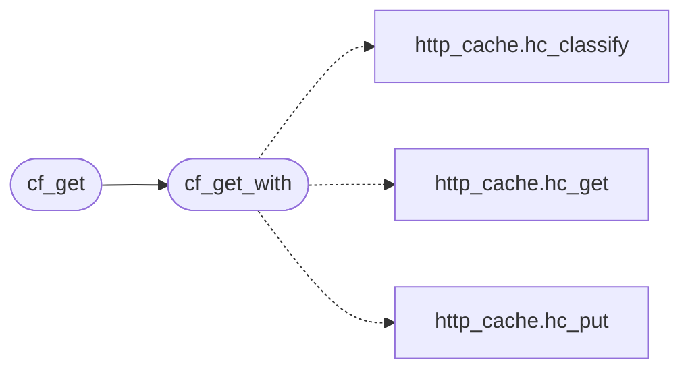

# `src/cached_fetch.c`

> Source: [src/cached_fetch.c:1](../../src/cached_fetch.c#L1) | language `c` | coverage 28.6% | [API index](../index.md)

## Contents

- **Functions:** [`cf_set_store`](#cf_set_store), [`cf_store`](#cf_store), [`cf_get_with`](#cf_get_with), [`cf_get`](#cf_get), [`cf_attach_redirect_memory`](#cf_attach_redirect_memory)
- **Macros:** [`_POSIX_C_SOURCE`](#_posix_c_source)

## Call Graph

Solid arrows stay in this module, dashed arrows leave it.



## Functions

<a id="cf_set_store"></a>

### `cf_set_store`

`function` | [src/cached_fetch.c:22](../../src/cached_fetch.c#L22)

```c
void cf_set_store(hc_store *store)
```

Process-wide store used by cf_get (NULL = caching off; set once at startup).

**Parameters**

| Name | Type | Default | Description |
|---|---|---|---|
| `store` | `hc_store *` |  |  |

> **Inherited:** Documentation from [`cf_set_store`](#cf_set_store) (include/cached_fetch.h:30).

---

<a id="cf_store"></a>

### `cf_store`

`function` | [src/cached_fetch.c:23](../../src/cached_fetch.c#L23)

```c
hc_store *cf_store(void)
```

**Returns:** `hc_store *`

---

<a id="cf_get_with"></a>

### `cf_get_with`

`function` | [src/cached_fetch.c:85](../../src/cached_fetch.c#L85)

```c
sf_status cf_get_with(hc_store *store, cf_fetch_fn fetch, const char *partition, const char *url, sf_config *cfg, sf_response *out, int *downgraded, int allowlisted, time_t now)
```

**Parameters**

| Name | Type | Default | Description |
|---|---|---|---|
| `store` | `hc_store *` |  |  |
| `fetch` | `cf_fetch_fn` |  |  |
| `partition` | `char *` |  |  |
| `url` | `char *` |  |  |
| `cfg` | `sf_config *` |  |  |
| `out` | `sf_response *` |  |  |
| `downgraded` | `int *` |  |  |
| `allowlisted` | `int` |  |  |
| `now` | `time_t` |  |  |

**Returns:** `sf_status`

*Calls:* [`hc_classify`](src.http_cache.c.md#hc_classify), [`hc_get`](src.http_cache.c.md#hc_get), [`hc_put`](src.http_cache.c.md#hc_put)

*Called by:* [`cf_get`](#cf_get)

---

<a id="cf_get"></a>

### `cf_get`

`function` | [src/cached_fetch.c:133](../../src/cached_fetch.c#L133)

```c
sf_status cf_get(const char *partition, const char *url, sf_config *cfg, sf_response *out, int *downgraded, int allowlisted)
```

**Parameters**

| Name | Type | Default | Description |
|---|---|---|---|
| `partition` | `char *` |  |  |
| `url` | `char *` |  |  |
| `cfg` | `sf_config *` |  |  |
| `out` | `sf_response *` |  |  |
| `downgraded` | `int *` |  |  |
| `allowlisted` | `int` |  |  |

**Returns:** `sf_status`

*Calls:* [`cf_get_with`](#cf_get_with)

---

<a id="cf_attach_redirect_memory"></a>

### `cf_attach_redirect_memory`

`function` | [src/cached_fetch.c:148](../../src/cached_fetch.c#L148)

```c
void cf_attach_redirect_memory(hc_store *store)
```

Persists permanent redirects (301/308) in the store and consults it on a RAM miss.

**Parameters**

| Name | Type | Default | Description |
|---|---|---|---|
| `store` | `hc_store *` |  |  |

> **Inherited:** Documentation from [`cf_attach_redirect_memory`](#cf_attach_redirect_memory) (include/cached_fetch.h:38).

---

## Macros

<a id="_posix_c_source"></a>

### `_POSIX_C_SOURCE`

`macro` | [src/cached_fetch.c:7](../../src/cached_fetch.c#L7)

```c
#define _POSIX_C_SOURCE
```

---
