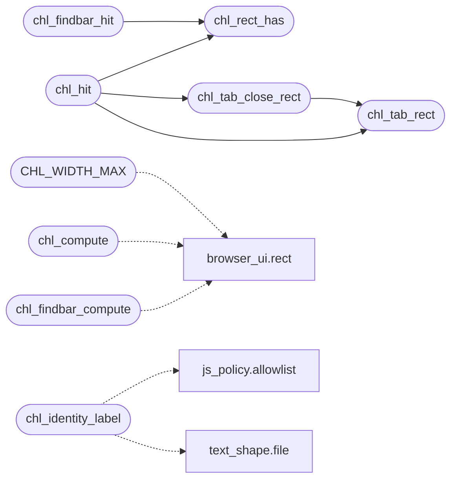

# `src/chrome_layout.c`

> Source: [src/chrome_layout.c:1](../../src/chrome_layout.c#L1) | language `c` | coverage 70.6% | [API index](../index.md)

chrome_layout -- browser chrome geometry + identity badge. spec/chrome_layout.md

## Contents

- **Functions:** [`chl_rect_has`](#chl_rect_has), [`chl_compute`](#chl_compute), [`chl_tab_rect`](#chl_tab_rect), [`chl_tab_close_rect`](#chl_tab_close_rect), [`chl_hit`](#chl_hit), [`chl_tab_drop_index`](#chl_tab_drop_index), [`chl_move_index`](#chl_move_index), [`chl_tab_for_digit`](#chl_tab_for_digit), [`chl_identity_of`](#chl_identity_of), [`chl_identity_label`](#chl_identity_label), [`chl_findbar_compute`](#chl_findbar_compute), [`chl_findbar_hit`](#chl_findbar_hit)
- **Macros:** [`CHL_TAB_CLOSE_INSET`](#chl_tab_close_inset), [`CHL_URL_GAP`](#chl_url_gap), [`CHL_ID_INSET`](#chl_id_inset), [`CHL_WIDTH_MAX`](#chl_width_max)

## Call Graph

Solid arrows stay in this module, dashed arrows leave it.



## Functions

<a id="chl_rect_has"></a>

### `chl_rect_has`

`function` | [src/chrome_layout.c:26](../../src/chrome_layout.c#L26)

```c
int chl_rect_has(chl_rect r, double x, double y)
```

1 if (x, y) lies inside r (half-open on the right and bottom).

**Parameters**

| Name | Type | Default | Description |
|---|---|---|---|
| `r` | `chl_rect` |  |  |
| `x` | `double` |  |  |
| `y` | `double` |  |  |

**Returns:** `int`

> **Inherited:** Documentation from [`chl_rect_has`](#chl_rect_has) (include/chrome_layout.h:85).

*Called by:* [`chl_findbar_hit`](#chl_findbar_hit), [`chl_hit`](#chl_hit)

---

<a id="chl_compute"></a>

### `chl_compute`

`function` | [src/chrome_layout.c:30](../../src/chrome_layout.c#L30)

```c
chl_status chl_compute(double width, int csd, int tab_count, int active, chl_layout *out)
```

**Parameters**

| Name | Type | Default | Description |
|---|---|---|---|
| `width` | `double` |  |  |
| `csd` | `int` |  |  |
| `tab_count` | `int` |  |  |
| `active` | `int` |  |  |
| `out` | `chl_layout *` |  |  |

**Returns:** `chl_status`

*Calls:* [`rect`](gui.browser_ui.c.md#rect)

---

<a id="chl_tab_rect"></a>

### `chl_tab_rect`

`function` | [src/chrome_layout.c:112](../../src/chrome_layout.c#L112)

```c
int chl_tab_rect(const chl_layout *l, int i, chl_rect *r)
```

Tab i's rectangle / its close button.

1 if it exists (visible), else 0.

**Parameters**

| Name | Type | Default | Description |
|---|---|---|---|
| `l` | `chl_layout *` |  |  |
| `i` | `int` |  |  |
| `r` | `chl_rect *` |  |  |

**Returns:** `int`

> **Inherited:** Documentation from [`chl_tab_rect`](#chl_tab_rect) (include/chrome_layout.h:81).

*Called by:* [`chl_hit`](#chl_hit), [`chl_tab_close_rect`](#chl_tab_close_rect)

---

<a id="chl_tab_close_rect"></a>

### `chl_tab_close_rect`

`function` | [src/chrome_layout.c:122](../../src/chrome_layout.c#L122)

```c
int chl_tab_close_rect(const chl_layout *l, int i, chl_rect *r)
```

**Parameters**

| Name | Type | Default | Description |
|---|---|---|---|
| `l` | `chl_layout *` |  |  |
| `i` | `int` |  |  |
| `r` | `chl_rect *` |  |  |

**Returns:** `int`

*Calls:* [`chl_tab_rect`](#chl_tab_rect)

*Called by:* [`chl_hit`](#chl_hit)

---

<a id="chl_hit"></a>

### `chl_hit`

`function` | [src/chrome_layout.c:132](../../src/chrome_layout.c#L132)

```c
chl_part chl_hit(const chl_layout *l, double x, double y, int *tab)
```

**Parameters**

| Name | Type | Default | Description |
|---|---|---|---|
| `l` | `chl_layout *` |  |  |
| `x` | `double` |  |  |
| `y` | `double` |  |  |
| `tab` | `int *` |  |  |

**Returns:** `chl_part`

*Calls:* [`chl_rect_has`](#chl_rect_has), [`chl_tab_close_rect`](#chl_tab_close_rect), [`chl_tab_rect`](#chl_tab_rect)

---

<a id="chl_tab_drop_index"></a>

### `chl_tab_drop_index`

`function` | [src/chrome_layout.c:165](../../src/chrome_layout.c#L165)

```c
int chl_tab_drop_index(const chl_layout *l, double x)
```

Absolute index of the visible tab slot under x (clamped to the visible tabs): where a dragged tab dropped at x lands. -1 if l is NULL or no tab is visible.

**Parameters**

| Name | Type | Default | Description |
|---|---|---|---|
| `l` | `chl_layout *` |  |  |
| `x` | `double` |  |  |

**Returns:** `int`

> **Inherited:** Documentation from [`chl_tab_drop_index`](#chl_tab_drop_index) (include/chrome_layout.h:93).

---

<a id="chl_move_index"></a>

### `chl_move_index`

`function` | [src/chrome_layout.c:175](../../src/chrome_layout.c#L175)

```c
int chl_move_index(int i, int from, int to)
```

Where element i ends up after the element at `from` moves to [`to`](include.render_doc.h.md#rd_block-to) (the others shift to close the gap and open the slot).

The single remapping for every index the GUI keeps.

**Parameters**

| Name | Type | Default | Description |
|---|---|---|---|
| `i` | `int` |  |  |
| `from` | `int` |  |  |
| `to` | `int` |  |  |

**Returns:** `int`

> **Inherited:** Documentation from [`chl_move_index`](#chl_move_index) (include/chrome_layout.h:97).

---

<a id="chl_tab_for_digit"></a>

### `chl_tab_for_digit`

`function` | [src/chrome_layout.c:182](../../src/chrome_layout.c#L182)

```c
int chl_tab_for_digit(int digit, int tab_count)
```

Ctrl+<digit>: 1..8 select that tab, 9 the last one (Firefox). -1 when there is none.

**Parameters**

| Name | Type | Default | Description |
|---|---|---|---|
| `digit` | `int` |  |  |
| `tab_count` | `int` |  |  |

**Returns:** `int`

> **Inherited:** Documentation from [`chl_tab_for_digit`](#chl_tab_for_digit) (include/chrome_layout.h:100).

---

<a id="chl_identity_of"></a>

### `chl_identity_of`

`function` | [src/chrome_layout.c:228](../../src/chrome_layout.c#L228)

```c
chl_identity chl_identity_of(const char *url, int transport_known, int downgrade, int operator_insecure)
```

**Parameters**

| Name | Type | Default | Description |
|---|---|---|---|
| `url` | `char *` |  |  |
| `transport_known` | `int` |  |  |
| `downgrade` | `int` |  |  |
| `operator_insecure` | `int` |  |  |

**Returns:** `chl_identity`

---

<a id="chl_identity_label"></a>

### `chl_identity_label`

`function` `const` | [src/chrome_layout.c:252](../../src/chrome_layout.c#L252)

```c
const char *chl_identity_label(chl_identity id)
```

Short English label for the badge (static, never NULL).

**Parameters**

| Name | Type | Default | Description |
|---|---|---|---|
| `id` | `chl_identity` |  |  |

**Returns:** `char *`

> **Inherited:** Documentation from [`chl_identity_label`](#chl_identity_label) (include/chrome_layout.h:151).

*Calls:* [`allowlist`](include.js_policy.h.md#allowlist), [`file`](src.text_shape.c.md#file)

---

<a id="chl_findbar_compute"></a>

### `chl_findbar_compute`

`function` | [src/chrome_layout.c:269](../../src/chrome_layout.c#L269)

```c
chl_status chl_findbar_compute(double width, double height, chl_findbar *out)
```

Find bar: the field at the left, prev/next right after it, the match count, and the close button at the right edge.

A narrow window shrinks the count, then the field.

**Parameters**

| Name | Type | Default | Description |
|---|---|---|---|
| `width` | `double` |  |  |
| `height` | `double` |  |  |
| `out` | `chl_findbar *` |  |  |

**Returns:** `chl_status`

*Calls:* [`rect`](gui.browser_ui.c.md#rect)

---

<a id="chl_findbar_hit"></a>

### `chl_findbar_hit`

`function` | [src/chrome_layout.c:305](../../src/chrome_layout.c#L305)

```c
chl_find_part chl_findbar_hit(const chl_findbar *f, double x, double y)
```

**Parameters**

| Name | Type | Default | Description |
|---|---|---|---|
| `f` | `chl_findbar *` |  |  |
| `x` | `double` |  |  |
| `y` | `double` |  |  |

**Returns:** `chl_find_part`

*Calls:* [`chl_rect_has`](#chl_rect_has)

---

## Macros

<a id="chl_tab_close_inset"></a>

### `CHL_TAB_CLOSE_INSET`

`macro` | [src/chrome_layout.c:9](../../src/chrome_layout.c#L9)

```c
#define CHL_TAB_CLOSE_INSET
```

Inset of a tab's close button from the tab's right edge.

---

<a id="chl_url_gap"></a>

### `CHL_URL_GAP`

`macro` | [src/chrome_layout.c:11](../../src/chrome_layout.c#L11)

```c
#define CHL_URL_GAP
```

Space between the reload button / the menu button and the URL pill.

---

<a id="chl_id_inset"></a>

### `CHL_ID_INSET`

`macro` | [src/chrome_layout.c:13](../../src/chrome_layout.c#L13)

```c
#define CHL_ID_INSET
```

Inset of the identity badge inside the pill.

---

<a id="chl_width_max"></a>

### `CHL_WIDTH_MAX`

`macro` | [src/chrome_layout.c:15](../../src/chrome_layout.c#L15)

```c
#define CHL_WIDTH_MAX
```

Largest width the layout honours; anything above is clamped so every sum stays finite.

*Calls:* [`rect`](gui.browser_ui.c.md#rect)

---
