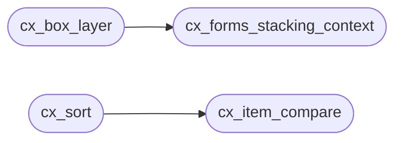

# `src/compositor.c`

> Source: [src/compositor.c:1](../../src/compositor.c#L1) | language `c` | coverage 60.0% | [API index](../index.md)

## Contents

- **Functions:** [`cx_forms_stacking_context`](#cx_forms_stacking_context), [`cx_box_layer`](#cx_box_layer), [`cx_item_compare`](#cx_item_compare), [`cx_sort`](#cx_sort)

## Call Graph

Solid arrows stay in this module, dashed arrows leave it.



## Functions

<a id="cx_forms_stacking_context"></a>

### `cx_forms_stacking_context`

`function` | [src/compositor.c:16](../../src/compositor.c#L16)

```c
int cx_forms_stacking_context(const cx_style *s)
```

Does this box establish a stacking context?

(The root context is the caller's.) NULL-safe: returns 0. See spec/compositor.md section 2 for the rule set.

**Parameters**

| Name | Type | Default | Description |
|---|---|---|---|
| `s` | `cx_style *` |  |  |

**Returns:** `int`

> **Inherited:** Documentation from [`cx_forms_stacking_context`](#cx_forms_stacking_context) (include/compositor.h:60).

*Called by:* [`cx_box_layer`](#cx_box_layer)

---

<a id="cx_box_layer"></a>

### `cx_box_layer`

`function` | [src/compositor.c:34](../../src/compositor.c#L34)

```c
cx_layer cx_box_layer(const cx_style *s)
```

**Parameters**

| Name | Type | Default | Description |
|---|---|---|---|
| `s` | `cx_style *` |  |  |

**Returns:** `cx_layer`

*Calls:* [`cx_forms_stacking_context`](#cx_forms_stacking_context)

*Called by:* [`bt_resolve_positioning_ex`](src.box_tree.c.md#bt_resolve_positioning_ex)

---

<a id="cx_item_compare"></a>

### `cx_item_compare`

`function` | [src/compositor.c:54](../../src/compositor.c#L54)

```c
int cx_item_compare(const cx_item *a, const cx_item *b)
```

Total paint order: layer ascending, then z-index ascending (auto == 0), then document order ascending.

Returns <0, 0 or >0 like a qsort comparator. NULL-safe (a NULL operand sorts first, defensively).

**Parameters**

| Name | Type | Default | Description |
|---|---|---|---|
| `a` | `cx_item *` |  |  |
| `b` | `cx_item *` |  |  |

**Returns:** `int`

> **Inherited:** Documentation from [`cx_item_compare`](#cx_item_compare) (include/compositor.h:80).

*Called by:* [`cx_sort`](#cx_sort)

---

<a id="cx_sort"></a>

### `cx_sort`

`function` | [src/compositor.c:70](../../src/compositor.c#L70)

```c
void cx_sort(cx_item *items, size_t n)
```

Stable insertion sort: n is bounded by the caller (BT_MAX_POSITIONED), so O(n^2) is fine, and stability keeps equal-key boxes in their original relative order (document order is already the final tie-break, so this only matters on true key collisions).

No allocation.

**Parameters**

| Name | Type | Default | Description |
|---|---|---|---|
| `items` | `cx_item *` |  |  |
| `n` | `size_t` |  |  |

*Calls:* [`cx_item_compare`](#cx_item_compare)

---
