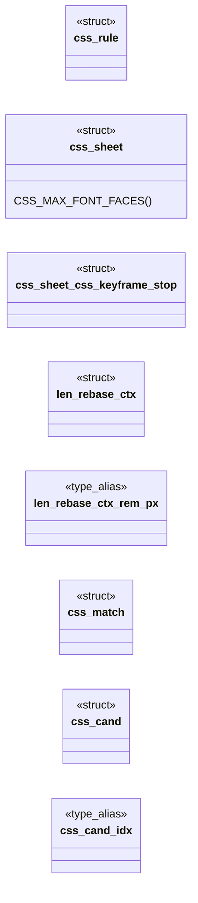
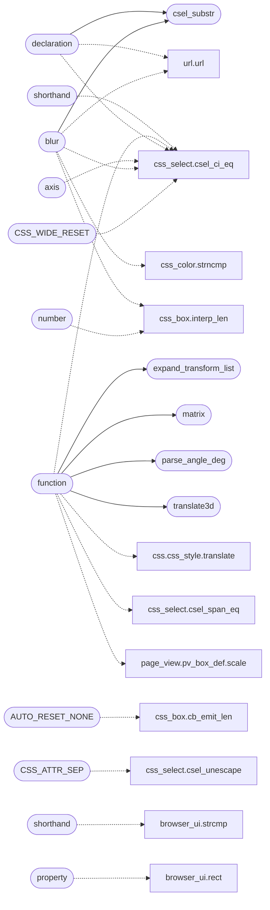

# `src/css.c`

> Source: [src/css.c:1](../../src/css.c#L1) | language `c` | coverage 24.1% | [API index](../index.md)

## Contents

- **Structs:** [`css_rule`](#css_rule), [`css_sheet`](#css_sheet), [`len_rebase_ctx`](#len_rebase_ctx), [`css_match`](#css_match), [`css_cand`](#css_cand)
- **Functions:** [`emit`](#emit), [`css_decl`](#css_decl), [`through`](#through), [`text`](#text), [`number`](#number), [`item`](#item), [`order`](#order), [`blur`](#blur), [`axis`](#axis), [`cap`](#cap), [`empty`](#empty), [`declaration`](#declaration), [`column`](#column), [`var`](#var), [`matrix`](#matrix), [`LIST`](#list), [`translate3d`](#translate3d), [`translateX`](#translatex), [`parse_angle_deg`](#parse_angle_deg), [`expand_transform_list`](#expand_transform_list), [`translateZ`](#translatez), [`function`](#function), [`shorthand`](#shorthand), [`property`](#property), [`writing`](#writing), [`shorthand`](#shorthand), [`caller`](#caller), [`slots`](#slots), [`sentinel`](#sentinel), [`here`](#here), [`csel_substr`](#csel_substr), [`download`](#download), [`var`](#var), [`css_parse`](#css_parse), [`css_parse_media`](#css_parse_media), [`css_parse_scoped`](#css_parse_scoped), [`css_parse_logged`](#css_parse_logged), [`consumer`](#consumer), [`css_free`](#css_free), [`page_view`](#page_view), [`parent`](#parent), [`css_ua_heading_em`](#css_ua_heading_em), [`css_computed_font_size_for_tag`](#css_computed_font_size_for_tag), [`css_resolve_el`](#css_resolve_el), [`css_resolve_el_ex`](#css_resolve_el_ex), [`css_resolve_pseudo`](#css_resolve_pseudo), [`css_resolve`](#css_resolve), [`NULL`](#null), [`css_font_face_count`](#css_font_face_count), [`css_font_face_at`](#css_font_face_at), [`css_parse_inline`](#css_parse_inline)
- **Macros:** [`CSS_INIT_SELS`](#css_init_sels), [`CSS_INIT_DECLS`](#css_init_decls), [`CSS_DECL_SLOTS_MIN`](#css_decl_slots_min), [`CSS_INIT_RULES`](#css_init_rules), [`CSS_SELS_PER_GROUP`](#css_sels_per_group), [`CSS_INLINE_DECLS`](#css_inline_decls), [`P_META_CUSTOM`](#p_meta_custom), [`P_META_VARSRC`](#p_meta_varsrc), [`CSS_MAX_RAW`](#css_max_raw), [`CSS_WIDE_RESET`](#css_wide_reset), [`AUTO_REJECT`](#auto_reject), [`AUTO_VALUE`](#auto_value), [`AUTO_RESET`](#auto_reset), [`AUTO_RESET_NONE`](#auto_reset_none), [`CSS_ATTR_MARK`](#css_attr_mark), [`CSS_ATTR_SEP`](#css_attr_sep), [`CSS_MEDIA_MAX_DEPTH`](#css_media_max_depth), [`CSS_VAR_POOL`](#css_var_pool)

## Type Diagram



## Call Graph

Solid arrows stay in this module, dashed arrows leave it.



## Structs

<a id="css_rule"></a>

### `css_rule`

`struct` | [src/css.c:101](../../src/css.c#L101)

```c
typedef struct { size_t start, count; } css_rule;
```

---

<a id="css_sheet"></a>

### `css_sheet`

`struct` | [src/css.c:103](../../src/css.c#L103)

```c
struct css_sheet
```

**Members**

| Member | Kind | Summary |
|---|---|---|
| [`css_keyframe_stop`](#css_sheet-css_keyframe_stop) | struct |  |
| [`CSS_MAX_FONT_FACES`](#css_sheet-css_max_font_faces) | macro | @font-face declarations (v1: font-family name + src URL). |

<a id="css_sheet-css_keyframe_stop"></a>

#### `css_sheet.css_keyframe_stop`

`struct` | [src/css.c:143](../../src/css.c#L143)

```c
struct css_keyframe_stop
```

<a id="css_sheet-css_max_font_faces"></a>

#### `css_sheet.CSS_MAX_FONT_FACES`

`macro` | [src/css.c:164](../../src/css.c#L164)

```c
#define CSS_MAX_FONT_FACES
```

@font-face declarations (v1: font-family name + src URL).

No I/O, no network — the caller resolves and downloads the URL against the page origin, same as background-image. url() is the only source format that is not discarded (other formats like local() are ignored). The family registers even with an empty src_url (data: URLs overflow the capture cap): element matching is by family hash, and only the trusted parent ever resolves a src (spec/webfont.md b3b).

---

<a id="len_rebase_ctx"></a>

### `len_rebase_ctx`

`struct` | [src/css.c:5060](../../src/css.c#L5060)

```c
typedef struct len_rebase_ctx
```

Unit scales for len_rebase; a scale <= 0 leaves that unit family untouched.

**Members**

| Member | Kind | Summary |
|---|---|---|
| [`rem_px`](#len_rebase_ctx-rem_px) | type_alias | Unit scales for len_rebase; a scale <= 0 leaves that unit family untouched. |

<a id="len_rebase_ctx-rem_px"></a>

#### `len_rebase_ctx.rem_px`

`type_alias` | [src/css.c:5060](../../src/css.c#L5060)

```c
typedef struct len_rebase_ctx { double rem_px;
```

Unit scales for len_rebase; a scale <= 0 leaves that unit family untouched.

---

<a id="css_match"></a>

### `css_match`

`struct` | [src/css.c:5884](../../src/css.c#L5884)

```c
typedef struct css_match
```

One matched selector, remembered between the passes of the element cascade.

---

<a id="css_cand"></a>

### `css_cand`

`struct` | [src/css.c:5890](../../src/css.c#L5890)

```c
typedef struct css_cand
```

A competing `--name` declaration: cascade key, then its text.

**Members**

| Member | Kind | Summary |
|---|---|---|
| [`idx`](#css_cand-idx) | type_alias | A competing `--name` declaration: cascade key, then its text. |

<a id="css_cand-idx"></a>

#### `css_cand.idx`

`type_alias` | [src/css.c:5890](../../src/css.c#L5890)

```c
typedef struct css_cand { int imp, espec, ord, idx;
```

A competing `--name` declaration: cascade key, then its text.

---

## Functions

<a id="emit"></a>

### `emit`

`function` | [src/css.c:63](../../src/css.c#L63)

```c
* * It must exceed the most slots ANY single declaration can emit (the widest today * is the `background` shorthand at 12), so that finishing with this much slack * proves no declaration in the rule w
```

**Parameters**

| Name | Type | Default | Description |
|---|---|---|---|
| `at` | `` the widest today * is the `background` shorthand 12 `` |  |  |

**Returns:** `* * It must exceed the most slots ANY single declaration can`

*Called by:* [`pf_scan`](src.prefetch.c.md#pf_scan), [`wh_on_notify`](src.ws_hub.c.md#wh_on_notify), [`wh_on_readable`](src.ws_hub.c.md#wh_on_readable), [`main`](tools.gen_psl.c.md#main)

---

<a id="css_decl"></a>

### `css_decl`

`function` | [src/css.c:90](../../src/css.c#L90)

```c
* text and stores the INDEX in the css_decl (int-only, see P_BG_IMAGE_URL);
```

**Parameters**

| Name | Type | Default | Description |
|---|---|---|---|
| `only` | `int-` |  |  |
| `P_BG_IMAGE_URL` | `see` |  |  |

**Returns:** `* text and stores the INDEX in the`

---

<a id="through"></a>

### `through`

`function` | [src/css.c:211](../../src/css.c#L211)

```c
* at the two SHARED chokepoints every property funnels through (the generic * dispatch tail, and emit_len for the <length-percentage> family) rather than in a * per-property table that would go stale on the next property added. * * `revert`/`revert-layer` roll back to the previous cascade origin. With one author * origin and a UA sheet expressed as per-tag defaults rather than as declarations, * "the previous origin" IS the unset default here, so they collapse onto the same * handling -- correct by construction rather than by approximation. */ /* wv[] marker: a CSS-wide keyword won a slot some earlier declaration had already * won (and possibly written). Distinct from every length sentinel. */ #define CSS_WIDE_RESET (INT_MIN + 64) /* clear of CSS_LEN_* sentinels (INT_MIN..+5) */
```

**Parameters**

| Name | Type | Default | Description |
|---|---|---|---|
| `tail` | `the generic * dispatch` |  |  |
| `family` | `and emit_len for the <length-percentage>` |  |  |

**Returns:** `* at the two SHARED chokepoints every property funnels`

---

<a id="text"></a>

### `text`

`function` | [src/css.c:264](../../src/css.c#L264)

```c
* source text (rem_rebase, see below) rather than by threading a context here. * * Viewport uni...
```

**Parameters**

| Name | Type | Default | Description |
|---|---|---|---|
| `below` | `see` |  |  |

**Returns:** `* source`

---

<a id="number"></a>

### `number`

`function` | [src/css.c:504](../../src/css.c#L504)

```c
* number (no unit) as px (common in shorthand context like "10 5"). */ static int interp_border_s...
```

**Parameters**

| Name | Type | Default | Description |
|---|---|---|---|
| `unit` | `no` |  |  |

**Returns:** `*`

*Calls:* [`interp_len`](src.css_box.c.md#interp_len)

---

<a id="item"></a>

### `item`

`function` | [src/css.c:1147](../../src/css.c#L1147)

```c
* timing list takes its first item (CSS Animations/Transitions 1: with one * transition/animation running, extra items have nothing to apply to). */ static void first_comma_item(const char *val, char *buf, size_t cap)
```

**Parameters**

| Name | Type | Default | Description |
|---|---|---|---|
| `running` | `CSS Animations/Transitions 1: with one * transition/animation` |  |  |
| `to` | `extra items have nothing to apply` |  |  |

**Returns:** `* timing list takes its first`

---

<a id="order"></a>

### `order`

`function` | [src/css.c:1440](../../src/css.c#L1440)

```c
* declaration order (dx, dy, optional blur >= 0);
```

**Parameters**

| Name | Type | Default | Description |
|---|---|---|---|
| `blur` | `optional >` | `0` |  |

**Returns:** `* declaration`

---

<a id="blur"></a>

### `blur`

`function` | [src/css.c:1475](../../src/css.c#L1475)

```c
* consumes ONLY blur(Npx);
```

**Returns:** `* consumes ONLY`

*Calls:* [`csel_ci_eq`](include.css_select.h.md#csel_ci_eq), [`url`](include.url.h.md#url), [`csel_substr`](#csel_substr), [`interp_len`](src.css_box.c.md#interp_len), [`strncmp`](src.css_color.c.md#strncmp)

---

<a id="axis"></a>

### `axis`

`function` | [src/css.c:1512](../../src/css.c#L1512)

```c
* bare center displaces it to the free axis (`center right` = x:right, y:center). * Any other co...
```

**Parameters**

| Name | Type | Default | Description |
|---|---|---|---|
| `right` | `` `center ` `` | `x:right` |  |
| `center` | `y:` |  |  |

**Returns:** `* bare center displaces it to the free`

*Calls:* [`csel_ci_eq`](include.css_select.h.md#csel_ci_eq)

---

<a id="cap"></a>

### `cap`

`function` | [src/css.c:1744](../../src/css.c#L1744)

```c
* string past the cap (emit_content): a conforming declaration must not * count as a discard just because an icon font ate the pool. */ if (*ncontent >= contentcap) return emit_content(dst, cap, NULL,
```

**Returns:** `a conforming declaration must not * count as a discard just because an icon font ate the pool. */ if (*ncontent >`

*Called by:* [`form`](include.render_doc.h.md#form), [`TSH_MAX_TEXT`](include.text_shape.h.md#tsh_max_text)

---

<a id="empty"></a>

### `empty`

`function` | [src/css.c:1778](../../src/css.c#L1778)

```c
* the slot with an explicit empty (ival -1) instead of dropping, or a * lower-priority string would leak through and the drops gate would count * a conforming declaration as a discard. */ if (csel_ci_
```

**Parameters**

| Name | Type | Default | Description |
|---|---|---|---|
| `ival` |  |  |  |

**Returns:** `* the slot with an`

---

<a id="declaration"></a>

### `declaration`

`function` | [src/css.c:2006](../../src/css.c#L2006)

```c
* invalid layer drops the whole declaration (fail closed). `none` is an explicit * no-shadow. ur...
```

**Parameters**

| Name | Type | Default | Description |
|---|---|---|---|
| `closed` | `fail` |  |  |

**Returns:** `* invalid layer drops the whole`

*Calls:* [`csel_ci_eq`](include.css_select.h.md#csel_ci_eq), [`url`](include.url.h.md#url), [`csel_substr`](#csel_substr)

---

<a id="column"></a>

### `column`

`function` | [src/css.c:2071](../../src/css.c#L2071)

```c
* column (`flex: 1 1 0%`);
```

**Parameters**

| Name | Type | Default | Description |
|---|---|---|---|
| `flex` |  |  |  |

**Returns:** `*`

---

<a id="var"></a>

### `var`

`function` | [src/css.c:2269](../../src/css.c#L2269)

```c
* cvr_resolve then substitutes var() references when a declaration's value is * interpreted (par...
```

**Returns:** `* cvr_resolve then substitutes`

---

<a id="matrix"></a>

### `matrix`

`function` | [src/css.c:2431](../../src/css.c#L2431)

```c
* * Contract: the matrix() branch's math, shared so the single-function and * list paths cannot disagree. Skew lands on skx only (the decomposition * convention: a shear pair has a family of factoriza
```

**Returns:** `* * Contract: the`

*Called by:* [`function`](#function)

---

<a id="list"></a>

### `LIST`

`function` | [src/css.c:2516](../../src/css.c#L2516)

```c
* transform FUNCTION LIST (CSS Transforms 1 3). * * Contract: space-separated functions apply in order and compose into one * affine matrix, QR-decomposed into the seven slots (shared with matrix()).
```

**Parameters**

| Name | Type | Default | Description |
|---|---|---|---|
| `Transforms` | `CSS 1 3` |  |  |

**Returns:** `* transform FUNCTION`

---

<a id="translate3d"></a>

### `translate3d`

`function` | [src/css.c:2523](../../src/css.c#L2523)

```c
* translate3d()/translateZ() flatten to their 2D projection (a 2D engine * renders z as nothing,...
```

**Returns:** `*`

*Called by:* [`function`](#function)

---

<a id="translatex"></a>

### `translateX`

`function` | [src/css.c:2786](../../src/css.c#L2786)

```c
* translateX()/translateY() offsets in px via interp_len (allow_auto=0 -- %, * viewport units and bare non-calc numbers all fail closed, same as any other * box-model length here);
```

**Returns:** `*`

---

<a id="parse_angle_deg"></a>

### `parse_angle_deg`

`function` | [src/css.c:2790](../../src/css.c#L2790)

```c
* parse_angle_deg (any of deg/grad/rad/turn, fractional allowed, rounded to * whole degrees);
```

**Parameters**

| Name | Type | Default | Description |
|---|---|---|---|
| `turn` | `any of deg/grad/rad/` |  |  |
| `allowed` | `fractional` |  |  |
| `degrees` | `rounded to * whole` |  |  |

**Returns:** `*`

*Called by:* [`function`](#function)

---

<a id="expand_transform_list"></a>

### `expand_transform_list`

`function` | [src/css.c:2793](../../src/css.c#L2793)

```c
* LISTS compose in order through expand_transform_list (CSS Transforms 1 3);
```

**Parameters**

| Name | Type | Default | Description |
|---|---|---|---|
| `Transforms` | `CSS 1 3` |  |  |

**Returns:** `* LISTS compose in order through`

*Called by:* [`function`](#function)

---

<a id="translatez"></a>

### `translateZ`

`function` | [src/css.c:2795](../../src/css.c#L2795)

```c
* translateZ(), rotateX(0) and rotateY(0) emit the identity (with the stacking * context Firefox builds);
```

**Returns:** `*`

---

<a id="function"></a>

### `function`

`function` | [src/css.c:2797](../../src/css.c#L2797)

```c
* transform function (perspective/rotate3d/...), or unparseable syntax, * rejects the WHOLE decl...
```

**Parameters**

| Name | Type | Default | Description |
|---|---|---|---|
| `rotate3d` | `perspective/ /...` |  |  |

**Returns:** `* transform`

*Calls:* [`css_style.translate`](include.css.h.md#css_style-translate), [`csel_ci_eq`](include.css_select.h.md#csel_ci_eq), [`csel_span_eq`](include.css_select.h.md#csel_span_eq), [`pv_box_def.scale`](include.page_view.h.md#pv_box_def-scale), [`expand_transform_list`](#expand_transform_list), [`matrix`](#matrix), [`parse_angle_deg`](#parse_angle_deg), [`translate3d`](#translate3d)

---

<a id="shorthand"></a>

### `shorthand`

`function` | [src/css.c:3071](../../src/css.c#L3071)

```c
* An uninterpretable token drops the whole shorthand (fail closed). */ static int expand_place(co...
```

**Parameters**

| Name | Type | Default | Description |
|---|---|---|---|
| `closed` | `fail` |  |  |

**Returns:** `* An uninterpretable token drops the whole`

*Calls:* [`strcmp`](gui.browser_ui.c.md#strcmp)

---

<a id="property"></a>

### `property`

`function` | [src/css.c:3106](../../src/css.c#L3106)

```c
* error drops the whole property (fail closed). */ static int expand_clip(const char *val, css_de...
```

**Parameters**

| Name | Type | Default | Description |
|---|---|---|---|
| `closed` | `fail` |  |  |

**Returns:** `* error drops the whole`

*Calls:* [`rect`](gui.browser_ui.c.md#rect)

---

<a id="writing"></a>

### `writing`

`function` | [src/css.c:3238](../../src/css.c#L3238)

```c
* Wide keywords claim BOTH slots without writing (inheritance then flows, as * the tail does for single-slot properties). */ static int expand_fontfamily(const char *val, css_decl *dst, int cap, char (*contenttab)[CSS_URL_MAX], size_t *ncontent, size_t contentcap)
```

**Parameters**

| Name | Type | Default | Description |
|---|---|---|---|
| `flows` | `inheritance then` |  |  |
| `properties` | `as * the tail does for single-slot` |  |  |

**Returns:** `* Wide keywords claim BOTH slots without`

---

<a id="shorthand"></a>

### `shorthand`

`function` | [src/css.c:3280](../../src/css.c#L3280)

```c
* generic bucket keeps the rest of the shorthand (same net effect as the * font-family longhand dropping an unknown name). */ static int expand_font(const char *val, css_decl *dst, int cap, char (*contenttab)[CSS_URL_MAX], size_t *ncontent, size_t contentcap)
```

**Parameters**

| Name | Type | Default | Description |
|---|---|---|---|
| `name` | `same net effect as the * font-family longhand dropping an unknown` |  |  |

**Returns:** `* generic bucket keeps the rest of the`

*Calls:* [`csel_ci_eq`](include.css_select.h.md#csel_ci_eq)

---

<a id="caller"></a>

### `caller`

`function` | [src/css.c:3360](../../src/css.c#L3360)

```c
* left to the caller (parse_one_decl stamps it). */ /* `known` (optional) reports whether the property NAME reached a branch of the * dispatch below, which is what separates "not implemented" from "im
```

**Parameters**

| Name | Type | Default | Description |
|---|---|---|---|
| `it` | `parse_one_decl stamps` |  |  |

**Returns:** `* left to the`

---

<a id="slots"></a>

### `slots`

`function` | [src/css.c:3530](../../src/css.c#L3530)

```c
* expand to several slots (border / box-shadow / outline / flex). */ if (strcmp(prop, "top") == 0) return emit_len(dst, cap, P_INSET_TOP, val, 1, 1);
```

**Parameters**

| Name | Type | Default | Description |
|---|---|---|---|
| `flex` | `border / box-shadow / outline /` |  |  |

**Returns:** `* expand to several`

---

<a id="sentinel"></a>

### `sentinel`

`function` | [src/css.c:3645](../../src/css.c#L3645)

```c
* cascade carries as the currentColor sentinel (in `color` the two are the * same thing);
```

**Parameters**

| Name | Type | Default | Description |
|---|---|---|---|
| `thing` | `` `color` the two are the * same `` |  |  |

**Returns:** `* cascade carries as the currentColor`

---

<a id="here"></a>

### `here`

`function` | [src/css.c:3848](../../src/css.c#L3848)

```c
* servers have no form here (fail closed). */ int o = csel_ci_eq(val, "none") ? CSS_SVG_PAINT_NONE : interp_color(val);
```

**Parameters**

| Name | Type | Default | Description |
|---|---|---|---|
| `closed` | `fail` |  |  |

**Returns:** `* servers have no form`

---

<a id="csel_substr"></a>

### `csel_substr`

`function` | [src/css.c:4552](../../src/css.c#L4552)

```c
return known && csel_substr(val, "var(", 1);
```

Substring test (used both to drop any value carrying url() — always ci — and by the attribute `*=` operator).

A non-empty needle only; an empty one never matches.

**Parameters**

| Name | Type | Default | Description |
|---|---|---|---|
| `var` |  |  |  |
| `1);` |  |  |  |

**Returns:** `return known &&`

> **Inherited:** Documentation from [`csel_substr`](#csel_substr) (include/css_select.h:222).

*Called by:* [`blur`](#blur), [`declaration`](#declaration)

---

<a id="download"></a>

### `download`

`function` | [src/css.c:4892](../../src/css.c#L4892)

```c
* the download (spec/webfont.md b3b). An empty src_url * simply never resolv...
```

**Parameters**

| Name | Type | Default | Description |
|---|---|---|---|
| `b3b` | `spec/webfont.md` |  |  |

**Returns:** `* the`

---

<a id="var"></a>

### `var`

`function` | [src/css.c:5244](../../src/css.c#L5244)

```c
* collected and forty var() declarations -- font sizes, widths, radii, the * whole theme -- ...
```

**Returns:** `* collected and forty`

---

<a id="css_parse"></a>

### `css_parse`

`function` | [src/css.c:5269](../../src/css.c#L5269)

```c
css_status css_parse(const char *text, size_t len, css_sheet **out)
```

**Parameters**

| Name | Type | Default | Description |
|---|---|---|---|
| `text` | `char *` |  |  |
| `len` | `size_t` |  |  |
| `out` | `css_sheet **` |  |  |

**Returns:** `css_status`

*Called by:* [`LLVMFuzzerTestOneInput`](fuzz.fuzz_css.c.md#llvmfuzzertestoneinput)

---

<a id="css_parse_media"></a>

### `css_parse_media`

`function` | [src/css.c:5273](../../src/css.c#L5273)

```c
css_status css_parse_media(const char *text, size_t len, const css_media *media, css_sheet **out)
```

**Parameters**

| Name | Type | Default | Description |
|---|---|---|---|
| `text` | `char *` |  |  |
| `len` | `size_t` |  |  |
| `media` | `css_media *` |  |  |
| `out` | `css_sheet **` |  |  |

**Returns:** `css_status`

*Called by:* [`LLVMFuzzerTestOneInput`](fuzz.fuzz_css.c.md#llvmfuzzertestoneinput)

---

<a id="css_parse_scoped"></a>

### `css_parse_scoped`

`function` | [src/css.c:5278](../../src/css.c#L5278)

```c
css_status css_parse_scoped(const char *text, size_t len, const css_media *media, const char *root_scope, css_sheet **out)
```

**Parameters**

| Name | Type | Default | Description |
|---|---|---|---|
| `text` | `char *` |  |  |
| `len` | `size_t` |  |  |
| `media` | `css_media *` |  |  |
| `root_scope` | `char *` |  |  |
| `out` | `css_sheet **` |  |  |

**Returns:** `css_status`

*Called by:* [`pv_build_styled`](src.page_view.c.md#pv_build_styled)

---

<a id="css_parse_logged"></a>

### `css_parse_logged`

`function` | [src/css.c:5283](../../src/css.c#L5283)

```c
css_status css_parse_logged(const char *text, size_t len, const css_media *media, const char *root_scope, css_sheet **out, css_drop_log *log)
```

**Parameters**

| Name | Type | Default | Description |
|---|---|---|---|
| `text` | `char *` |  |  |
| `len` | `size_t` |  |  |
| `media` | `css_media *` |  |  |
| `root_scope` | `char *` |  |  |
| `out` | `css_sheet **` |  |  |
| `log` | `css_drop_log *` |  |  |

**Returns:** `css_status`

---

<a id="consumer"></a>

### `consumer`

`function` | [src/css.c:5317](../../src/css.c#L5317)

```c
* consumer (shorthands, calc(), var() values) gets it with no context * threaded through...
```

**Parameters**

| Name | Type | Default | Description |
|---|---|---|---|
| `calc` |  |  |  |
| `values` | `var()` |  |  |

**Returns:** `*`

---

<a id="css_free"></a>

### `css_free`

`function` | [src/css.c:5375](../../src/css.c#L5375)

```c
void css_free(css_sheet *s)
```

Idempotent; NULL-safe.

**Parameters**

| Name | Type | Default | Description |
|---|---|---|---|
| `s` | `css_sheet *` |  |  |

> **Inherited:** Documentation from [`css_free`](#css_free) (include/css.h:1078).

---

<a id="page_view"></a>

### `page_view`

`function` | [src/css.c:5413](../../src/css.c#L5413)

```c
* the generated text reaches page_view (which materialises it as a synthetic * run);
```

**Parameters**

| Name | Type | Default | Description |
|---|---|---|---|
| `run` | `which materialises it as a synthetic *` |  |  |

**Returns:** `* the generated text reaches`

---

<a id="parent"></a>

### `parent`

`function` | [src/css.c:5446](../../src/css.c#L5446)

```c
* property from the parent (`inherit`), and an unset non-inherited one * stands at its i...
```

**Parameters**

| Name | Type | Default | Description |
|---|---|---|---|
| `inherit` |  |  |  |

**Returns:** `* property from the`

---

<a id="css_ua_heading_em"></a>

### `css_ua_heading_em`

`function` | [src/css.c:5865](../../src/css.c#L5865)

```c
double css_ua_heading_em(int level)
```

The user-agent sheet's font-size of <h1>..<h6> as a multiple of the parent's (HTML Rendering 15.3.6: 2em, 1.5em, 1.17em, 1em, .83em, .67em).

1.0 for any other level. The ONE table: the painter's theme reads it too.

**Parameters**

| Name | Type | Default | Description |
|---|---|---|---|
| `level` | `int` |  |  |

**Returns:** `double`

> **Inherited:** Documentation from [`css_ua_heading_em`](#css_ua_heading_em) (include/css.h:1199).

---

<a id="css_computed_font_size_for_tag"></a>

### `css_computed_font_size_for_tag`

`function` | [src/css.c:5870](../../src/css.c#L5870)

```c
double css_computed_font_size_for_tag(const css_style *o, double inherited_px, const char *tag)
```

**Parameters**

| Name | Type | Default | Description |
|---|---|---|---|
| `o` | `css_style *` |  |  |
| `inherited_px` | `double` |  |  |
| `tag` | `char *` |  |  |

**Returns:** `double`

---

<a id="css_resolve_el"></a>

### `css_resolve_el`

`function` | [src/css.c:6056](../../src/css.c#L6056)

```c
css_style css_resolve_el(const css_sheet *sheet, const css_element *el, const char *inline_style, size_t inline_len)
```

**Parameters**

| Name | Type | Default | Description |
|---|---|---|---|
| `sheet` | `css_sheet *` |  |  |
| `el` | `css_element *` |  |  |
| `inline_style` | `char *` |  |  |
| `inline_len` | `size_t` |  |  |

**Returns:** `css_style`

*Called by:* [`LLVMFuzzerTestOneInput`](fuzz.fuzz_css.c.md#llvmfuzzertestoneinput)

---

<a id="css_resolve_el_ex"></a>

### `css_resolve_el_ex`

`function` | [src/css.c:6065](../../src/css.c#L6065)

```c
css_style css_resolve_el_ex(const css_sheet *sheet, const css_element *el, const char *inline_style, size_t inline_len, cvr_table *own_out)
```

**Parameters**

| Name | Type | Default | Description |
|---|---|---|---|
| `sheet` | `css_sheet *` |  |  |
| `el` | `css_element *` |  |  |
| `inline_style` | `char *` |  |  |
| `inline_len` | `size_t` |  |  |
| `own_out` | `cvr_table *` |  |  |

**Returns:** `css_style`

*Called by:* [`cch_element_style_vars`](src.css_chain.c.md#cch_element_style_vars)

---

<a id="css_resolve_pseudo"></a>

### `css_resolve_pseudo`

`function` | [src/css.c:6081](../../src/css.c#L6081)

```c
css_style css_resolve_pseudo(const css_sheet *sheet, const css_element *el, int which)
```

**Parameters**

| Name | Type | Default | Description |
|---|---|---|---|
| `sheet` | `css_sheet *` |  |  |
| `el` | `css_element *` |  |  |
| `which` | `int` |  |  |

**Returns:** `css_style`

*Called by:* [`cch_pseudo_style`](src.css_chain.c.md#cch_pseudo_style)

---

<a id="css_resolve"></a>

### `css_resolve`

`function` | [src/css.c:6349](../../src/css.c#L6349)

```c
css_style css_resolve(const css_sheet *sheet, const char *tag, const char *id, const char *const *classes, size_t nclasses, const char *inline_style, size_t inline_len)
```

**Parameters**

| Name | Type | Default | Description |
|---|---|---|---|
| `sheet` | `css_sheet *` |  |  |
| `tag` | `char *` |  |  |
| `id` | `char *` |  |  |
| `classes` | `char *const *` |  |  |
| `nclasses` | `size_t` |  |  |
| `inline_style` | `char *` |  |  |
| `inline_len` | `size_t` |  |  |

**Returns:** `css_style`

*Called by:* [`LLVMFuzzerTestOneInput`](fuzz.fuzz_css.c.md#llvmfuzzertestoneinput)

---

<a id="null"></a>

### `NULL`

`function` | [src/css.c:6373](../../src/css.c#L6373)

```c
* Sheet can be NULL (inline style, no @keyframes). */ void css_resolve_anim_keyframes(css_style *...
```

**Parameters**

| Name | Type | Default | Description |
|---|---|---|---|
| `style` | `inline` |  |  |
| `keyframes` | `no @` |  |  |

**Returns:** `* Sheet can be`

*Called by:* [`UI_MAX_TABS`](gui.browser_ui.c.md#ui_max_tabs)

---

<a id="css_font_face_count"></a>

### `css_font_face_count`

`function` | [src/css.c:6405](../../src/css.c#L6405)

```c
size_t css_font_face_count(const css_sheet *sheet)
```

Web font access: returns the number of @font-face declarations parsed into the sheet, and copies the i-th declaration's family and src URL into the caller's buffers (both sized CSS_TOK_MAX / CSS_URL_MAX).

Returns 0 on success, -1 if i is out of range.

**Parameters**

| Name | Type | Default | Description |
|---|---|---|---|
| `sheet` | `css_sheet *` |  |  |

**Returns:** `size_t`

> **Inherited:** Documentation from [`css_font_face_count`](#css_font_face_count) (include/css.h:1214).

---

<a id="css_font_face_at"></a>

### `css_font_face_at`

`function` | [src/css.c:6409](../../src/css.c#L6409)

```c
int css_font_face_at(const css_sheet *sheet, size_t i, char *family, size_t fam_cap, char *src_url, size_t url_cap)
```

**Parameters**

| Name | Type | Default | Description |
|---|---|---|---|
| `sheet` | `css_sheet *` |  |  |
| `i` | `size_t` |  |  |
| `family` | `char *` |  |  |
| `fam_cap` | `size_t` |  |  |
| `src_url` | `char *` |  |  |
| `url_cap` | `size_t` |  |  |

**Returns:** `int`

---

<a id="css_parse_inline"></a>

### `css_parse_inline`

`function` | [src/css.c:6419](../../src/css.c#L6419)

```c
css_style css_parse_inline(const char *style, size_t len)
```

**Parameters**

| Name | Type | Default | Description |
|---|---|---|---|
| `style` | `char *` |  |  |
| `len` | `size_t` |  |  |

**Returns:** `css_style`

*Called by:* [`LLVMFuzzerTestOneInput`](fuzz.fuzz_css.c.md#llvmfuzzertestoneinput)

---

## Macros

<a id="css_init_sels"></a>

### `CSS_INIT_SELS`

`macro` | [src/css.c:50](../../src/css.c#L50)

```c
#define CSS_INIT_SELS
```

Initial capacities (anti-DoS hint: start small, grow on demand).

Every real browser does this; hardcoding an artificial ceiling is a bug, not a feature.

---

<a id="css_init_decls"></a>

### `CSS_INIT_DECLS`

`macro` | [src/css.c:51](../../src/css.c#L51)

```c
#define CSS_INIT_DECLS
```

---

<a id="css_decl_slots_min"></a>

### `CSS_DECL_SLOTS_MIN`

`macro` | [src/css.c:66](../../src/css.c#L66)

```c
#define CSS_DECL_SLOTS_MIN
```

Free declaration slots guaranteed to be available before a rule's block is interpreted, and the slack that must REMAIN afterwards for the result to be trusted as complete.

Without it, a rule parsed while the sheet's array happened to be nearly full lost
every declaration after the first few, silently: the array doubled only once it
was completely full, so the free space cycled down to 1 and whichever rules landed
there were truncated. Measured with the drop log, which reported them as
"bad-value" -- a plain `width: 70%` and `margin-left: 20px` appearing as invalid
is what exposed it.

It must exceed the most slots ANY single declaration can emit (the widest today
is the `background` shorthand at 12), so that finishing with this much slack
proves no declaration in the rule was refused for lack of room.

---

<a id="css_init_rules"></a>

### `CSS_INIT_RULES`

`macro` | [src/css.c:67](../../src/css.c#L67)

```c
#define CSS_INIT_RULES
```

---

<a id="css_sels_per_group"></a>

### `CSS_SELS_PER_GROUP`

`macro` | [src/css.c:68](../../src/css.c#L68)

```c
#define CSS_SELS_PER_GROUP
```

---

<a id="css_inline_decls"></a>

### `CSS_INLINE_DECLS`

`macro` | [src/css.c:69](../../src/css.c#L69)

```c
#define CSS_INLINE_DECLS
```

---

<a id="p_meta_custom"></a>

### `P_META_CUSTOM`

`macro` | [src/css.c:82](../../src/css.c#L82)

```c
#define P_META_CUSTOM
```

Meta declarations (spec/css_vars.md, "Alcance por elemento").

They live in a rule's declaration array but never claim a cascade slot: P_META_CUSTOM is a `--name: value` declaration, P_META_VARSRC the raw text of a declaration whose value holds var(), followed by the [`span`](src.css_color.c.md#span) declarations the page-global resolution produced. ival indexes the sheet's raw pool.

---

<a id="p_meta_varsrc"></a>

### `P_META_VARSRC`

`macro` | [src/css.c:83](../../src/css.c#L83)

```c
#define P_META_VARSRC
```

---

<a id="css_max_raw"></a>

### `CSS_MAX_RAW`

`macro` | [src/css.c:86](../../src/css.c#L86)

```c
#define CSS_MAX_RAW
```

Raw-pool entries per sheet (anti-DoS); past it a declaration keeps only its page-global meaning.

---

<a id="css_wide_reset"></a>

### `CSS_WIDE_RESET`

`macro` | [src/css.c:221](../../src/css.c#L221)

```c
#define CSS_WIDE_RESET
```

wv[] marker: a CSS-wide keyword won a slot some earlier declaration had already won (and possibly written).

Distinct from every length sentinel.

*Calls:* [`csel_ci_eq`](include.css_select.h.md#csel_ci_eq)

---

<a id="auto_reject"></a>

### `AUTO_REJECT`

`macro` | [src/css.c:274](../../src/css.c#L274)

```c
#define AUTO_REJECT
```

Length/box/grid/calc value family lives in css_box.c (single owner).

Thin wrappers keep existing call sites stable while the cascade decomposes. See spec/css_box.md.

---

<a id="auto_value"></a>

### `AUTO_VALUE`

`macro` | [src/css.c:275](../../src/css.c#L275)

```c
#define AUTO_VALUE
```

---

<a id="auto_reset"></a>

### `AUTO_RESET`

`macro` | [src/css.c:276](../../src/css.c#L276)

```c
#define AUTO_RESET
```

---

<a id="auto_reset_none"></a>

### `AUTO_RESET_NONE`

`macro` | [src/css.c:277](../../src/css.c#L277)

```c
#define AUTO_RESET_NONE
```

*Calls:* [`cb_emit_len`](include.css_box.h.md#cb_emit_len)

---

<a id="css_attr_mark"></a>

### `CSS_ATTR_MARK`

`macro` | [src/css.c:1685](../../src/css.c#L1685)

```c
#define CSS_ATTR_MARK
```

content: attr(name[, fallback]) marker.

Stored as "\x01attr:" + lowercased name + optional "\x1f" + fallback (unescaped). The 0x01 prefix can never start a real quoted string value (a control char + literal), so the marker is unambiguous.

---

<a id="css_attr_sep"></a>

### `CSS_ATTR_SEP`

`macro` | [src/css.c:1686](../../src/css.c#L1686)

```c
#define CSS_ATTR_SEP
```

*Calls:* [`csel_unescape`](include.css_select.h.md#csel_unescape)

---

<a id="css_media_max_depth"></a>

### `CSS_MEDIA_MAX_DEPTH`

`macro` | [src/css.c:4652](../../src/css.c#L4652)

```c
#define CSS_MEDIA_MAX_DEPTH
```

Nesting bound for conditional group rules (@media, @supports, @layer) -- they nest in real sheets (a @layer holding @media holding @supports).

---

<a id="css_var_pool"></a>

### `CSS_VAR_POOL`

`macro` | [src/css.c:5956](../../src/css.c#L5956)

```c
#define CSS_VAR_POOL
```

url()/content strings a re-resolved declaration may carry; they only need to live until apply_decl has copied them.

---
