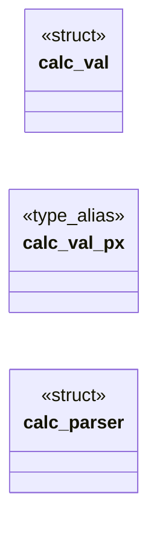
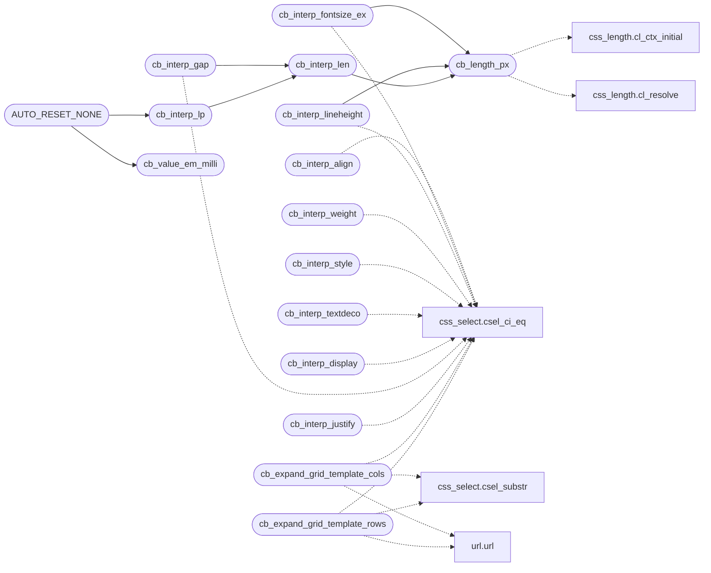

# `src/css_box.c`

> Source: [src/css_box.c:1](../../src/css_box.c#L1) | language `c` | coverage 46.9% | [API index](../index.md)

## Contents

- **Structs:** [`calc_val`](#calc_val), [`calc_parser`](#calc_parser)
- **Functions:** [`cb_length_px`](#cb_length_px), [`cb_interp_align`](#cb_interp_align), [`RELATIVE`](#relative), [`cb_interp_fontsize_ex`](#cb_interp_fontsize_ex), [`cb_interp_lineheight`](#cb_interp_lineheight), [`cb_interp_weight`](#cb_interp_weight), [`cb_interp_style`](#cb_interp_style), [`cb_interp_textdeco`](#cb_interp_textdeco), [`cb_interp_display`](#cb_interp_display), [`cb_interp_gap`](#cb_interp_gap), [`cb_interp_justify`](#cb_interp_justify), [`repeat`](#repeat), [`cb_expand_grid_template_cols`](#cb_expand_grid_template_cols), [`cb_expand_grid_template_rows`](#cb_expand_grid_template_rows), [`accepts`](#accepts), [`min`](#min), [`cb_interp_len`](#cb_interp_len), [`cb_value_em_milli`](#cb_value_em_milli), [`cb_interp_lp`](#cb_interp_lp), [`term`](#term), [`interp_len`](#interp_len), [`cb_expand_box2`](#cb_expand_box2)
- **Macros:** [`CSS_CALC_MAX_DEPTH`](#css_calc_max_depth), [`CSS_MATHFN_MAX_ARGS`](#css_mathfn_max_args), [`AUTO_REJECT`](#auto_reject), [`AUTO_VALUE`](#auto_value), [`AUTO_RESET`](#auto_reset), [`AUTO_RESET_NONE`](#auto_reset_none)

## Type Diagram



## Call Graph

Solid arrows stay in this module, dashed arrows leave it.



## Structs

<a id="calc_val"></a>

### `calc_val`

`struct` | [src/css_box.c:697](../../src/css_box.c#L697)

```c
typedef struct calc_val { double px; double em; double pct; int is_length; } calc_val;
```

[`pct`](include.interp.h.md#pct) is the percentage component, carried through the arithmetic exactly like `em` and for exactly the same reason: a calc() result is the affine combination a*1px + b*1em + c*1%, and CSS Values 4 section 10 lets an author mix all three.

Collapsing the percentage at parse time is impossible -- its basis is the containing block, which the element-free cascade does not know -- so it travels symbolically to bx_lp_px, the one place a percentage becomes pixels.

Before this, calc() understood no percentage at all, so `width: calc(100% - 2rem)`
-- the single most common responsive idiom on the web -- was dropped whole.

**Members**

| Member | Kind | Summary |
|---|---|---|
| [`px`](#calc_val-px) | type_alias | [`pct`](include.interp.h.md#pct) is the percentage component, carried through the arithmetic exactly like `em` and for exactly the same reason: a calc() result is the affine combination... |

<a id="calc_val-px"></a>

#### `calc_val.px`

`type_alias` | [src/css_box.c:697](../../src/css_box.c#L697)

```c
typedef struct calc_val { double px;
```

[`pct`](include.interp.h.md#pct) is the percentage component, carried through the arithmetic exactly like `em` and for exactly the same reason: a calc() result is the affine combination a*1px + b*1em + c*1%, and CSS Values 4 section 10 lets an author mix all three.

Collapsing the percentage at parse time is impossible -- its basis is the containing block, which the element-free cascade does not know -- so it travels symbolically to bx_lp_px, the one place a percentage becomes pixels.

Before this, calc() understood no percentage at all, so `width: calc(100% - 2rem)`
-- the single most common responsive idiom on the web -- was dropped whole.

---

<a id="calc_parser"></a>

### `calc_parser`

`struct` `const` | [src/css_box.c:698](../../src/css_box.c#L698)

```c
typedef struct calc_parser { const char *s; size_t n, i; } calc_parser;
```

---

## Functions

<a id="cb_length_px"></a>

### `cb_length_px`

`function` | [src/css_box.c:49](../../src/css_box.c#L49)

```c
int cb_length_px(const char *v, double *px)
```

Resolves a NUL-terminated <length> token to px through the canonical resolver.

Returns 1 on success. This is the ONLY place in the cascade that turns a unit into pixels -- see spec/css_length.md for why that matters.

**Parameters**

| Name | Type | Default | Description |
|---|---|---|---|
| `v` | `char *` |  |  |
| `px` | `double *` |  |  |

**Returns:** `int`

*Calls:* [`cl_ctx_initial`](src.css_length.c.md#cl_ctx_initial), [`cl_resolve`](src.css_length.c.md#cl_resolve)

*Called by:* [`cb_interp_fontsize_ex`](#cb_interp_fontsize_ex), [`cb_interp_len`](#cb_interp_len), [`cb_interp_lineheight`](#cb_interp_lineheight)

---

<a id="cb_interp_align"></a>

### `cb_interp_align`

`function` | [src/css_box.c:54](../../src/css_box.c#L54)

```c
int cb_interp_align(const char *v)
```

**Parameters**

| Name | Type | Default | Description |
|---|---|---|---|
| `v` | `char *` |  |  |

**Returns:** `int`

*Calls:* [`csel_ci_eq`](include.css_select.h.md#csel_ci_eq)

---

<a id="relative"></a>

### `RELATIVE`

`function` | [src/css_box.c:63](../../src/css_box.c#L63)

```c
* or RELATIVE (of the inherited size). Absolute: px/pt/rem/viewport units and the * absolute keywords. Relative: em, %, and smaller/larger. *abs is written on every * path, including the -1 failure, s
```

**Parameters**

| Name | Type | Default | Description |
|---|---|---|---|
| `size` | `of the inherited` |  |  |

**Returns:** `* or`

---

<a id="cb_interp_fontsize_ex"></a>

### `cb_interp_fontsize_ex`

`function` | [src/css_box.c:72](../../src/css_box.c#L72)

```c
int cb_interp_fontsize_ex(const char *v, int *abs_out)
```

**Parameters**

| Name | Type | Default | Description |
|---|---|---|---|
| `v` | `char *` |  |  |
| `abs_out` | `int *` |  |  |

**Returns:** `int`

*Calls:* [`csel_ci_eq`](include.css_select.h.md#csel_ci_eq), [`cb_length_px`](#cb_length_px)

---

<a id="cb_interp_lineheight"></a>

### `cb_interp_lineheight`

`function` | [src/css_box.c:145](../../src/css_box.c#L145)

```c
int cb_interp_lineheight(const char *v)
```

line-height as a percent of the natural line box.

A unitless multiplier ("1.5" -> 150) or a percent ("160%" -> 160); "normal" is unset (the UA default). Absolute px/em line-heights need a font size we don't have here, so they are dropped (return -1). Clamped to [CSS_LINE_MIN, CSS_LINE_MAX] (anti-DoS).

**Parameters**

| Name | Type | Default | Description |
|---|---|---|---|
| `v` | `char *` |  |  |

**Returns:** `int`

*Calls:* [`csel_ci_eq`](include.css_select.h.md#csel_ci_eq), [`cb_length_px`](#cb_length_px)

---

<a id="cb_interp_weight"></a>

### `cb_interp_weight`

`function` | [src/css_box.c:174](../../src/css_box.c#L174)

```c
int cb_interp_weight(const char *v)
```

**Parameters**

| Name | Type | Default | Description |
|---|---|---|---|
| `v` | `char *` |  |  |

**Returns:** `int`

*Calls:* [`csel_ci_eq`](include.css_select.h.md#csel_ci_eq)

---

<a id="cb_interp_style"></a>

### `cb_interp_style`

`function` | [src/css_box.c:183](../../src/css_box.c#L183)

```c
int cb_interp_style(const char *v)
```

**Parameters**

| Name | Type | Default | Description |
|---|---|---|---|
| `v` | `char *` |  |  |

**Returns:** `int`

*Calls:* [`csel_ci_eq`](include.css_select.h.md#csel_ci_eq)

---

<a id="cb_interp_textdeco"></a>

### `cb_interp_textdeco`

`function` | [src/css_box.c:193](../../src/css_box.c#L193)

```c
int cb_interp_textdeco(const char *v)
```

text-decoration / text-decoration-line: OR of the line keywords underline / overline / line-through found in the (space-separated) value.

"none" -> 0 (explicit removal). Style/color/thickness tokens (wavy, red, 2px, solid, ...) are ignored. A value carrying no line keyword at all is unsupported -> -1 (dropped).

**Parameters**

| Name | Type | Default | Description |
|---|---|---|---|
| `v` | `char *` |  |  |

**Returns:** `int`

*Calls:* [`csel_ci_eq`](include.css_select.h.md#csel_ci_eq)

---

<a id="cb_interp_display"></a>

### `cb_interp_display`

`function` | [src/css_box.c:213](../../src/css_box.c#L213)

```c
int cb_interp_display(const char *v)
```

**Parameters**

| Name | Type | Default | Description |
|---|---|---|---|
| `v` | `char *` |  |  |

**Returns:** `int`

*Calls:* [`csel_ci_eq`](include.css_select.h.md#csel_ci_eq)

---

<a id="cb_interp_gap"></a>

### `cb_interp_gap`

`function` | [src/css_box.c:288](../../src/css_box.c#L288)

```c
int cb_interp_gap(const char *v)
```

One gap length.

Reuses interp_len (px / em / rem / bare 0 / calc() / math functions), so a `gap: 1em` is 16px instead of the old misparse-as-1px, and a trailing junk token fails closed. Negative fails; clamped to CSS_GAP_MAX.

**Parameters**

| Name | Type | Default | Description |
|---|---|---|---|
| `v` | `char *` |  |  |

**Returns:** `int`

*Calls:* [`csel_ci_eq`](include.css_select.h.md#csel_ci_eq), [`cb_interp_len`](#cb_interp_len)

---

<a id="cb_interp_justify"></a>

### `cb_interp_justify`

`function` | [src/css_box.c:295](../../src/css_box.c#L295)

```c
int cb_interp_justify(const char *v)
```

**Parameters**

| Name | Type | Default | Description |
|---|---|---|---|
| `v` | `char *` |  |  |

**Returns:** `int`

*Calls:* [`csel_ci_eq`](include.css_select.h.md#csel_ci_eq)

---

<a id="repeat"></a>

### `repeat`

`function` | [src/css_box.c:309](../../src/css_box.c#L309)

```c
* repeat(<positive-integer>, <track-list>) into (count * tracks-in-pattern). * repeat(auto-fill|...) / repeat(auto-fit|...) need an available width this pure * parser does not have, so they fail the W
```

**Parameters**

| Name | Type | Default | Description |
|---|---|---|---|
| `integer` | `<positive- >` |  |  |
| `list` | `<track- >` |  |  |

**Returns:** `*`

---

<a id="cb_expand_grid_template_cols"></a>

### `cb_expand_grid_template_cols`

`function` | [src/css_box.c:591](../../src/css_box.c#L591)

```c
int cb_expand_grid_template_cols(const char *val, css_decl *dst, int cap)
```

grid-template-columns: track count PLUS the first CSS_GRID_TRACKS_MAX track sizes, emitted in lock-step (P_GRIDCOLS + P_GRID_TRACK0..7; unsized slots emit 0 = auto so a higher-tier declaration fully resets a lower-tier one). none/url()/malformed drop the declaration, exactly like interp_gridcols.

**Parameters**

| Name | Type | Default | Description |
|---|---|---|---|
| `val` | `char *` |  |  |
| `dst` | `css_decl *` |  |  |
| `cap` | `int` |  |  |

**Returns:** `int`

*Calls:* [`csel_ci_eq`](include.css_select.h.md#csel_ci_eq), [`csel_substr`](include.css_select.h.md#csel_substr), [`url`](include.url.h.md#url)

---

<a id="cb_expand_grid_template_rows"></a>

### `cb_expand_grid_template_rows`

`function` | [src/css_box.c:614](../../src/css_box.c#L614)

```c
int cb_expand_grid_template_rows(const char *val, css_decl *dst, int cap)
```

**Parameters**

| Name | Type | Default | Description |
|---|---|---|---|
| `val` | `char *` |  |  |
| `dst` | `css_decl *` |  |  |
| `cap` | `int` |  |  |

**Returns:** `int`

*Calls:* [`csel_ci_eq`](include.css_select.h.md#csel_ci_eq), [`csel_substr`](include.css_select.h.md#csel_substr), [`url`](include.url.h.md#url)

---

<a id="accepts"></a>

### `accepts`

`function` | [src/css_box.c:670](../../src/css_box.c#L670)

```c
* itself accepts (no %: this engine has no containing block to resolve it * against, so calc() cannot reach further than interp_len already can). Bounded: * the whole expression already lives inside o
```

**Parameters**

| Name | Type | Default | Description |
|---|---|---|---|
| `against` | `no %: this engine has no containing block to resolve it *` |  |  |
| `can` | `so calc() cannot reach further than interp_len already` |  |  |

**Returns:** `* itself`

---

<a id="min"></a>

### `min`

`function` | [src/css_box.c:768](../../src/css_box.c#L768)

```c
* without the basis: min(50%, 600px) would compare a px half of 0 against 600 * and pick 0, i.e. collapse the element to zero width. Dropping the declaration * leaves the element at its content size,
```

**Parameters**

| Name | Type | Default | Description |
|---|---|---|---|
| `50%` |  |  |  |
| `px` |  |  |  |

**Returns:** `* without the basis:`

---

<a id="cb_interp_len"></a>

### `cb_interp_len`

`function` | [src/css_box.c:986](../../src/css_box.c#L986)

```c
int cb_interp_len(const char *v, int allow_auto, int *out)
```

**Parameters**

| Name | Type | Default | Description |
|---|---|---|---|
| `v` | `char *` |  |  |
| `allow_auto` | `int` |  |  |
| `out` | `int *` |  |  |

**Returns:** `int`

*Calls:* [`csel_ci_eq`](include.css_select.h.md#csel_ci_eq), [`cb_length_px`](#cb_length_px)

*Called by:* [`cb_interp_gap`](#cb_interp_gap), [`cb_interp_lp`](#cb_interp_lp)

---

<a id="cb_value_em_milli"></a>

### `cb_value_em_milli`

`function` | [src/css_box.c:1065](../../src/css_box.c#L1065)

```c
int cb_value_em_milli(const char *v)
```

The font-relative derivative of `v`, in thousandths of an em, saturating at CSS_EM_MILLI_MAX.

Zero for anything that does not move with the font-size -- which includes a plain px value, a percentage, `auto`, and any value this module could not parse as a length at all.

Deliberately re-resolves rather than being plumbed through interp_len's 17
call sites: the derivative is a property of the VALUE TEXT, so asking the one
canonical resolver for it keeps a single source of truth. calc() answers for
its own sum via calc_eval; a bare token answers through cl_resolve_lp.

**Parameters**

| Name | Type | Default | Description |
|---|---|---|---|
| `v` | `char *` |  |  |

**Returns:** `int`

*Calls:* [`cl_ctx_initial`](src.css_length.c.md#cl_ctx_initial), [`cl_resolve_lp`](src.css_length.c.md#cl_resolve_lp)

*Called by:* [`AUTO_RESET_NONE`](#auto_reset_none)

---

<a id="cb_interp_lp"></a>

### `cb_interp_lp`

`function` | [src/css_box.c:1085](../../src/css_box.c#L1085)

```c
int cb_interp_lp(const char *v, int allow_auto, int allow_pct, int *out_px, int *out_pm)
```

**Parameters**

| Name | Type | Default | Description |
|---|---|---|---|
| `v` | `char *` |  |  |
| `allow_auto` | `int` |  |  |
| `allow_pct` | `int` |  |  |
| `out_px` | `int *` |  |  |
| `out_pm` | `int *` |  |  |

**Returns:** `int`

*Calls:* [`cb_interp_len`](#cb_interp_len), [`cl_ctx_initial`](src.css_length.c.md#cl_ctx_initial), [`cl_resolve_lp`](src.css_length.c.md#cl_resolve_lp)

*Called by:* [`AUTO_RESET_NONE`](#auto_reset_none)

---

<a id="term"></a>

### `term`

`function` | [src/css_box.c:1092](../../src/css_box.c#L1092)

```c
* the same expression and failed closed on the percentage term (its property * may not accept one);
```

**Parameters**

| Name | Type | Default | Description |
|---|---|---|---|
| `one` | `its property * may not accept` |  |  |

**Returns:** `* the same expression and failed closed on the percentage`

---

<a id="interp_len"></a>

### `interp_len`

`function` | [src/css_box.c:1261](../../src/css_box.c#L1261)

```c
* this file that might hand a token to interp_len (transitively: margin/padding/ * inset, flex-basis, border/outline width, text-shadow/box-shadow offsets) uses * this helper, so calc() works uniformly instead of only in single-value * properties. Returns 0 (tok untouched) when there is nothing left to read. */ int cb_next_ws_token(const char **p, char *tok, size_t cap)
```

**Parameters**

| Name | Type | Default | Description |
|---|---|---|---|
| `inset` | `transitively: margin/padding/ *` |  |  |
| `basis` | `flex-` |  |  |
| `width` | `border/outline` |  |  |
| `offsets` | `text-shadow/box-shadow` |  |  |

**Returns:** `* this file that might hand a token to`

*Calls:* [`cb_next_ws_token`](include.css_box.h.md#cb_next_ws_token)

*Called by:* [`blur`](src.css.c.md#blur), [`number`](src.css.c.md#number)

---

<a id="cb_expand_box2"></a>

### `cb_expand_box2`

`function` | [src/css_box.c:1332](../../src/css_box.c#L1332)

```c
int cb_expand_box2(const char *val, int slot_start, int slot_end, int allow_auto, int allow_neg, css_decl *dst, int cap)
```

Expands a two-slot logical shorthand (margin-inline / padding-block / inset-inline: one value sets both sides, two set start then end; 2026-07-10).

Fail closed on zero, more than two, or any uninterpretable token.

**Parameters**

| Name | Type | Default | Description |
|---|---|---|---|
| `val` | `char *` |  |  |
| `slot_start` | `int` |  |  |
| `slot_end` | `int` |  |  |
| `allow_auto` | `int` |  |  |
| `allow_neg` | `int` |  |  |
| `dst` | `css_decl *` |  |  |
| `cap` | `int` |  |  |

**Returns:** `int`

*Calls:* [`cb_emit_len`](include.css_box.h.md#cb_emit_len), [`cb_next_ws_token`](include.css_box.h.md#cb_next_ws_token)

---

## Macros

<a id="css_calc_max_depth"></a>

### `CSS_CALC_MAX_DEPTH`

`macro` | [src/css_box.c:678](../../src/css_box.c#L678)

```c
#define CSS_CALC_MAX_DEPTH
```

--- calc() for length values -------------------------------------------------

A small recursive-descent evaluator over +, -, *, / and parens. Operands are
plain numbers or px/em/rem/vw/vh/vmin/vmax lengths -- the same units interp_len
itself accepts (no %: this engine has no containing block to resolve it
against, so calc() cannot reach further than interp_len already can). Bounded:
the whole expression already lives inside one CSS_TOK_MAX (64-byte) token,
and CSS_CALC_MAX_DEPTH additionally caps parenthesis nesting -- never unbounded
recursion. Dimensionally checked like real calc(): +/- require both sides to be
the same "shape" (both lengths, or both bare numbers); * requires at least one
bare-number side; / requires a bare-number, non-zero divisor. A bare-number
*result* (e.g. calc(2 * 3), no length anywhere) is not a valid length -> fails.

---

<a id="css_mathfn_max_args"></a>

### `CSS_MATHFN_MAX_ARGS`

`macro` | [src/css_box.c:682](../../src/css_box.c#L682)

```c
#define CSS_MATHFN_MAX_ARGS
```

Max arguments of one min()/max() call (clamp() takes exactly three).

More fail the declaration (anti-DoS; the whole value already fits one CSS_TOK_MAX token).

---

<a id="auto_reject"></a>

### `AUTO_REJECT`

`macro` | [src/css_box.c:1158](../../src/css_box.c#L1158)

```c
#define AUTO_REJECT
```

How `auto` is treated for a given <length-percentage> slot.

The distinction is not cosmetic. On a margin, `auto` is a real value with real
behaviour (it absorbs free space, which is how `margin:0 auto` centres). On
width/height/min/max it means "size to content" -- and content sizing IS this
engine's behaviour for an undeclared box dimension, so the correct
representation of `width:auto` is an unset dimension whose CASCADE SLOT is
claimed. Claiming matters: `.a{width:200px} .a.b{width:auto}` must come out
content-sized, and dropping the second declaration (which is what happened
before) left the 200px in place. 90 declarations in the measured corpus.

---

<a id="auto_value"></a>

### `AUTO_VALUE`

`macro` | [src/css_box.c:1159](../../src/css_box.c#L1159)

```c
#define AUTO_VALUE
```

`auto` is not in this property's value grammar

---

<a id="auto_reset"></a>

### `AUTO_RESET`

`macro` | [src/css_box.c:1160](../../src/css_box.c#L1160)

```c
#define AUTO_RESET
```

`auto` is a distinct value -> CSS_LEN_AUTO

---

<a id="auto_reset_none"></a>

### `AUTO_RESET_NONE`

`macro` | [src/css_box.c:1164](../../src/css_box.c#L1164)

```c
#define AUTO_RESET_NONE
```

max-width/max-height take [`none`](src.page_view.c.md#none), not `auto`, as their "no constraint" initial value (CSS 2.1 section 10.4).

Same reset semantics, different spelling -- kept a distinct mode so `width:none`, which is not valid CSS, still fails closed.

*Calls:* [`cb_emit_len`](include.css_box.h.md#cb_emit_len), [`cb_lp_can_be_nonneg`](include.css_box.h.md#cb_lp_can_be_nonneg), [`csel_ci_eq`](include.css_select.h.md#csel_ci_eq), [`csel_span_eq`](include.css_select.h.md#csel_span_eq), [`cb_interp_lp`](#cb_interp_lp), [`cb_value_em_milli`](#cb_value_em_milli)

---
