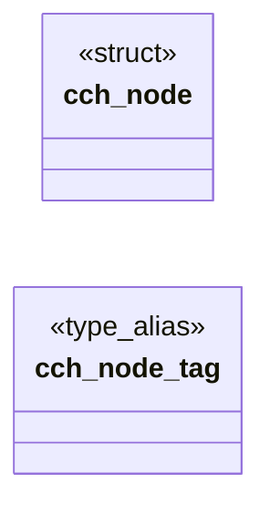
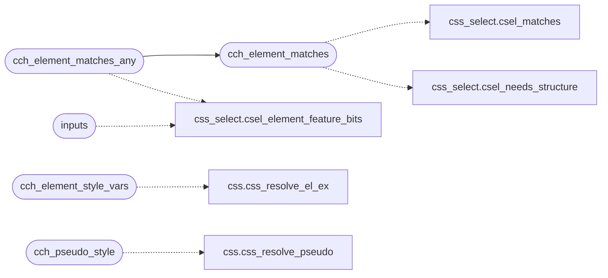

# `src/css_chain.c`

> Source: [src/css_chain.c:1](../../src/css_chain.c#L1) | language `c` | coverage 43.8% | [API index](../index.md)

## Contents

- **Structs:** [`cch_node`](#cch_node)
- **Functions:** [`inputs`](#inputs), [`cch_element_style_vars`](#cch_element_style_vars), [`cch_pseudo_style`](#cch_pseudo_style), [`cch_element_style`](#cch_element_style), [`cch_element_matches`](#cch_element_matches), [`cch_element_matches_any`](#cch_element_matches_any)
- **Macros:** [`CCH_TAG_MAX`](#cch_tag_max), [`CCH_ID_MAX`](#cch_id_max), [`CCH_CLASS_BUF`](#cch_class_buf), [`CCH_MAX_CLASSES`](#cch_max_classes), [`CCH_CLASS_SPILL_MAX`](#cch_class_spill_max), [`CCH_MAX_ATTRS`](#cch_max_attrs), [`CCH_ATTR_BUF`](#cch_attr_buf)

## Type Diagram



## Call Graph

Solid arrows stay in this module, dashed arrows leave it.



## Structs

<a id="cch_node"></a>

### `cch_node`

`struct` | [src/css_chain.c:27](../../src/css_chain.c#L27)

```c
typedef struct cch_node
```

One element's selector inputs (tag/id/classes) plus its css_element view, with backing storage so the css_element pointers stay valid for the chain's lifetime.

**Members**

| Member | Kind | Summary |
|---|---|---|
| [`tag`](#cch_node-tag) | type_alias | One element's selector inputs (tag/id/classes) plus its css_element view, with backing storage so the css_element pointers stay valid for the chain's lifetime. |

<a id="cch_node-tag"></a>

#### `cch_node.tag`

`type_alias` | [src/css_chain.c:27](../../src/css_chain.c#L27)

```c
typedef struct cch_node { char tag[CCH_TAG_MAX];
```

One element's selector inputs (tag/id/classes) plus its css_element view, with backing storage so the css_element pointers stay valid for the chain's lifetime.

---

## Functions

<a id="inputs"></a>

### `inputs`

`function` | [src/css_chain.c:241](../../src/css_chain.c#L241)

```c
* identical inputs (single source of truth). */ static const css_element *build_chain(lxb_dom_ele...
```

**Parameters**

| Name | Type | Default | Description |
|---|---|---|---|
| `truth` | `single source of` |  |  |

**Returns:** `* identical`

*Calls:* [`csel_element_feature_bits`](include.css_select.h.md#csel_element_feature_bits)

---

<a id="cch_element_style_vars"></a>

### `cch_element_style_vars`

`function` | [src/css_chain.c:310](../../src/css_chain.c#L310)

```c
css_style cch_element_style_vars(lxb_dom_element_t *el, const css_sheet *sheet, double parent_font_size, const struct cvr_chain *inherited, struct cvr_table *own_out)
```

**Parameters**

| Name | Type | Default | Description |
|---|---|---|---|
| `el` | `lxb_dom_element_t *` |  |  |
| `sheet` | `css_sheet *` |  |  |
| `parent_font_size` | `double` |  |  |
| `inherited` | `struct cvr_chain *` |  |  |
| `own_out` | `struct cvr_table *` |  |  |

**Returns:** `css_style`

*Calls:* [`css_resolve_el_ex`](src.css.c.md#css_resolve_el_ex)

---

<a id="cch_pseudo_style"></a>

### `cch_pseudo_style`

`function` | [src/css_chain.c:341](../../src/css_chain.c#L341)

```c
css_style cch_pseudo_style(lxb_dom_element_t *el, const css_sheet *sheet, int which, double font_size, const struct cvr_chain *inherited)
```

**Parameters**

| Name | Type | Default | Description |
|---|---|---|---|
| `el` | `lxb_dom_element_t *` |  |  |
| `sheet` | `css_sheet *` |  |  |
| `which` | `int` |  |  |
| `font_size` | `double` |  |  |
| `inherited` | `struct cvr_chain *` |  |  |

**Returns:** `css_style`

*Calls:* [`css_resolve_pseudo`](src.css.c.md#css_resolve_pseudo)

*Called by:* [`pv_build_styled`](src.page_view.c.md#pv_build_styled)

---

<a id="cch_element_style"></a>

### `cch_element_style`

`function` | [src/css_chain.c:360](../../src/css_chain.c#L360)

```c
css_style cch_element_style(lxb_dom_element_t *el, const css_sheet *sheet)
```

**Parameters**

| Name | Type | Default | Description |
|---|---|---|---|
| `el` | `lxb_dom_element_t *` |  |  |
| `sheet` | `css_sheet *` |  |  |

**Returns:** `css_style`

*Called by:* [`pv_build_styled`](src.page_view.c.md#pv_build_styled)

---

<a id="cch_element_matches"></a>

### `cch_element_matches`

`function` | [src/css_chain.c:364](../../src/css_chain.c#L364)

```c
int cch_element_matches(lxb_dom_element_t *el, const css_sel *sel)
```

Nonzero iff the parsed selector *sel matches element `el`, built against the same bounded ancestor/sibling/attribute context as cch_element_style.

This is the single source of truth for selector matching: the DOM's querySelector and the author-CSS cascade agree by construction. `sel` is a pre-parsed css_sel (see csel_parse); NULL args return 0 (fail closed).

**Parameters**

| Name | Type | Default | Description |
|---|---|---|---|
| `el` | `lxb_dom_element_t *` |  |  |
| `sel` | `css_sel *` |  |  |

**Returns:** `int`

> **Inherited:** Documentation from [`cch_element_matches`](#cch_element_matches) (include/css_chain.h:69).

*Calls:* [`csel_matches`](include.css_select.h.md#csel_matches), [`csel_needs_structure`](src.css_select.c.md#csel_needs_structure)

*Called by:* [`cch_element_matches_any`](#cch_element_matches_any)

---

<a id="cch_element_matches_any"></a>

### `cch_element_matches_any`

`function` | [src/css_chain.c:378](../../src/css_chain.c#L378)

```c
int cch_element_matches_any(lxb_dom_element_t *el, const css_sel *sels, size_t n)
```

**Parameters**

| Name | Type | Default | Description |
|---|---|---|---|
| `el` | `lxb_dom_element_t *` |  |  |
| `sels` | `css_sel *` |  |  |
| `n` | `size_t` |  |  |

**Returns:** `int`

*Calls:* [`csel_element_feature_bits`](include.css_select.h.md#csel_element_feature_bits), [`cch_element_matches`](#cch_element_matches)

---

## Macros

<a id="cch_tag_max"></a>

### `CCH_TAG_MAX`

`macro` | [src/css_chain.c:15](../../src/css_chain.c#L15)

```c
#define CCH_TAG_MAX
```

Bounds for the element selector inputs handed to css_resolve (anti-DoS; an over-long token simply does not match, which fails closed).

---

<a id="cch_id_max"></a>

### `CCH_ID_MAX`

`macro` | [src/css_chain.c:16](../../src/css_chain.c#L16)

```c
#define CCH_ID_MAX
```

---

<a id="cch_class_buf"></a>

### `CCH_CLASS_BUF`

`macro` `inline` | [src/css_chain.c:17](../../src/css_chain.c#L17)

```c
#define CCH_CLASS_BUF
```

---

<a id="cch_max_classes"></a>

### `CCH_MAX_CLASSES`

`macro` `inline` | [src/css_chain.c:18](../../src/css_chain.c#L18)

```c
#define CCH_MAX_CLASSES
```

inline class storage; longer lists spill to the heap

---

<a id="cch_class_spill_max"></a>

### `CCH_CLASS_SPILL_MAX`

`macro` | [src/css_chain.c:21](../../src/css_chain.c#L21)

```c
#define CCH_CLASS_SPILL_MAX
```

Anti-DoS bound on one element's class list once it spills: a real page tops out in the low thousands of bytes (CSS Modules, Tailwind), never this.

---

<a id="cch_max_attrs"></a>

### `CCH_MAX_ATTRS`

`macro` | [src/css_chain.c:22](../../src/css_chain.c#L22)

```c
#define CCH_MAX_ATTRS
```

---

<a id="cch_attr_buf"></a>

### `CCH_ATTR_BUF`

`macro` | [src/css_chain.c:23](../../src/css_chain.c#L23)

```c
#define CCH_ATTR_BUF
```

attributes captured per element for [attr] selectors

---
