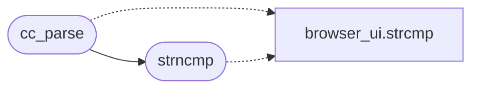

# `src/css_color.c`

> Source: [src/css_color.c:1](../../src/css_color.c#L1) | language `c` | coverage 38.5% | [API index](../index.md)

## Contents

- **Structs:** [`cc_named`](#cc_named)
- **Functions:** [`span`](#span), [`cc_parse`](#cc_parse), [`strncmp`](#strncmp), [`cc_pack`](#cc_pack), [`cc_unpack`](#cc_unpack)
- **Macros:** [`CC_TOKEN_MAX`](#cc_token_max), [`CC_CHANNEL_MAX`](#cc_channel_max), [`CC_PERCENT_MAX`](#cc_percent_max), [`CC_NUMBER_MAX_DIGITS`](#cc_number_max_digits), [`CC_HSL_SCALE`](#cc_hsl_scale), [`CC_PI`](#cc_pi)

## Call Graph

Solid arrows stay in this module, dashed arrows leave it.



## Structs

<a id="cc_named"></a>

### `cc_named`

`struct` | [src/css_color.c:33](../../src/css_color.c#L33)

```c
typedef struct cc_named
```

---

## Functions

<a id="span"></a>

### `span`

`function` | [src/css_color.c:325](../../src/css_color.c#L325)

```c
* span (when a slash is present) into ab/ae, and returns the component count, * or -1. Bounded: ...
```

**Parameters**

| Name | Type | Default | Description |
|---|---|---|---|
| `present` | `when a slash is` |  |  |

**Returns:** `*`

---

<a id="cc_parse"></a>

### `cc_parse`

`function` | [src/css_color.c:583](../../src/css_color.c#L583)

```c
cc_status cc_parse(const char *token, cc_rgb *out)
```

**Parameters**

| Name | Type | Default | Description |
|---|---|---|---|
| `token` | `char *` |  |  |
| `out` | `cc_rgb *` |  |  |

**Returns:** `cc_status`

*Calls:* [`strcmp`](gui.browser_ui.c.md#strcmp), [`strncmp`](#strncmp)

*Called by:* [`cv_parse_color`](src.css_values.c.md#cv_parse_color), [`PV_COLOR_TOKEN_MAX`](src.page_view.c.md#pv_color_token_max)

---

<a id="strncmp"></a>

### `strncmp`

`function` | [src/css_color.c:598](../../src/css_color.c#L598)

```c
strncmp(buf, "oklab(", 6) == 0 || strncmp(buf, "oklch(", 6) == 0)
```

**Parameters**

| Name | Type | Default | Description |
|---|---|---|---|
| `oklab` |  |  |  |
| `6)` |  | `= 0 \|\| strncmp(buf, "oklch(", 6) == 0)` |  |

*Calls:* [`strcmp`](gui.browser_ui.c.md#strcmp)

*Called by:* [`arrives`](gui.browser_ui.c.md#arrives), [`only`](gui.browser_ui.c.md#only), [`blur`](src.css.c.md#blur), [`cb_clip_inset`](src.css_box.c.md#cb_clip_inset), [`cc_parse`](#cc_parse), [`cnt_is_marker`](src.css_counter.c.md#cnt_is_marker), [`cnt_parse_decls`](src.css_counter.c.md#cnt_parse_decls), [`dl_should_download`](src.download.c.md#dl_should_download), [`gets`](src.freedom.c.md#gets), [`main`](src.freedom.c.md#main), [`parent`](src.freedom.c.md#parent), [`hls_resolve_url`](src.hls.c.md#hls_resolve_url) and 5 more

---

<a id="cc_pack"></a>

### `cc_pack`

`function` | [src/css_color.c:623](../../src/css_color.c#L623)

```c
int cc_pack(cc_rgb c)
```

Packs a color into a non-negative 0x00RRGGBB integer (suitable for transport and for the pipeline's "no color" sentinel of -1).

**Parameters**

| Name | Type | Default | Description |
|---|---|---|---|
| `c` | `cc_rgb` |  |  |

**Returns:** `int`

> **Inherited:** Documentation from [`cc_pack`](#cc_pack) (include/css_color.h:49).

---

<a id="cc_unpack"></a>

### `cc_unpack`

`function` | [src/css_color.c:627](../../src/css_color.c#L627)

```c
cc_rgb cc_unpack(int packed)
```

**Parameters**

| Name | Type | Default | Description |
|---|---|---|---|
| `packed` | `int` |  |  |

**Returns:** `cc_rgb`

*Called by:* [`rgb_from_packed`](gui.bui_theme.c.md#rgb_from_packed)

---

## Macros

<a id="cc_token_max"></a>

### `CC_TOKEN_MAX`

`macro` | [src/css_color.c:19](../../src/css_color.c#L19)

```c
#define CC_TOKEN_MAX
```

Largest CSS color token accepted.

The longest named color ("lightgoldenrodyellow") is 20 bytes; functional rgba() with percentages fits well under this. A longer token is not a color and fails closed.

---

<a id="cc_channel_max"></a>

### `CC_CHANNEL_MAX`

`macro` | [src/css_color.c:22](../../src/css_color.c#L22)

```c
#define CC_CHANNEL_MAX
```

Channel maxima for the rgb() functional form.

---

<a id="cc_percent_max"></a>

### `CC_PERCENT_MAX`

`macro` | [src/css_color.c:23](../../src/css_color.c#L23)

```c
#define CC_PERCENT_MAX
```

---

<a id="cc_number_max_digits"></a>

### `CC_NUMBER_MAX_DIGITS`

`macro` | [src/css_color.c:28](../../src/css_color.c#L28)

```c
#define CC_NUMBER_MAX_DIGITS
```

Digits accepted on either side of the decimal point in one component.

A real value has a handful; the cap is what stops a hostile stylesheet from handing the scanner an unbounded digit run (anti-DoS, fail closed). A preprocessor emitting `91.862745098%` uses 9 fractional digits, so the bound is set well clear of it.

---

<a id="cc_hsl_scale"></a>

### `CC_HSL_SCALE`

`macro` | [src/css_color.c:31](../../src/css_color.c#L31)

```c
#define CC_HSL_SCALE
```

Fixed-point scale for hsl() saturation/lightness: hundredths of a percent, so 100% is CC_HSL_SCALE.

See parse_hsl_comp.

---

<a id="cc_pi"></a>

### `CC_PI`

`macro` | [src/css_color.c:463](../../src/css_color.c#L463)

```c
#define CC_PI
```

---
