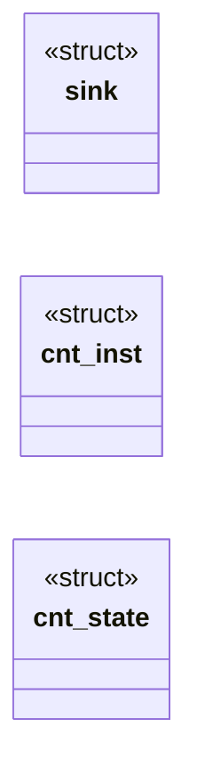
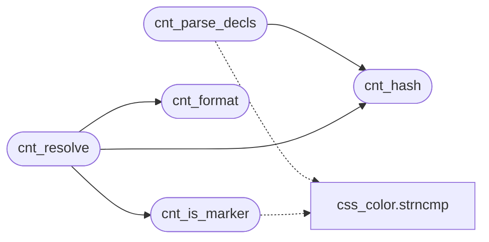

# `src/css_counter.c`

> Source: [src/css_counter.c:1](../../src/css_counter.c#L1) | language `c` | coverage 30.0% | [API index](../index.md)

## Contents

- **Structs:** [`sink`](#sink), [`cnt_inst`](#cnt_inst), [`cnt_state`](#cnt_state)
- **Functions:** [`cnt_hash`](#cnt_hash), [`cnt_parse_decls`](#cnt_parse_decls), [`cnt_format`](#cnt_format), [`cnt_is_marker`](#cnt_is_marker), [`cnt_parse_content`](#cnt_parse_content), [`cnt_state_new`](#cnt_state_new), [`cnt_state_free`](#cnt_state_free), [`cnt_reset`](#cnt_reset), [`cnt_increment`](#cnt_increment), [`cnt_leave`](#cnt_leave), [`cnt_resolve`](#cnt_resolve)
- **Macros:** [`CNT_SEQ_MARK`](#cnt_seq_mark), [`CNT_ITEM_END`](#cnt_item_end), [`CNT_FIELD_SEP`](#cnt_field_sep), [`CNT_VALUE_LIMIT`](#cnt_value_limit), [`CNT_STR_MAX`](#cnt_str_max)

## Type Diagram



## Call Graph

Solid arrows stay in this module, dashed arrows leave it.



## Structs

<a id="sink"></a>

### `sink`

`struct` | [src/css_counter.c:190](../../src/css_counter.c#L190)

```c
typedef struct { char *o; size_t n, cap; int bad; } sink;
```

---

<a id="cnt_inst"></a>

### `cnt_inst`

`struct` | [src/css_counter.c:359](../../src/css_counter.c#L359)

```c
typedef struct { unsigned name; int value; int depth; } cnt_inst;
```

---

<a id="cnt_state"></a>

### `cnt_state`

`struct` | [src/css_counter.c:361](../../src/css_counter.c#L361)

```c
struct cnt_state
```

---

## Functions

<a id="cnt_hash"></a>

### `cnt_hash`

`function` | [src/css_counter.c:18](../../src/css_counter.c#L18)

```c
unsigned cnt_hash(const char *name, size_t len)
```

FNV-1a over `len` bytes of an identifier, ASCII case preserved (identifiers are case-sensitive).

Never 0.

**Parameters**

| Name | Type | Default | Description |
|---|---|---|---|
| `name` | `char *` |  |  |
| `len` | `size_t` |  |  |

**Returns:** `unsigned`

> **Inherited:** Documentation from [`cnt_hash`](#cnt_hash) (include/css_counter.h:34).

*Called by:* [`cnt_parse_decls`](#cnt_parse_decls), [`cnt_resolve`](#cnt_resolve)

---

<a id="cnt_parse_decls"></a>

### `cnt_parse_decls`

`function` | [src/css_counter.c:59](../../src/css_counter.c#L59)

```c
int cnt_parse_decls(const char *val, int dflt, cnt_decl out[CNT_MAX_DECL])
```

**Parameters**

| Name | Type | Default | Description |
|---|---|---|---|
| `val` | `char *` |  |  |
| `dflt` | `int` |  |  |
| `CNT_MAX_DECL` | `cnt_decl out[ ]` |  |  |

**Returns:** `int`

*Calls:* [`strncmp`](src.css_color.c.md#strncmp), [`cnt_hash`](#cnt_hash)

---

<a id="cnt_format"></a>

### `cnt_format`

`function` | [src/css_counter.c:120](../../src/css_counter.c#L120)

```c
size_t cnt_format(int style, long value, char *out, size_t cap)
```

Formats `value` in `style` (unknown or unrepresentable falls back to decimal).

Returns the length written; always NUL-terminated when cap > 0.

**Parameters**

| Name | Type | Default | Description |
|---|---|---|---|
| `style` | `int` |  |  |
| `value` | `long` |  |  |
| `out` | `char *` |  |  |
| `cap` | `size_t` |  |  |

**Returns:** `size_t`

> **Inherited:** Documentation from [`cnt_format`](#cnt_format) (include/css_counter.h:49).

*Called by:* [`cnt_resolve`](#cnt_resolve)

---

<a id="cnt_is_marker"></a>

### `cnt_is_marker`

`function` | [src/css_counter.c:272](../../src/css_counter.c#L272)

```c
int cnt_is_marker(const char *s)
```

**Parameters**

| Name | Type | Default | Description |
|---|---|---|---|
| `s` | `char *` |  |  |

**Returns:** `int`

*Calls:* [`strncmp`](src.css_color.c.md#strncmp)

*Called by:* [`cnt_resolve`](#cnt_resolve)

---

<a id="cnt_parse_content"></a>

### `cnt_parse_content`

`function` | [src/css_counter.c:286](../../src/css_counter.c#L286)

```c
int cnt_parse_content(const char *val, char *out, size_t cap)
```

Parses a `content` value that uses counter()/counters().

Writes a marker into `out` and returns 1; returns 0 when the value has no counter function (not this module's), -1 when it is malformed or does not fit in [`cap`](src.css.c.md#cap).

**Parameters**

| Name | Type | Default | Description |
|---|---|---|---|
| `val` | `char *` |  |  |
| `out` | `char *` |  |  |
| `cap` | `size_t` |  |  |

**Returns:** `int`

> **Inherited:** Documentation from [`cnt_parse_content`](#cnt_parse_content) (include/css_counter.h:44).

---

<a id="cnt_state_new"></a>

### `cnt_state_new`

`function` | [src/css_counter.c:366](../../src/css_counter.c#L366)

```c
cnt_state *cnt_state_new(void)
```

**Returns:** `cnt_state *`

---

<a id="cnt_state_free"></a>

### `cnt_state_free`

`function` | [src/css_counter.c:367](../../src/css_counter.c#L367)

```c
void cnt_state_free(cnt_state *s)
```

**Parameters**

| Name | Type | Default | Description |
|---|---|---|---|
| `s` | `cnt_state *` |  |  |

---

<a id="cnt_reset"></a>

### `cnt_reset`

`function` | [src/css_counter.c:379](../../src/css_counter.c#L379)

```c
void cnt_reset(cnt_state *s, int depth, const cnt_decl *d, int n)
```

An element at tree depth [`depth`](src.tab.c.md#depth) runs these in order: reset, then increment.

**Parameters**

| Name | Type | Default | Description |
|---|---|---|---|
| `s` | `cnt_state *` |  |  |
| `depth` | `int` |  |  |
| `d` | `cnt_decl *` |  |  |
| `n` | `int` |  |  |

> **Inherited:** Documentation from [`cnt_reset`](#cnt_reset) (include/css_counter.h:56).

---

<a id="cnt_increment"></a>

### `cnt_increment`

`function` | [src/css_counter.c:392](../../src/css_counter.c#L392)

```c
void cnt_increment(cnt_state *s, int depth, const cnt_decl *d, int n)
```

**Parameters**

| Name | Type | Default | Description |
|---|---|---|---|
| `s` | `cnt_state *` |  |  |
| `depth` | `int` |  |  |
| `d` | `cnt_decl *` |  |  |
| `n` | `int` |  |  |

---

<a id="cnt_leave"></a>

### `cnt_leave`

`function` | [src/css_counter.c:407](../../src/css_counter.c#L407)

```c
void cnt_leave(cnt_state *s, int depth)
```

The children of an element have all been walked: drop what they created (instances created at depth >= [`depth`](src.tab.c.md#depth), i.e. the children's depth).

**Parameters**

| Name | Type | Default | Description |
|---|---|---|---|
| `s` | `cnt_state *` |  |  |
| `depth` | `int` |  |  |

> **Inherited:** Documentation from [`cnt_leave`](#cnt_leave) (include/css_counter.h:60).

---

<a id="cnt_resolve"></a>

### `cnt_resolve`

`function` | [src/css_counter.c:412](../../src/css_counter.c#L412)

```c
size_t cnt_resolve(const cnt_state *s, const char *marker, cnt_attr_fn attr, void *ctx, char *out, size_t cap)
```

Expands a marker against the live state.

A string that is not a marker is copied verbatim. Returns the length written, NUL-terminated, never beyond [`cap`](src.css.c.md#cap).

**Parameters**

| Name | Type | Default | Description |
|---|---|---|---|
| `s` | `cnt_state *` |  |  |
| `marker` | `char *` |  |  |
| `attr` | `cnt_attr_fn` |  |  |
| `ctx` | `void *` |  |  |
| `out` | `char *` |  |  |
| `cap` | `size_t` |  |  |

**Returns:** `size_t`

> **Inherited:** Documentation from [`cnt_resolve`](#cnt_resolve) (include/css_counter.h:67).

*Calls:* [`cnt_format`](#cnt_format), [`cnt_hash`](#cnt_hash), [`cnt_is_marker`](#cnt_is_marker)

---

## Macros

<a id="cnt_seq_mark"></a>

### `CNT_SEQ_MARK`

`macro` | [src/css_counter.c:12](../../src/css_counter.c#L12)

```c
#define CNT_SEQ_MARK
```

---

<a id="cnt_item_end"></a>

### `CNT_ITEM_END`

`macro` | [src/css_counter.c:13](../../src/css_counter.c#L13)

```c
#define CNT_ITEM_END
```

---

<a id="cnt_field_sep"></a>

### `CNT_FIELD_SEP`

`macro` | [src/css_counter.c:14](../../src/css_counter.c#L14)

```c
#define CNT_FIELD_SEP
```

---

<a id="cnt_value_limit"></a>

### `CNT_VALUE_LIMIT`

`macro` | [src/css_counter.c:15](../../src/css_counter.c#L15)

```c
#define CNT_VALUE_LIMIT
```

---

<a id="cnt_str_max"></a>

### `CNT_STR_MAX`

`macro` | [src/css_counter.c:16](../../src/css_counter.c#L16)

```c
#define CNT_STR_MAX
```

---
