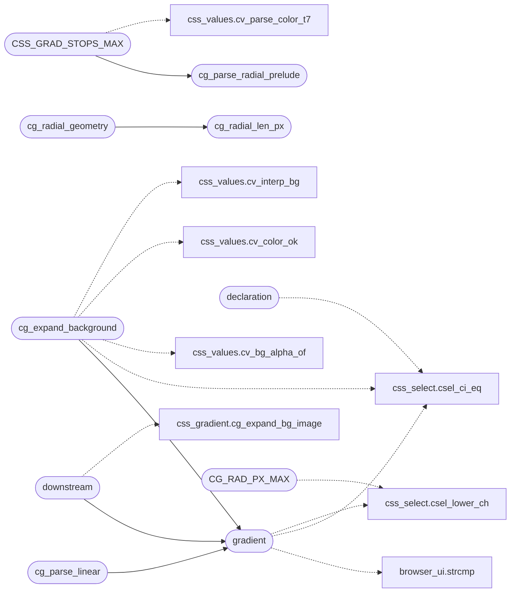

# `src/css_gradient.c`

> Source: [src/css_gradient.c:1](../../src/css_gradient.c#L1) | language `c` | coverage 18.8% | [API index](../index.md)

## Contents

- **Functions:** [`gradient`](#gradient), [`CSS_GRAD_STOPS_MAX`](#css_grad_stops_max), [`pool`](#pool), [`downstream`](#downstream), [`declaration`](#declaration), [`cg_expand_background`](#cg_expand_background), [`cg_parse_radial_prelude`](#cg_parse_radial_prelude), [`cg_radial_len_px`](#cg_radial_len_px), [`cg_radial_geometry`](#cg_radial_geometry), [`cg_parse_linear`](#cg_parse_linear)
- **Macros:** [`CG_RAD_TOKENS`](#cg_rad_tokens), [`CG_RAD_PM_MAX`](#cg_rad_pm_max), [`CG_RAD_PX_MAX`](#cg_rad_px_max), [`CG_RAD_FLOOR`](#cg_rad_floor), [`CG_SQRT2`](#cg_sqrt2)

## Call Graph

Solid arrows stay in this module, dashed arrows leave it.



## Functions

<a id="gradient"></a>

### `gradient`

`function` | [src/css_gradient.c:28](../../src/css_gradient.c#L28)

```c
* or fewer than 2 stops drop the gradient (and, for the `background` shorthand, * the whole declaration). */ /* `to <side-or-corner>` (two keywords in either order) or `<int>deg` -> CSS degrees * normalized [0,359]. Returns -1 when seg is not direction syntax at all (it may be * the first color stop), -2 when it IS direction syntax but invalid (poisons the * gradient). */ static int grad_direction(const char *seg)
```

**Parameters**

| Name | Type | Default | Description |
|---|---|---|---|
| `shorthand` | `` for the `background` `` |  |  |
| `declaration` | `* the whole` |  |  |

**Returns:** `* or fewer than 2 stops drop the`

*Calls:* [`strcmp`](gui.browser_ui.c.md#strcmp), [`csel_ci_eq`](include.css_select.h.md#csel_ci_eq), [`csel_lower_ch`](include.css_select.h.md#csel_lower_ch)

*Called by:* [`cg_expand_background`](#cg_expand_background), [`cg_parse_linear`](#cg_parse_linear), [`downstream`](#downstream)

---

<a id="css_grad_stops_max"></a>

### `CSS_GRAD_STOPS_MAX`

`function` | [src/css_gradient.c:184](../../src/css_gradient.c#L184)

```c
* CSS_GRAD_STOPS_MAX (stops past the cap are kept out unvalidated), or 0 when * the gradient fai...
```

**Parameters**

| Name | Type | Default | Description |
|---|---|---|---|
| `unvalidated` | `stops past the cap are kept out` |  |  |

**Returns:** `*`

*Calls:* [`cv_parse_color_t7`](include.css_values.h.md#cv_parse_color_t7), [`cg_parse_radial_prelude`](#cg_parse_radial_prelude)

---

<a id="pool"></a>

### `pool`

`function` | [src/css_gradient.c:400](../../src/css_gradient.c#L400)

```c
* pool (gradient explicitly reset);
```

**Parameters**

| Name | Type | Default | Description |
|---|---|---|---|
| `reset` | `gradient explicitly` |  |  |

**Returns:** `*`

---

<a id="downstream"></a>

### `downstream`

`function` | [src/css_gradient.c:404](../../src/css_gradient.c#L404)

```c
* happens downstream (render_doc.c), gated by caps.images like an . */ int cg_expand_bg_imag...
```

**Parameters**

| Name | Type | Default | Description |
|---|---|---|---|
| `c` | `render_doc.` |  |  |

**Returns:** `* happens`

*Calls:* [`cg_expand_bg_image`](include.css_gradient.h.md#cg_expand_bg_image), [`gradient`](#gradient)

---

<a id="declaration"></a>

### `declaration`

`function` | [src/css_gradient.c:465](../../src/css_gradient.c#L465)

```c
* declaration (fail closed);
```

**Parameters**

| Name | Type | Default | Description |
|---|---|---|---|
| `closed` | `fail` |  |  |

**Returns:** `*`

*Calls:* [`csel_ci_eq`](include.css_select.h.md#csel_ci_eq)

---

<a id="cg_expand_background"></a>

### `cg_expand_background`

`function` | [src/css_gradient.c:512](../../src/css_gradient.c#L512)

```c
int cg_expand_background(const char *val, css_decl *dst, int cap, char (*urltab)[CSS_URL_MAX], size_t *nurl, size_t urlcap)
```

**Parameters**

| Name | Type | Default | Description |
|---|---|---|---|
| `val` | `char *` |  |  |
| `dst` | `css_decl *` |  |  |
| `cap` | `int` |  |  |
| `CSS_URL_MAX` | `char (*urltab)[ ]` |  |  |
| `nurl` | `size_t *` |  |  |
| `urlcap` | `size_t` |  |  |

**Returns:** `int`

*Calls:* [`csel_ci_eq`](include.css_select.h.md#csel_ci_eq), [`cv_bg_alpha_of`](include.css_values.h.md#cv_bg_alpha_of), [`cv_color_ok`](include.css_values.h.md#cv_color_ok), [`cv_interp_bg`](include.css_values.h.md#cv_interp_bg), [`gradient`](#gradient)

---

<a id="cg_parse_radial_prelude"></a>

### `cg_parse_radial_prelude`

`function` | [src/css_gradient.c:672](../../src/css_gradient.c#L672)

```c
int cg_parse_radial_prelude(const char *seg, cg_radial *out)
```

**Parameters**

| Name | Type | Default | Description |
|---|---|---|---|
| `seg` | `char *` |  |  |
| `out` | `cg_radial *` |  |  |

**Returns:** `int`

*Called by:* [`CSS_GRAD_STOPS_MAX`](#css_grad_stops_max)

---

<a id="cg_radial_len_px"></a>

### `cg_radial_len_px`

`function` | [src/css_gradient.c:748](../../src/css_gradient.c#L748)

```c
double cg_radial_len_px(int enc, double dim)
```

A radial length resolved against a box dimension in px.

**Parameters**

| Name | Type | Default | Description |
|---|---|---|---|
| `enc` | `int` |  |  |
| `dim` | `double` |  |  |

**Returns:** `double`

> **Inherited:** Documentation from [`cg_radial_len_px`](#cg_radial_len_px) (include/css_gradient.h:37).

*Called by:* [`cg_radial_geometry`](#cg_radial_geometry)

---

<a id="cg_radial_geometry"></a>

### `cg_radial_geometry`

`function` | [src/css_gradient.c:760](../../src/css_gradient.c#L760)

```c
void cg_radial_geometry(const cg_radial *r, double w, double h, double *cx, double *cy, double *rx, double *ry)
```

**Parameters**

| Name | Type | Default | Description |
|---|---|---|---|
| `r` | `cg_radial *` |  |  |
| `w` | `double` |  |  |
| `h` | `double` |  |  |
| `cx` | `double *` |  |  |
| `cy` | `double *` |  |  |
| `rx` | `double *` |  |  |
| `ry` | `double *` |  |  |

*Calls:* [`cg_radial_len_px`](#cg_radial_len_px)

---

<a id="cg_parse_linear"></a>

### `cg_parse_linear`

`function` | [src/css_gradient.c:797](../../src/css_gradient.c#L797)

```c
int cg_parse_linear(const char *fn, int *angle, int *colors, int *positions)
```

Parses one `linear-gradient(...)` function (the whole text, nothing around it) into its angle (CSS degrees), packed stop colours (alpha rides bits 24..30 as TRANSPARENCY, 0 opaque ..

127 clear) and stop positions (per-mille, -1 = evenly spaced); both arrays hold CSS_GRAD_STOPS_MAX entries and the caller initialises positions to -1. Returns the stop count, 0 when the text is not a valid linear gradient. Used by the mask parser, which wants the alpha of each stop.

**Parameters**

| Name | Type | Default | Description |
|---|---|---|---|
| `fn` | `char *` |  |  |
| `angle` | `int *` |  |  |
| `colors` | `int *` |  |  |
| `positions` | `int *` |  |  |

**Returns:** `int`

> **Inherited:** Documentation from [`cg_parse_linear`](#cg_parse_linear) (include/css_gradient.h:51).

*Calls:* [`gradient`](#gradient)

---

## Macros

<a id="cg_rad_tokens"></a>

### `CG_RAD_TOKENS`

`macro` | [src/css_gradient.c:596](../../src/css_gradient.c#L596)

```c
#define CG_RAD_TOKENS
```

---

<a id="cg_rad_pm_max"></a>

### `CG_RAD_PM_MAX`

`macro` | [src/css_gradient.c:597](../../src/css_gradient.c#L597)

```c
#define CG_RAD_PM_MAX
```

---

<a id="cg_rad_px_max"></a>

### `CG_RAD_PX_MAX`

`macro` | [src/css_gradient.c:598](../../src/css_gradient.c#L598)

```c
#define CG_RAD_PX_MAX
```

per-mille cap: 1000x the box (anti-DoS, never reached)

*Calls:* [`csel_lower_ch`](include.css_select.h.md#csel_lower_ch)

---

<a id="cg_rad_floor"></a>

### `CG_RAD_FLOOR`

`macro` | [src/css_gradient.c:754](../../src/css_gradient.c#L754)

```c
#define CG_RAD_FLOOR
```

---

<a id="cg_sqrt2"></a>

### `CG_SQRT2`

`macro` | [src/css_gradient.c:755](../../src/css_gradient.c#L755)

```c
#define CG_SQRT2
```

---
