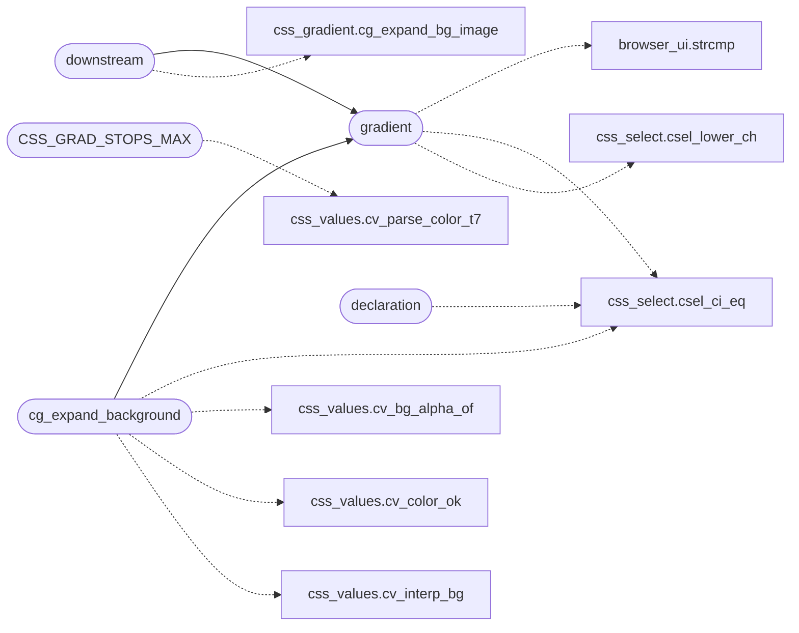

# `src/css_gradient.c`

> Source: [src/css_gradient.c:1](../../src/css_gradient.c#L1) | language `c` | coverage 0.0% | [API index](../index.md)

## Contents

- **Functions:** [`gradient`](#gradient), [`CSS_GRAD_STOPS_MAX`](#css_grad_stops_max), [`pool`](#pool), [`downstream`](#downstream), [`declaration`](#declaration), [`cg_expand_background`](#cg_expand_background)

## Call Graph

Solid arrows stay in this module, dashed arrows leave it.



## Functions

<a id="gradient"></a>

### `gradient`

`function` | [src/css_gradient.c:27](../../src/css_gradient.c#L27)

```c
* or fewer than 2 stops drop the gradient (and, for the `background` shorthand, * the whole declaration). */ /* `to <side-or-corner>` (two keywords in either order) or `<int>deg` -> CSS degrees * normalized [0,359]. Returns -1 when seg is not direction syntax at all (it may be * the first color stop), -2 when it IS direction syntax but invalid (poisons the * gradient). */ static int grad_direction(const char *seg)
```

**Parameters**

| Name | Type | Default | Description |
|---|---|---|---|
| `shorthand` | `` for the `background` `` |  |  |
| `declaration` | `* the whole` |  |  |

**Returns:** `* or fewer than 2 stops drop the`

*Calls:* [`strcmp`](gui.browser_ui.c.md#strcmp), [`csel_ci_eq`](include.css_select.h.md#csel_ci_eq), [`csel_lower_ch`](include.css_select.h.md#csel_lower_ch)

*Called by:* [`cg_expand_background`](#cg_expand_background), [`downstream`](#downstream)

---

<a id="css_grad_stops_max"></a>

### `CSS_GRAD_STOPS_MAX`

`function` | [src/css_gradient.c:183](../../src/css_gradient.c#L183)

```c
* CSS_GRAD_STOPS_MAX (stops past the cap are kept out unvalidated), or 0 when * the gradient fai...
```

**Parameters**

| Name | Type | Default | Description |
|---|---|---|---|
| `unvalidated` | `stops past the cap are kept out` |  |  |

**Returns:** `*`

*Calls:* [`cv_parse_color_t7`](include.css_values.h.md#cv_parse_color_t7)

---

<a id="pool"></a>

### `pool`

`function` | [src/css_gradient.c:380](../../src/css_gradient.c#L380)

```c
* pool (gradient explicitly reset);
```

**Parameters**

| Name | Type | Default | Description |
|---|---|---|---|
| `reset` | `gradient explicitly` |  |  |

**Returns:** `*`

---

<a id="downstream"></a>

### `downstream`

`function` | [src/css_gradient.c:384](../../src/css_gradient.c#L384)

```c
* happens downstream (render_doc.c), gated by caps.images like an . */ int cg_expand_bg_imag...
```

**Parameters**

| Name | Type | Default | Description |
|---|---|---|---|
| `c` | `render_doc.` |  |  |

**Returns:** `* happens`

*Calls:* [`cg_expand_bg_image`](include.css_gradient.h.md#cg_expand_bg_image), [`gradient`](#gradient)

---

<a id="declaration"></a>

### `declaration`

`function` | [src/css_gradient.c:443](../../src/css_gradient.c#L443)

```c
* declaration (fail closed);
```

**Parameters**

| Name | Type | Default | Description |
|---|---|---|---|
| `closed` | `fail` |  |  |

**Returns:** `*`

*Calls:* [`csel_ci_eq`](include.css_select.h.md#csel_ci_eq)

---

<a id="cg_expand_background"></a>

### `cg_expand_background`

`function` | [src/css_gradient.c:490](../../src/css_gradient.c#L490)

```c
int cg_expand_background(const char *val, css_decl *dst, int cap, char (*urltab)[CSS_URL_MAX], size_t *nurl, size_t urlcap)
```

**Parameters**

| Name | Type | Default | Description |
|---|---|---|---|
| `val` | `char *` |  |  |
| `dst` | `css_decl *` |  |  |
| `cap` | `int` |  |  |
| `CSS_URL_MAX` | `char (*urltab)[ ]` |  |  |
| `nurl` | `size_t *` |  |  |
| `urlcap` | `size_t` |  |  |

**Returns:** `int`

*Calls:* [`csel_ci_eq`](include.css_select.h.md#csel_ci_eq), [`cv_bg_alpha_of`](include.css_values.h.md#cv_bg_alpha_of), [`cv_color_ok`](include.css_values.h.md#cv_color_ok), [`cv_interp_bg`](include.css_values.h.md#cv_interp_bg), [`gradient`](#gradient)

---
