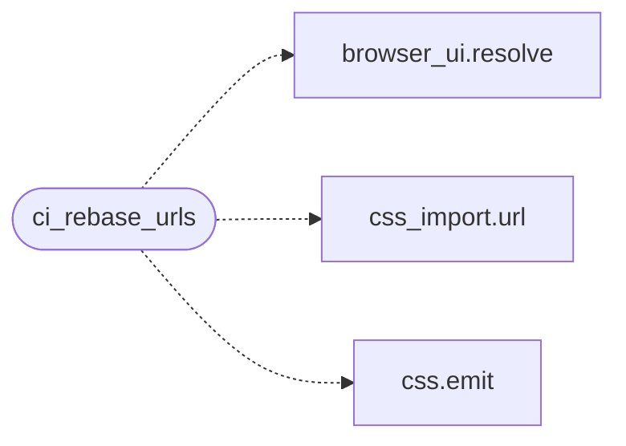

# `src/css_import.c`

> Source: [src/css_import.c:1](../../src/css_import.c#L1) | language `c` | coverage 80.0% | [API index](../index.md)

css_import -- @import prelude reader (spec/css_import.md).

Pure: no I/O, no allocation, no global state. Every read is bounded by len.

## Contents

- **Functions:** [`ci_scan`](#ci_scan), [`ci_wrap`](#ci_wrap), [`ci_balanced`](#ci_balanced), [`ci_rebase_urls`](#ci_rebase_urls)

## Call Graph

Solid arrows stay in this module, dashed arrows leave it.



## Functions

<a id="ci_scan"></a>

### `ci_scan`

`function` | [src/css_import.c:156](../../src/css_import.c#L156)

```c
size_t ci_scan(const char *css, size_t len, ci_import *out, size_t cap)
```

Reads the leading @import rules of css[0,len) into out (at most cap).

Skips whitespace, comments, @charset and @layer statements; stops at the first other rule. A malformed or oversized import is ignored. NULL/0 args => 0.

**Parameters**

| Name | Type | Default | Description |
|---|---|---|---|
| `css` | `char *` |  |  |
| `len` | `size_t` |  |  |
| `out` | `ci_import *` |  |  |
| `cap` | `size_t` |  |  |

**Returns:** `size_t`

> **Inherited:** Documentation from [`ci_scan`](#ci_scan) (include/css_import.h:36).

---

<a id="ci_wrap"></a>

### `ci_wrap`

`function` | [src/css_import.c:194](../../src/css_import.c#L194)

```c
int ci_wrap(const ci_import *im, char *open, size_t ocap, char *close, size_t ccap)
```

Builds the wrapper for one import: open = "@layer N {@supports (S) {@media M {" (only the parts present) and close = the matching braces.

No condition => both empty. Returns 0, or -1 when an argument is NULL or a buffer is too small.

**Parameters**

| Name | Type | Default | Description |
|---|---|---|---|
| `im` | `ci_import *` |  |  |
| `open` | `char *` |  |  |
| `ocap` | `size_t` |  |  |
| `close` | `char *` |  |  |
| `ccap` | `size_t` |  |  |

**Returns:** `int`

> **Inherited:** Documentation from [`ci_wrap`](#ci_wrap) (include/css_import.h:41).

---

<a id="ci_balanced"></a>

### `ci_balanced`

`function` | [src/css_import.c:220](../../src/css_import.c#L220)

```c
int ci_balanced(const char *css, size_t len)
```

1 iff every comment and string in css[0,len) terminates and the braces outside them never go negative and end at zero; else 0.

NULL => 0 (empty text => 1).

**Parameters**

| Name | Type | Default | Description |
|---|---|---|---|
| `css` | `char *` |  |  |
| `len` | `size_t` |  |  |

**Returns:** `int`

> **Inherited:** Documentation from [`ci_balanced`](#ci_balanced) (include/css_import.h:45).

---

<a id="ci_rebase_urls"></a>

### `ci_rebase_urls`

`function` | [src/css_import.c:303](../../src/css_import.c#L303)

```c
int ci_rebase_urls(const char *css, size_t len, const char *base, ci_resolve_fn resolve, void *rctx, ci_emit_fn emit, void *ectx)
```

**Parameters**

| Name | Type | Default | Description |
|---|---|---|---|
| `css` | `char *` |  |  |
| `len` | `size_t` |  |  |
| `base` | `char *` |  |  |
| `resolve` | `ci_resolve_fn` |  |  |
| `rctx` | `void *` |  |  |
| `emit` | `ci_emit_fn` |  |  |
| `ectx` | `void *` |  |  |

**Returns:** `int`

*Calls:* [`resolve`](gui.browser_ui.c.md#resolve), [`url`](include.css_import.h.md#url), [`emit`](src.css.c.md#emit)

---
