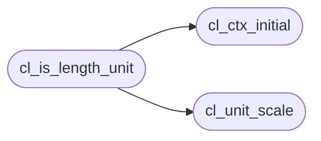

# `src/css_length.c`

> Source: [src/css_length.c:1](../../src/css_length.c#L1) | language `c` | coverage 25.0% | [API index](../index.md)

## Contents

- **Functions:** [`know`](#know), [`cl_ctx_initial`](#cl_ctx_initial), [`cl_unit_scale`](#cl_unit_scale), [`cl_is_length_unit`](#cl_is_length_unit), [`cl_unit_is_font_relative`](#cl_unit_is_font_relative), [`cl_em_refit`](#cl_em_refit), [`cl_number`](#cl_number), [`cl_resolve`](#cl_resolve), [`cl_resolve_lp`](#cl_resolve_lp), [`cl_lp_used`](#cl_lp_used)
- **Macros:** [`CL_PX_PER_IN`](#cl_px_per_in)

## Call Graph

Solid arrows stay in this module, dashed arrows leave it.



## Functions

<a id="know"></a>

### `know`

`function` | [src/css_length.c:7](../../src/css_length.c#L7)

```c
* this module cannot know (real font metrics, the viewport) arrives through * cl_ctx rather than...
```

**Parameters**

| Name | Type | Default | Description |
|---|---|---|---|
| `metrics` | `real font` |  |  |
| `viewport` | `the` |  |  |

**Returns:** `* this module cannot`

---

<a id="cl_ctx_initial"></a>

### `cl_ctx_initial`

`function` | [src/css_length.c:100](../../src/css_length.c#L100)

```c
cl_ctx cl_ctx_initial(void)
```

**Returns:** `cl_ctx`

*Called by:* [`cb_interp_lp`](src.css_box.c.md#cb_interp_lp), [`cb_length_px`](src.css_box.c.md#cb_length_px), [`cb_value_em_milli`](src.css_box.c.md#cb_value_em_milli), [`cl_is_length_unit`](#cl_is_length_unit)

---

<a id="cl_unit_scale"></a>

### `cl_unit_scale`

`function` | [src/css_length.c:117](../../src/css_length.c#L117)

```c
cl_status cl_unit_scale(const char *unit, size_t unit_len, const cl_ctx *ctx, double *out_px_per_unit)
```

**Parameters**

| Name | Type | Default | Description |
|---|---|---|---|
| `unit` | `char *` |  |  |
| `unit_len` | `size_t` |  |  |
| `ctx` | `cl_ctx *` |  |  |
| `out_px_per_unit` | `double *` |  |  |

**Returns:** `cl_status`

*Called by:* [`cl_is_length_unit`](#cl_is_length_unit)

---

<a id="cl_is_length_unit"></a>

### `cl_is_length_unit`

`function` | [src/css_length.c:167](../../src/css_length.c#L167)

```c
int cl_is_length_unit(const char *unit, size_t unit_len)
```

Non-zero when `unit` names a <length> unit at all (any of the three families plus px).

Used to tell "unsupported unit" apart from "not a length".

**Parameters**

| Name | Type | Default | Description |
|---|---|---|---|
| `unit` | `char *` |  |  |
| `unit_len` | `size_t` |  |  |

**Returns:** `int`

> **Inherited:** Documentation from [`cl_is_length_unit`](#cl_is_length_unit) (include/css_length.h:246).

*Calls:* [`cl_ctx_initial`](#cl_ctx_initial), [`cl_unit_scale`](#cl_unit_scale)

---

<a id="cl_unit_is_font_relative"></a>

### `cl_unit_is_font_relative`

`function` | [src/css_length.c:174](../../src/css_length.c#L174)

```c
int cl_unit_is_font_relative(const char *unit, size_t unit_len)
```

**Parameters**

| Name | Type | Default | Description |
|---|---|---|---|
| `unit` | `char *` |  |  |
| `unit_len` | `size_t` |  |  |

**Returns:** `int`

---

<a id="cl_em_refit"></a>

### `cl_em_refit`

`function` | [src/css_length.c:219](../../src/css_length.c#L219)

```c
double cl_em_refit(double px, double em, double from_font_size, double font_size)
```

**Parameters**

| Name | Type | Default | Description |
|---|---|---|---|
| `px` | `double` |  |  |
| `em` | `double` |  |  |
| `from_font_size` | `double` |  |  |
| `font_size` | `double` |  |  |

**Returns:** `double`

---

<a id="cl_number"></a>

### `cl_number`

`function` | [src/css_length.c:292](../../src/css_length.c#L292)

```c
int cl_number(const char *s, double *out, const char **endp)
```

Parses a CSS <number> at the start of `s` (CSS Syntax Level 3, 4.3.12):

[+-]?  ( digit+ ('.' digit*)?  |  '.' digit+ )  ( [eE] [+-]? digit+ )?

Returns 1 on success, writing *out and pointing *endp at the first
unconsumed character; 0 if there is no number there.

Exported because it is the same grammar for a length, a colour channel, an
opacity and a transform argument, and having one implementation is what
prevents them from disagreeing. The previous private parser required a digit
BEFORE the decimal point, so the extremely common `.5` spelling -- as in
`rgba(0,0,0,.5)`, `opacity:.75` or `padding:0 28px 0 .75em` -- was rejected
and the whole declaration dropped.

Locale-independent by construction: it never calls strtod, so a locale whose
decimal separator is ',' cannot truncate "1.5px" to 1px.

**Parameters**

| Name | Type | Default | Description |
|---|---|---|---|
| `s` | `char *` |  |  |
| `out` | `double *` |  |  |
| `endp` | `char **` |  |  |

**Returns:** `int`

> **Inherited:** Documentation from [`cl_number`](#cl_number) (include/css_length.h:230).

---

<a id="cl_resolve"></a>

### `cl_resolve`

`function` | [src/css_length.c:377](../../src/css_length.c#L377)

```c
cl_status cl_resolve(const char *value, const cl_ctx *ctx, double *out_px)
```

**Parameters**

| Name | Type | Default | Description |
|---|---|---|---|
| `value` | `char *` |  |  |
| `ctx` | `cl_ctx *` |  |  |
| `out_px` | `double *` |  |  |

**Returns:** `cl_status`

*Called by:* [`cb_length_px`](src.css_box.c.md#cb_length_px)

---

<a id="cl_resolve_lp"></a>

### `cl_resolve_lp`

`function` | [src/css_length.c:391](../../src/css_length.c#L391)

```c
cl_status cl_resolve_lp(const char *value, const cl_ctx *ctx, cl_lp *out)
```

**Parameters**

| Name | Type | Default | Description |
|---|---|---|---|
| `value` | `char *` |  |  |
| `ctx` | `cl_ctx *` |  |  |
| `out` | `cl_lp *` |  |  |

**Returns:** `cl_status`

*Called by:* [`cb_interp_lp`](src.css_box.c.md#cb_interp_lp), [`cb_value_em_milli`](src.css_box.c.md#cb_value_em_milli)

---

<a id="cl_lp_used"></a>

### `cl_lp_used`

`function` | [src/css_length.c:395](../../src/css_length.c#L395)

```c
double cl_lp_used(cl_lp lp, double basis)
```

**Parameters**

| Name | Type | Default | Description |
|---|---|---|---|
| `lp` | `cl_lp` |  |  |
| `basis` | `double` |  |  |

**Returns:** `double`

---

## Macros

<a id="cl_px_per_in"></a>

### `CL_PX_PER_IN`

`macro` | [src/css_length.c:21](../../src/css_length.c#L21)

```c
#define CL_PX_PER_IN
```

CSS Values 4 section 5.2 anchors the whole absolute family to the inch: 1in is defined as exactly 96px.

Every other absolute unit is a fraction of an inch, so all of them derive from this one number.

---
