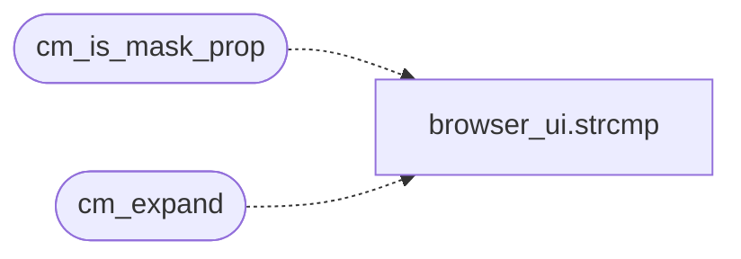

# `src/css_mask.c`

> Source: [src/css_mask.c:1](../../src/css_mask.c#L1) | language `c` | coverage 28.6% | [API index](../index.md)

## Contents

- **Functions:** [`cm_is_mask_prop`](#cm_is_mask_prop), [`cm_encode_layer`](#cm_encode_layer), [`cm_decode_layer`](#cm_decode_layer), [`cm_expand`](#cm_expand)
- **Macros:** [`CM_TOK_MAX`](#cm_tok_max), [`CM_MAX_TOKS`](#cm_max_toks)

## Call Graph

Solid arrows stay in this module, dashed arrows leave it.



## Functions

<a id="cm_is_mask_prop"></a>

### `cm_is_mask_prop`

`function` | [src/css_mask.c:17](../../src/css_mask.c#L17)

```c
int cm_is_mask_prop(const char *prop)
```

True for every property name this module owns (after the vendor prefix is removed).

**Parameters**

| Name | Type | Default | Description |
|---|---|---|---|
| `prop` | `char *` |  |  |

**Returns:** `int`

> **Inherited:** Documentation from [`cm_is_mask_prop`](#cm_is_mask_prop) (include/css_mask.h:28).

*Calls:* [`strcmp`](gui.browser_ui.c.md#strcmp)

---

<a id="cm_encode_layer"></a>

### `cm_encode_layer`

`function` | [src/css_mask.c:24](../../src/css_mask.c#L24)

```c
void cm_encode_layer(const cm_layer *l, int *meta, int *alphas, int *poss)
```

The three compact words of a layer, and back.

**Parameters**

| Name | Type | Default | Description |
|---|---|---|---|
| `l` | `cm_layer *` |  |  |
| `meta` | `int *` |  |  |
| `alphas` | `int *` |  |  |
| `poss` | `int *` |  |  |

> **Inherited:** Documentation from [`cm_encode_layer`](#cm_encode_layer) (include/css_mask.h:35).

---

<a id="cm_decode_layer"></a>

### `cm_decode_layer`

`function` | [src/css_mask.c:45](../../src/css_mask.c#L45)

```c
void cm_decode_layer(int meta, int alphas, int poss, cm_layer *out)
```

**Parameters**

| Name | Type | Default | Description |
|---|---|---|---|
| `meta` | `int` |  |  |
| `alphas` | `int` |  |  |
| `poss` | `int` |  |  |
| `out` | `cm_layer *` |  |  |

---

<a id="cm_expand"></a>

### `cm_expand`

`function` | [src/css_mask.c:181](../../src/css_mask.c#L181)

```c
int cm_expand(const char *prop, const char *val, css_decl *dst, int cap, int webkit_vocab)
```

**Parameters**

| Name | Type | Default | Description |
|---|---|---|---|
| `prop` | `char *` |  |  |
| `val` | `char *` |  |  |
| `dst` | `css_decl *` |  |  |
| `cap` | `int` |  |  |
| `webkit_vocab` | `int` |  |  |

**Returns:** `int`

*Calls:* [`strcmp`](gui.browser_ui.c.md#strcmp)

---

## Macros

<a id="cm_tok_max"></a>

### `CM_TOK_MAX`

`macro` | [src/css_mask.c:8](../../src/css_mask.c#L8)

```c
#define CM_TOK_MAX
```

---

<a id="cm_max_toks"></a>

### `CM_MAX_TOKS`

`macro` | [src/css_mask.c:9](../../src/css_mask.c#L9)

```c
#define CM_MAX_TOKS
```

---
