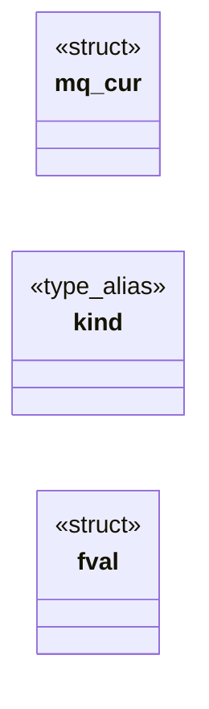
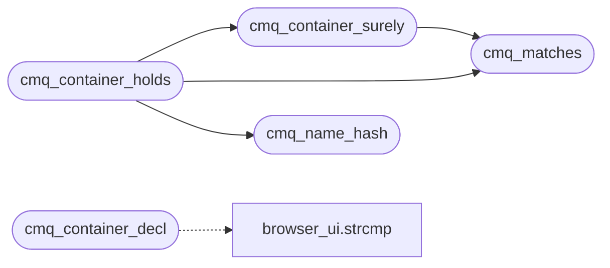

# `src/css_mq.c`

> Source: [src/css_mq.c:1](../../src/css_mq.c#L1) | language `c` | coverage 33.3% | [API index](../index.md)

## Contents

- **Structs:** [`mq_cur`](#mq_cur), [`fval`](#fval)
- **Type Aliases:** [`kind`](#kind)
- **Functions:** [`cmq_matches`](#cmq_matches), [`cmq_container_surely`](#cmq_container_surely), [`cmq_name_hash`](#cmq_name_hash), [`cmq_container_holds`](#cmq_container_holds), [`cmq_container_decl`](#cmq_container_decl)
- **Macros:** [`CMQ_DEVICE_W`](#cmq_device_w), [`CMQ_DPPX`](#cmq_dppx), [`CMQ_COLOR_BITS`](#cmq_color_bits), [`CMQ_DPI_PER_DPPX`](#cmq_dpi_per_dppx), [`CMQ_CM_PER_IN`](#cmq_cm_per_in), [`MQ_EPS`](#mq_eps)

## Type Diagram



## Call Graph

Solid arrows stay in this module, dashed arrows leave it.



## Structs

<a id="mq_cur"></a>

### `mq_cur`

`struct` | [src/css_mq.c:26](../../src/css_mq.c#L26)

```c
typedef struct mq_cur
```

---

<a id="fval"></a>

### `fval`

`struct` | [src/css_mq.c:97](../../src/css_mq.c#L97)

```c
typedef struct fval
```

---

## Type Aliases

<a id="kind"></a>

### `kind`

`type_alias` | [src/css_mq.c:96](../../src/css_mq.c#L96)

```c
typedef struct fval { fv_kind kind;
```

---

## Functions

<a id="cmq_matches"></a>

### `cmq_matches`

`function` | [src/css_mq.c:460](../../src/css_mq.c#L460)

```c
int cmq_matches(const char *s, size_t len, const cmq_env *env)
```

1 iff the media query list s[0,len) matches env; malformed/unknown parts fail closed.

An empty list matches (all). NULL s or env -> 0.

**Parameters**

| Name | Type | Default | Description |
|---|---|---|---|
| `s` | `char *` |  |  |
| `len` | `size_t` |  |  |
| `env` | `cmq_env *` |  |  |

**Returns:** `int`

> **Inherited:** Documentation from [`cmq_matches`](#cmq_matches) (include/css_mq.h:28).

*Called by:* [`cmq_container_holds`](#cmq_container_holds), [`cmq_container_surely`](#cmq_container_surely)

---

<a id="cmq_container_surely"></a>

### `cmq_container_surely`

`function` | [src/css_mq.c:537](../../src/css_mq.c#L537)

```c
int cmq_container_surely(const char *s, size_t len, int max_width)
```

@container condition s[0,len) (optionally led by a container name) is SURELY true for every container no wider than max_width: it must be a pure width interval (width/inline-size comparisons joined by `and`) true at width 0 and at max_width.

Anything else -- or, not, height, style(), unknown -- is 0. spec/css_mq.md.

**Parameters**

| Name | Type | Default | Description |
|---|---|---|---|
| `s` | `char *` |  |  |
| `len` | `size_t` |  |  |
| `max_width` | `int` |  |  |

**Returns:** `int`

> **Inherited:** Documentation from [`cmq_container_surely`](#cmq_container_surely) (include/css_mq.h:34).

*Calls:* [`cmq_matches`](#cmq_matches)

*Called by:* [`cmq_container_holds`](#cmq_container_holds)

---

<a id="cmq_name_hash"></a>

### `cmq_name_hash`

`function` | [src/css_mq.c:549](../../src/css_mq.c#L549)

```c
unsigned cmq_name_hash(const char *s, size_t n)
```

Case-sensitive hash of a container name (custom-ident); never 0 for a non-empty name, 0 for NULL/empty.

**Parameters**

| Name | Type | Default | Description |
|---|---|---|---|
| `s` | `char *` |  |  |
| `n` | `size_t` |  |  |

**Returns:** `unsigned`

> **Inherited:** Documentation from [`cmq_name_hash`](#cmq_name_hash) (include/css_mq.h:50).

*Called by:* [`cmq_container_holds`](#cmq_container_holds)

---

<a id="cmq_container_holds"></a>

### `cmq_container_holds`

`function` | [src/css_mq.c:556](../../src/css_mq.c#L556)

```c
int cmq_container_holds(const char *s, size_t len, const cmq_container *scope, int max_width)
```

**Parameters**

| Name | Type | Default | Description |
|---|---|---|---|
| `s` | `char *` |  |  |
| `len` | `size_t` |  |  |
| `scope` | `cmq_container *` |  |  |
| `max_width` | `int` |  |  |

**Returns:** `int`

*Calls:* [`cmq_container_surely`](#cmq_container_surely), [`cmq_matches`](#cmq_matches), [`cmq_name_hash`](#cmq_name_hash)

---

<a id="cmq_container_decl"></a>

### `cmq_container_decl`

`function` | [src/css_mq.c:618](../../src/css_mq.c#L618)

```c
int cmq_container_decl(const char *prop, const char *val, int *type, unsigned names[CMQ_CONTAINER_NAMES], int *has_type, int *has_names)
```

Interprets a `container-type`, `container-name` or `container` declaration value. *type (CMQ_CT_*) is written when the property carries a type, names[] (hashes, 0 = unused) when it carries names; *has_type / *has_names say which.

Returns 1 when the value is valid for the property, 0 otherwise (nothing written is meaningful then). `container: a b / inline-size` sets both; without a `/` the type is normal.

**Parameters**

| Name | Type | Default | Description |
|---|---|---|---|
| `prop` | `char *` |  |  |
| `val` | `char *` |  |  |
| `type` | `int *` |  |  |
| `CMQ_CONTAINER_NAMES` | `unsigned names[ ]` |  |  |
| `has_type` | `int *` |  |  |
| `has_names` | `int *` |  |  |

**Returns:** `int`

> **Inherited:** Documentation from [`cmq_container_decl`](#cmq_container_decl) (include/css_mq.h:63).

*Calls:* [`strcmp`](gui.browser_ui.c.md#strcmp)

---

## Macros

<a id="cmq_device_w"></a>

### `CMQ_DEVICE_W`

`macro` | [src/css_mq.c:19](../../src/css_mq.c#L19)

```c
#define CMQ_DEVICE_W
```

The device the engine claims to be (anti-fingerprinting): never measured.

---

<a id="cmq_dppx"></a>

### `CMQ_DPPX`

`macro` | [src/css_mq.c:21](../../src/css_mq.c#L21)

```c
#define CMQ_DPPX
```

---

<a id="cmq_color_bits"></a>

### `CMQ_COLOR_BITS`

`macro` | [src/css_mq.c:22](../../src/css_mq.c#L22)

```c
#define CMQ_COLOR_BITS
```

---

<a id="cmq_dpi_per_dppx"></a>

### `CMQ_DPI_PER_DPPX`

`macro` | [src/css_mq.c:23](../../src/css_mq.c#L23)

```c
#define CMQ_DPI_PER_DPPX
```

---

<a id="cmq_cm_per_in"></a>

### `CMQ_CM_PER_IN`

`macro` | [src/css_mq.c:24](../../src/css_mq.c#L24)

```c
#define CMQ_CM_PER_IN
```

---

<a id="mq_eps"></a>

### `MQ_EPS`

`macro` | [src/css_mq.c:205](../../src/css_mq.c#L205)

```c
#define MQ_EPS
```

---
