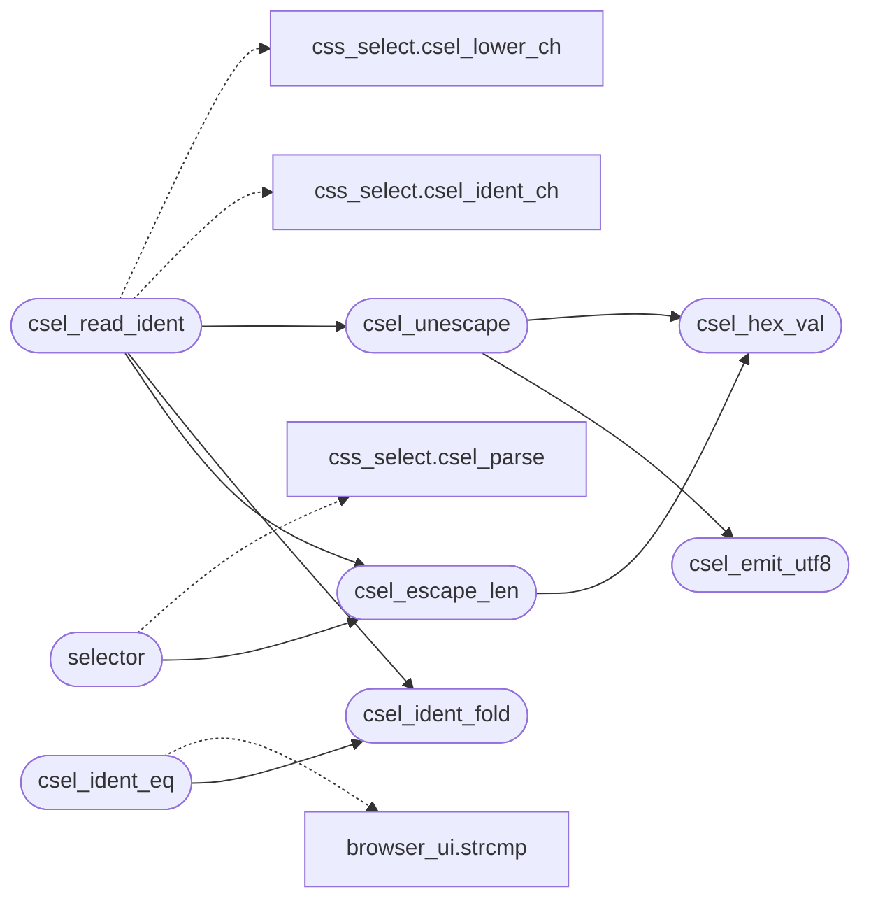

# `src/css_select.c`

> Source: [src/css_select.c:1](../../src/css_select.c#L1) | language `c` | coverage 64.3% | [API index](../index.md)

## Contents

- **Functions:** [`csel_hex_val`](#csel_hex_val), [`csel_emit_utf8`](#csel_emit_utf8), [`csel_unescape`](#csel_unescape), [`csel_escape_len`](#csel_escape_len), [`csel_decl_end`](#csel_decl_end), [`csel_ident_fold`](#csel_ident_fold), [`csel_ident_eq`](#csel_ident_eq), [`csel_read_ident`](#csel_read_ident), [`between`](#between), [`selector`](#selector), [`built`](#built), [`csel_matches`](#csel_matches)
- **Macros:** [`HAS_MAX_DEPTH`](#has_max_depth)

## Call Graph

Solid arrows stay in this module, dashed arrows leave it.



## Functions

<a id="csel_hex_val"></a>

### `csel_hex_val`

`function` | [src/css_select.c:23](../../src/css_select.c#L23)

```c
int csel_hex_val(char c)
```

CSS Syntax 4.3.7 escape consumption (moved from css.c; shared by quoted content values and selector identifiers).

Backslash + 1-6 hex digits (then one optional whitespace, eaten as the terminator) is the codepoint, emitted UTF-8; backslash + newline eats both (continuation); backslash + anything else is that char; a trailing backslash is dropped. Null, surrogates and > U+10FFFF become U+FFFD. Decoded output only ever shrinks, except \0-like escapes (2 chars -> 3 bytes), so the write is capped and a hostile value truncates instead of overflowing.

**Parameters**

| Name | Type | Default | Description |
|---|---|---|---|
| `c` | `char` |  |  |

**Returns:** `int`

*Called by:* [`csel_escape_len`](#csel_escape_len), [`csel_unescape`](#csel_unescape)

---

<a id="csel_emit_utf8"></a>

### `csel_emit_utf8`

`function` | [src/css_select.c:30](../../src/css_select.c#L30)

```c
size_t csel_emit_utf8(unsigned int cp, char *out)
```

**Parameters**

| Name | Type | Default | Description |
|---|---|---|---|
| `cp` | `unsigned int` |  |  |
| `out` | `char *` |  |  |

**Returns:** `size_t`

*Called by:* [`csel_unescape`](#csel_unescape)

---

<a id="csel_unescape"></a>

### `csel_unescape`

`function` | [src/css_select.c:52](../../src/css_select.c#L52)

```c
void csel_unescape(char *dst, size_t cap, const char *src, size_t n)
```

Decodes CSS escapes in src[0,n) into dst (cap bytes, NUL-terminated, truncates).

**Parameters**

| Name | Type | Default | Description |
|---|---|---|---|
| `dst` | `char *` |  |  |
| `cap` | `size_t` |  |  |
| `src` | `char *` |  |  |
| `n` | `size_t` |  |  |

> **Inherited:** Documentation from [`csel_unescape`](#csel_unescape) (include/css_select.h:177).

*Calls:* [`csel_emit_utf8`](#csel_emit_utf8), [`csel_hex_val`](#csel_hex_val)

*Called by:* [`csel_read_ident`](#csel_read_ident)

---

<a id="csel_escape_len"></a>

### `csel_escape_len`

`function` | [src/css_select.c:91](../../src/css_select.c#L91)

```c
size_t csel_escape_len(const char *s, size_t i, size_t b)
```

Bytes the escape starting at s[i] occupies (0 when s[i] does not start one).

**Parameters**

| Name | Type | Default | Description |
|---|---|---|---|
| `s` | `char *` |  |  |
| `i` | `size_t` |  |  |
| `b` | `size_t` |  |  |

**Returns:** `size_t`

> **Inherited:** Documentation from [`csel_escape_len`](#csel_escape_len) (include/css_select.h:179).

*Calls:* [`csel_hex_val`](#csel_hex_val)

*Called by:* [`csel_read_ident`](#csel_read_ident), [`selector`](#selector)

---

<a id="csel_decl_end"></a>

### `csel_decl_end`

`function` | [src/css_select.c:104](../../src/css_select.c#L104)

```c
size_t csel_decl_end(const char *s, size_t i, size_t b, int stop_brace)
```

Index of the ';' ending the declaration that starts at s[i] (or of a '}' when stop_brace), or b: separators inside quotes, inside (...) such as url(data:a;b), or escaped, are not separators (CSS Syntax 5 section 5.4.4).

**Parameters**

| Name | Type | Default | Description |
|---|---|---|---|
| `s` | `char *` |  |  |
| `i` | `size_t` |  |  |
| `b` | `size_t` |  |  |
| `stop_brace` | `int` |  |  |

**Returns:** `size_t`

> **Inherited:** Documentation from [`csel_decl_end`](#csel_decl_end) (include/css_select.h:191).

---

<a id="csel_ident_fold"></a>

### `csel_ident_fold`

`function` | [src/css_select.c:127](../../src/css_select.c#L127)

```c
void csel_ident_fold(const char *src, size_t len, char *dst)
```

dst (CSS_TOK_MAX bytes) receives src[0,len) as-is, or folded when too long.

**Parameters**

| Name | Type | Default | Description |
|---|---|---|---|
| `src` | `char *` |  |  |
| `len` | `size_t` |  |  |
| `dst` | `char *` |  |  |

> **Inherited:** Documentation from [`csel_ident_fold`](#csel_ident_fold) (include/css_select.h:181).

*Called by:* [`csel_ident_eq`](#csel_ident_eq), [`csel_read_ident`](#csel_read_ident)

---

<a id="csel_ident_eq"></a>

### `csel_ident_eq`

`function` | [src/css_select.c:142](../../src/css_select.c#L142)

```c
int csel_ident_eq(const char *stored, const char *tok, size_t tlen)
```

A stored (possibly folded) identifier against an element token of tlen bytes.

**Parameters**

| Name | Type | Default | Description |
|---|---|---|---|
| `stored` | `char *` |  |  |
| `tok` | `char *` |  |  |
| `tlen` | `size_t` |  |  |

**Returns:** `int`

> **Inherited:** Documentation from [`csel_ident_eq`](#csel_ident_eq) (include/css_select.h:183).

*Calls:* [`strcmp`](gui.browser_ui.c.md#strcmp), [`csel_ident_fold`](#csel_ident_fold)

---

<a id="csel_read_ident"></a>

### `csel_read_ident`

`function` | [src/css_select.c:150](../../src/css_select.c#L150)

```c
int csel_read_ident(const char *s, size_t *ip, size_t b, char *dst, int lower)
```

Reads an identifier at s[*ip] (escapes decoded, non-ASCII kept, lowercased when lower != 0) into dst (CSS_TOK_MAX).

Returns 0, *ip untouched, when none.

**Parameters**

| Name | Type | Default | Description |
|---|---|---|---|
| `s` | `char *` |  |  |
| `ip` | `size_t *` |  |  |
| `b` | `size_t` |  |  |
| `dst` | `char *` |  |  |
| `lower` | `int` |  |  |

**Returns:** `int`

> **Inherited:** Documentation from [`csel_read_ident`](#csel_read_ident) (include/css_select.h:186).

*Calls:* [`csel_ident_ch`](include.css_select.h.md#csel_ident_ch), [`csel_lower_ch`](include.css_select.h.md#csel_lower_ch), [`csel_escape_len`](#csel_escape_len), [`csel_ident_fold`](#csel_ident_fold), [`csel_unescape`](#csel_unescape)

---

<a id="between"></a>

### `between`

`function` | [src/css_select.c:376](../../src/css_select.c#L376)

```c
* between ( and ) is split on commas (not inside [] or ());
```

**Returns:** `*`

---

<a id="selector"></a>

### `selector`

`function` | [src/css_select.c:559](../../src/css_select.c#L559)

```c
* the whole selector (fail closed). A chain deeper than CSS_MAX_COMPOUNDS is * dropped. Whitespa...
```

**Parameters**

| Name | Type | Default | Description |
|---|---|---|---|
| `closed` | `fail` |  |  |

**Returns:** `* the whole`

*Calls:* [`csel_parse`](include.css_select.h.md#csel_parse), [`csel_escape_len`](#csel_escape_len)

---

<a id="built"></a>

### `built`

`function` | [src/css_select.c:1014](../../src/css_select.c#L1014)

```c
* chains the caller built (an element without parent/prev links never matches * through that combinator — fail closed). When pseudo_kind is non-NULL and the * subject compound (rightmost, index k) matches via PSEUDO_BEFORE or * PSEUDO_AFTER, *pseudo_kind is set to that kind. */ static int complex_matches(const css_sel *sel, int k, const css_element *el, const char *target_id, int allow_pseudo_el, int *pseudo_kind)
```

**Parameters**

| Name | Type | Default | Description |
|---|---|---|---|
| `closed` | `an element without parent/prev links never matches * through that combinator — fail` |  |  |

**Returns:** `* chains the caller`

---

<a id="csel_matches"></a>

### `csel_matches`

`function` | [src/css_select.c:1055](../../src/css_select.c#L1055)

```c
int csel_matches(const css_sel *sel, const css_element *el, const char *target_id, int allow_pseudo_el, int *pseudo_kind)
```

True if *sel matches element *el against its ancestor chain. target_id (optional) is the URL fragment for :target matching; NULL -> never matches. allow_pseudo_el: 1 = CSS cascade mode (::before/::after match), 0 = DOM query mode (pseudo-elements never match real elements). pseudo_kind (optional, may be NULL): when non-NULL and the subject compound matched via PSEUDO_BEFORE or PSEUDO_AFTER, *pseudo_kind is set to that pseudo-element kind; otherwise set to -1.

**Parameters**

| Name | Type | Default | Description |
|---|---|---|---|
| `sel` | `css_sel *` |  |  |
| `el` | `css_element *` |  |  |
| `target_id` | `char *` |  |  |
| `allow_pseudo_el` | `int` |  |  |
| `pseudo_kind` | `int *` |  |  |

**Returns:** `int`

> **Inherited:** Documentation from [`csel_matches`](#csel_matches) (include/css_select.h:159).

---

## Macros

<a id="has_max_depth"></a>

### `HAS_MAX_DEPTH`

`macro` | [src/css_select.c:839](../../src/css_select.c#L839)

```c
#define HAS_MAX_DEPTH
```

Recursive depth cap to prevent unbounded traversal on deep DOM.

---
