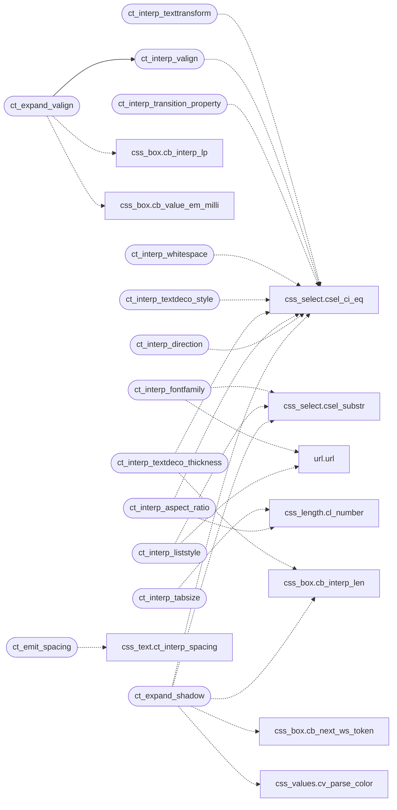

# `src/css_text.c`

> Source: [src/css_text.c:1](../../src/css_text.c#L1) | language `c` | coverage 73.3% | [API index](../index.md)

--- text-presentation extensions (Hito 23b-6) ---

## Contents

- **Functions:** [`ct_interp_fontfamily`](#ct_interp_fontfamily), [`ct_interp_texttransform`](#ct_interp_texttransform), [`ct_interp_valign`](#ct_interp_valign), [`ct_expand_valign`](#ct_expand_valign), [`ct_interp_transition_property`](#ct_interp_transition_property), [`ct_interp_whitespace`](#ct_interp_whitespace), [`ct_interp_tabsize`](#ct_interp_tabsize), [`ct_interp_textdeco_style`](#ct_interp_textdeco_style), [`ct_interp_textdeco_thickness`](#ct_interp_textdeco_thickness), [`ct_interp_aspect_ratio`](#ct_interp_aspect_ratio), [`ct_interp_direction`](#ct_interp_direction), [`ct_interp_liststyle`](#ct_interp_liststyle), [`ct_emit_spacing`](#ct_emit_spacing), [`ct_expand_shadow`](#ct_expand_shadow)

## Call Graph

Solid arrows stay in this module, dashed arrows leave it.



## Functions

<a id="ct_interp_fontfamily"></a>

### `ct_interp_fontfamily`

`function` | [src/css_text.c:47](../../src/css_text.c#L47)

```c
int ct_interp_fontfamily(const char *v)
```

font-family: the first recognised name in the comma-separated stack wins (its generic bucket).

Quotes are stripped. url() defensively dropped. -1 if none known.

**Parameters**

| Name | Type | Default | Description |
|---|---|---|---|
| `v` | `char *` |  |  |

**Returns:** `int`

*Calls:* [`csel_substr`](include.css_select.h.md#csel_substr), [`url`](include.url.h.md#url)

---

<a id="ct_interp_texttransform"></a>

### `ct_interp_texttransform`

`function` | [src/css_text.c:69](../../src/css_text.c#L69)

```c
int ct_interp_texttransform(const char *v)
```

**Parameters**

| Name | Type | Default | Description |
|---|---|---|---|
| `v` | `char *` |  |  |

**Returns:** `int`

*Calls:* [`csel_ci_eq`](include.css_select.h.md#csel_ci_eq)

---

<a id="ct_interp_valign"></a>

### `ct_interp_valign`

`function` | [src/css_text.c:91](../../src/css_text.c#L91)

```c
int ct_interp_valign(const char *v)
```

**Parameters**

| Name | Type | Default | Description |
|---|---|---|---|
| `v` | `char *` |  |  |

**Returns:** `int`

*Calls:* [`csel_ci_eq`](include.css_select.h.md#csel_ci_eq)

*Called by:* [`ct_expand_valign`](#ct_expand_valign)

---

<a id="ct_expand_valign"></a>

### `ct_expand_valign`

`function` | [src/css_text.c:122](../../src/css_text.c#L122)

```c
int ct_expand_valign(const char *val, css_decl *dst, int cap)
```

vertical-align (CSS 2.1 section 10.8.1) has two productions: a keyword, and a <length-percentage> baseline SHIFT (positive raises).

They are different kinds of value, so they take different slots -- a keyword enum cannot also hold a signed length -- and both are emitted on every declaration so that whichever the author wrote CLEARS the other. Without that, `vertical-align: middle` under a lower-specificity `vertical-align: -2px` would apply both.

The percentage resolves against the element's own line-height, which is the one
basis in CSS Values that is neither a containing block nor the element's border
box, so it has its own pct slot. Measured: jkanime's icon font sets `.255em` on
every glyph, and the whole declaration was dropped.

**Parameters**

| Name | Type | Default | Description |
|---|---|---|---|
| `val` | `char *` |  |  |
| `dst` | `css_decl *` |  |  |
| `cap` | `int` |  |  |

**Returns:** `int`

*Calls:* [`cb_interp_lp`](include.css_box.h.md#cb_interp_lp), [`cb_value_em_milli`](include.css_box.h.md#cb_value_em_milli), [`ct_interp_valign`](#ct_interp_valign)

---

<a id="ct_interp_transition_property"></a>

### `ct_interp_transition_property`

`function` | [src/css_text.c:139](../../src/css_text.c#L139)

```c
int ct_interp_transition_property(const char *v)
```

transition-property value encoding: -1 = unset, 0 = none, 1 = all, 2 = opacity, 3 = transform.

Other values not yet supported.

**Parameters**

| Name | Type | Default | Description |
|---|---|---|---|
| `v` | `char *` |  |  |

**Returns:** `int`

*Calls:* [`csel_ci_eq`](include.css_select.h.md#csel_ci_eq)

---

<a id="ct_interp_whitespace"></a>

### `ct_interp_whitespace`

`function` | [src/css_text.c:147](../../src/css_text.c#L147)

```c
int ct_interp_whitespace(const char *v)
```

**Parameters**

| Name | Type | Default | Description |
|---|---|---|---|
| `v` | `char *` |  |  |

**Returns:** `int`

*Calls:* [`csel_ci_eq`](include.css_select.h.md#csel_ci_eq)

---

<a id="ct_interp_tabsize"></a>

### `ct_interp_tabsize`

`function` | [src/css_text.c:160](../../src/css_text.c#L160)

```c
int ct_interp_tabsize(const char *v)
```

tab-size: a non-negative integer (number of spaces). -1 if unsupported.

**Parameters**

| Name | Type | Default | Description |
|---|---|---|---|
| `v` | `char *` |  |  |

**Returns:** `int`

*Calls:* [`cl_number`](include.css_length.h.md#cl_number)

---

<a id="ct_interp_textdeco_style"></a>

### `ct_interp_textdeco_style`

`function` | [src/css_text.c:171](../../src/css_text.c#L171)

```c
int ct_interp_textdeco_style(const char *v)
```

text-decoration-style: solid/wavy/dotted/dashed/double. -1 if unknown.

**Parameters**

| Name | Type | Default | Description |
|---|---|---|---|
| `v` | `char *` |  |  |

**Returns:** `int`

*Calls:* [`csel_ci_eq`](include.css_select.h.md#csel_ci_eq)

---

<a id="ct_interp_textdeco_thickness"></a>

### `ct_interp_textdeco_thickness`

`function` | [src/css_text.c:182](../../src/css_text.c#L182)

```c
int ct_interp_textdeco_thickness(const char *v)
```

text-decoration-thickness: `from-font` (keyword -> 0), or a non-negative length (px -> px, em/rem x16). -1 if unsupported (negative, %, etc -> dropped).

**Parameters**

| Name | Type | Default | Description |
|---|---|---|---|
| `v` | `char *` |  |  |

**Returns:** `int`

*Calls:* [`cb_interp_len`](include.css_box.h.md#cb_interp_len), [`csel_ci_eq`](include.css_select.h.md#csel_ci_eq)

---

<a id="ct_interp_aspect_ratio"></a>

### `ct_interp_aspect_ratio`

`function` | [src/css_text.c:194](../../src/css_text.c#L194)

```c
int ct_interp_aspect_ratio(const char *v, int *num, int *den)
```

aspect-ratio: `auto`, a `<ratio>` such as `16/9` or `1.5`, or `auto <ratio>` (auto fallback).

Stores both numerator and denominator x1000 (for sub-integer ratios like 1.5 -> 1500/1000). Returns 1 with *num and *den set, 0 if unsupported. A bare number 1.5 is stored as 1500/1000; 16/9 as 16000/9000; auto / unparseable -> 0 (unset).

**Parameters**

| Name | Type | Default | Description |
|---|---|---|---|
| `v` | `char *` |  |  |
| `num` | `int *` |  |  |
| `den` | `int *` |  |  |

**Returns:** `int`

*Calls:* [`cl_number`](include.css_length.h.md#cl_number), [`csel_ci_eq`](include.css_select.h.md#csel_ci_eq)

---

<a id="ct_interp_direction"></a>

### `ct_interp_direction`

`function` | [src/css_text.c:236](../../src/css_text.c#L236)

```c
int ct_interp_direction(const char *v)
```

direction: ltr/rtl. -1 if unknown.

**Parameters**

| Name | Type | Default | Description |
|---|---|---|---|
| `v` | `char *` |  |  |

**Returns:** `int`

*Calls:* [`csel_ci_eq`](include.css_select.h.md#csel_ci_eq)

---

<a id="ct_interp_liststyle"></a>

### `ct_interp_liststyle`

`function` | [src/css_text.c:274](../../src/css_text.c#L274)

```c
int ct_interp_liststyle(const char *v)
```

list-style-type, or the type token of the list-style shorthand: the first recognised keyword wins. url() (a list-style-image) is dropped: never fetch.

**Parameters**

| Name | Type | Default | Description |
|---|---|---|---|
| `v` | `char *` |  |  |

**Returns:** `int`

*Calls:* [`csel_substr`](include.css_select.h.md#csel_substr), [`url`](include.url.h.md#url)

---

<a id="ct_emit_spacing"></a>

### `ct_emit_spacing`

`function` | [src/css_text.c:309](../../src/css_text.c#L309)

```c
int ct_emit_spacing(css_decl *dst, int cap, int slot, const char *val)
```

**Parameters**

| Name | Type | Default | Description |
|---|---|---|---|
| `dst` | `css_decl *` |  |  |
| `cap` | `int` |  |  |
| `slot` | `int` |  |  |
| `val` | `char *` |  |  |

**Returns:** `int`

*Calls:* [`ct_interp_spacing`](include.css_text.h.md#ct_interp_spacing)

---

<a id="ct_expand_shadow"></a>

### `ct_expand_shadow`

`function` | [src/css_text.c:322](../../src/css_text.c#L322)

```c
int ct_expand_shadow(const char *val, css_decl *dst, int cap)
```

text-shadow (single layer): collects up to three lengths (dx, dy, blur — blur is ignored) and an optional color, in any order.

"none" emits an explicit no-shadow. Needs at least dx and dy or the whole declaration is dropped (fail closed). When no color is given it defaults to black. url() dropped: never fetch. Writes the three contiguous P_SHADOW_* slots; offsets clamped to [-CSS_SHADOW_MAX, CSS_SHADOW_MAX].

**Parameters**

| Name | Type | Default | Description |
|---|---|---|---|
| `val` | `char *` |  |  |
| `dst` | `css_decl *` |  |  |
| `cap` | `int` |  |  |

**Returns:** `int`

*Calls:* [`cb_interp_len`](include.css_box.h.md#cb_interp_len), [`cb_next_ws_token`](include.css_box.h.md#cb_next_ws_token), [`csel_ci_eq`](include.css_select.h.md#csel_ci_eq), [`csel_substr`](include.css_select.h.md#csel_substr), [`cv_parse_color`](include.css_values.h.md#cv_parse_color), [`url`](include.url.h.md#url)

---
