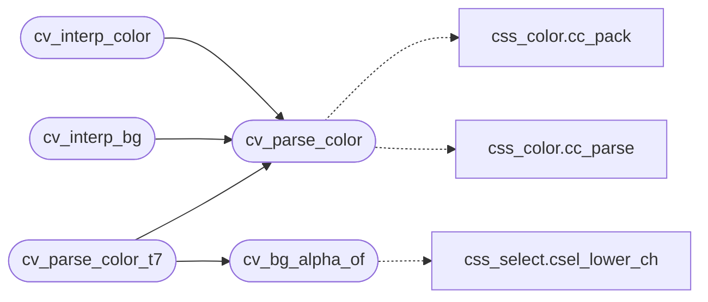

# `src/css_values.c`

> Source: [src/css_values.c:1](../../src/css_values.c#L1) | language `c` | coverage 14.3% | [API index](../index.md)

## Contents

- **Functions:** [`cv_parse_color`](#cv_parse_color), [`cv_interp_color`](#cv_interp_color), [`cv_color_ok`](#cv_color_ok), [`cv_bg_alpha_of`](#cv_bg_alpha_of), [`cv_interp_bg`](#cv_interp_bg), [`cv_parse_color_t7`](#cv_parse_color_t7)

## Call Graph

Solid arrows stay in this module, dashed arrows leave it.



## Functions

<a id="cv_parse_color"></a>

### `cv_parse_color`

`function` | [src/css_values.c:16](../../src/css_values.c#L16)

```c
int cv_parse_color(const char *v)
```

**Parameters**

| Name | Type | Default | Description |
|---|---|---|---|
| `v` | `char *` |  |  |

**Returns:** `int`

*Calls:* [`cc_pack`](include.css_color.h.md#cc_pack), [`cc_parse`](src.css_color.c.md#cc_parse)

*Called by:* [`cv_interp_bg`](#cv_interp_bg), [`cv_interp_color`](#cv_interp_color), [`cv_parse_color_t7`](#cv_parse_color_t7)

---

<a id="cv_interp_color"></a>

### `cv_interp_color`

`function` | [src/css_values.c:36](../../src/css_values.c#L36)

```c
int cv_interp_color(const char *v)
```

**Parameters**

| Name | Type | Default | Description |
|---|---|---|---|
| `v` | `char *` |  |  |

**Returns:** `int`

*Calls:* [`cv_parse_color`](#cv_parse_color)

---

<a id="cv_color_ok"></a>

### `cv_color_ok`

`function` | [src/css_values.c:41](../../src/css_values.c#L41)

```c
int cv_color_ok(int c)
```

**Parameters**

| Name | Type | Default | Description |
|---|---|---|---|
| `c` | `int` |  |  |

**Returns:** `int`

---

<a id="cv_bg_alpha_of"></a>

### `cv_bg_alpha_of`

`function` | [src/css_values.c:46](../../src/css_values.c#L46)

```c
int cv_bg_alpha_of(const char *v)
```

**Parameters**

| Name | Type | Default | Description |
|---|---|---|---|
| `v` | `char *` |  |  |

**Returns:** `int`

*Calls:* [`csel_lower_ch`](include.css_select.h.md#csel_lower_ch)

*Called by:* [`cv_parse_color_t7`](#cv_parse_color_t7)

---

<a id="cv_interp_bg"></a>

### `cv_interp_bg`

`function` | [src/css_values.c:160](../../src/css_values.c#L160)

```c
int cv_interp_bg(const char *v)
```

**Parameters**

| Name | Type | Default | Description |
|---|---|---|---|
| `v` | `char *` |  |  |

**Returns:** `int`

*Calls:* [`cv_parse_color`](#cv_parse_color)

---

<a id="cv_parse_color_t7"></a>

### `cv_parse_color_t7`

`function` | [src/css_values.c:205](../../src/css_values.c#L205)

```c
int cv_parse_color_t7(const char *v)
```

cv_parse_color with the color's alpha as TRANSPARENCY in bits 24..30 (0 opaque, 127 clear): an opaque color is exactly cv_parse_color's 0xRRGGBB.

Sentinels (-1 invalid, CC_COLOR_CURRENT, CC_COLOR_TRANSPARENT) pass through unchanged.

**Parameters**

| Name | Type | Default | Description |
|---|---|---|---|
| `v` | `char *` |  |  |

**Returns:** `int`

> **Inherited:** Documentation from [`cv_parse_color_t7`](#cv_parse_color_t7) (include/css_values.h:19).

*Calls:* [`cv_bg_alpha_of`](#cv_bg_alpha_of), [`cv_parse_color`](#cv_parse_color)

---
