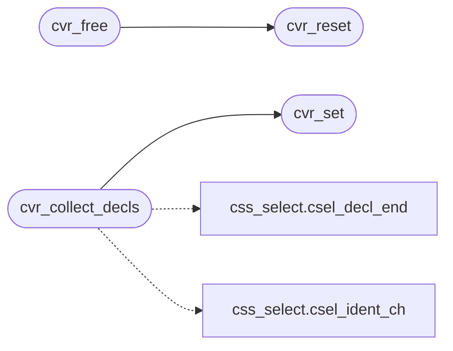

# `src/css_vars.c`

> Source: [src/css_vars.c:1](../../src/css_vars.c#L1) | language `c` | coverage 55.6% | [API index](../index.md)

## Contents

- **Functions:** [`cvr_set`](#cvr_set), [`cvr_get`](#cvr_get), [`cvr_count`](#cvr_count), [`cvr_reset`](#cvr_reset), [`cvr_free`](#cvr_free), [`cvr_collect_decls`](#cvr_collect_decls), [`cvr_resolve`](#cvr_resolve), [`cvr_lookup`](#cvr_lookup)

## Call Graph

Solid arrows stay in this module, dashed arrows leave it.



## Functions

<a id="cvr_set"></a>

### `cvr_set`

`function` | [src/css_vars.c:67](../../src/css_vars.c#L67)

```c
int cvr_set(cvr_table *t, const char *name, size_t nlen, const char *value, size_t vlen)
```

**Parameters**

| Name | Type | Default | Description |
|---|---|---|---|
| `t` | `cvr_table *` |  |  |
| `name` | `char *` |  |  |
| `nlen` | `size_t` |  |  |
| `value` | `char *` |  |  |
| `vlen` | `size_t` |  |  |

**Returns:** `int`

*Called by:* [`cvr_collect_decls`](#cvr_collect_decls)

---

<a id="cvr_get"></a>

### `cvr_get`

`function` `const` | [src/css_vars.c:94](../../src/css_vars.c#L94)

```c
const char *cvr_get(const cvr_table *t, const char *name, size_t nlen)
```

The stored value for name[0,nlen), or NULL.

Case-sensitive (custom property names are). t may be NULL.

**Parameters**

| Name | Type | Default | Description |
|---|---|---|---|
| `t` | `cvr_table *` |  |  |
| `name` | `char *` |  |  |
| `nlen` | `size_t` |  |  |

**Returns:** `char *`

> **Inherited:** Documentation from [`cvr_get`](#cvr_get) (include/css_vars.h:69).

---

<a id="cvr_count"></a>

### `cvr_count`

`function` | [src/css_vars.c:100](../../src/css_vars.c#L100)

```c
size_t cvr_count(const cvr_table *t)
```

**Parameters**

| Name | Type | Default | Description |
|---|---|---|---|
| `t` | `cvr_table *` |  |  |

**Returns:** `size_t`

---

<a id="cvr_reset"></a>

### `cvr_reset`

`function` | [src/css_vars.c:102](../../src/css_vars.c#L102)

```c
void cvr_reset(cvr_table *t)
```

Frees every stored string and empties the table, keeping its arrays for reuse.

NULL-safe.

**Parameters**

| Name | Type | Default | Description |
|---|---|---|---|
| `t` | `cvr_table *` |  |  |

> **Inherited:** Documentation from [`cvr_reset`](#cvr_reset) (include/css_vars.h:75).

*Called by:* [`cvr_free`](#cvr_free)

---

<a id="cvr_free"></a>

### `cvr_free`

`function` | [src/css_vars.c:112](../../src/css_vars.c#L112)

```c
void cvr_free(cvr_table *t)
```

Releases everything; the table is left zeroed and reusable.

Idempotent.

**Parameters**

| Name | Type | Default | Description |
|---|---|---|---|
| `t` | `cvr_table *` |  |  |

> **Inherited:** Documentation from [`cvr_free`](#cvr_free) (include/css_vars.h:78).

*Calls:* [`cvr_reset`](#cvr_reset)

---

<a id="cvr_collect_decls"></a>

### `cvr_collect_decls`

`function` | [src/css_vars.c:139](../../src/css_vars.c#L139)

```c
void cvr_collect_decls(cvr_table *t, const char *s, size_t a, size_t b)
```

Scans the declaration span s[a,b) for `--ident : value` pairs and stores each (a trailing !important is stripped).

A name is recognised only where it cannot be the tail of a longer identifier.

**Parameters**

| Name | Type | Default | Description |
|---|---|---|---|
| `t` | `cvr_table *` |  |  |
| `s` | `char *` |  |  |
| `a` | `size_t` |  |  |
| `b` | `size_t` |  |  |

> **Inherited:** Documentation from [`cvr_collect_decls`](#cvr_collect_decls) (include/css_vars.h:83).

*Calls:* [`csel_decl_end`](include.css_select.h.md#csel_decl_end), [`csel_ident_ch`](include.css_select.h.md#csel_ident_ch), [`cvr_set`](#cvr_set)

---

<a id="cvr_resolve"></a>

### `cvr_resolve`

`function` | [src/css_vars.c:230](../../src/css_vars.c#L230)

```c
int cvr_resolve(const char *val, char *out, size_t outcap, const cvr_scope *sc)
```

**Parameters**

| Name | Type | Default | Description |
|---|---|---|---|
| `val` | `char *` |  |  |
| `out` | `char *` |  |  |
| `outcap` | `size_t` |  |  |
| `sc` | `cvr_scope *` |  |  |

**Returns:** `int`

---

<a id="cvr_lookup"></a>

### `cvr_lookup`

`function` `const` | [src/css_vars.c:239](../../src/css_vars.c#L239)

```c
const char *cvr_lookup(const cvr_scope *sc, const char *name, size_t nlen)
```

The value name[0,nlen) has in scope sc (same lookup order as cvr_resolve), or NULL.

Not substituted: the stored text.

**Parameters**

| Name | Type | Default | Description |
|---|---|---|---|
| `sc` | `cvr_scope *` |  |  |
| `name` | `char *` |  |  |
| `nlen` | `size_t` |  |  |

**Returns:** `char *`

> **Inherited:** Documentation from [`cvr_lookup`](#cvr_lookup) (include/css_vars.h:96).

---
