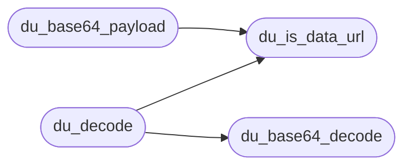

# `src/data_url.c`

> Source: [src/data_url.c:1](../../src/data_url.c#L1) | language `c` | coverage 20.0% | [API index](../index.md)

## Contents

- **Functions:** [`du_is_data_url`](#du_is_data_url), [`du_base64_payload`](#du_base64_payload), [`du_base64_decode`](#du_base64_decode), [`du_decode`](#du_decode)

## Call Graph

Solid arrows stay in this module, dashed arrows leave it.



## Functions

<a id="du_is_data_url"></a>

### `du_is_data_url`

`function` | [src/data_url.c:28](../../src/data_url.c#L28)

```c
int du_is_data_url(const char *url)
```

Nonzero iff url begins (case-insensitively) with "data:".

NULL => 0.

**Parameters**

| Name | Type | Default | Description |
|---|---|---|---|
| `url` | `char *` |  |  |

**Returns:** `int`

> **Inherited:** Documentation from [`du_is_data_url`](#du_is_data_url) (include/data_url.h:46).

*Called by:* [`du_base64_payload`](#du_base64_payload), [`du_decode`](#du_decode)

---

<a id="du_base64_payload"></a>

### `du_base64_payload`

`function` | [src/data_url.c:32](../../src/data_url.c#L32)

```c
du_status du_base64_payload(const char *url, const char **payload, size_t *payload_len)
```

**Parameters**

| Name | Type | Default | Description |
|---|---|---|---|
| `url` | `char *` |  |  |
| `payload` | `char **` |  |  |
| `payload_len` | `size_t *` |  |  |

**Returns:** `du_status`

*Calls:* [`du_is_data_url`](#du_is_data_url)

*Called by:* [`rdp_image_decision`](src.render_policy.c.md#rdp_image_decision), [`tab_decode_image_data_url`](src.tab.c.md#tab_decode_image_data_url)

---

<a id="du_base64_decode"></a>

### `du_base64_decode`

`function` | [src/data_url.c:70](../../src/data_url.c#L70)

```c
du_status du_base64_decode(const char *b64, size_t b64_len, uint8_t **out, size_t *out_len)
```

**Parameters**

| Name | Type | Default | Description |
|---|---|---|---|
| `b64` | `char *` |  |  |
| `b64_len` | `size_t` |  |  |
| `out` | `uint8_t **` |  |  |
| `out_len` | `size_t *` |  |  |

**Returns:** `du_status`

*Called by:* [`du_decode`](#du_decode)

---

<a id="du_decode"></a>

### `du_decode`

`function` | [src/data_url.c:131](../../src/data_url.c#L131)

```c
du_status du_decode(const char *url, char *mime, size_t mime_cap, uint8_t **out, size_t *out_len)
```

**Parameters**

| Name | Type | Default | Description |
|---|---|---|---|
| `url` | `char *` |  |  |
| `mime` | `char *` |  |  |
| `mime_cap` | `size_t` |  |  |
| `out` | `uint8_t **` |  |  |
| `out_len` | `size_t *` |  |  |

**Returns:** `du_status`

*Calls:* [`du_base64_decode`](#du_base64_decode), [`du_is_data_url`](#du_is_data_url)

---
