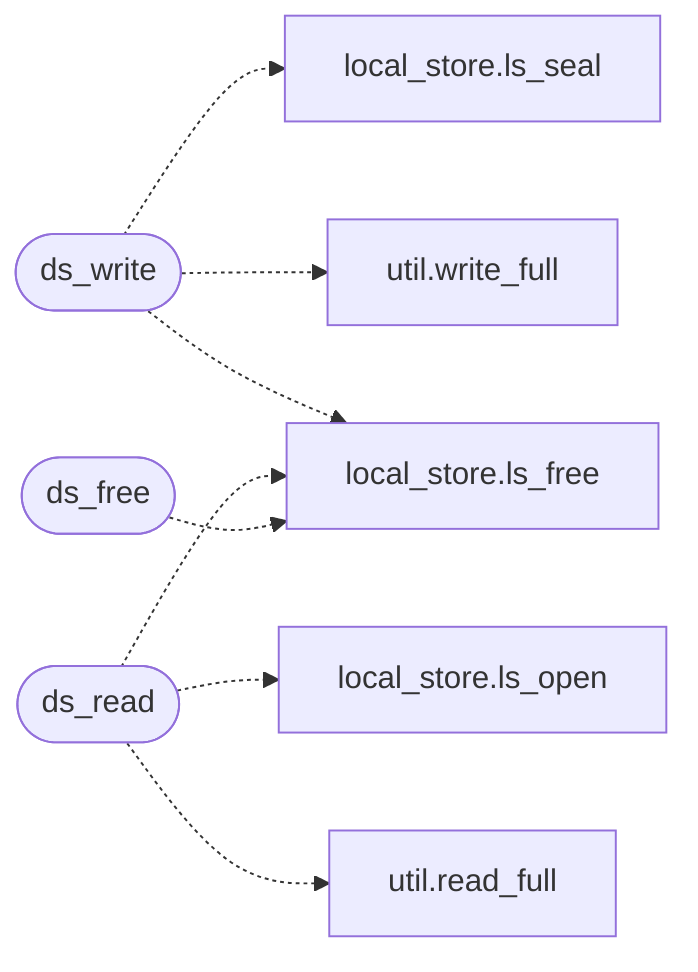

# `src/disk_store.c`

> Source: [src/disk_store.c:1](../../src/disk_store.c#L1) | language `c` | coverage 20.0% | [API index](../index.md)

## Contents

- **Functions:** [`ds_write`](#ds_write), [`ds_read`](#ds_read), [`ds_free`](#ds_free)
- **Macros:** [`_POSIX_C_SOURCE`](#_posix_c_source)

## Call Graph

Solid arrows stay in this module, dashed arrows leave it.



## Functions

<a id="ds_write"></a>

### `ds_write`

`function` | [src/disk_store.c:66](../../src/disk_store.c#L66)

```c
ds_status ds_write(const char *path, const uint8_t key[LS_KEY_LEN], ls_aead aead, const uint8_t *plaintext, size_t pt_len)
```

**Parameters**

| Name | Type | Default | Description |
|---|---|---|---|
| `path` | `char *` |  |  |
| `LS_KEY_LEN` | `uint8_t key[ ]` |  |  |
| `aead` | `ls_aead` |  |  |
| `plaintext` | `uint8_t *` |  |  |
| `pt_len` | `size_t` |  |  |

**Returns:** `ds_status`

*Calls:* [`ls_free`](include.local_store.h.md#ls_free), [`write_full`](include.util.h.md#write_full), [`ls_seal`](src.local_store.c.md#ls_seal)

*Called by:* [`hc_open`](src.http_cache.c.md#hc_open), [`profile_save`](src.profile.c.md#profile_save)

---

<a id="ds_read"></a>

### `ds_read`

`function` | [src/disk_store.c:103](../../src/disk_store.c#L103)

```c
ds_status ds_read(const char *path, const uint8_t key[LS_KEY_LEN], uint8_t **out, size_t *out_len)
```

**Parameters**

| Name | Type | Default | Description |
|---|---|---|---|
| `path` | `char *` |  |  |
| `LS_KEY_LEN` | `uint8_t key[ ]` |  |  |
| `out` | `uint8_t **` |  |  |
| `out_len` | `size_t *` |  |  |

**Returns:** `ds_status`

*Calls:* [`ls_free`](include.local_store.h.md#ls_free), [`read_full`](include.util.h.md#read_full), [`ls_open`](src.local_store.c.md#ls_open)

*Called by:* [`hc_open`](src.http_cache.c.md#hc_open), [`profile_load`](src.profile.c.md#profile_load)

---

<a id="ds_free"></a>

### `ds_free`

`function` | [src/disk_store.c:136](../../src/disk_store.c#L136)

```c
void ds_free(uint8_t *buf, size_t len)
```

Secure free of a buffer returned by ds_read (delegates to ls_free).

**Parameters**

| Name | Type | Default | Description |
|---|---|---|---|
| `buf` | `uint8_t *` |  |  |
| `len` | `size_t` |  |  |

> **Inherited:** Documentation from [`ds_free`](#ds_free) (include/disk_store.h:47).

*Calls:* [`ls_free`](include.local_store.h.md#ls_free)

---

## Macros

<a id="_posix_c_source"></a>

### `_POSIX_C_SOURCE`

`macro` | [src/disk_store.c:11](../../src/disk_store.c#L11)

```c
#define _POSIX_C_SOURCE
```

---
