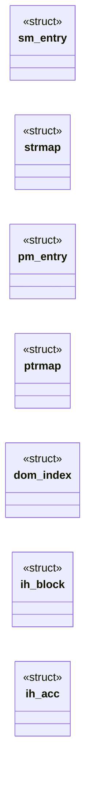
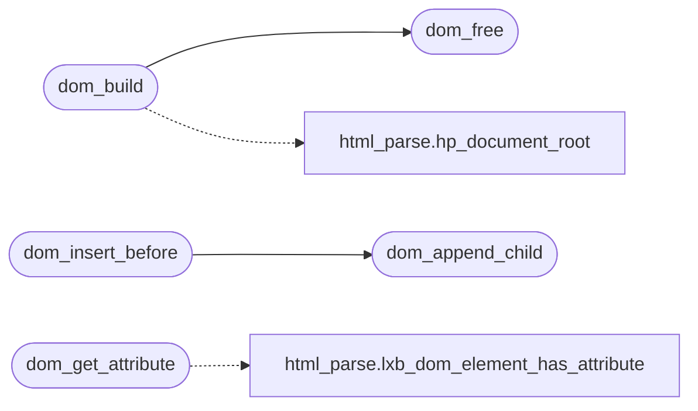

# `src/dom.c`

> Source: [src/dom.c:1](../../src/dom.c#L1) | language `c` | coverage 26.5% | [API index](../index.md)

## Contents

- **Structs:** [`sm_entry`](#sm_entry), [`strmap`](#strmap), [`pm_entry`](#pm_entry), [`ptrmap`](#ptrmap), [`dom_index`](#dom_index), [`ih_block`](#ih_block), [`ih_acc`](#ih_acc)
- **Functions:** [`dom_build`](#dom_build), [`dom_free`](#dom_free), [`dom_node_count`](#dom_node_count), [`dom_get_element_by_id`](#dom_get_element_by_id), [`dom_get_by_tag`](#dom_get_by_tag), [`dom_get_by_class`](#dom_get_by_class), [`count`](#count), [`dom_query_selector`](#dom_query_selector), [`dom_query_selector_all`](#dom_query_selector_all), [`dom_matches`](#dom_matches), [`dom_closest`](#dom_closest), [`dom_document_position`](#dom_document_position), [`dom_precedes`](#dom_precedes), [`dom_node_at`](#dom_node_at), [`dom_parent`](#dom_parent), [`dom_first_child`](#dom_first_child), [`dom_next_sibling`](#dom_next_sibling), [`dom_tag_name`](#dom_tag_name), [`dom_get_attribute`](#dom_get_attribute), [`dom_attribute_names`](#dom_attribute_names), [`dom_text_content`](#dom_text_content), [`dom_document_title`](#dom_document_title), [`dom_set_text_content`](#dom_set_text_content), [`dom_set_document_title`](#dom_set_document_title), [`dom_create_element`](#dom_create_element), [`dom_append_child`](#dom_append_child), [`dom_remove_child`](#dom_remove_child), [`dom_set_attribute`](#dom_set_attribute), [`dom_remove_attribute`](#dom_remove_attribute), [`dom_set_inner_html`](#dom_set_inner_html), [`dom_get_inner_html`](#dom_get_inner_html), [`dom_insert_before`](#dom_insert_before), [`dom_clone_node`](#dom_clone_node), [`dom_move_children`](#dom_move_children), [`dom_node_kind`](#dom_node_kind), [`dom_child_node`](#dom_child_node), [`dom_sibling_node`](#dom_sibling_node), [`dom_create_char_node`](#dom_create_char_node)
- **Macros:** [`_POSIX_C_SOURCE`](#_posix_c_source), [`DOM_QS_MAX_SELECTORS`](#dom_qs_max_selectors), [`IH_BLOCK_SIZE`](#ih_block_size)

## Type Diagram



## Call Graph

Solid arrows stay in this module, dashed arrows leave it.



## Structs

<a id="sm_entry"></a>

### `sm_entry`

`struct` | [src/dom.c:55](../../src/dom.c#L55)

```c
typedef struct sm_entry
```

---

<a id="strmap"></a>

### `strmap`

`struct` | [src/dom.c:64](../../src/dom.c#L64)

```c
typedef struct strmap
```

---

<a id="pm_entry"></a>

### `pm_entry`

`struct` | [src/dom.c:154](../../src/dom.c#L154)

```c
typedef struct pm_entry
```

---

<a id="ptrmap"></a>

### `ptrmap`

`struct` | [src/dom.c:160](../../src/dom.c#L160)

```c
typedef struct ptrmap
```

---

<a id="dom_index"></a>

### `dom_index`

`struct` | [src/dom.c:220](../../src/dom.c#L220)

```c
struct dom_index
```

---

<a id="ih_block"></a>

### `ih_block`

`struct` | [src/dom.c:820](../../src/dom.c#L820)

```c
typedef struct ih_block
```

---

<a id="ih_acc"></a>

### `ih_acc`

`struct` | [src/dom.c:825](../../src/dom.c#L825)

```c
typedef struct ih_acc
```

---

## Functions

<a id="dom_build"></a>

### `dom_build`

`function` | [src/dom.c:291](../../src/dom.c#L291)

```c
dom_status dom_build(const hp_document *doc, dom_index **out)
```

**Parameters**

| Name | Type | Default | Description |
|---|---|---|---|
| `doc` | `hp_document *` |  |  |
| `out` | `dom_index **` |  |  |

**Returns:** `dom_status`

*Calls:* [`hp_document_root`](include.html_parse.h.md#hp_document_root), [`dom_free`](#dom_free)

*Called by:* [`LLVMFuzzerTestOneInput`](fuzz.fuzz_js_dom.c.md#llvmfuzzertestoneinput), [`run_js`](src.tab.c.md#run_js)

---

<a id="dom_free"></a>

### `dom_free`

`function` | [src/dom.c:332](../../src/dom.c#L332)

```c
void dom_free(dom_index *idx)
```

Idempotent; safe on NULL and safe to call twice.

Does not free the tree.

**Parameters**

| Name | Type | Default | Description |
|---|---|---|---|
| `idx` | `dom_index *` |  |  |

> **Inherited:** Documentation from [`dom_free`](#dom_free) (include/dom.h:48).

*Called by:* [`dom_build`](#dom_build)

---

<a id="dom_node_count"></a>

### `dom_node_count`

`function` | [src/dom.c:344](../../src/dom.c#L344)

```c
size_t dom_node_count(const dom_index *idx)
```

Number of element nodes indexed.

NULL idx => 0.

**Parameters**

| Name | Type | Default | Description |
|---|---|---|---|
| `idx` | `dom_index *` |  |  |

**Returns:** `size_t`

> **Inherited:** Documentation from [`dom_node_count`](#dom_node_count) (include/dom.h:51).

---

<a id="dom_get_element_by_id"></a>

### `dom_get_element_by_id`

`function` | [src/dom.c:348](../../src/dom.c#L348)

```c
dom_node_id dom_get_element_by_id(const dom_index *idx, const char *id)
```

**Parameters**

| Name | Type | Default | Description |
|---|---|---|---|
| `idx` | `dom_index *` |  |  |
| `id` | `char *` |  |  |

**Returns:** `dom_node_id`

*Called by:* [`LLVMFuzzerTestOneInput`](fuzz.fuzz_dom.c.md#llvmfuzzertestoneinput)

---

<a id="dom_get_by_tag"></a>

### `dom_get_by_tag`

`function` | [src/dom.c:361](../../src/dom.c#L361)

```c
size_t dom_get_by_tag(const dom_index *idx, const char *tag, dom_node_id *out, size_t cap)
```

**Parameters**

| Name | Type | Default | Description |
|---|---|---|---|
| `idx` | `dom_index *` |  |  |
| `tag` | `char *` |  |  |
| `out` | `dom_node_id *` |  |  |
| `cap` | `size_t` |  |  |

**Returns:** `size_t`

*Called by:* [`jd_process_iframes`](src.js_embed.c.md#jd_process_iframes), [`run`](src.tab.c.md#run)

---

<a id="dom_get_by_class"></a>

### `dom_get_by_class`

`function` | [src/dom.c:370](../../src/dom.c#L370)

```c
size_t dom_get_by_class(const dom_index *idx, const char *cls, dom_node_id *out, size_t cap)
```

**Parameters**

| Name | Type | Default | Description |
|---|---|---|---|
| `idx` | `dom_index *` |  |  |
| `cls` | `char *` |  |  |
| `out` | `dom_node_id *` |  |  |
| `cap` | `size_t` |  |  |

**Returns:** `size_t`

---

<a id="count"></a>

### `count`

`function` | [src/dom.c:437](../../src/dom.c#L437)

```c
* count (may exceed cap), and returns DOM_NODE_NONE. */ static dom_node_id qs_walk(const dom_inde...
```

**Parameters**

| Name | Type | Default | Description |
|---|---|---|---|
| `cap` | `may exceed` |  |  |

**Returns:** `*`

---

<a id="dom_query_selector"></a>

### `dom_query_selector`

`function` | [src/dom.c:467](../../src/dom.c#L467)

```c
dom_node_id dom_query_selector(const dom_index *idx, dom_node_id root, const char *selector)
```

**Parameters**

| Name | Type | Default | Description |
|---|---|---|---|
| `idx` | `dom_index *` |  |  |
| `root` | `dom_node_id` |  |  |
| `selector` | `char *` |  |  |

**Returns:** `dom_node_id`

*Called by:* [`LLVMFuzzerTestOneInput`](fuzz.fuzz_dom.c.md#llvmfuzzertestoneinput)

---

<a id="dom_query_selector_all"></a>

### `dom_query_selector_all`

`function` | [src/dom.c:476](../../src/dom.c#L476)

```c
size_t dom_query_selector_all(const dom_index *idx, dom_node_id root, const char *selector, dom_node_id *out, size_t cap)
```

**Parameters**

| Name | Type | Default | Description |
|---|---|---|---|
| `idx` | `dom_index *` |  |  |
| `root` | `dom_node_id` |  |  |
| `selector` | `char *` |  |  |
| `out` | `dom_node_id *` |  |  |
| `cap` | `size_t` |  |  |

**Returns:** `size_t`

*Called by:* [`LLVMFuzzerTestOneInput`](fuzz.fuzz_dom.c.md#llvmfuzzertestoneinput)

---

<a id="dom_matches"></a>

### `dom_matches`

`function` | [src/dom.c:487](../../src/dom.c#L487)

```c
int dom_matches(const dom_index *idx, dom_node_id node, const char *selector)
```

Nonzero iff node itself matches the selector list (Element.matches).

**Parameters**

| Name | Type | Default | Description |
|---|---|---|---|
| `idx` | `dom_index *` |  |  |
| `node` | `dom_node_id` |  |  |
| `selector` | `char *` |  |  |

**Returns:** `int`

> **Inherited:** Documentation from [`dom_matches`](#dom_matches) (include/dom.h:91).

---

<a id="dom_closest"></a>

### `dom_closest`

`function` | [src/dom.c:496](../../src/dom.c#L496)

```c
dom_node_id dom_closest(const dom_index *idx, dom_node_id node, const char *selector)
```

**Parameters**

| Name | Type | Default | Description |
|---|---|---|---|
| `idx` | `dom_index *` |  |  |
| `node` | `dom_node_id` |  |  |
| `selector` | `char *` |  |  |

**Returns:** `dom_node_id`

*Called by:* [`LLVMFuzzerTestOneInput`](fuzz.fuzz_dom.c.md#llvmfuzzertestoneinput)

---

<a id="dom_document_position"></a>

### `dom_document_position`

`function` | [src/dom.c:512](../../src/dom.c#L512)

```c
size_t dom_document_position(const dom_index *idx, dom_node_id node)
```

0-based document-order position of node, or 0 if node is invalid.

**Parameters**

| Name | Type | Default | Description |
|---|---|---|---|
| `idx` | `dom_index *` |  |  |
| `node` | `dom_node_id` |  |  |

**Returns:** `size_t`

> **Inherited:** Documentation from [`dom_document_position`](#dom_document_position) (include/dom.h:101).

---

<a id="dom_precedes"></a>

### `dom_precedes`

`function` | [src/dom.c:517](../../src/dom.c#L517)

```c
int dom_precedes(const dom_index *idx, dom_node_id a, dom_node_id b)
```

Nonzero iff a precedes b in document order.

**Parameters**

| Name | Type | Default | Description |
|---|---|---|---|
| `idx` | `dom_index *` |  |  |
| `a` | `dom_node_id` |  |  |
| `b` | `dom_node_id` |  |  |

**Returns:** `int`

> **Inherited:** Documentation from [`dom_precedes`](#dom_precedes) (include/dom.h:104).

---

<a id="dom_node_at"></a>

### `dom_node_at`

`function` | [src/dom.c:522](../../src/dom.c#L522)

```c
dom_node_id dom_node_at(const dom_index *idx, size_t position)
```

**Parameters**

| Name | Type | Default | Description |
|---|---|---|---|
| `idx` | `dom_index *` |  |  |
| `position` | `size_t` |  |  |

**Returns:** `dom_node_id`

---

<a id="dom_parent"></a>

### `dom_parent`

`function` | [src/dom.c:527](../../src/dom.c#L527)

```c
dom_node_id dom_parent(const dom_index *idx, dom_node_id node)
```

**Parameters**

| Name | Type | Default | Description |
|---|---|---|---|
| `idx` | `dom_index *` |  |  |
| `node` | `dom_node_id` |  |  |

**Returns:** `dom_node_id`

---

<a id="dom_first_child"></a>

### `dom_first_child`

`function` | [src/dom.c:537](../../src/dom.c#L537)

```c
dom_node_id dom_first_child(const dom_index *idx, dom_node_id node)
```

**Parameters**

| Name | Type | Default | Description |
|---|---|---|---|
| `idx` | `dom_index *` |  |  |
| `node` | `dom_node_id` |  |  |

**Returns:** `dom_node_id`

*Called by:* [`jd_process_iframes`](src.js_embed.c.md#jd_process_iframes)

---

<a id="dom_next_sibling"></a>

### `dom_next_sibling`

`function` | [src/dom.c:545](../../src/dom.c#L545)

```c
dom_node_id dom_next_sibling(const dom_index *idx, dom_node_id node)
```

**Parameters**

| Name | Type | Default | Description |
|---|---|---|---|
| `idx` | `dom_index *` |  |  |
| `node` | `dom_node_id` |  |  |

**Returns:** `dom_node_id`

*Called by:* [`jd_process_iframes`](src.js_embed.c.md#jd_process_iframes)

---

<a id="dom_tag_name"></a>

### `dom_tag_name`

`function` `const` | [src/dom.c:553](../../src/dom.c#L553)

```c
const char *dom_tag_name(const dom_index *idx, dom_node_id node, size_t *len)
```

Lowercase qualified tag name, or NULL. *len (optional) excludes the NUL.

**Parameters**

| Name | Type | Default | Description |
|---|---|---|---|
| `idx` | `dom_index *` |  |  |
| `node` | `dom_node_id` |  |  |
| `len` | `size_t *` |  |  |

**Returns:** `char *`

> **Inherited:** Documentation from [`dom_tag_name`](#dom_tag_name) (include/dom.h:118).

---

<a id="dom_get_attribute"></a>

### `dom_get_attribute`

`function` `const` | [src/dom.c:564](../../src/dom.c#L564)

```c
const char *dom_get_attribute(const dom_index *idx, dom_node_id node, const char *name, size_t *len)
```

Attribute value by name, or NULL if absent. *len (optional) excludes NUL.

**Parameters**

| Name | Type | Default | Description |
|---|---|---|---|
| `idx` | `dom_index *` |  |  |
| `node` | `dom_node_id` |  |  |
| `name` | `char *` |  |  |
| `len` | `size_t *` |  |  |

**Returns:** `char *`

> **Inherited:** Documentation from [`dom_get_attribute`](#dom_get_attribute) (include/dom.h:121).

*Calls:* [`lxb_dom_element_has_attribute`](src.html_parse.c.md#lxb_dom_element_has_attribute)

---

<a id="dom_attribute_names"></a>

### `dom_attribute_names`

`function` | [src/dom.c:586](../../src/dom.c#L586)

```c
size_t dom_attribute_names(const dom_index *idx, dom_node_id node, const char **names, size_t *lens, size_t cap)
```

Qualified names of node's attributes, in document order, written to names[] (borrowed, valid while idx/doc are alive) with matching lens[] (excluding NUL).

Writes at most cap entries; returns the total attribute count (which may exceed cap, so the caller can tell it truncated). node without attributes returns 0.

**Parameters**

| Name | Type | Default | Description |
|---|---|---|---|
| `idx` | `dom_index *` |  |  |
| `node` | `dom_node_id` |  |  |
| `names` | `char **` |  |  |
| `lens` | `size_t *` |  |  |
| `cap` | `size_t` |  |  |

**Returns:** `size_t`

> **Inherited:** Documentation from [`dom_attribute_names`](#dom_attribute_names) (include/dom.h:128).

---

<a id="dom_text_content"></a>

### `dom_text_content`

`function` `const` | [src/dom.c:604](../../src/dom.c#L604)

```c
const char *dom_text_content(const dom_index *idx, dom_node_id node, size_t *len)
```

Concatenated text content of node's subtree (borrowed, valid while idx/doc are alive), or NULL. *len (optional) excludes the NUL.

**Parameters**

| Name | Type | Default | Description |
|---|---|---|---|
| `idx` | `dom_index *` |  |  |
| `node` | `dom_node_id` |  |  |
| `len` | `size_t *` |  |  |

**Returns:** `char *`

> **Inherited:** Documentation from [`dom_text_content`](#dom_text_content) (include/dom.h:133).

---

<a id="dom_document_title"></a>

### `dom_document_title`

`function` `const` | [src/dom.c:614](../../src/dom.c#L614)

```c
const char *dom_document_title(const dom_index *idx, size_t *len)
```

Current document <title> text (borrowed), or NULL. *len excludes the NUL.

**Parameters**

| Name | Type | Default | Description |
|---|---|---|---|
| `idx` | `dom_index *` |  |  |
| `len` | `size_t *` |  |  |

**Returns:** `char *`

> **Inherited:** Documentation from [`dom_document_title`](#dom_document_title) (include/dom.h:136).

---

<a id="dom_set_text_content"></a>

### `dom_set_text_content`

`function` | [src/dom.c:627](../../src/dom.c#L627)

```c
dom_status dom_set_text_content(dom_index *idx, dom_node_id node, const char *text, size_t len)
```

**Parameters**

| Name | Type | Default | Description |
|---|---|---|---|
| `idx` | `dom_index *` |  |  |
| `node` | `dom_node_id` |  |  |
| `text` | `char *` |  |  |
| `len` | `size_t` |  |  |

**Returns:** `dom_status`

---

<a id="dom_set_document_title"></a>

### `dom_set_document_title`

`function` | [src/dom.c:661](../../src/dom.c#L661)

```c
dom_status dom_set_document_title(dom_index *idx, const char *text, size_t len)
```

**Parameters**

| Name | Type | Default | Description |
|---|---|---|---|
| `idx` | `dom_index *` |  |  |
| `text` | `char *` |  |  |
| `len` | `size_t` |  |  |

**Returns:** `dom_status`

---

<a id="dom_create_element"></a>

### `dom_create_element`

`function` | [src/dom.c:690](../../src/dom.c#L690)

```c
dom_status dom_create_element(dom_index *idx, const char *tag, dom_node_id *out_id)
```

**Parameters**

| Name | Type | Default | Description |
|---|---|---|---|
| `idx` | `dom_index *` |  |  |
| `tag` | `char *` |  |  |
| `out_id` | `dom_node_id *` |  |  |

**Returns:** `dom_status`

*Called by:* [`jd_process_iframes`](src.js_embed.c.md#jd_process_iframes)

---

<a id="dom_append_child"></a>

### `dom_append_child`

`function` | [src/dom.c:710](../../src/dom.c#L710)

```c
dom_status dom_append_child(dom_index *idx, dom_node_id parent, dom_node_id child)
```

**Parameters**

| Name | Type | Default | Description |
|---|---|---|---|
| `idx` | `dom_index *` |  |  |
| `parent` | `dom_node_id` |  |  |
| `child` | `dom_node_id` |  |  |

**Returns:** `dom_status`

*Called by:* [`dom_insert_before`](#dom_insert_before), [`jd_process_iframes`](src.js_embed.c.md#jd_process_iframes)

---

<a id="dom_remove_child"></a>

### `dom_remove_child`

`function` | [src/dom.c:724](../../src/dom.c#L724)

```c
dom_status dom_remove_child(dom_index *idx, dom_node_id parent, dom_node_id child)
```

**Parameters**

| Name | Type | Default | Description |
|---|---|---|---|
| `idx` | `dom_index *` |  |  |
| `parent` | `dom_node_id` |  |  |
| `child` | `dom_node_id` |  |  |

**Returns:** `dom_status`

---

<a id="dom_set_attribute"></a>

### `dom_set_attribute`

`function` | [src/dom.c:732](../../src/dom.c#L732)

```c
dom_status dom_set_attribute(dom_index *idx, dom_node_id node, const char *name, const char *value)
```

**Parameters**

| Name | Type | Default | Description |
|---|---|---|---|
| `idx` | `dom_index *` |  |  |
| `node` | `dom_node_id` |  |  |
| `name` | `char *` |  |  |
| `value` | `char *` |  |  |

**Returns:** `dom_status`

*Called by:* [`jd_process_iframes`](src.js_embed.c.md#jd_process_iframes)

---

<a id="dom_remove_attribute"></a>

### `dom_remove_attribute`

`function` | [src/dom.c:761](../../src/dom.c#L761)

```c
dom_status dom_remove_attribute(dom_index *idx, dom_node_id node, const char *name)
```

**Parameters**

| Name | Type | Default | Description |
|---|---|---|---|
| `idx` | `dom_index *` |  |  |
| `node` | `dom_node_id` |  |  |
| `name` | `char *` |  |  |

**Returns:** `dom_status`

---

<a id="dom_set_inner_html"></a>

### `dom_set_inner_html`

`function` | [src/dom.c:780](../../src/dom.c#L780)

```c
dom_status dom_set_inner_html(dom_index *idx, dom_node_id node, const char *html, size_t len)
```

**Parameters**

| Name | Type | Default | Description |
|---|---|---|---|
| `idx` | `dom_index *` |  |  |
| `node` | `dom_node_id` |  |  |
| `html` | `char *` |  |  |
| `len` | `size_t` |  |  |

**Returns:** `dom_status`

---

<a id="dom_get_inner_html"></a>

### `dom_get_inner_html`

`function` | [src/dom.c:887](../../src/dom.c#L887)

```c
dom_status dom_get_inner_html(const dom_index *idx, dom_node_id node, char **out, size_t *out_len)
```

**Parameters**

| Name | Type | Default | Description |
|---|---|---|---|
| `idx` | `dom_index *` |  |  |
| `node` | `dom_node_id` |  |  |
| `out` | `char **` |  |  |
| `out_len` | `size_t *` |  |  |

**Returns:** `dom_status`

---

<a id="dom_insert_before"></a>

### `dom_insert_before`

`function` | [src/dom.c:917](../../src/dom.c#L917)

```c
dom_status dom_insert_before(dom_index *idx, dom_node_id parent, dom_node_id child, dom_node_id ref)
```

**Parameters**

| Name | Type | Default | Description |
|---|---|---|---|
| `idx` | `dom_index *` |  |  |
| `parent` | `dom_node_id` |  |  |
| `child` | `dom_node_id` |  |  |
| `ref` | `dom_node_id` |  |  |

**Returns:** `dom_status`

*Calls:* [`dom_append_child`](#dom_append_child)

---

<a id="dom_clone_node"></a>

### `dom_clone_node`

`function` | [src/dom.c:934](../../src/dom.c#L934)

```c
dom_status dom_clone_node(dom_index *idx, dom_node_id node, int deep, dom_node_id *out_id)
```

**Parameters**

| Name | Type | Default | Description |
|---|---|---|---|
| `idx` | `dom_index *` |  |  |
| `node` | `dom_node_id` |  |  |
| `deep` | `int` |  |  |
| `out_id` | `dom_node_id *` |  |  |

**Returns:** `dom_status`

---

<a id="dom_move_children"></a>

### `dom_move_children`

`function` | [src/dom.c:948](../../src/dom.c#L948)

```c
dom_status dom_move_children(dom_index *idx, dom_node_id src, dom_node_id parent, dom_place where, dom_node_id ref)
```

**Parameters**

| Name | Type | Default | Description |
|---|---|---|---|
| `idx` | `dom_index *` |  |  |
| `src` | `dom_node_id` |  |  |
| `parent` | `dom_node_id` |  |  |
| `where` | `dom_place` |  |  |
| `ref` | `dom_node_id` |  |  |

**Returns:** `dom_status`

---

<a id="dom_node_kind"></a>

### `dom_node_kind`

`function` | [src/dom.c:1000](../../src/dom.c#L1000)

```c
int dom_node_kind(const dom_index *idx, dom_node_id node)
```

DOM_KIND_* of node, DOM_KIND_NONE for an invalid handle.

**Parameters**

| Name | Type | Default | Description |
|---|---|---|---|
| `idx` | `dom_index *` |  |  |
| `node` | `dom_node_id` |  |  |

**Returns:** `int`

> **Inherited:** Documentation from [`dom_node_kind`](#dom_node_kind) (include/dom.h:207).

---

<a id="dom_child_node"></a>

### `dom_child_node`

`function` | [src/dom.c:1004](../../src/dom.c#L1004)

```c
dom_node_id dom_child_node(dom_index *idx, dom_node_id node, int last)
```

**Parameters**

| Name | Type | Default | Description |
|---|---|---|---|
| `idx` | `dom_index *` |  |  |
| `node` | `dom_node_id` |  |  |
| `last` | `int` |  |  |

**Returns:** `dom_node_id`

---

<a id="dom_sibling_node"></a>

### `dom_sibling_node`

`function` | [src/dom.c:1011](../../src/dom.c#L1011)

```c
dom_node_id dom_sibling_node(dom_index *idx, dom_node_id node, int prev)
```

**Parameters**

| Name | Type | Default | Description |
|---|---|---|---|
| `idx` | `dom_index *` |  |  |
| `node` | `dom_node_id` |  |  |
| `prev` | `int` |  |  |

**Returns:** `dom_node_id`

---

<a id="dom_create_char_node"></a>

### `dom_create_char_node`

`function` | [src/dom.c:1018](../../src/dom.c#L1018)

```c
dom_status dom_create_char_node(dom_index *idx, int kind, const char *text, size_t len, dom_node_id *out_id)
```

**Parameters**

| Name | Type | Default | Description |
|---|---|---|---|
| `idx` | `dom_index *` |  |  |
| `kind` | `int` |  |  |
| `text` | `char *` |  |  |
| `len` | `size_t` |  |  |
| `out_id` | `dom_node_id *` |  |  |

**Returns:** `dom_status`

---

## Macros

<a id="_posix_c_source"></a>

### `_POSIX_C_SOURCE`

`macro` | [src/dom.c:11](../../src/dom.c#L11)

```c
#define _POSIX_C_SOURCE
```

---

<a id="dom_qs_max_selectors"></a>

### `DOM_QS_MAX_SELECTORS`

`macro` | [src/dom.c:380](../../src/dom.c#L380)

```c
#define DOM_QS_MAX_SELECTORS
```

Max complex selectors in one comma-separated list.

A longer list is truncated (anti-DoS): the extra selectors are dropped, which only narrows matches.

---

<a id="ih_block_size"></a>

### `IH_BLOCK_SIZE`

`macro` | [src/dom.c:818](../../src/dom.c#L818)

```c
#define IH_BLOCK_SIZE
```

Accumulator for innerHTML serialization using a chain of fixed-size blocks.

When one block fills up, a new one is allocated and linked — no single contiguous allocation cap (anti-DoS is OOM from malloc, not an arbitrary cap). Blocks are freed by freeing the chain head.

---
