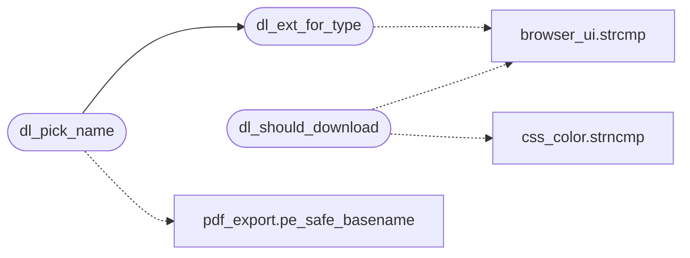

# `src/download.c`

> Source: [src/download.c:1](../../src/download.c#L1) | language `c` | coverage 16.7% | [API index](../index.md)

## Contents

- **Functions:** [`dl_should_download`](#dl_should_download), [`dl_ext_for_type`](#dl_ext_for_type), [`dl_pick_name`](#dl_pick_name), [`dl_build_path`](#dl_build_path), [`dl_check_size`](#dl_check_size)

## Call Graph

Solid arrows stay in this module, dashed arrows leave it.



## Functions

<a id="dl_should_download"></a>

### `dl_should_download`

`function` | [src/download.c:47](../../src/download.c#L47)

```c
int dl_should_download(const char *content_type, const char *content_disposition)
```

1 if the response should be saved (attachment, or a non-renderable media type), 0 if it should be rendered.

NULL/empty content_type renders (preserves behavior for servers that omit it); an unknown/binary type downloads. See spec.

**Parameters**

| Name | Type | Default | Description |
|---|---|---|---|
| `content_type` | `char *` |  |  |
| `content_disposition` | `char *` |  |  |

**Returns:** `int`

> **Inherited:** Documentation from [`dl_should_download`](#dl_should_download) (include/download.h:43).

*Calls:* [`strcmp`](gui.browser_ui.c.md#strcmp), [`strncmp`](src.css_color.c.md#strncmp)

---

<a id="dl_ext_for_type"></a>

### `dl_ext_for_type`

`function` `const` | [src/download.c:58](../../src/download.c#L58)

```c
const char *dl_ext_for_type(const char *content_type)
```

**Parameters**

| Name | Type | Default | Description |
|---|---|---|---|
| `content_type` | `char *` |  |  |

**Returns:** `char *`

*Calls:* [`strcmp`](gui.browser_ui.c.md#strcmp)

*Called by:* [`dl_pick_name`](#dl_pick_name)

---

<a id="dl_pick_name"></a>

### `dl_pick_name`

`function` | [src/download.c:153](../../src/download.c#L153)

```c
dl_status dl_pick_name(const char *url, const char *content_disposition, const char *content_type, char *out, size_t outsz)
```

**Parameters**

| Name | Type | Default | Description |
|---|---|---|---|
| `url` | `char *` |  |  |
| `content_disposition` | `char *` |  |  |
| `content_type` | `char *` |  |  |
| `out` | `char *` |  |  |
| `outsz` | `size_t` |  |  |

**Returns:** `dl_status`

*Calls:* [`dl_ext_for_type`](#dl_ext_for_type), [`pe_safe_basename`](src.pdf_export.c.md#pe_safe_basename)

---

<a id="dl_build_path"></a>

### `dl_build_path`

`function` | [src/download.c:195](../../src/download.c#L195)

```c
dl_status dl_build_path(const char *dir, const char *name, char *out, size_t outsz)
```

**Parameters**

| Name | Type | Default | Description |
|---|---|---|---|
| `dir` | `char *` |  |  |
| `name` | `char *` |  |  |
| `out` | `char *` |  |  |
| `outsz` | `size_t` |  |  |

**Returns:** `dl_status`

---

<a id="dl_check_size"></a>

### `dl_check_size`

`function` | [src/download.c:213](../../src/download.c#L213)

```c
dl_status dl_check_size(size_t len)
```

**Parameters**

| Name | Type | Default | Description |
|---|---|---|---|
| `len` | `size_t` |  |  |

**Returns:** `dl_status`

---
