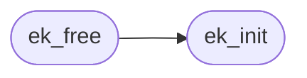

# `src/exact_key.c`

> Source: [src/exact_key.c:1](../../src/exact_key.c#L1) | language `c` | coverage 85.7% | [API index](../index.md)

## Contents

- **Functions:** [`ek_init`](#ek_init), [`ek_reset`](#ek_reset), [`ek_put`](#ek_put), [`ek_equal`](#ek_equal), [`ek_swap`](#ek_swap), [`ek_free`](#ek_free)

## Call Graph

Solid arrows stay in this module, dashed arrows leave it.



## Functions

<a id="ek_init"></a>

### `ek_init`

`function` | [src/exact_key.c:6](../../src/exact_key.c#L6)

```c
void ek_init(ek_key *k)
```

An empty key with no memory.

NULL-safe.

**Parameters**

| Name | Type | Default | Description |
|---|---|---|---|
| `k` | `ek_key *` |  |  |

> **Inherited:** Documentation from [`ek_init`](#ek_init) (include/exact_key.h:24).

*Called by:* [`ek_free`](#ek_free)

---

<a id="ek_reset"></a>

### `ek_reset`

`function` | [src/exact_key.c:13](../../src/exact_key.c#L13)

```c
void ek_reset(ek_key *k)
```

Empties the key (n = 0, bad = 0) and keeps its memory.

NULL-safe.

**Parameters**

| Name | Type | Default | Description |
|---|---|---|---|
| `k` | `ek_key *` |  |  |

> **Inherited:** Documentation from [`ek_reset`](#ek_reset) (include/exact_key.h:27).

---

<a id="ek_put"></a>

### `ek_put`

`function` | [src/exact_key.c:19](../../src/exact_key.c#L19)

```c
void ek_put(ek_key *k, const void *p, size_t len)
```

Appends len bytes of p.

A failed or oversized append, or p == NULL with len > 0, marks the key bad. NULL key is a no-op.

**Parameters**

| Name | Type | Default | Description |
|---|---|---|---|
| `k` | `ek_key *` |  |  |
| `p` | `void *` |  |  |
| `len` | `size_t` |  |  |

> **Inherited:** Documentation from [`ek_put`](#ek_put) (include/exact_key.h:31).

---

<a id="ek_equal"></a>

### `ek_equal`

`function` | [src/exact_key.c:36](../../src/exact_key.c#L36)

```c
int ek_equal(const ek_key *a, const ek_key *b)
```

1 when a and b hold the same byte sequence and neither is bad, else 0 (NULL = 0).

**Parameters**

| Name | Type | Default | Description |
|---|---|---|---|
| `a` | `ek_key *` |  |  |
| `b` | `ek_key *` |  |  |

**Returns:** `int`

> **Inherited:** Documentation from [`ek_equal`](#ek_equal) (include/exact_key.h:34).

---

<a id="ek_swap"></a>

### `ek_swap`

`function` | [src/exact_key.c:41](../../src/exact_key.c#L41)

```c
void ek_swap(ek_key *a, ek_key *b)
```

Exchanges the contents of a and b without copying.

NULL-safe.

**Parameters**

| Name | Type | Default | Description |
|---|---|---|---|
| `a` | `ek_key *` |  |  |
| `b` | `ek_key *` |  |  |

> **Inherited:** Documentation from [`ek_swap`](#ek_swap) (include/exact_key.h:37).

---

<a id="ek_free"></a>

### `ek_free`

`function` | [src/exact_key.c:48](../../src/exact_key.c#L48)

```c
void ek_free(ek_key *k)
```

Releases the key's memory and leaves it empty.

NULL-safe, idempotent.

**Parameters**

| Name | Type | Default | Description |
|---|---|---|---|
| `k` | `ek_key *` |  |  |

> **Inherited:** Documentation from [`ek_free`](#ek_free) (include/exact_key.h:40).

*Calls:* [`ek_init`](#ek_init)

---
