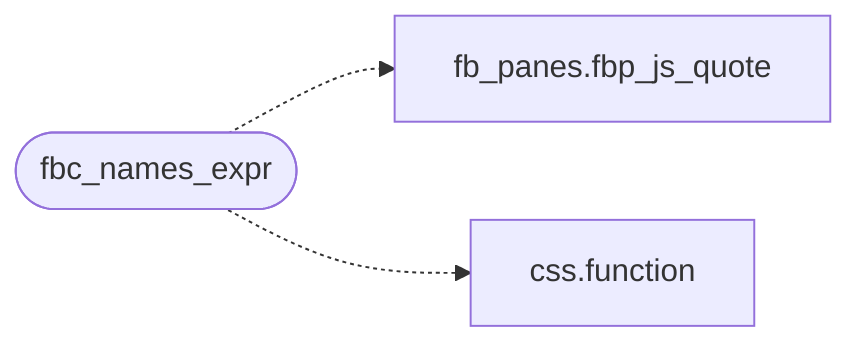

# `src/fb_cmdline.c`

> Source: [src/fb_cmdline.c:1](../../src/fb_cmdline.c#L1) | language `c` | coverage 66.7% | [API index](../index.md)

## Contents

- **Functions:** [`fbc_history_init`](#fbc_history_init), [`fbc_history_free`](#fbc_history_free), [`fbc_history_push`](#fbc_history_push), [`fbc_history_prev`](#fbc_history_prev), [`fbc_history_next`](#fbc_history_next), [`fbc_complete_split`](#fbc_complete_split), [`fbc_names_expr`](#fbc_names_expr), [`fbc_complete_pick`](#fbc_complete_pick), [`fbc_filter_passes`](#fbc_filter_passes), [`fbc_filter_next`](#fbc_filter_next), [`fbc_filter_label`](#fbc_filter_label)

## Call Graph

Solid arrows stay in this module, dashed arrows leave it.



## Functions

<a id="fbc_history_init"></a>

### `fbc_history_init`

`function` | [src/fb_cmdline.c:19](../../src/fb_cmdline.c#L19)

```c
void fbc_history_init(fbc_history *h)
```

**Parameters**

| Name | Type | Default | Description |
|---|---|---|---|
| `h` | `fbc_history *` |  |  |

---

<a id="fbc_history_free"></a>

### `fbc_history_free`

`function` | [src/fb_cmdline.c:23](../../src/fb_cmdline.c#L23)

```c
void fbc_history_free(fbc_history *h)
```

**Parameters**

| Name | Type | Default | Description |
|---|---|---|---|
| `h` | `fbc_history *` |  |  |

---

<a id="fbc_history_push"></a>

### `fbc_history_push`

`function` | [src/fb_cmdline.c:32](../../src/fb_cmdline.c#L32)

```c
int fbc_history_push(fbc_history *h, const char *text, size_t len)
```

0 stored/ignored-benign (empty, same as the newest), -1 too long or out of memory.

Returns to the live line.

**Parameters**

| Name | Type | Default | Description |
|---|---|---|---|
| `h` | `fbc_history *` |  |  |
| `text` | `char *` |  |  |
| `len` | `size_t` |  |  |

**Returns:** `int`

> **Inherited:** Documentation from [`fbc_history_push`](#fbc_history_push) (include/fb_cmdline.h:31).

---

<a id="fbc_history_prev"></a>

### `fbc_history_prev`

`function` `const` | [src/fb_cmdline.c:53](../../src/fb_cmdline.c#L53)

```c
const char *fbc_history_prev(fbc_history *h, const char *cur, size_t curlen)
```

Older entry (saves cur as the draft when leaving the live line), or NULL when there is none.

The pointer is valid until the next call on h.

**Parameters**

| Name | Type | Default | Description |
|---|---|---|---|
| `h` | `fbc_history *` |  |  |
| `cur` | `char *` |  |  |
| `curlen` | `size_t` |  |  |

**Returns:** `char *`

> **Inherited:** Documentation from [`fbc_history_prev`](#fbc_history_prev) (include/fb_cmdline.h:35).

---

<a id="fbc_history_next"></a>

### `fbc_history_next`

`function` `const` | [src/fb_cmdline.c:63](../../src/fb_cmdline.c#L63)

```c
const char *fbc_history_next(fbc_history *h)
```

Newer entry; past the newest, the draft ("" when none).

NULL when already on the live line.

**Parameters**

| Name | Type | Default | Description |
|---|---|---|---|
| `h` | `fbc_history *` |  |  |

**Returns:** `char *`

> **Inherited:** Documentation from [`fbc_history_next`](#fbc_history_next) (include/fb_cmdline.h:38).

---

<a id="fbc_complete_split"></a>

### `fbc_complete_split`

`function` | [src/fb_cmdline.c:74](../../src/fb_cmdline.c#L74)

```c
long fbc_complete_split(const char *text, size_t n, char *base, size_t cap, size_t *prefix_off)
```

Splits the trailing property path of text[0,n): base ("a.b" of "a.b.c", "" = global) into base[cap], *prefix_off = where the prefix starts.

Returns the prefix length, or -1 when nothing is completable.

**Parameters**

| Name | Type | Default | Description |
|---|---|---|---|
| `text` | `char *` |  |  |
| `n` | `size_t` |  |  |
| `base` | `char *` |  |  |
| `cap` | `size_t` |  |  |
| `prefix_off` | `size_t *` |  |  |

**Returns:** `long`

> **Inherited:** Documentation from [`fbc_complete_split`](#fbc_complete_split) (include/fb_cmdline.h:42).

---

<a id="fbc_names_expr"></a>

### `fbc_names_expr`

`function` | [src/fb_cmdline.c:95](../../src/fb_cmdline.c#L95)

```c
size_t fbc_names_expr(const char *base, char *out, size_t cap)
```

JS expression returning the newline-joined property names reachable from the path `base` (no getter is run).

Returns its length, 0 on a bad path or small cap.

**Parameters**

| Name | Type | Default | Description |
|---|---|---|---|
| `base` | `char *` |  |  |
| `out` | `char *` |  |  |
| `cap` | `size_t` |  |  |

**Returns:** `size_t`

> **Inherited:** Documentation from [`fbc_names_expr`](#fbc_names_expr) (include/fb_cmdline.h:46).

*Calls:* [`fbp_js_quote`](include.fb_panes.h.md#fbp_js_quote), [`function`](src.css.c.md#function)

---

<a id="fbc_complete_pick"></a>

### `fbc_complete_pick`

`function` | [src/fb_cmdline.c:118](../../src/fb_cmdline.c#L118)

```c
size_t fbc_complete_pick(const char *names, const char *prefix, size_t plen, char *ins, size_t ins_cap, char *list, size_t list_cap, size_t *count)
```

From the newline-separated `names`, those starting with prefix[0,plen): `ins` gets the longest common extension beyond the prefix, [`list`](include.render_doc.h.md#list) the candidates space-separated; *count how many matched.

Returns the length of the insertion.

**Parameters**

| Name | Type | Default | Description |
|---|---|---|---|
| `names` | `char *` |  |  |
| `prefix` | `char *` |  |  |
| `plen` | `size_t` |  |  |
| `ins` | `char *` |  |  |
| `ins_cap` | `size_t` |  |  |
| `list` | `char *` |  |  |
| `list_cap` | `size_t` |  |  |
| `count` | `size_t *` |  |  |

**Returns:** `size_t`

> **Inherited:** Documentation from [`fbc_complete_pick`](#fbc_complete_pick) (include/fb_cmdline.h:51).

---

<a id="fbc_filter_passes"></a>

### `fbc_filter_passes`

`function` | [src/fb_cmdline.c:159](../../src/fb_cmdline.c#L159)

```c
int fbc_filter_passes(int filter, int level)
```

**Parameters**

| Name | Type | Default | Description |
|---|---|---|---|
| `filter` | `int` |  |  |
| `level` | `int` |  |  |

**Returns:** `int`

---

<a id="fbc_filter_next"></a>

### `fbc_filter_next`

`function` | [src/fb_cmdline.c:168](../../src/fb_cmdline.c#L168)

```c
int fbc_filter_next(int filter)
```

level is an fb_level

**Parameters**

| Name | Type | Default | Description |
|---|---|---|---|
| `filter` | `int` |  |  |

**Returns:** `int`

> **Inherited:** Documentation from [`fbc_filter_next`](#fbc_filter_next) (include/fb_cmdline.h:63).

---

<a id="fbc_filter_label"></a>

### `fbc_filter_label`

`function` `const` | [src/fb_cmdline.c:173](../../src/fb_cmdline.c#L173)

```c
const char *fbc_filter_label(int filter)
```

cyclic; an invalid filter counts as ALL

**Parameters**

| Name | Type | Default | Description |
|---|---|---|---|
| `filter` | `int` |  |  |

**Returns:** `char *`

> **Inherited:** Documentation from [`fbc_filter_label`](#fbc_filter_label) (include/fb_cmdline.h:64).

---
