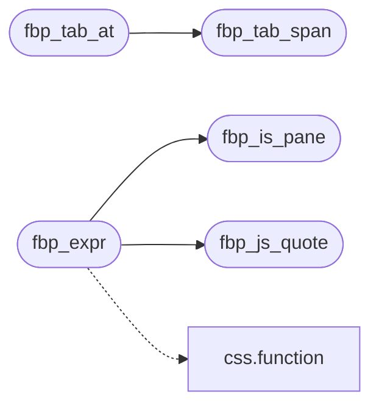

# `src/fb_panes.c`

> Source: [src/fb_panes.c:1](../../src/fb_panes.c#L1) | language `c` | coverage 88.9% | [API index](../index.md)

## Contents

- **Functions:** [`fbp_tab_label`](#fbp_tab_label), [`fbp_tab_from_name`](#fbp_tab_from_name), [`fbp_tab_wrap`](#fbp_tab_wrap), [`fbp_tab_span`](#fbp_tab_span), [`fbp_tab_at`](#fbp_tab_at), [`fbp_is_pane`](#fbp_is_pane), [`fbp_js_quote`](#fbp_js_quote), [`fbp_expr`](#fbp_expr)

## Call Graph

Solid arrows stay in this module, dashed arrows leave it.



## Functions

<a id="fbp_tab_label"></a>

### `fbp_tab_label`

`function` `const` | [src/fb_panes.c:72](../../src/fb_panes.c#L72)

```c
const char *fbp_tab_label(int tab)
```

Label of a tab; an out-of-range id is the console.

Never NULL.

**Parameters**

| Name | Type | Default | Description |
|---|---|---|---|
| `tab` | `int` |  |  |

**Returns:** `char *`

> **Inherited:** Documentation from [`fbp_tab_label`](#fbp_tab_label) (include/fb_panes.h:32).

---

<a id="fbp_tab_from_name"></a>

### `fbp_tab_from_name`

`function` | [src/fb_panes.c:83](../../src/fb_panes.c#L83)

```c
int fbp_tab_from_name(const char *name)
```

Tab named [`name`](src.text_shape.c.md#name) (case-insensitive), or -1 when unknown / NULL.

**Parameters**

| Name | Type | Default | Description |
|---|---|---|---|
| `name` | `char *` |  |  |

**Returns:** `int`

> **Inherited:** Documentation from [`fbp_tab_from_name`](#fbp_tab_from_name) (include/fb_panes.h:35).

---

<a id="fbp_tab_wrap"></a>

### `fbp_tab_wrap`

`function` | [src/fb_panes.c:90](../../src/fb_panes.c#L90)

```c
int fbp_tab_wrap(int tab, int dir)
```

The tab [`dir`](include.profile.h.md#dir) steps away (cyclic); an invalid `tab` counts as the console.

**Parameters**

| Name | Type | Default | Description |
|---|---|---|---|
| `tab` | `int` |  |  |
| `dir` | `int` |  |  |

**Returns:** `int`

> **Inherited:** Documentation from [`fbp_tab_wrap`](#fbp_tab_wrap) (include/fb_panes.h:38).

---

<a id="fbp_tab_span"></a>

### `fbp_tab_span`

`function` | [src/fb_panes.c:96](../../src/fb_panes.c#L96)

```c
void fbp_tab_span(int tab, double cell_w, double pad_cells, double *x, double *w)
```

x-extent of a tab in the bar: each is (letters + 2 * pad_cells) cells wide, contiguous.

**Parameters**

| Name | Type | Default | Description |
|---|---|---|---|
| `tab` | `int` |  |  |
| `cell_w` | `double` |  |  |
| `pad_cells` | `double` |  |  |
| `x` | `double *` |  |  |
| `w` | `double *` |  |  |

> **Inherited:** Documentation from [`fbp_tab_span`](#fbp_tab_span) (include/fb_panes.h:41).

*Called by:* [`fbp_tab_at`](#fbp_tab_at)

---

<a id="fbp_tab_at"></a>

### `fbp_tab_at`

`function` | [src/fb_panes.c:105](../../src/fb_panes.c#L105)

```c
int fbp_tab_at(double px, double cell_w, double pad_cells)
```

The tab under pointer x, or -1 outside the bar.

Exact inverse of fbp_tab_span.

**Parameters**

| Name | Type | Default | Description |
|---|---|---|---|
| `px` | `double` |  |  |
| `cell_w` | `double` |  |  |
| `pad_cells` | `double` |  |  |

**Returns:** `int`

> **Inherited:** Documentation from [`fbp_tab_at`](#fbp_tab_at) (include/fb_panes.h:44).

*Calls:* [`fbp_tab_span`](#fbp_tab_span)

---

<a id="fbp_is_pane"></a>

### `fbp_is_pane`

`function` | [src/fb_panes.c:115](../../src/fb_panes.c#L115)

```c
int fbp_is_pane(int tab)
```

Whether the tab's editor argument is meaningful (console: JS; others: selector/index/filter).

**Parameters**

| Name | Type | Default | Description |
|---|---|---|---|
| `tab` | `int` |  |  |

**Returns:** `int`

> **Inherited:** Documentation from [`fbp_is_pane`](#fbp_is_pane) (include/fb_panes.h:47).

*Called by:* [`fbp_expr`](#fbp_expr)

---

<a id="fbp_js_quote"></a>

### `fbp_js_quote`

`function` | [src/fb_panes.c:117](../../src/fb_panes.c#L117)

```c
size_t fbp_js_quote(const char *s, size_t n, char *out, size_t cap)
```

JS string literal for s[0,n) (double-quoted).

Returns its length, or 0 on failure (n too long, embedded NUL, cap too small).

**Parameters**

| Name | Type | Default | Description |
|---|---|---|---|
| `s` | `char *` |  |  |
| `n` | `size_t` |  |  |
| `out` | `char *` |  |  |
| `cap` | `size_t` |  |  |

**Returns:** `size_t`

> **Inherited:** Documentation from [`fbp_js_quote`](#fbp_js_quote) (include/fb_panes.h:51).

*Called by:* [`fbp_expr`](#fbp_expr)

---

<a id="fbp_expr"></a>

### `fbp_expr`

`function` | [src/fb_panes.c:146](../../src/fb_panes.c#L146)

```c
size_t fbp_expr(int tab, const char *sel, size_t n, char *out, size_t cap)
```

The expression that fills `tab`'s panel for argument sel[0,n); NUL-terminated in out.

Returns its length, or 0 for the console, a hostile/oversized argument or a small cap.

**Parameters**

| Name | Type | Default | Description |
|---|---|---|---|
| `tab` | `int` |  |  |
| `sel` | `char *` |  |  |
| `n` | `size_t` |  |  |
| `out` | `char *` |  |  |
| `cap` | `size_t` |  |  |

**Returns:** `size_t`

> **Inherited:** Documentation from [`fbp_expr`](#fbp_expr) (include/fb_panes.h:55).

*Calls:* [`function`](src.css.c.md#function), [`fbp_is_pane`](#fbp_is_pane), [`fbp_js_quote`](#fbp_js_quote)

---
