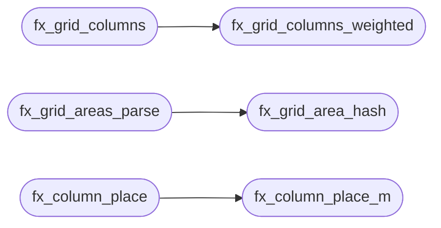

# `src/flex_layout.c`

> Source: [src/flex_layout.c:1](../../src/flex_layout.c#L1) | language `c` | coverage 34.6% | [API index](../index.md)

## Contents

- **Functions:** [`fx_flex_line`](#fx_flex_line), [`fx_grid_columns`](#fx_grid_columns), [`fx_autofill_count`](#fx_autofill_count), [`fx_grid_columns_weighted`](#fx_grid_columns_weighted), [`fx_grid_place_span`](#fx_grid_place_span), [`fx_grid_area_hash`](#fx_grid_area_hash), [`fx_grid_areas_parse`](#fx_grid_areas_parse), [`fx_grid_area_rect`](#fx_grid_area_rect), [`fx_float_insets`](#fx_float_insets), [`fx_float_pack`](#fx_float_pack), [`fx_float_pack_wrap`](#fx_float_pack_wrap), [`fx_grid_cell`](#fx_grid_cell), [`fx_auto_margins`](#fx_auto_margins), [`fx_auto_min_size`](#fx_auto_min_size), [`fx_multicol_used`](#fx_multicol_used), [`fx_multicol_balance`](#fx_multicol_balance), [`fx_justify_name`](#fx_justify_name), [`fx_column_place`](#fx_column_place), [`fx_column_place_m`](#fx_column_place_m), [`fx_cross_offset`](#fx_cross_offset), [`fx_grid_line_side`](#fx_grid_line_side), [`fx_grid_line_parse`](#fx_grid_line_parse), [`fx_grid_line_resolve`](#fx_grid_line_resolve), [`fx_col_free_split`](#fx_col_free_split)
- **Macros:** [`FX_EPS`](#fx_eps)

## Call Graph

Solid arrows stay in this module, dashed arrows leave it.



## Functions

<a id="fx_flex_line"></a>

### `fx_flex_line`

`function` | [src/flex_layout.c:23](../../src/flex_layout.c#L23)

```c
fx_status fx_flex_line(const fx_item *items, size_t n, double avail, double gap, fx_justify justify, fx_result *out)
```

**Parameters**

| Name | Type | Default | Description |
|---|---|---|---|
| `items` | `fx_item *` |  |  |
| `n` | `size_t` |  |  |
| `avail` | `double` |  |  |
| `gap` | `double` |  |  |
| `justify` | `fx_justify` |  |  |
| `out` | `fx_result *` |  |  |

**Returns:** `fx_status`

---

<a id="fx_grid_columns"></a>

### `fx_grid_columns`

`function` | [src/flex_layout.c:128](../../src/flex_layout.c#L128)

```c
fx_status fx_grid_columns(double avail, size_t ncols, double gap, double *col_x, double *col_w)
```

**Parameters**

| Name | Type | Default | Description |
|---|---|---|---|
| `avail` | `double` |  |  |
| `ncols` | `size_t` |  |  |
| `gap` | `double` |  |  |
| `col_x` | `double *` |  |  |
| `col_w` | `double *` |  |  |

**Returns:** `fx_status`

*Calls:* [`fx_grid_columns_weighted`](#fx_grid_columns_weighted)

---

<a id="fx_autofill_count"></a>

### `fx_autofill_count`

`function` | [src/flex_layout.c:133](../../src/flex_layout.c#L133)

```c
size_t fx_autofill_count(double avail, double gap, double minw)
```

repeat(auto-fill, minmax(min, max)): how many min-wide tracks fit in avail (CSS Grid 1 7.2.3.2; one gap between tracks).

Pure: floor((avail+gap)/(min+gap)) clamped to [1, FX_MAX_ITEMS]. Non-positive/NaN inputs fail safe to 1 (never 0: a grid with zero columns places nothing). The caller still caps to its own BT_MAX_CHILDREN. See spec/css.md (2026-10-09).

**Parameters**

| Name | Type | Default | Description |
|---|---|---|---|
| `avail` | `double` |  |  |
| `gap` | `double` |  |  |
| `minw` | `double` |  |  |

**Returns:** `size_t`

> **Inherited:** Documentation from [`fx_autofill_count`](#fx_autofill_count) (include/flex_layout.h:129).

---

<a id="fx_grid_columns_weighted"></a>

### `fx_grid_columns_weighted`

`function` | [src/flex_layout.c:143](../../src/flex_layout.c#L143)

```c
fx_status fx_grid_columns_weighted(double avail, size_t ncols, double gap, const int *track, size_t ntrack, double *col_x, double *col_w)
```

**Parameters**

| Name | Type | Default | Description |
|---|---|---|---|
| `avail` | `double` |  |  |
| `ncols` | `size_t` |  |  |
| `gap` | `double` |  |  |
| `track` | `int *` |  |  |
| `ntrack` | `size_t` |  |  |
| `col_x` | `double *` |  |  |
| `col_w` | `double *` |  |  |

**Returns:** `fx_status`

*Called by:* [`fx_grid_columns`](#fx_grid_columns)

---

<a id="fx_grid_place_span"></a>

### `fx_grid_place_span`

`function` | [src/flex_layout.c:177](../../src/flex_layout.c#L177)

```c
fx_status fx_grid_place_span(size_t nitems, size_t ncols, const int *span, const int *row_span, const int *fixed_row, const int *fixed_col, size_t *out_row, size_t *out_col)
```

**Parameters**

| Name | Type | Default | Description |
|---|---|---|---|
| `nitems` | `size_t` |  |  |
| `ncols` | `size_t` |  |  |
| `span` | `int *` |  |  |
| `row_span` | `int *` |  |  |
| `fixed_row` | `int *` |  |  |
| `fixed_col` | `int *` |  |  |
| `out_row` | `size_t *` |  |  |
| `out_col` | `size_t *` |  |  |

**Returns:** `fx_status`

---

<a id="fx_grid_area_hash"></a>

### `fx_grid_area_hash`

`function` | [src/flex_layout.c:319](../../src/flex_layout.c#L319)

```c
unsigned fx_grid_area_hash(const char *name)
```

FNV-1a of a trimmed, case-sensitive CSS identifier; never returns 0 for a non-empty name (0 is reserved for "unnamed").

NULL/empty/blank -> 0. Comparing hashes rather than strings is what lets an item's area name cross the IPC codec as one int; see spec/grid_areas.md section 2 on collisions.

**Parameters**

| Name | Type | Default | Description |
|---|---|---|---|
| `name` | `char *` |  |  |

**Returns:** `unsigned`

> **Inherited:** Documentation from [`fx_grid_area_hash`](#fx_grid_area_hash) (include/flex_layout.h:153).

*Called by:* [`fx_grid_areas_parse`](#fx_grid_areas_parse)

---

<a id="fx_grid_areas_parse"></a>

### `fx_grid_areas_parse`

`function` | [src/flex_layout.c:349](../../src/flex_layout.c#L349)

```c
fx_status fx_grid_areas_parse(const char *tmpl, fx_area_map *out)
```

**Parameters**

| Name | Type | Default | Description |
|---|---|---|---|
| `tmpl` | `char *` |  |  |
| `out` | `fx_area_map *` |  |  |

**Returns:** `fx_status`

*Calls:* [`fx_grid_area_hash`](#fx_grid_area_hash)

*Called by:* [`container`](src.page_view.c.md#container), [`walk`](src.page_view.c.md#walk)

---

<a id="fx_grid_area_rect"></a>

### `fx_grid_area_rect`

`function` | [src/flex_layout.c:424](../../src/flex_layout.c#L424)

```c
fx_status fx_grid_area_rect(const fx_area_map *m, unsigned name, int *row, int *col, int *row_span, int *col_span)
```

**Parameters**

| Name | Type | Default | Description |
|---|---|---|---|
| `m` | `fx_area_map *` |  |  |
| `name` | `unsigned` |  |  |
| `row` | `int *` |  |  |
| `col` | `int *` |  |  |
| `row_span` | `int *` |  |  |
| `col_span` | `int *` |  |  |

**Returns:** `fx_status`

*Called by:* [`walk`](src.page_view.c.md#walk)

---

<a id="fx_float_insets"></a>

### `fx_float_insets`

`function` | [src/flex_layout.c:506](../../src/flex_layout.c#L506)

```c
fx_status fx_float_insets(const fx_float_rect *r, size_t n, double y, double h, double avail, double *out_l, double *out_r)
```

**Parameters**

| Name | Type | Default | Description |
|---|---|---|---|
| `r` | `fx_float_rect *` |  |  |
| `n` | `size_t` |  |  |
| `y` | `double` |  |  |
| `h` | `double` |  |  |
| `avail` | `double` |  |  |
| `out_l` | `double *` |  |  |
| `out_r` | `double *` |  |  |

**Returns:** `fx_status`

---

<a id="fx_float_pack"></a>

### `fx_float_pack`

`function` | [src/flex_layout.c:546](../../src/flex_layout.c#L546)

```c
fx_status fx_float_pack(const double *width, const int *side, size_t n, double avail, double gap, double *out_x)
```

**Parameters**

| Name | Type | Default | Description |
|---|---|---|---|
| `width` | `double *` |  |  |
| `side` | `int *` |  |  |
| `n` | `size_t` |  |  |
| `avail` | `double` |  |  |
| `gap` | `double` |  |  |
| `out_x` | `double *` |  |  |

**Returns:** `fx_status`

---

<a id="fx_float_pack_wrap"></a>

### `fx_float_pack_wrap`

`function` | [src/flex_layout.c:551](../../src/flex_layout.c#L551)

```c
fx_status fx_float_pack_wrap(const double *width, const int *side, size_t n, double avail, double gap, double *out_x, size_t *out_row)
```

**Parameters**

| Name | Type | Default | Description |
|---|---|---|---|
| `width` | `double *` |  |  |
| `side` | `int *` |  |  |
| `n` | `size_t` |  |  |
| `avail` | `double` |  |  |
| `gap` | `double` |  |  |
| `out_x` | `double *` |  |  |
| `out_row` | `size_t *` |  |  |

**Returns:** `fx_status`

---

<a id="fx_grid_cell"></a>

### `fx_grid_cell`

`function` | [src/flex_layout.c:593](../../src/flex_layout.c#L593)

```c
void fx_grid_cell(size_t index, size_t ncols, size_t *row, size_t *col)
```

Row and column of the index-th item placed row-major into ncols columns. ncols == 0 yields row = col = 0 (defensive; no divide-by-zero).

**Parameters**

| Name | Type | Default | Description |
|---|---|---|---|
| `index` | `size_t` |  |  |
| `ncols` | `size_t` |  |  |
| `row` | `size_t *` |  |  |
| `col` | `size_t *` |  |  |

> **Inherited:** Documentation from [`fx_grid_cell`](#fx_grid_cell) (include/flex_layout.h:74).

---

<a id="fx_auto_margins"></a>

### `fx_auto_margins`

`function` | [src/flex_layout.c:605](../../src/flex_layout.c#L605)

```c
fx_status fx_auto_margins(fx_result *res, size_t n, const unsigned char *auto_l, const unsigned char *auto_r, double avail, double gap)
```

CSS Flexbox 4.5.

See the contract in flex_layout.h.

**Parameters**

| Name | Type | Default | Description |
|---|---|---|---|
| `res` | `fx_result *` |  |  |
| `n` | `size_t` |  |  |
| `auto_l` | `unsigned char *` |  |  |
| `auto_r` | `unsigned char *` |  |  |
| `avail` | `double` |  |  |
| `gap` | `double` |  |  |

**Returns:** `fx_status`

*Called by:* [`height`](src.box_tree.c.md#height)

---

<a id="fx_auto_min_size"></a>

### `fx_auto_min_size`

`function` | [src/flex_layout.c:628](../../src/flex_layout.c#L628)

```c
double fx_auto_min_size(double min_content, double basis, double author_min, int scroll_container)
```

Automatic minimum size of a flex item along the main axis (CSS Flexbox 4.5), in px.

This is what `min-width: auto` -- the INITIAL value, so the case for almost every item on the web -- resolves to. It is the floor fx_flex_line must not shrink an item below, and getting it wrong is visible everywhere: with a floor of zero an overflowing line grinds every item down to a sliver and its text falls to one character per line.

min_content  the item's min-content size (its longest unbreakable word, or a
               replaced element's intrinsic size), in the same border-box+margin
               units as fx_item.basis. Negative is treated as 0.
  basis        the item's SPECIFIED size (its declared `width`, in the same units),
               the "specified size suggestion": the content-based minimum is clamped
               by it, so an item the author sized small is not inflated by one long
               word. Negative means no specified size and leaves the minimum at
               min-content; a flex-basis is NOT a specified size.
  author_min   the author's own `min-width` in px when they set one (min-width is
               then NOT `auto` and wins outright, larger OR smaller), or < 0 when
               unset.
  scroll_container  non-zero when the item's [`overflow`](gui.browser_ui.c.md#overflow) is anything but `visible`.
               Such an item has an automatic minimum size of ZERO -- this is what
               makes the near-universal `overflow:hidden` truncation idiom work.

Pure, total, no allocation. The result is never negative.

**Parameters**

| Name | Type | Default | Description |
|---|---|---|---|
| `min_content` | `double` |  |  |
| `basis` | `double` |  |  |
| `author_min` | `double` |  |  |
| `scroll_container` | `int` |  |  |

**Returns:** `double`

> **Inherited:** Documentation from [`fx_auto_min_size`](#fx_auto_min_size) (include/flex_layout.h:265).

---

<a id="fx_multicol_used"></a>

### `fx_multicol_used`

`function` | [src/flex_layout.c:645](../../src/flex_layout.c#L645)

```c
fx_status fx_multicol_used(double avail_w, int column_count, double column_width, double gap, int *out_n, double *out_w)
```

**Parameters**

| Name | Type | Default | Description |
|---|---|---|---|
| `avail_w` | `double` |  |  |
| `column_count` | `int` |  |  |
| `column_width` | `double` |  |  |
| `gap` | `double` |  |  |
| `out_n` | `int *` |  |  |
| `out_w` | `double *` |  |  |

**Returns:** `fx_status`

---

<a id="fx_multicol_balance"></a>

### `fx_multicol_balance`

`function` | [src/flex_layout.c:682](../../src/flex_layout.c#L682)

```c
fx_status fx_multicol_balance(const double *heights, size_t n, int ncol, int *out_col, double *out_colh)
```

**Parameters**

| Name | Type | Default | Description |
|---|---|---|---|
| `heights` | `double *` |  |  |
| `n` | `size_t` |  |  |
| `ncol` | `int` |  |  |
| `out_col` | `int *` |  |  |
| `out_colh` | `double *` |  |  |

**Returns:** `fx_status`

---

<a id="fx_justify_name"></a>

### `fx_justify_name`

`function` `const` | [src/flex_layout.c:713](../../src/flex_layout.c#L713)

```c
const char *fx_justify_name(fx_justify j)
```

Stable, short English name of a justify mode for structured/agent output.

Never NULL; an unknown enum value yields "start".

**Parameters**

| Name | Type | Default | Description |
|---|---|---|---|
| `j` | `fx_justify` |  |  |

**Returns:** `char *`

> **Inherited:** Documentation from [`fx_justify_name`](#fx_justify_name) (include/flex_layout.h:321).

---

<a id="fx_column_place"></a>

### `fx_column_place`

`function` | [src/flex_layout.c:725](../../src/flex_layout.c#L725)

```c
fx_status fx_column_place(const double *h, const double *grow, size_t n, double gap, double inner_h, int justify, int reverse, double *y_out, double *h_out, double *extent)
```

**Parameters**

| Name | Type | Default | Description |
|---|---|---|---|
| `h` | `double *` |  |  |
| `grow` | `double *` |  |  |
| `n` | `size_t` |  |  |
| `gap` | `double` |  |  |
| `inner_h` | `double` |  |  |
| `justify` | `int` |  |  |
| `reverse` | `int` |  |  |
| `y_out` | `double *` |  |  |
| `h_out` | `double *` |  |  |
| `extent` | `double *` |  |  |

**Returns:** `fx_status`

*Calls:* [`fx_column_place_m`](#fx_column_place_m)

---

<a id="fx_column_place_m"></a>

### `fx_column_place_m`

`function` | [src/flex_layout.c:732](../../src/flex_layout.c#L732)

```c
fx_status fx_column_place_m(const double *h, const double *grow, const int *mauto, size_t n, double gap, double inner_h, int justify, int reverse, double *y_out, double *h_out, double *extent)
```

**Parameters**

| Name | Type | Default | Description |
|---|---|---|---|
| `h` | `double *` |  |  |
| `grow` | `double *` |  |  |
| `mauto` | `int *` |  |  |
| `n` | `size_t` |  |  |
| `gap` | `double` |  |  |
| `inner_h` | `double` |  |  |
| `justify` | `int` |  |  |
| `reverse` | `int` |  |  |
| `y_out` | `double *` |  |  |
| `h_out` | `double *` |  |  |
| `extent` | `double *` |  |  |

**Returns:** `fx_status`

*Called by:* [`fx_column_place`](#fx_column_place)

---

<a id="fx_cross_offset"></a>

### `fx_cross_offset`

`function` | [src/flex_layout.c:793](../../src/flex_layout.c#L793)

```c
double fx_cross_offset(double avail, double w, int align, int mauto_l, int mauto_r)
```

Cross-axis (horizontal) offset of a column item of width w in avail px. auto margins win (both = centre, left only = end); else align (BT-style 0 start, 1 center, 2 end, 3 stretch) places it.

Never negative.

**Parameters**

| Name | Type | Default | Description |
|---|---|---|---|
| `avail` | `double` |  |  |
| `w` | `double` |  |  |
| `align` | `int` |  |  |
| `mauto_l` | `int` |  |  |
| `mauto_r` | `int` |  |  |

**Returns:** `double`

> **Inherited:** Documentation from [`fx_cross_offset`](#fx_cross_offset) (include/flex_layout.h:354).

---

<a id="fx_grid_line_side"></a>

### `fx_grid_line_side`

`function` | [src/flex_layout.c:860](../../src/flex_layout.c#L860)

```c
int fx_grid_line_side(const char *s, int *out)
```

**Parameters**

| Name | Type | Default | Description |
|---|---|---|---|
| `s` | `char *` |  |  |
| `out` | `int *` |  |  |

**Returns:** `int`

---

<a id="fx_grid_line_parse"></a>

### `fx_grid_line_parse`

`function` | [src/flex_layout.c:868](../../src/flex_layout.c#L868)

```c
int fx_grid_line_parse(const char *v, int *start, int *end)
```

The shorthand `<side> [ / <side> ]` (no slash => end is auto).

1 or 0 (both outputs untouched on 0).

**Parameters**

| Name | Type | Default | Description |
|---|---|---|---|
| `v` | `char *` |  |  |
| `start` | `int *` |  |  |
| `end` | `int *` |  |  |

**Returns:** `int`

> **Inherited:** Documentation from [`fx_grid_line_parse`](#fx_grid_line_parse) (include/flex_layout.h:117).

---

<a id="fx_grid_line_resolve"></a>

### `fx_grid_line_resolve`

`function` | [src/flex_layout.c:888](../../src/flex_layout.c#L888)

```c
void fx_grid_line_resolve(int start, int end, int ntracks, int *pos0, int *span)
```

Resolves a start/end pair against ntracks explicit tracks: *pos0 = 0-based start track or -1 (auto-place), *span >= 1.

Never fails: anything unresolvable falls back to auto placement.

**Parameters**

| Name | Type | Default | Description |
|---|---|---|---|
| `start` | `int` |  |  |
| `end` | `int` |  |  |
| `ntracks` | `int` |  |  |
| `pos0` | `int *` |  |  |
| `span` | `int *` |  |  |

> **Inherited:** Documentation from [`fx_grid_line_resolve`](#fx_grid_line_resolve) (include/flex_layout.h:122).

---

<a id="fx_col_free_split"></a>

### `fx_col_free_split`

`function` | [src/flex_layout.c:930](../../src/flex_layout.c#L930)

```c
fx_status fx_col_free_split(double free_px, const int *grow, const int *mauto, size_t n, double *before, double *grow_px, double *after)
```

**Parameters**

| Name | Type | Default | Description |
|---|---|---|---|
| `free_px` | `double` |  |  |
| `grow` | `int *` |  |  |
| `mauto` | `int *` |  |  |
| `n` | `size_t` |  |  |
| `before` | `double *` |  |  |
| `grow_px` | `double *` |  |  |
| `after` | `double *` |  |  |

**Returns:** `fx_status`

---

## Macros

<a id="fx_eps"></a>

### `FX_EPS`

`macro` | [src/flex_layout.c:16](../../src/flex_layout.c#L16)

```c
#define FX_EPS
```

---
