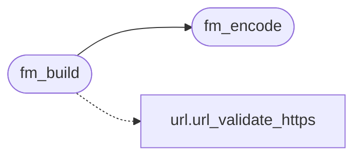

# `src/form.c`

> Source: [src/form.c:1](../../src/form.c#L1) | language `c` | coverage 0.0% | [API index](../index.md)

## Contents

- **Functions:** [`fm_encode`](#fm_encode), [`fm_build`](#fm_build)

## Call Graph

Solid arrows stay in this module, dashed arrows leave it.



## Functions

<a id="fm_encode"></a>

### `fm_encode`

`function` | [src/form.c:43](../../src/form.c#L43)

```c
fm_status fm_encode(const fm_field *fields, size_t n, char *out, size_t outsz, size_t *out_len)
```

**Parameters**

| Name | Type | Default | Description |
|---|---|---|---|
| `fields` | `fm_field *` |  |  |
| `n` | `size_t` |  |  |
| `out` | `char *` |  |  |
| `outsz` | `size_t` |  |  |
| `out_len` | `size_t *` |  |  |

**Returns:** `fm_status`

*Called by:* [`fm_build`](#fm_build)

---

<a id="fm_build"></a>

### `fm_build`

`function` | [src/form.c:120](../../src/form.c#L120)

```c
fm_status fm_build(const char *base, const char *action, fm_method method, const fm_field *fields, size_t n, fm_plan *out)
```

**Parameters**

| Name | Type | Default | Description |
|---|---|---|---|
| `base` | `char *` |  |  |
| `action` | `char *` |  |  |
| `method` | `fm_method` |  |  |
| `fields` | `fm_field *` |  |  |
| `n` | `size_t` |  |  |
| `out` | `fm_plan *` |  |  |

**Returns:** `fm_status`

*Calls:* [`fm_encode`](#fm_encode), [`url_validate_https`](src.url.c.md#url_validate_https)

---
