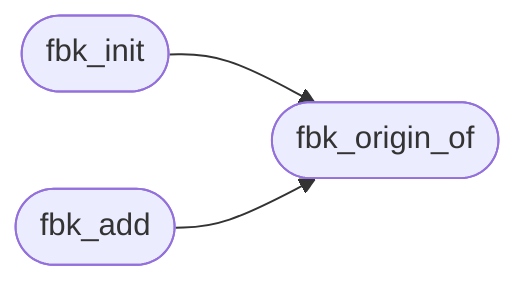

# `src/frame_broker.c`

> Source: [src/frame_broker.c:1](../../src/frame_broker.c#L1) | language `c` | coverage 71.4% | [API index](../index.md)

## Contents

- **Functions:** [`fbk_origin_of`](#fbk_origin_of), [`fbk_init`](#fbk_init), [`fbk_add`](#fbk_add), [`fbk_remove`](#fbk_remove), [`fbk_origin`](#fbk_origin), [`fbk_route`](#fbk_route)

## Call Graph

Solid arrows stay in this module, dashed arrows leave it.



## Functions

<a id="fbk_origin_of"></a>

### `fbk_origin_of`

`function` | [src/frame_broker.c:15](../../src/frame_broker.c#L15)

```c
int fbk_origin_of(const char *url, char *out, size_t cap)
```

Serialized origin ("https://host[:port]", lowercase) or "null" for opaque/non-https/unparseable.

0 on success, -1 if out does not fit or args are NULL.

**Parameters**

| Name | Type | Default | Description |
|---|---|---|---|
| `url` | `char *` |  |  |
| `out` | `char *` |  |  |
| `cap` | `size_t` |  |  |

**Returns:** `int`

> **Inherited:** Documentation from [`fbk_origin_of`](#fbk_origin_of) (include/frame_broker.h:42).

*Called by:* [`fbk_add`](#fbk_add), [`fbk_init`](#fbk_init)

---

<a id="fbk_init"></a>

### `fbk_init`

`function` | [src/frame_broker.c:53](../../src/frame_broker.c#L53)

```c
int fbk_init(fbk_table *t, const char *top_url)
```

Resets t and registers the top document (frame 0) for top_url.

0 / -1.

**Parameters**

| Name | Type | Default | Description |
|---|---|---|---|
| `t` | `fbk_table *` |  |  |
| `top_url` | `char *` |  |  |

**Returns:** `int`

> **Inherited:** Documentation from [`fbk_init`](#fbk_init) (include/frame_broker.h:45).

*Calls:* [`fbk_origin_of`](#fbk_origin_of)

---

<a id="fbk_add"></a>

### `fbk_add`

`function` | [src/frame_broker.c:66](../../src/frame_broker.c#L66)

```c
int fbk_add(fbk_table *t, int parent, const char *url, int *out_id)
```

Adds a child of `parent` for url.

Writes its id. 0 on success; -1 on a bad parent, depth over FBK_MAX_DEPTH, full table or NULL args (fail closed).

**Parameters**

| Name | Type | Default | Description |
|---|---|---|---|
| `t` | `fbk_table *` |  |  |
| `parent` | `int` |  |  |
| `url` | `char *` |  |  |
| `out_id` | `int *` |  |  |

**Returns:** `int`

> **Inherited:** Documentation from [`fbk_add`](#fbk_add) (include/frame_broker.h:49).

*Calls:* [`fbk_origin_of`](#fbk_origin_of)

---

<a id="fbk_remove"></a>

### `fbk_remove`

`function` | [src/frame_broker.c:84](../../src/frame_broker.c#L84)

```c
void fbk_remove(fbk_table *t, int id)
```

Removes frame id and its whole subtree.

The top (0) cannot be removed. Idempotent.

**Parameters**

| Name | Type | Default | Description |
|---|---|---|---|
| `t` | `fbk_table *` |  |  |
| `id` | `int` |  |  |

> **Inherited:** Documentation from [`fbk_remove`](#fbk_remove) (include/frame_broker.h:52).

---

<a id="fbk_origin"></a>

### `fbk_origin`

`function` `const` | [src/frame_broker.c:96](../../src/frame_broker.c#L96)

```c
const char *fbk_origin(const fbk_table *t, int id)
```

Origin of a live frame or NULL.

**Parameters**

| Name | Type | Default | Description |
|---|---|---|---|
| `t` | `fbk_table *` |  |  |
| `id` | `int` |  |  |

**Returns:** `char *`

> **Inherited:** Documentation from [`fbk_origin`](#fbk_origin) (include/frame_broker.h:55).

---

<a id="fbk_route"></a>

### `fbk_route`

`function` | [src/frame_broker.c:118](../../src/frame_broker.c#L118)

```c
fbk_verdict fbk_route(const fbk_table *t, int from, fbk_rel rel, int child, const char *target_origin, size_t size, int *dest)
```

**Parameters**

| Name | Type | Default | Description |
|---|---|---|---|
| `t` | `fbk_table *` |  |  |
| `from` | `int` |  |  |
| `rel` | `fbk_rel` |  |  |
| `child` | `int` |  |  |
| `target_origin` | `char *` |  |  |
| `size` | `size_t` |  |  |
| `dest` | `int *` |  |  |

**Returns:** `fbk_verdict`

---
