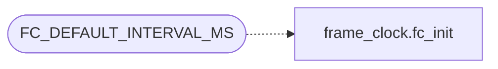

# `src/frame_clock.c`

> Source: [src/frame_clock.c:1](../../src/frame_clock.c#L1) | language `c` | coverage 0.0% | [API index](../index.md)

## Contents

- **Functions:** [`fc_set_active`](#fc_set_active), [`fc_needs_tick`](#fc_needs_tick), [`fc_interval_ms`](#fc_interval_ms)
- **Macros:** [`FC_DEFAULT_INTERVAL_MS`](#fc_default_interval_ms)

## Call Graph

Solid arrows stay in this module, dashed arrows leave it.



## Functions

<a id="fc_set_active"></a>

### `fc_set_active`

`function` | [src/frame_clock.c:16](../../src/frame_clock.c#L16)

```c
void fc_set_active(fc_clock *c, int active)
```

**Parameters**

| Name | Type | Default | Description |
|---|---|---|---|
| `c` | `fc_clock *` |  |  |
| `active` | `int` |  |  |

---

<a id="fc_needs_tick"></a>

### `fc_needs_tick`

`function` | [src/frame_clock.c:21](../../src/frame_clock.c#L21)

```c
int fc_needs_tick(const fc_clock *c)
```

**Parameters**

| Name | Type | Default | Description |
|---|---|---|---|
| `c` | `fc_clock *` |  |  |

**Returns:** `int`

---

<a id="fc_interval_ms"></a>

### `fc_interval_ms`

`function` | [src/frame_clock.c:26](../../src/frame_clock.c#L26)

```c
int fc_interval_ms(const fc_clock *c)
```

**Parameters**

| Name | Type | Default | Description |
|---|---|---|---|
| `c` | `fc_clock *` |  |  |

**Returns:** `int`

---

## Macros

<a id="fc_default_interval_ms"></a>

### `FC_DEFAULT_INTERVAL_MS`

`macro` | [src/frame_clock.c:8](../../src/frame_clock.c#L8)

```c
#define FC_DEFAULT_INTERVAL_MS
```

*Calls:* [`fc_init`](include.frame_clock.h.md#fc_init)

---
