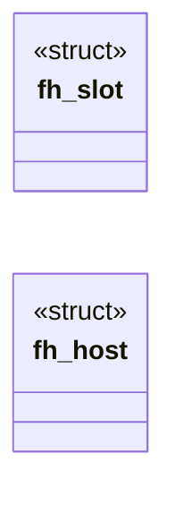
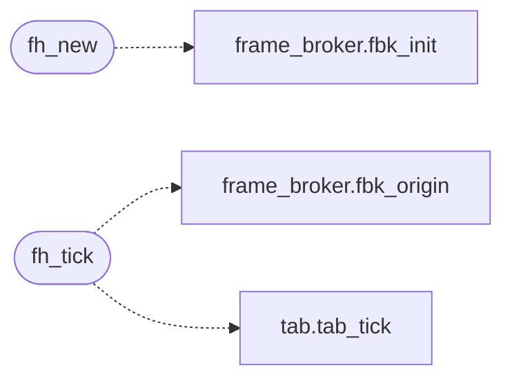

# `src/frame_host.c`

> Source: [src/frame_host.c:1](../../src/frame_host.c#L1) | language `c` | coverage 62.5% | [API index](../index.md)

## Contents

- **Structs:** [`fh_slot`](#fh_slot), [`fh_host`](#fh_host)
- **Functions:** [`fh_new`](#fh_new), [`fh_free`](#fh_free), [`fh_count`](#fh_count), [`fh_apply_top`](#fh_apply_top), [`fh_tick`](#fh_tick)

## Type Diagram



## Call Graph

Solid arrows stay in this module, dashed arrows leave it.



## Structs

<a id="fh_slot"></a>

### `fh_slot`

`struct` | [src/frame_host.c:14](../../src/frame_host.c#L14)

```c
typedef struct fh_slot
```

---

<a id="fh_host"></a>

### `fh_host`

`struct` | [src/frame_host.c:20](../../src/frame_host.c#L20)

```c
struct fh_host
```

---

## Functions

<a id="fh_new"></a>

### `fh_new`

`function` | [src/frame_host.c:32](../../src/frame_host.c#L32)

```c
fh_host *fh_new(const char *top_url, tab_fetch_fn fetch, void *fetch_ctx, fh_top_msg_fn top_msg, void *top_ctx)
```

top_url: the trusted top document; fetch/fetch_ctx: the page's policy-gated subresource fetcher (used for the frame document and handed to each frame worker for its own XHR/fetch).

NULL on OOM or bad args.

**Parameters**

| Name | Type | Default | Description |
|---|---|---|---|
| `top_url` | `char *` |  |  |
| `fetch` | `tab_fetch_fn` |  |  |
| `fetch_ctx` | `void *` |  |  |
| `top_msg` | `fh_top_msg_fn` |  |  |
| `top_ctx` | `void *` |  |  |

**Returns:** `fh_host *`

> **Inherited:** Documentation from [`fh_new`](#fh_new) (include/frame_host.h:27).

*Calls:* [`fbk_init`](include.frame_broker.h.md#fbk_init)

---

<a id="fh_free"></a>

### `fh_free`

`function` | [src/frame_host.c:55](../../src/frame_host.c#L55)

```c
void fh_free(fh_host *h)
```

Closes every frame worker and frees the host.

Idempotent on NULL.

**Parameters**

| Name | Type | Default | Description |
|---|---|---|---|
| `h` | `fh_host *` |  |  |

> **Inherited:** Documentation from [`fh_free`](#fh_free) (include/frame_host.h:31).

---

<a id="fh_count"></a>

### `fh_count`

`function` | [src/frame_host.c:63](../../src/frame_host.c#L63)

```c
int fh_count(const fh_host *h)
```

Number of live frame workers (excludes the top).

**Parameters**

| Name | Type | Default | Description |
|---|---|---|---|
| `h` | `fh_host *` |  |  |

**Returns:** `int`

> **Inherited:** Documentation from [`fh_count`](#fh_count) (include/frame_host.h:42).

---

<a id="fh_apply_top"></a>

### `fh_apply_top`

`function` | [src/frame_host.c:197](../../src/frame_host.c#L197)

```c
void fh_apply_top(fh_host *h, const tab_page *page)
```

Processes the frame ops (kinds FRAME_OPEN/CLOSE/POST) among page->ws of the TOP document; other kinds are ignored.

**Parameters**

| Name | Type | Default | Description |
|---|---|---|---|
| `h` | `fh_host *` |  |  |
| `page` | `tab_page *` |  |  |

> **Inherited:** Documentation from [`fh_apply_top`](#fh_apply_top) (include/frame_host.h:35).

---

<a id="fh_tick"></a>

### `fh_tick`

`function` | [src/frame_host.c:202](../../src/frame_host.c#L202)

```c
int fh_tick(fh_host *h, int elapsed_ms)
```

Advances every frame's virtual clock by elapsed_ms and processes what they posted.

Returns the smallest pending frame timer in ms, or -1 when none.

**Parameters**

| Name | Type | Default | Description |
|---|---|---|---|
| `h` | `fh_host *` |  |  |
| `elapsed_ms` | `int` |  |  |

**Returns:** `int`

> **Inherited:** Documentation from [`fh_tick`](#fh_tick) (include/frame_host.h:39).

*Calls:* [`fbk_origin`](include.frame_broker.h.md#fbk_origin), [`tab_tick`](src.tab.c.md#tab_tick)

---
